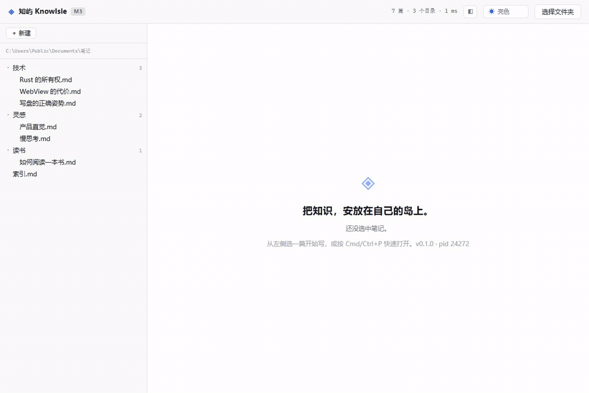

# 知屿 KnowIsle

> 把知识，安放在自己的岛上。

本地优先的开源 Markdown 个人知识库。所有笔记都是磁盘上普通的 `.md` 文件，索引与数据库只是可以随时重建的派生物 —— 删掉应用，你的知识还在原地。



## 现在能做什么

| 能力 | 状态 | 说明 |
|---|---|---|
| Vault 扫描与文件树 | 已实现 | 磁盘上有的目录树里就有；空文件夹也不藏 |
| Markdown 编辑 | 已实现 | CodeMirror 6，语法高亮、加粗/斜体、撤销栈 |
| 崩溃安全保存 | 已实现 | 写入走 `tmp → fsync → rename`；CI 里真的 `kill -9` 验证 |
| 快速打开 | 已实现 | `Cmd/Ctrl+P`，子序列模糊匹配 |
| 全文搜索 | 已实现 | `Cmd/Ctrl+Shift+F`，FTS5 索引 + 中文 bigram 预切分；命中仍是**字面子串**语义 |
| 大纲 | 已实现 | 随光标高亮当前章节 |
| 新建 / 重命名 / 删除 | 已实现 | 删除先进回收站，不直接抹掉 |
| 回收站 | 已实现 | 侧栏底部：原名 / 原路径 / 时间 / 大小，恢复回**原目录**；撞名不覆盖（改叫 `笔记 2.md`）；**只有「原目录已被删除」才降级**到库根，且说清是记录缺失 / 记录损坏 / 目录没了；清空才真删，删不掉的会如实报数 |
| 主题 | 已实现 | 跟随系统 / 浅色 / 深色，首帧就生效，不闪白 |
| 安装包 | 已实现 | Windows msi/nsis、macOS dmg、Linux AppImage |
| 检索索引 | 已实现 | `.knowisle/index.sqlite`，**派生数据、删了自动重建**；`vault_scan` 时按 mtime+size 增量同步 |
| AI 能力 | 未开始 | — |
| 多端同步 | 未开始 | — |

当前处于 **M5** 阶段：单机可用、能装能编辑、检索不再把全库读进内存，删除也可以撤销。里程碑与验收口径见 [`docs/MVP-SCOPE.md`](docs/MVP-SCOPE.md)。

## 快捷键

| 键 | 动作 |
|---|---|
| `Cmd/Ctrl+P` | 快速打开 |
| `Cmd/Ctrl+Shift+F` | 全文搜索 |
| `Cmd/Ctrl+N` | 新建笔记 |
| `Cmd/Ctrl+\` | 收起 / 展开侧栏 |
| `Cmd/Ctrl+S` | 立即保存（平时自动保存） |
| `Cmd/Ctrl+B` / `Cmd/Ctrl+I` | 加粗 / 斜体 |

## 技术栈

| 层 | 选型 |
|---|---|
| 外壳 | Tauri 2（Rust core + 系统 WebView） |
| 前端 | React 19 + TypeScript + Vite 8 |
| 编辑器 | CodeMirror 6（唯一主编辑内核） |
| 存储 | SQLite + rusqlite（bundled），手写 Repository，不用 ORM；索引库是派生数据，**无迁移、整库重建** |
| 检索 | FTS5 双通道（ASCII 投影 + CJK bigram 预切分）+ RRF 融合，定位仍由字面子串扫描产出（ADR-007） |
| 样式 | Tailwind v4 + 三层 CSS 变量 token |
| IPC 契约 | tauri-specta 生成 `bindings.ts` 并入库，CI 校验漂移 |

架构决策的完整依据见 [`docs/ARCHITECTURE.md`](docs/ARCHITECTURE.md)，它是本项目的唯一真相源；改动架构前先写 ADR，再改文档。

### 五条不可协商的约束

1. 磁盘上的 Markdown 是唯一真相源，DB 只是可重建的派生索引。
2. 核心逻辑不依赖 UI：`isle` CLI 与 GUI 共享 `ki-core`，core 内禁止出现 `tauri::`。
3. 编辑态（CodeMirror）与渲染态（remark/rehype）是两条独立管线。
4. 启动关键路径上不允许出现任何插件代码。
5. 所有写操作必须 `tmp → fsync → rename`，崩溃后可自愈。

## 目录结构

```
crates/
  ki-core/       # 领域模型与错误模型（无 UI、无 IO 框架）
  ki-vault/      # Vault 扫描、读写、崩溃安全落盘
  ki-store/      # SQLite 索引库：schema、体检/重建、手写 Repository
  ki-search/     # 纯函数检索规划：bigram 切分、ASCII 投影、FTS5 表达式、RRF
  ki-ipc/        # Tauri 命令层（≤15 行/命令：解包 → 调 service → 序列化）
apps/desktop/
  src-tauri/     # 应用壳：注册插件、起窗口、关窗前落盘
  src/           # React 前端
docs/            # 架构、范围、里程碑
scripts/         # CI 用的验收脚本（崩溃一致性、性能）
```

## 本地环境要求

| 依赖 | 版本 | 说明 |
|---|---|---|
| Node.js | ≥ 22 | `package.json` 的 `engines` 已锁定 |
| pnpm | 12.15.0 | 由 `packageManager` 字段固定，建议用 corepack 启用 |
| Rust | stable (msvc) | Windows 下必须是 `x86_64-pc-windows-msvc` 工具链 |
| WebView2 | 系统自带 | Windows 10/11 默认已安装 |

## 快速开始

```bash
corepack enable
pnpm install
pnpm dev          # 启动 Tauri 开发窗口（内部会拉起 Vite）
```

常用校验：

```bash
pnpm typecheck    # tsc -b，全工作区
pnpm lint         # oxlint
pnpm check        # cargo check --workspace
pnpm test         # cargo test --workspace
pnpm bindings:check   # IPC 契约是否漂移
```

出安装包：

```bash
cd apps/desktop && pnpm exec tauri build --bundles nsis --ci
```

产出的包**没有代码签名**（M3 明确不做 Authenticode 与 macOS 公证）。所以：

- **macOS**：别的机器上会被 Gatekeeper 拦下，去掉隔离标记即可 —— `xattr -d com.apple.quarantine /Applications/知屿.app`
- **Windows**：SmartScreen 提示「未知发布者」，点「更多信息 → 仍要运行」

## 三个必须保留的配置（都踩过坑）

**1. pnpm 必须使用 `nodeLinker: hoisted`**

见 [`pnpm-workspace.yaml`](pnpm-workspace.yaml)。Windows 下创建目录符号链接需要开发者模式或管理员权限，缺权限时 pnpm 的默认隔离布局会**静默失败**——安装看似成功，运行时却找不到模块。`hoisted` 用真实目录代替 symlink，代价是失去 pnpm 的严格依赖隔离，换来「在任何 Windows 机器上 `pnpm install` 都不会静默失败」。

**2. Vite 必须显式绑定 `server.host: '127.0.0.1'`**

见 [`apps/desktop/vite.config.ts`](apps/desktop/vite.config.ts)。Node 18+ 的 `localhost` 在 Windows 上会优先解析到 `::1`，于是 Vite 只监听 `[::1]:1420`；而 WebView2 解析 `localhost` 时优先走 `127.0.0.1`，结果就是**应用窗口一片空白、控制台没有任何报错**。`tauri.conf.json` 的 `devUrl` 因此也写死为 `http://127.0.0.1:1420`，两处必须一致。

**3. 契约导出器必须用 feature 门控**

见 [`apps/desktop/src-tauri/Cargo.toml`](apps/desktop/src-tauri/Cargo.toml)。`tauri build` 会把 crate 里**所有** bin 一起塞进安装包——不加 `required-features` 时，内部工具 `export_bindings.exe` 会跟着发出去，实测让 NSIS 载荷多出 3.76MB（占 38%）。

## 性能预算

数字写在 [`docs/ARCHITECTURE.md`](docs/ARCHITECTURE.md) 的 2.7 节。两条冷启动指标分开量，因为量到的根本不是一回事：

| 指标 | 预算 | 实测（本机 Windows） |
|---|---|---|
| K1 窗口首次可见 | ≤ 600ms | p95 395ms |
| K2 侧栏树渲染完 | ≤ 2000ms | p95 1774ms |
| 安装包（msi / nsis / dmg） | ≤ 20MiB | 3.29 / 2.27 / 2.68 MiB |
| 安装包（AppImage） | ≤ 100MiB | 77.6 MiB（内含 WebKitGTK） |

K2 那 1.7 秒几乎全是 Tauri + WebView2 的进程与环境初始化：把前端换成一张 165 字节的空白页，这个数仍然是 1709ms。所以 K2 卡的是前端与扫描的回归，不是启动速度。

CI 只守 K1 与安装包体积。K2 与空载内存是**发布前在本机跑一遍**的验收（`node scripts/perf-coldstart.mjs`）：托管 runner 上的 WebView2 不开调试端口，这条路在 CI 里走不通，原因记在架构文档 2.7 节。

## 许可证

[GNU AGPL-3.0](LICENSE)。你可以自由使用、修改、分发，但如果把它作为网络服务提供给别人用，必须同样开源你的修改。
