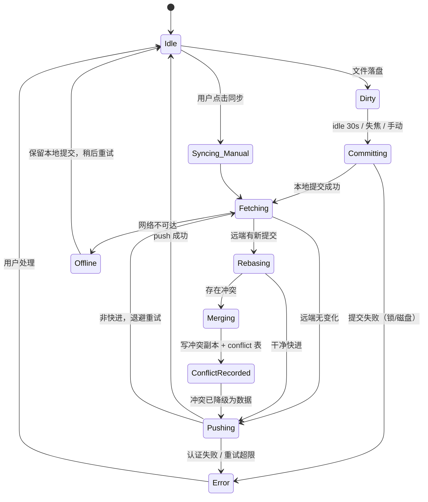
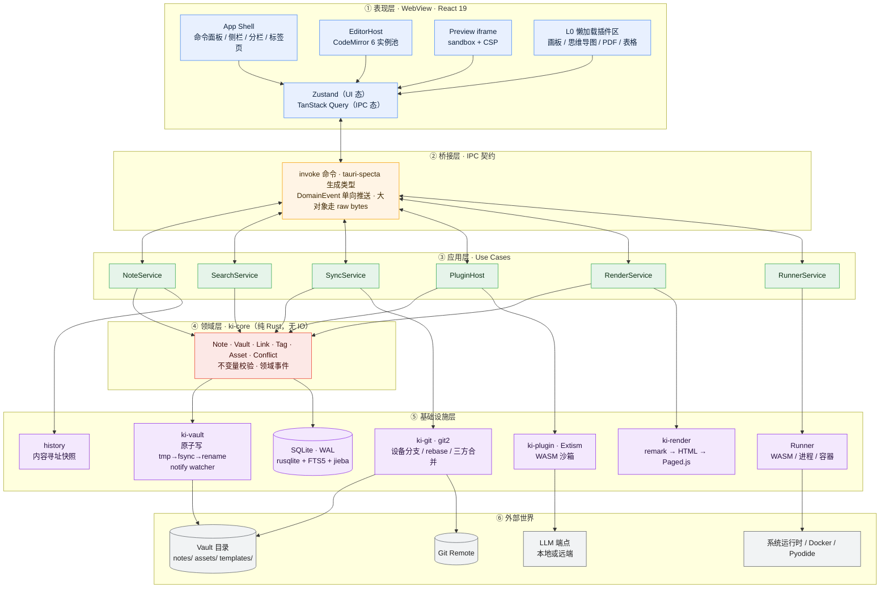

# 知屿 KnowIsle · 技术架构与选型决策文档

> **把知识，安放在自己的岛上。**
>
> 文档编号：KI-ARCH-001
> 状态：**Accepted（已冻结，变更需新增 ADR 并废弃本条）**
> 适用版本：v0.1 ~ v1.x
> 最后更新：2026-10-29

---

## 0. 阅读指南

本文不是"技术栈罗列"，而是一份**决策记录**。每一条选型都必须回答三个问题：

1. **在什么约束下做的这个决定？**（Context）
2. **我们选了什么，为什么是它而不是别的？**（Decision）
3. **这个决定的代价是什么，我们准备怎么还这笔债？**（Consequences）

没有代价的技术选型是幻觉。凡是本文写"坚决不选"的方案，都不是因为它差，而是因为**它与本项目的某条硬约束结构性冲突**——换句话说，在另一个项目里它可能是正确答案。

### 0.1 五条架构公理（不可协商）

这五条是后面所有 ADR 的推导前提。任何 PR 违反其中一条，直接打回，不需要讨论。

| # | 公理 | 推论 |
|---|------|------|
| **A1** | **磁盘上的 Markdown 是唯一真相源。** | 数据库是可随时删除重建的派生索引。任何"只存在 DB 里"的用户内容都是 Bug。 |
| **A2** | **核心逻辑不依赖 UI。** | `isle` CLI 与 GUI 共享同一个 `ki-core`。core 层代码里不允许出现 `tauri::` 字样。 |
| **A3** | **编辑态与渲染态是两条独立管线。** | 编辑用 CodeMirror，渲染用 remark/rehype，二者永不互相污染。 |
| **A4** | **启动关键路径上不允许出现任何插件代码。** | 冷启动只加载"打开一篇笔记"所需的最小闭包。 |
| **A5** | **所有写操作必须原子且可自愈。** | `tmp → fsync → rename`；崩溃后能靠日志与哈希校验回到一致状态。 |

> 这五条公理的解释：我们卖的不是功能，是**"你的知识不会因为我们的 Bug 而消失"**。这是本地优先产品的全部信誉所在。功能可以少，数据不能丢。

---

## 1. 技术选型对比与决策（ADR）

### ADR-001 · 桌面框架：Tauri 2.0

#### Context

需求里同时出现了三个互相拉扯的约束：

- **本地优先** → 大量文件 IO、全文索引、Git 操作，全部在本地完成，不能靠"转发给 Node 再说"。
- **多窗口同时编辑预览** → 每个窗口都是一份独立 WebView 实例，框架的边际内存成本被放大 N 倍。
- **内置一键运行代码** → 需要 spawn 子进程、限制资源、超时杀进程树、捕获 stdout/stderr 流。这是**操作系统级能力**，不是 Web 能力。

#### 对比

| 维度 | Tauri 2.0 | Electron 38 | 权重 |
|------|-----------|-------------|------|
| 安装包体积 | **8–15 MB** | 90–150 MB | 中 |
| 空载常驻内存（Win11） | **~90–140 MB** | ~180–300 MB | 高 |
| 多窗口边际成本 | 低（共享系统 WebView 进程池） | 高（每窗口 +60~90 MB） | **极高** |
| 文件 IO / 索引吞吐 | Rust 原生，SQLite 同进程，零序列化 | Node 侧，跨进程转发 | 高 |
| 进程管控能力（跑代码） | Rust：Job Object / rlimit / PTY / 进程树 kill / cgroup | Node `child_process`，权限模型薄弱，难以做资源限额 | **极高** |
| WebView 渲染一致性 | **碎片化**：WebView2 / WKWebView / WebKitGTK 三套内核 | 自带 Chromium，像素级一致 | 高（负分） |
| 调试与排错体验 | 较差（Rust ↔ JS 双层栈，WebView 差异） | 优秀（一套 DevTools 走天下） | 中 |
| 生态成熟度 | 中（插件数量少，但 2.0 后补齐了 updater/fs/sql 等刚需） | 极高 | 中 |
| 团队上手成本 | 陡（Rust + 生命周期 + 跨语言错误处理） | 平（纯 JS） | 中 |
| 长期维护风险 | 中（依赖各平台 WebView 演进） | 低（自控 Chromium） | 中 |

#### Decision

**选用 Tauri 2.0。Rust 作为唯一的核心运行时，前端只做视图。**

核心理由不是"包小"（那只是营销数字），而是这一条：

> **"一键运行代码"要求我们成为进程的所有者（process owner），而不是进程的调用者（caller）。**

Electron 里跑用户代码，你能拿到的是 `spawn()` 返回的一个 pid。想限制它只能用 256MB 内存？想让它 10 秒后连同所有子孙进程一起死？想给它一个干净的 PID namespace？在 Node 里你要么依赖第三方 native addon，要么放弃。而在 Rust 里，`tokio::process` + Windows Job Object / Unix `setrlimit` + `process_group(0)` + `killpg` 是标准库级别的能力，写出来不到 200 行，且**可以在 CI 里被单元测试覆盖**。

第二个理由：本地优先产品的性能天花板由**索引器**决定。10 万篇笔记的首次索引、增量重建、FTS5 写入，走 Rust + `rusqlite` 是纯内存操作；走 Electron 则要跨越 `renderer → main → native` 三跳，每跳一次结构化克隆。这不是优化问题，是架构问题。

#### Consequences（代价与偿还计划）

| 代价 | 缓解措施 |
|------|----------|
| **WebView 碎片化**：WebKitGTK 在 Linux 上对新 CSS 特性支持滞后 6–18 个月 | ① 明确支持矩阵：Windows 10 1809+ / macOS 12+ / Ubuntu 22.04+（WebKitGTK 4.1）。② CI 三平台跑 Playwright 视觉回归。③ 建立"基线特性白名单"，禁用 `:has()`、`subgrid`、`@container style()` 等非全平台特性，由 ESLint 插件静态拦截。 |
| Rust 开发效率低于 TS | 严格分层：Rust 只写"IO + 算法 + 状态机"，绝不写业务 UI 逻辑。领域层 `ki-core` 保持纯函数风格，测试覆盖率要求 ≥ 85%。 |
| 双语言调试成本 | 统一错误模型：Rust 侧 `KiError` 序列化为 tagged union，前端拿到 `code` 而非解析 message。所有跨语言调用在 `tauri-specta` 生成的类型约束下编译期校验。 |
| 插件生态贫瘠 | 不依赖 Tauri 官方插件做业务，只用作外壳（updater / single-instance / global-shortcut）。业务能力全部自建。 |

#### 坚决不选

- ❌ **Electron** —— 不是因为"它慢"，而是因为它的内存模型与"多窗口 + 常驻后台索引"直接冲突；且进程管控能力不足以支撑可信的代码执行沙箱。
- ❌ **Flutter Desktop** —— 自绘 UI 意味着整个 Markdown 渲染、文本选择、输入法（IME）组合、无障碍全部要重写。中文输入法在自绘引擎里是长期流血点。
- ❌ **纯 Web + PWA** —— 无法访问文件系统目录、无法跑代码、无法做真正的 Git。与"本地优先"根本矛盾。
- ❌ **Wails / Neutralino** —— 同类但生态与 2.0 之后的工程化程度（updater、移动端、权限模型）明显落后。

---

### ADR-002 · 前端框架：React 19

#### Context

一个反直觉的事实：**这个项目 70% 的前端复杂度不在"写 UI"，而在"托管别人的重型 UI"**。

画板、思维导图、电子表格、PDF 标注——这四个都是"轮子已经造好了，你只需要把它塞进来并且别让它把主程序搞崩"的典型场景。选框架的第一优先级不是"谁的运行时更快"，而是**"谁能让这些重型库以最小摩擦落地"**。

#### 对比

| 维度 | React 19 | Vue 3.5 | Svelte 5 |
|------|----------|---------|----------|
| 重型可视化库一等公民支持 | **Excalidraw / tldraw / xyflow(React Flow) / Univer(表格) 全部 React 原生** | 需社区 wrapper，版本滞后 | 需 wrapper 或 iframe 隔离 |
| 细粒度更新模型 | 需手动（编译器 + 状态外置） | Proxy 响应式，自动依赖收集 | 编译期信号，最优 |
| 首屏运行时体积（gzip） | ~45 KB | ~34 KB | ~10 KB |
| 与 CodeMirror 6 的集成范式 | 命令式桥接（`useRef` + `EditorView`），模式成熟稳定 | 成熟 | 成熟 |
| 大列表 / 虚拟滚动 | TanStack Virtual 一等 | 有 | 有 |
| 生态广度（a11y、dnd、图表、表单） | 最大 | 大 | 小 |
| 招聘 / 贡献者池 | 最大 | 大 | 小 |
| 长期演进风险 | 中（RSC 方向有分歧，但 SPA 路线稳定） | 低 | 中（团队规模小，Svelte 5 迁移刚完成） |

#### Decision

**选用 React 19 + TypeScript 5.x，SPA 模式（不使用 RSC / SSR）。**

决定性理由：**`Excalidraw`、`tldraw`、`xyflow`、`Univer` 这四个库，构成了我们"高级组件"需求的 80%。它们都是 React 原生实现，且内部深度依赖 React 的调度与 Portal 机制。** 在 Vue/Svelte 里用它们，你要么等社区 wrapper（滞后 6–12 个月，且遇到 bug 无人修），要么用 iframe 隔离（跨 iframe 的剪贴板、拖拽、焦点管理是地狱）。

而 React 的已知短板——"re-render 太多"——在我们这个场景里有一个**结构性解法**：

> **编辑器文档状态永不进入 React 状态树。**

CodeMirror 的 `EditorState` 是它自己的响应式系统，输入一个字符只触发它内部的 transaction，与 React 的调和完全无关。React 只负责"渲染编辑器外壳"（工具栏、状态栏、标签页），而这些组件的更新频率是**秒级**而非**毫秒级**。我们不需要 React 快，我们只需要它**别挡路**。

#### Consequences

| 代价 | 缓解措施 |
|------|----------|
| 默认 re-render 策略粗放 | ① 三条硬规则：编辑器内容不进 React；滚动/拖拽/光标位置用 `ref` + 订阅；跨组件高频通信走外部 store 的 `subscribe` 而非 context。② CI 引入 React DevTools Profiler 基线，PR 触发 render 次数回归检测。 |
| 包体积大于 Svelte | 路由级 + 插件级 code split；主 chunk 预算 350KB（gzip），CI 卡口。 |
| `useEffect` 心智负担 | 用 TanStack Query 接管所有异步 IPC（不再手写 `useEffect` 做数据获取），用 Zustand 接管全局状态，把 `useEffect` 的用途压缩到"DOM 副作用"一类。 |

#### 坚决不选

- ❌ **Vue 3** —— 语言本身更优雅，但在"重型第三方库托管"这个决定性维度上，我们要为每个库付一次适配成本。这不划算。
- ❌ **Svelte 5** —— 运行时最优雅、体积最小。但生态是硬伤：贡献者池小一个数量级，插件作者更可能写 React 版本。
- ❌ **Next.js / Nuxt / SvelteKit** —— 我们是桌面应用，没有服务端。引入 SSR 框架只为拿到路由和构建，代价是整条 RSC/边缘运行时的心智负担。**用 Vite + React Router（或 TanStack Router）即可。**
- ❌ **Web Components 作为主架构** —— 样式隔离很香，但状态管理与生态几乎为零，且与 CodeMirror 的命令式 API 配合别扭。仅用于**插件样式隔离**（见 2.4）。

---

### ADR-003 · 编辑器内核：CodeMirror 6

#### Context

这是全项目**最不可逆**的一个决定。编辑器内核决定了：Vim 模式能做到什么程度、10 万字文档能不能流畅、多窗口能不能开得起、Live Preview 能不能实现。

需求给出的三个关键词是：**Vim 支持、Markdown 性能、多窗口**。这三个词已经把答案锁死了，但我们仍然要论证一遍。

#### 对比

| 维度 | CodeMirror 6 | Monaco Editor | ProseMirror |
|------|--------------|---------------|-------------|
| 文档模型 | 平衡树（Text rope）+ 增量解析（Lezer） | 行数组 + 全文 tokenizer | Schema 化节点树 |
| 打开 10 万字 Markdown | **~80 ms** | ~400 ms | ~600 ms+（需全文 parse） |
| 单实例常驻内存 | **~6–10 MB** | ~60–120 MB | ~30 MB |
| 10 个实例同时存在 | 可行（~80 MB） | 不可行（~1 GB） | 勉强（~300 MB） |
| Vim 模式 | **`@replit/codemirror-vim` 一等支持**，与 CM6 事务模型深度整合 | `monaco-vim` 社区维护，长期滞后，与官方 API 打架 | `prosemirror-vim` 残缺，选择/撤销语义不匹配 |
| 源码即真相 | **天然**（缓冲区就是文本） | 天然 | **需 round-trip，有损** |
| 所见即所得 | 通过 Decoration / Widget 叠加实现（Live Preview） | 不适合 | 天生擅长 |
| 包体积（gzip） | **~200 KB**（按需引入语言包） | ~5 MB | ~350 KB |
| 可扩展性 | 极高（Extension 组合，函数式） | 中（API 面窄，改不动） | 高（但受 Schema 约束） |
| 多光标 / 折叠 / 搜索 | 内置 | 内置 | 需自行实现 |

#### Decision

**选用 CodeMirror 6 作为唯一的主编辑内核。ProseMirror 仅允许作为插件内部的局部编辑器，永不做主文档模型。**

三条理由，按重要性排序：

**① Markdown 的真相是纯文本，任何"解析成富文本树再序列化回来"的方案都会吃掉用户的东西。**

ProseMirror 的世界观是"文档是一棵有 Schema 的树"。这在富文本里是优点，在 Markdown 里是灾难：frontmatter、HTML 片段、非标准表格、`<details>` 折叠块、注释 `<!-- -->`、行内 LaTeX 边界、缩进敏感的嵌套列表——每一项都要在 Schema 里建模，每一项 round-trip 都可能丢字符或重排空白。

用户打开一篇 Markdown，看到的是他写的样子；保存后文件 diff 应该**只有他改的那几行**。这是本地优先产品的底线（Git 同步直接依赖它，见 3.5）。ProseMirror 做不到这个保证，CodeMirror 6 天然就是。

**② Vim 模式不是"加分项"，是"筛选器"。**

`@replit/codemirror-vim` 是把 Vim 的 keymap 编译成 CM6 的 Transaction 序列，因此 Vim 的 `dG`、`ci"`、宏录制、`.` 重复，都能和 CM6 的撤销栈、多光标、语法高亮正确协同。`monaco-vim` 是外部补丁，很多操作绕过了 Monaco 的编辑模型，导致撤销栈错乱——这是 Vim 用户第一个小时就会发现的问题。

**③ 多窗口是内存问题，而 Monaco 的单位内存成本高一个数量级。**

用户开 6 个窗口对比笔记是常见操作。CM6 每实例 ~8MB，6 个 = 48MB；Monaco 每实例 ~80MB，6 个 = 480MB，还没算 Chromium/WebView 本身。在"多窗口同时编辑预览"这条需求上，Monaco 直接出局。

#### 关键设计：Live Preview 的实现方式

我们不采用"源码模式 / 预览模式"二选一，而是**单缓冲区 + Decoration 叠加**：

```
EditorState.doc  ← 唯一真相（纯 Markdown 文本）
       │
       ├── Lezer Markdown 语法树（增量解析，viewport 优先）
       │
       └── Decoration 层：
             · 标题 → 字号/字重（ViewPlugin）
             · 图片/表格/公式 → Widget（替换渲染，光标进入时还原为源码）
             · 语法符号 → 淡化（cursor-line 内高亮，其余隐藏）
```

核心约束：**Decoration 永远是"视图层投影"，绝不回写文档**。这意味着无论 Live Preview 多花哨，`Ctrl+S` 写出去的一定是用户敲的那个纯文本。这条约束也是 A3 公理的落地形式。

#### Consequences

| 代价 | 缓解措施 |
|------|----------|
| 富文本能力需要自己搭 | 建立 `packages/editor` 内部 DSL：`defineBlockRenderer()` 统一注册 Widget，避免每个语法各写一套。表格编辑走"光标进入时切换为轻量 grid 编辑器"的局部方案。 |
| 大文档的 Decoration 计算可能卡顿 | 严格 viewport 优先：只对可视区 ±2000px 计算 Decoration；超过 500KB 的文档自动降级为"纯源码模式"并提示。 |
| 没有开箱的 Markdown LSP | 自建 `ki-lint`：基于 Lezer 树做规则检查（死链、重复标题、frontmatter schema 校验），跑在 Worker 里。 |

#### 坚决不选

- ❌ **Monaco** —— 它是"代码编辑器"，不是"知识库编辑器"。5MB 体积、每实例 80MB 内存、Vim 支持残缺，三个硬伤各自致命。
- ❌ **ProseMirror / Tiptap 作为主内核** —— 会让我们失去"纯文本真相"，进而破坏 Git 同步与用户信任。**Tiptap 允许作为某个插件的内部编辑器**（例如"可视化表格"或"卡片式大纲"），但不允许触碰 `.md` 文件。
- ❌ **Slate.js** —— 维护活跃度与稳定性不足，文档模型同样是富文本树，问题同 ProseMirror。
- ❌ **自研 contenteditable 编辑器** —— 这是一条用两年时间重新发现"为什么大家都用现成内核"的路。
- ❌ **Electron + VS Code 的 Monaco 复用（Theia 路线）** —— 见 ADR-001。

---

### ADR-004 · 本地存储：SQLite + rusqlite（无 ORM）

> **⚠️ 本 ADR 的检索部分与迁移方案已被下方 ADR-007 取代（M4 落地时实测推翻）。**
>
> 保留原文是为了让后来者看清**前提错在哪**：第 2 点「中文分词」的实现方案（`jieba-rs` 预分词 + `unicode61`）建立在「`unicode61` 按字切分中文」这个错误认知上；`refinery` 迁移也一并取消（索引库是派生数据，整库重建即可）。
>
> **仍然有效**：SQLite + `rusqlite`(bundled) + 手写 Repository、坚决不用 ORM、PRAGMA 基线、Consequences 里 `spawn_blocking` 与「UI 线程永不直连」的约束。

#### Context

数据库承担三个角色，性质完全不同：

1. **元数据索引**（标题、标签、时间、链接图）→ 关系型，需要 JOIN。
2. **全文检索**（中文分词！）→ FTS5。
3. **操作日志 / 历史版本索引** → 追加写，需要事务。

三者都在本地，单进程，单用户。这个场景下 ORM 的价值（屏蔽多数据库差异、团队协作规范、复杂关联加载）几乎全部不成立，而它的成本（编译摩擦、N+1、失控的 SQL、难以使用 SQLite 特有能力）全部成立。

#### 对比

| 方案 | 类型安全 | 迁移 | FTS5 / 自定义分词 | 构建摩擦 | 异步模型 | 结论 |
|------|----------|------|-------------------|----------|----------|------|
| **rusqlite + 手写 Repository**（~~refinery~~ 已按 ADR-007 取消） | 手写映射（编译期保证） | 索引库**整库重建**，无迁移 | **完全掌控** | **低**（bundled feature，零系统依赖） | 同步（配 `spawn_blocking`） | ✅ **选用** |
| Diesel | 编译期最强 | 需 `diesel_cli` | 需绕开 DSL 写裸 SQL | 高（宏重、编译慢、错误信息晦涩） | 同步 | ❌ |
| SeaORM | 运行期 + 部分编译期 | 内置 | 受限（难注册 tokenizer） | 中（被迫引入 tokio 全栈） | 异步 | ❌ |
| sqlx | 编译期（需 `DATABASE_URL` 或 `.sqlx` 离线缓存） | 需外部工具 | 受限 | **中高**（离线缓存极易与 schema 漂移，贡献者首跑必踩坑） | 异步 | ❌ |
| Prisma / Drizzle | 优秀 | 优秀 | 不支持 FTS5 自定义分词 | 极高（需要 Node 侧持有 DB） | — | ❌ 架构错位 |

#### Decision

**`rusqlite`（`bundled` feature）+ `refinery` 迁移 + 手写 Repository 层。**

关键考量是**中文全文检索**。FTS5 内置的 `unicode61` 分词器对中文是**按字切分**的——搜"知识库"会命中任何包含"知""识""库"三个字的文档，召回率 100%，准确率接近 0。这是国产知识库产品的头号体验杀手。

我们的方案是**双通道索引**（⚠️ 下方 DDL 已被 ADR-007 取代，保留原文以对照前提错在哪，**勿照抄**；现行 DDL 见 `crates/ki-store/src/schema.rs`）：

```sql
-- ⚠️ 已被 ADR-007 取代：unicode61 不按字切分中文，jieba 预分词做不了子串查询
-- 通道 A：原文 + unicode61（服务英文与代码标识符）
CREATE VIRTUAL TABLE note_fts USING fts5(
    title, body, tags,
    content='',                       -- 外部内容表，不重复存储
    tokenize='unicode61 remove_diacritics 2'
);

-- 通道 B：jieba 预分词后的影子列（服务中文）
-- body_tokens = "知识 库 本地 优先 架构 设计"
CREATE VIRTUAL TABLE note_fts_zh USING fts5(
    title_tokens, body_tokens,
    content='',
    tokenize='unicode61'
);
```

写入时用 `jieba-rs` 做一次分词（10 万字约 40ms，跑在索引线程池），查询时用同样的分词器处理 query，两条通道结果用 RRF（Reciprocal Rank Fusion）融合排序。

> ⚠️ **上一段的两个前提都不成立**（M4 实测）：① `unicode61` 把连续汉字合成**一个** token，不是按字切分，「召回率 100%、准确率 0」这个判断本身是错的；② 统计分词（jieba）切出来的词表**无法保证子串查询的召回**（查「知识库」而文档里是「知识库的设计」，词表里是「知识」「库」「设计」—— 词级 AND 直接漏掉）。现行方案是 **CJK bigram 预切分**，见 ADR-007。

> 为什么不用 FTS5 的 custom tokenizer 接口？因为那要求把 jieba 注册进 SQLite 的 C 层，跨平台编译（尤其 Windows MSVC + wasm 目标）麻烦，且无法在 WASM 版复用。预分词落库是"用存储换简单性"的经典权衡，代价是索引体积 +35%，完全可接受。

#### PRAGMA 基线（不可省略）

```sql
PRAGMA journal_mode = WAL;        -- 读写并发，崩溃安全
PRAGMA synchronous = NORMAL;      -- WAL 下足够安全，性能提升 3-5x
PRAGMA foreign_keys = ON;         -- 默认是 OFF，必须显式开
PRAGMA busy_timeout = 5000;       -- 避免索引线程与 UI 线程互锁
PRAGMA temp_store = MEMORY;
PRAGMA mmap_size = 268435456;     -- 256MB，加速大库顺序读
PRAGMA cache_size = -65536;       -- 64MB page cache
```

#### Consequences

| 代价 | 缓解措施 |
|------|----------|
| 手写映射样板代码 | 用 `#[derive(FromRow)]` 宏（自研 60 行）+ Repository trait 收敛；每个表只允许一个 Repository 拥有写权限。 |
| 无编译期 SQL 校验 | 单测里对每个 Repository 跑真实 SQLite（`tempfile` + 内存库），覆盖率 100%；CI 里跑 `EXPLAIN QUERY PLAN` 断言无 `SCAN TABLE`（除 FTS）。 |
| 同步 API 阻塞 async 运行时 | 所有 DB 调用走 `tokio::task::spawn_blocking`，且使用独立连接池（`r2d2_sqlite`），UI 线程永不直连。 |

#### 坚决不选

- ❌ **任何 ORM** —— 我们的表只有约 15 张，但需要 ATTACH、partial index、FTS5、触发器、自定义排序规则。ORM 在这里是纯负资产。
- ❌ **JSON 文件存元数据** —— 10k 笔记的元数据 JSON 约 30MB，每次启动全量 parse 要 400ms+，且无法做增量更新。SQLite 就是"结构化的 JSON"，没有理由不用。
- ❌ **IndexedDB / localStorage 作为主存储** —— 数据在 WebView 的 profile 目录里，用户备份、迁移、跨设备同步全部失控。违反 A1。
- ❌ **LMDB / RocksDB / sled** —— 键值存储做不了"按标签 + 时间 + 全文"的复合查询，最终还是要建倒排索引，等于重写 SQLite。

---

### ADR-005 · 前端状态管理：Zustand + TanStack Query

#### Context

前端的"状态"其实是五种完全不同的东西，混在一起管理是绝大多数编辑器项目后期失控的根源：

| 状态类型 | 例子 | 更新频率 | 归属 |
|----------|------|----------|------|
| 文档状态 | 当前笔记的文本、选区、撤销栈 | 每次击键 | **CodeMirror `EditorState`** |
| 服务端态 | 笔记列表、标签树、搜索结果 | 秒级 | TanStack Query |
| 全局 UI 态 | 侧栏展开、当前 tab、命令面板开关 | 秒级 | Zustand |
| 瞬态交互态 | 拖拽位置、滚动偏移、鼠标坐标 | 每帧 | `ref` + 直接 DOM 操作 |
| 跨窗口态 | 窗口布局、焦点笔记 | 事件驱动 | Tauri event + 持久化 |

#### Decision

**分层治理，绝不合并成一个 store。**

```ts
// 1. 文档态：不进 React
const view = new EditorView({ state: EditorState.create({ doc, extensions }) });
// React 只持有 ref，永不 setState

// 2. 服务端态：TanStack Query
const { data: notes } = useQuery({
  queryKey: ['notes', folderId],
  queryFn: () => invoke('note::list', { folderId }),
  staleTime: 30_000,
});

// 3. 全局 UI 态：Zustand + slice 切分
export const useUIStore = create<UIState>()(
  subscribeWithSelector((set) => ({ /* ... */ }))
);

// 4. 高频瞬态：ref + 订阅，零 re-render
useEffect(() => view.scrollDOM.addEventListener('scroll', onScroll, { passive: true }), []);
```

**关键设计：core → UI 的单向事件流。** Rust 侧任何状态变更（文件被外部修改、索引完成、Git 同步进度）通过 `emit` 推送，前端在 `main.tsx` 里统一订阅，路由到 Query 的 `invalidateQueries` 或 Zustand 的 action。**前端不做轮询。**

> **实施状态（2026-10-26）：MVP 未接入 Zustand 与 TanStack Query。**
> `apps/desktop/package.json` 里这两个包都不存在，当前实现是 `useState` + `useRef`
> （`App.tsx` 1614 行 / 28 处 `useState`），服务端态由每次调用直接 `invoke` +
> 手动 `setState` 承载，没有缓存、失效与重试。
>
> 上面那张表的分层判断**仍然成立**：文档态确实只在 CM6 的 `EditorState` 里，
> 从没进过 React state——这是本 ADR 最重要的一条，也是唯一被完整执行的一条。
> 缺的是「服务端态」与「全局 UI 态」这两层的库。
>
> **接入触发条件**（满足任一条）：
> 1. 同一个查询被三处以上组件各自拉一遍（TanStack Query 的收益起点是**去重**，
>    不是"用上库"）；或
> 2. 跨域共享的 UI 态超过三个域——当前恰好是三个（回收站 / 搜索 / 侧栏，见 B-35）。
>    到第四个域时先拆 hook（B-35），拆完仍需要跨组件订阅才引入 Zustand。
>
> **为什么现在不接**：一个 1614 行的单组件树用不上缓存失效与乐观更新，
> 引入两个库只会把「状态在哪」这个问题从一处变成三处。ADR 写的是**目标形态**，
> 它需要一条明确的接入条件，而不是一个默认已完成的假象。

#### 坚决不选

- ❌ **Redux Toolkit** —— 样板代码与"服务端态"的缺失，让我们要手写缓存、失效、重试。2026 年了，不该再手写这些。
- ❌ **MobX** —— 隐式依赖追踪在**多人插件**场景下不可控：插件的 observable 会意外触发宿主的 reaction，且难以在错误边界里回滚。
- ❌ **Jotai / Recoil** —— 原子化在表单场景很美，在文档级应用里会退化成"一张全局变量表 + 隐式依赖图"，调试成本高于收益。
- ❌ **Context 传递高频状态** —— Context 变更会让整棵子树重渲染，这是 React 性能事故的第一大来源。
- ❌ **把编辑器内容放进任何 React store** —— 违反则直接导致每次击键全树重渲染。这是 Code Review 的红线。

---

### ADR-006 · 样式与主题：Tailwind CSS v4 + 三层 Design Token

#### Context

"主题自定义"这条需求，本质要求是：**在不重新编译、不重启的前提下，让整个应用（包括第三方插件）换一套视觉。**

这排除了所有"编译期固化颜色"的方案。

#### 对比

| 方案 | 运行时换肤 | 与插件隔离 | 体积/性能 | 开发效率 | 结论 |
|------|-----------|-----------|-----------|----------|------|
| **Tailwind v4 + CSS Variables** | ✅ 改 `:root` 变量即可 | ✅ Shadow DOM 内注入 token 副本 | 优秀（原子类，purge 后极小） | 高 | ✅ **选用** |
| CSS-in-JS（Emotion / styled-components） | ✅ | ⚠️ 与 Shadow DOM 冲突 | 差（运行时样式计算，每 keystroke 生成类名） | 中 | ❌ |
| SCSS + 变量 | ❌ 编译期固化 | — | 优秀 | 中 | ❌ |
| UnoCSS | ✅ | ✅ | 优秀 | 高（但预设生态小于 Tailwind） | ⚠️ 备选 |
| 纯 CSS Modules | ✅（变量） | ✅ | 优秀 | 中 | ⚠️ 可与 Tailwind 并用 |

#### Decision

**Tailwind CSS v4（CSS-first 配置）+ 三层 Design Token 体系。**

```css
/* L1 · Primitive：物理色板，永不被组件直接引用 */
:root {
  --ki-blue-500: oklch(0.62 0.19 254);
  --ki-slate-900: oklch(0.21 0.02 258);
}

/* L2 · Semantic：语义层，主题只覆写这一层 */
:root, [data-theme="light"] {
  --ki-bg-canvas: var(--ki-slate-50);
  --ki-bg-surface: #fff;
  --ki-text-primary: var(--ki-slate-900);
  --ki-text-muted: var(--ki-slate-500);
  --ki-border-subtle: oklch(0.92 0.005 258);
  --ki-accent: var(--ki-blue-500);
}

[data-theme="dark"] {
  --ki-bg-canvas: oklch(0.18 0.015 258);
  --ki-bg-surface: oklch(0.22 0.015 258);
  --ki-text-primary: oklch(0.95 0.005 258);
  --ki-text-muted: oklch(0.66 0.01 258);
}

/* L3 · Component：组件级微调，允许主题精细控制 */
:root {
  --ki-editor-cursor: var(--ki-accent);
  --ki-editor-selection: oklch(0.62 0.19 254 / 0.18);
  --ki-sidebar-item-active-bg: oklch(0.62 0.19 254 / 0.10);
}
```

Tailwind v4 的 `@theme` 直接映射到 CSS 变量，因此：

```html
<div class="bg-[var(--ki-bg-surface)] text-[var(--ki-text-primary)]">
```

**主题 = 一份 JSON，只覆写 L2/L3。**

```ts
export interface ThemeDefinition {
  id: string;                       // "ki.solarized-dark"
  name: string;                     // "Solarized Dark"
  base: 'light' | 'dark';           // 决定原生控件（滚动条、菜单）的明暗
  tokens: Partial<Record<`--ki-${string}`, string>>;
  syntax?: Record<string, string>;  // CodeMirror 高亮色
}
```

应用主题 = 注入一个 `<style id="ki-theme">` + 设置 `data-theme` 属性。**零重载，零重编译。**

> **实施状态（2026-10-26）：token 体系已落地，Tailwind 未接入。**
> 当前样式是 `apps/desktop/src/index.css`（1660 行手写 CSS），三层结构与本节
> 逐层对应：L1 `--ki-slate-*`（物理色板）、L2 `--ki-bg-*` / `--ki-text-*` /
> `--ki-accent`（语义层，主题只覆写这一层）、L3 `--ki-editor-*` /
> `--ki-sidebar-*`（组件级）。暗色主题就是 `[data-theme='dark']` 覆写 L2 一次，
> 组件规则零改动——本节承诺的「运行时换肤」已经兑现。
>
> 没有的只有 Tailwind 那一层（`package.json` 里没有 `tailwindcss`，
> `index.css` 里没有 `@theme`）。
>
> **接入触发条件**（满足任一条）：
> 1. 新增一个**有设计稿的新界面**——那时本来就要写新样式，顺手用原子类不是返工；
> 2. `index.css` 超过 2500 行，且新增规则开始大量重复现有的组合
>    （那时缺的是抽象；先抽 `@layer components`，Tailwind 是可选解不是唯一解）。
>
> **为什么现在不接**：接入意味着把 1660 行 CSS 与 12 个 `.tsx` 里的每一处
> className 都改一遍（共 24 个源文件）。这是**纯机械替换，不产生任何用户可见
> 价值**，却要重跑全部 GUI 验收。ADR 写的是选型，不是排期；差异在这里说清楚，
> 比在 README 里假装已经用了要诚实。

**插件样式隔离**：插件渲染在 Shadow DOM 内，宿主在 `shadowRoot` 上注入一份 token 的 CSS 变量副本。插件用 `var(--ki-*)` 就自动跟随主题；想绕过则自己写死颜色（后果自负）。这比 `iframe` 轻，比 `scoped CSS` 强。

#### 坚决不选

- ❌ **CSS-in-JS** —— 运行时样式计算在"多窗口 × 多编辑器实例 × 每次击键"的组合下是灾难；且与 CodeMirror 直接操作 DOM 的生命周期冲突。
- ❌ **SCSS 变量做主题** —— 编译期固化，无法运行时切换。SCSS 可以用于**构建期的 mixin 复用**，但不承担主题职责。
- ❌ **Ant Design / MUI 作为主 UI 库** —— 它们的样式体系自带强主张（主题变量、组件结构），与"深度自定义 + 插件生态"冲突。改用 **Radix UI（headless）+ 自研样式**，只借无障碍与交互逻辑。
- ❌ **`styled-jsx` / Vue SFC scoped 思路** —— 与 React 生态和 Shadow DOM 都不合。

---

### ADR-007 · 检索：FTS5 双通道 + bigram，不用 jieba（取代 ADR-004 的检索部分）

> **状态**：v0.3（M4）已实施。ADR-004 的「本地存储」结论仍然有效，
> 但其中**检索方案那一段（双通道 + jieba）已被本 ADR 取代**，
> 且它陈述的一个技术前提是错的。改检索之前先读这里。

#### Context：ADR-004 写错了一个前提

ADR-004 里这句话是**错的**：

> FTS5 内置的 `unicode61` 分词器对中文是**按字切分**的——搜"知识库"会命中
> 任何包含"知""识""库"三个字的文档。

实测（SQLite 3.46 / 3.53 均一致）：

```sql
-- 插入 "知识库的设计"
SELECT count(*) FROM t WHERE t MATCH '知识库';   -- 0
SELECT count(*) FROM t WHERE t MATCH '知识库的设计'; -- 1
```

`unicode61` **不按字切分**，它把一段**连续汉字合成一个 token**。
`知识库的设计` 整体是一个 token，所以查 `知识库`（精确）命中不了，
查 `库` 也命中不了（除非那个「库」在原文里被空格或标点隔开）。

这推翻的不是"要做双通道"这个结论，而是**做双通道的理由**：

- ❌ 错理由：「unicode61 按字切，召回 100% 准确率 0」
- ✅ 对理由：**token 级匹配做不了 CJK 子串匹配**。任何以词/token 为单位的
  索引（unicode61、jieba、trigram 之外的一切）都要求查询与文档在同一个
  切分粒度上对齐；而用户搜的是子串，子串天然不对齐。

顺带修正另一条：`Rust的所有权` 在 `unicode61` 下也是**一个** token。
所以查 `rust`（精确）不中、`rust*`（前缀）中——但 `本地优先Rust` 这种
「ASCII 在汉字后面」的写法连前缀都不行。这是通道 A 必须做 **ASCII 投影**
（把非 ASCII 抹成空格）的原因。

#### Decision

三层分工，每层只做一件事：

```
plan(query)  ──> 通道 A（ASCII 投影，词首前缀）   ┐
                通道 B（CJK bigram，AND）        ├─> RRF ─> 候选池 ─> NoteLocator ─> 命中行
                文件名通道（字面子串）            ┘
```

1. **索引层只选候选，不做判定。** 行号、UTF-16 列号、摘要窗口全部由
   `ki_vault::NoteLocator` 的字面子串扫描产出。这条分工是整次换芯的支点：
   18 条既有行为契约自动继续成立（它们是同一份代码在跑），检索精度与旧引擎
   完全相同，差异只可能来自候选集。
2. **通道 B 用 bigram，不用 jieba。** 见下。
3. **两张 FTS 表都是 `content=''`**（contentless）：索引里**不存正文副本**
   （公理 A1：磁盘才是唯一真相源）。

#### 为什么是 bigram 而不是 jieba

索引层的任务只有一条：**不能漏候选**。bigram 恰好能给出这条保证，
而且可以证明：

> 若 `Q ⊆ T`（Q 是 T 的连续子串）且 Q 含 ≥2 个汉字，
> 则 Q 的 bigram 多重集 ⊆ T 的 bigram 多重集。

证明是一行：Q 里每个 bigram 都是 T 里同一个位置的 bigram。多重集而非集合，
是因为 `哈哈` 在 T 里出现一次、在 Q 里出现两次时需要能"用两次"；
而 FTS5 的 `AND` 只查有没有，比多重集更宽松，所以这条保证只会更强。

实测：300 篇随机混排文档 + **2971 组**「Q 是 T 的连续子串且含 ≥2 汉字」的
随机查询，**漏召回 0 组**。

jieba 给不出任何保证：查询切出来的词与文档切出来的词依赖上下文，
`知识库` 在一处成词、在另一处被切成 `知识` + `库`，于是「明明有这句话却搜不到」。
它换来的是更好的相关性排序——但排序在我们这里是 RRF 与定位器的事，
不该拿召回率去换。附带省掉：14MB 内嵌词典、`Jieba::new()` 的启动成本、
query/doc 分词不一致这一类 bug。

**切分规则**（`crates/ki-search/src/bigram.rs`）：

| 文本 | 通道 B |
|---|---|
| `知识库` | `知识 识库` |
| `Rust的所有权` | `的所 所有 有权 t的` |
| `知识库Rust` | `知识 识库 库R` |
| `的` / `🙂🙂` / `foo_bar` | 空 |

- 字符分三类：`Cjk`（Han 各区块 + 假名 + 谚文 + 注音，**不含** CJK 标点与全角形式）、
  `Word`（`is_alphanumeric() && !is_cjk`，含全角字母数字，**不含** `_`/`-`/emoji）、
  `Other`（分隔）。
- 每个 `Cjk` run 发全部重叠 bigram；**跨脚本边界**另发 `prev+run[0]` /
  `run[last]+next`（`知识库Rust` 里 `库R` 是唯一的跨脚本线索，不发就漏召回）。
- `Word` run 本身不进通道 B（通道 A 负责）。token 用单空格连接，**保留重复**
  （bm25 需要词频）。

#### 为什么是 contentless，以及摘要从哪来

`content=''` 的 FTS5 表默认**不支持 DELETE**（报
`cannot DELETE from contentless fts5 table`），必须带 `contentless_delete=1`
（SQLite ≥ 3.43）。它与 `columnsize=0` **互斥**，一起写建表直接报错。

contentless 不存原文，因此 `snippet()` / `highlight()` 不可用——**我们本来也不需要**：
摘要由定位器从磁盘上的正文算出来，那才是唯一真相源。这顺带解决了文档里
`content=''` 与 `snippet()` 的既有冲突。

#### 为什么不用 refinery

索引库整库可重建（10k 篇的库，SQL 侧只要 0.5 秒；剩下的时间全是逐篇读盘，见下）。迁移是给「删了就没了」的数据用的；
对可重建的库，迁移只会留下一串立刻会被丢弃的迁移文件，并引入一条
「迁移写错了但没人发现」的新故障路径。

**处置**：任何可疑状态（`quick_check` 不过、schema 版本不符、分词版本不符、
`vault_root` 不符、三张表行数不一致）一律**整库重建**。

**偿还触发条件**：第一张存不可重建数据的表（历史版本、链接元数据）落地时，
同时引入 refinery 与从 v1 起的基线迁移——那时重建不再是无损操作。

#### RRF 参数

`score(d) = Σ 1/(k + rank_i(d))`，**k = 60，权重全 1.0**。

**候选池的大小由「索引说有多少篇可能命中」决定，不由查询长度决定**
（`POOL_EXACT_MAX = 1200`，`POOL_SCAN_MAX = 200`）：

| 融合后的候选数 | 池子 | `total` | `truncated` |
|---|---|---|---|
| ≤ 1200 | **全部候选** | 准确值 | `false` |
| > 1200 | RRF 前 200 | 下界 | `true` |

两条通道都取 `POOL_EXACT_MAX + 1 = 1201` 条：融合之后不超过 1200，就证明
**没有任何一条通道取满**，池子 = 全部候选。**取满即饱和**（`>=`，不是 `>`）。
文件名通道与 FTS 通道共用这个预算——`name_hit` 是排序契约第一键，但它不能
靠「读更多篇」来保证：预算就是预算。

**为什么不是「按查询宽度（bigram 数）自适应」**：实测两者不相关。`样本笔记`
与 `本地优先` 都是 3 个 bigram，前者命中 1000/1000 篇，后者在 10k 库上命中
10000/10000 篇——同一个宽度，命中面差一个数量级。真正的判据是候选数，
而查它只是一次索引扫描（不读正文）。

**为什么超过预算就只读 200 篇**：那时 `total` 必然是下界，多读只会把
「至少 200」变成「至少 400」，对用户没有信息量；而 `hits` 本来就只返回
200 条。200 篇在「一篇至少一条命中」时刚好填满列表。

#### `total` 与 `truncated` 的契约（不可协商）

- `total` 是**命中行数**（不是文件数）。它要么是准确值，要么是下界——
  **没有第三种**。
- `truncated` 是「`total` 是下界」的**唯一**信号。`hits` 只返回前 200 条
  是另一件事，它永远成立，**不计入** `truncated`。
- 推论：**`total` 不准而 `truncated == false` 是 bug**，不是「精度差异」。
- `total` 数的是**全部**命中行：`MAX_HITS_PER_FILE = 3` 只限制每篇返回几条，
  不参与计数。旧实现拿返回条数当行数，一篇里写 10 次只算 3 次，而
  `truncated` 是 false——那正是上面那条 bug。
- 数得准的代价是读盘：contentless 的 FTS 表不存正文，要数全库就得读全库。
  所以准确值只保证到 1200 篇候选为止，再往上就是下界（物理下限，不是实现
  偷懒：10k 篇光 `CreateFileW` 就是 6.2 s）。
- 池内某一篇读不到（扫描之后被删）也算「不完整」：少了一篇的命中，
  `total` 只能是下界，`truncated` 为真。

不做通道加权：A/B 互斥，N 的重要性由第一排序键保证，加权只增加解释成本。

#### 精确 `total` 的代价（M7 第四刀实测，第五刀偿还；release 构建）

准确值要读盘，读盘按「篇」计价，所以代价 = 读盘篇数 × 单篇 open。实测：

| 场景 | 候选 | 实际读盘 | 第四刀后 p50 | 第五刀后 p50 |
|---|---|---|---|---|
| 10k 库 `本地优先`（命中全库） | 10000 | 200（下界） | 297.4 ms | **140.6 ms** |
| 10k 库 `笔记 001` | 10000 | 200（下界） | 289.7 ms | **135.1 ms** |
| 10k 库 `00042` | 1 | 1（准确） | 5.32 ms | 2.95 ms |
| 1000 篇夹具 `样本笔记`（命中全库） | 1000 | 1000（准确） | 2423 ms | **454 ms** |

- 10k 那三行来自 `crates/ki-ipc/tests/search_latency.rs`
  （`cargo test -p ki-ipc --release --test search_latency -- --ignored`，
  50 次采样取 p50，同一份 10k 夹具、同一台机器）。
- 1000 篇那行来自一次性探针（5 次取中位数，夹具形状与
  `scripts/e2e/fixtures.mjs` 相同）。
- 单篇单价：本机 `read_note + NoteLocator::new` = **2.07 ms/篇**（release，
  1000 篇平均）。它比上面「钱花在哪」表里的 **619 µs** 贵 3.3 倍——同一台
  机器、同一量级的文件，差别是杀软实时保护的状态。按 619 µs 算，1200 篇的
  上界是 0.74 s；按本机现在的单价是 2.5 s。
- **`00042` 不在本刀的受益面内**：候选 1 篇 < `MIN_PARALLEL_POOL`，走的是串行
  分支，代码路径与第四刀等价。5.32 → 2.95 ms 是机器状态漂移，不是本刀的功劳
  ——同一轮里它的 p95 是 3.79、max 是 5.63，旧 p50 落在今天的分布里。

**这是一笔明账，不是意外**：宽查询在小库上要 2.4 s 才数得准（本机），在 10k
库上反而只要 0.3 s（超预算，只读 200 篇）。第五刀没有让单篇 open 变便宜，它
让**同一时刻有 8 篇在飞**——账还是按篇算，只是不再一次只开一篇。

#### 并行 open：3.7×，以及为什么不是「每批开线程」（M7 第五刀）

**门禁先于实现。** ADR 里那个 2.9× 是纯 `File::open` 微基准，与「杀软实时保护 +
`fold_ascii` CPU 折叠」的真实组合不是一回事，所以先写了一次性探针：同一份
1000 篇 pool、release、同一进程、5 次取中位数、**杀软实时保护开着**（那是真实
状态，不许为测速关掉）。加速比 **3.27×**（8 线程）≥ 1.5× 的阈值，才动手。

##### 实测曲线（1000 篇夹具，`样本笔记`，端到端 `service::search`）

| 线程 | 1 | 2 | 4 | 8 | 16 |
|---|---|---|---|---|---|
| p50 | 1695 ms | 859 ms | 541 ms | **454 ms** | — |
| 加速比 | 1.00× | 1.97× | 3.13× | **3.73×** | — |

16 线程没有进产品：纯读盘探针上它只比 8 线程多 0.7×（3.97 vs 3.27），代价是
双倍在途内存。`MAX_LOCATE_THREADS = 8` 是上限，实际取
`available_parallelism().clamp(1, 8)`，**不是写死的常量**；唯一的覆盖入口是
`hooks::LOCATE_THREADS`（`#[doc(hidden)]`，只给测试与基准，不持久化、不走 IPC）。

**3.73× 与「2423 → 454 ms = 5.3×」是两个数，别混着用**：前者是同一进程、几分钟
内的 A/B，因果干净；后者跨了两天与一次机器状态变化（同一份代码跑 1 线程，今天
是 1695 ms 而不是 2423 ms）。报性能必须连工具与日期一起报——这条在
`TOOLING.md` 里。

##### 形状：跨步 worker，不是「每批 threads 篇、每批现开线程」

同一个探针里量过两种形状：

| 形状 | 2 线程 | 4 线程 | 8 线程 |
|---|---|---|---|
| 每批现开线程（批大小 = 线程数） | 1.44× | 1.69× | **2.00×** |
| 跨步 worker（一次开满，按 `i, i+threads, …` 取） | 2.02× | 2.97× | **3.27×** |

差的那 1.27× 全是建线程与 `join` 屏障：1000 篇要开 1000 个线程，且每批的耗时
等于那批里最慢的一篇。跨步版本只开 `threads` 个线程，没有批间屏障。

在途内存上界两者相同，因为**每个 worker 一次只持有一篇**（读 → 定位 → 丢 → 下一篇）：

| 口径 | 在途正文 |
|---|---|
| 单篇 | `content` + `lower` ≤ 2 × `MAX_INDEX_BYTES` = **4 MB** |
| 8 线程 | ≤ **32 MB**（实测增量 27 MB，见下） |
| 若「先全读进来」 | 全库正文 × 2（10k 篇的 2.5 MB 夹具只有 5 MB，量不出差别） |

内存那条用 60 篇 × 1.5 MB（磁盘 90 MB）的夹具单独量：**复用索引**、只跑查询，
峰值工作集 9 → 36 MB（增量 **27 MB**，与「8 × 2 × 1.5 = 24 MB」的模型吻合）。
同一份夹具若一次读进内存是 180 MB。10k 夹具量不出这件事——它的正文一共 2.5 MB。

##### 确定性靠排序，不靠调度

并行阶段**不排序、不截断**，`hits` 与 `lines` 各攒各的，最后统一交给 `finish` 的
全序（`name_hit → path → line`，`path + line` 唯一）。于是「全局前 200」在任何
线程数下都是同一批 200 条。

有人会想「每线程只留 200 条」来省内存：数学上「全局前 200 ⊆ 各线程前 200 的并集」
成立，但那是需要论证的优化，而最坏情况的收集量只是 1200 篇 × 3 = 3600 条
`SearchHit`——内存不是瓶颈，别为它引入一条要证明的引理。

`tests/search_parallel.rs` 钉住三件事：1/2/3/4/8 线程下 `hits` **逐元素**相同、
`total`/`truncated` 相同、以及**每篇 5 次命中时 `hits` 只有 3 条而 `total` 是 5**
（返回条数与计数是两件事，并行化最容易顺手改坏的就是它）。用例自带两条变异验证：
去掉 `finish` 的 path/line 次级键 → 2 线程下顺序立刻不同；去掉 `failed |=` →
「某篇读不到」在 2 线程下不再降级为下界。

##### 错误传播：一个 bool，没有锁

`read_note` 失败仍然静默跳过（它可能在扫描与搜索之间被删了），但必须让 `total`
降级成下界。跨线程只做 `bool |=` 与 `usize +=`，各 worker 的结果**按 worker 序号**
合并，不依赖完成顺序。

worker 里的 panic 不折成 `failed`：那是 bug，不是「这一篇读不到」。折进去会变成
一次静默的少结果——本模块最反对的失败模式。`join()` 拿到 `Err` 就
`resume_unwind`，原样抛回去。

##### `Mode::FullScan` 共用同一个内核

全扫查询的 pool 是 `db.ok_candidates()` 的**全量**。它走的是同一个
`locate_all`，不写第二份。10k 库上 `笔`（单字）p50 **16.6 s → 4.4 s**（3.7×）。
这条路径的收益最大，也最需要跨步取——「先全读进来」在 10k 篇上就是 10k 次
open 之后再一次性占住全库正文。

**第六刀之后 `笔` 不在这一列了**（见下一节）：CJK 单字改走索引的前缀通道。
留在全扫的只剩 ASCII 单字、纯 emoji、纯标点——10k 库上它们仍然是 4.4 s
这一档，因为索引里确实没有它们的 token。

##### 这一刀没有做什么

- 没有内容缓存。公理 A1：磁盘上的 Markdown 是唯一真相源，缓存是第二份真相。
- 没有改排序键、`total`/`truncated` 契约、`POOL_EXACT_MAX`/`POOL_SCAN_MAX`、
  `MAX_HITS_PER_FILE`、FTS5 结构、`ki-search`/`ki-store`。
- 没有加依赖（`std::thread::scope` 就够，`rayon` 不进来）。
- 没有把**建库**并行化。下一节那个「5.4 s 地板」说的是建库（还有 SQL 写入与
  2.5 s 的构建预算），与查询的定位阶段是两件事。


**但 RRF 目前只决定「谁进池」，不决定最终顺序。** 命中行的顺序仍是
`name_hit desc → path asc → line asc`，与旧引擎逐字一致——否则前端列表顺序
会变，而那是没有契约支撑的行为变更。**相关性排序（让最相关的笔记靠前）
仍然没有做**，它需要新的排序契约与前端文案。

#### 单字查询：从全扫到前缀通道（M7 第六刀）

**门禁先于实现，而这一次门禁是「召回」不是「速度」。** 第五刀把单字全扫的
斜率削了 3.7×（16.6 s → 4.4 s），但没削**斜率本身**：10k 库上它仍然与库大小
成正比，是搜索里最慢的一条（比第二名慢 30 倍）。用户搜一个只在 30 篇里出现的
`伸`，要读 10000 篇。

真正的风险不在慢，在**漏召回**：索引少给一个候选，`total` 就少算、`hits` 就
少一条，而且不报错、不抛异常，只是「搜不到」。所以动手之前先量覆盖洞。

##### 覆盖洞有多大（1000 篇夹具 `knowisle-search-total`，改前切分规则）

| 口径 | 数值 |
|---|---|
| 有洞的篇数 | **1000 / 1000（100%）** |
| (篇, 字) 对里拿不到 token 的 | **5270 / 20376（25.86%）** |
| 出现过的 48 个汉字里有洞的 | 16（33.3%） |
| 洞的成因（run 末字符后面跟什么）：空白 / 换行 / 标点 | 2072 / 1101 / 2208 |

`# 笔记 001` 是最小复现：`tokens` 只发 `笔记`，于是 `笔` 有 token（`笔记`）、
`记` **一个都没有**——它是 run 的末字符，后面跟空格，连边界 bigram 都不发。

##### 补法：每个 run 多一个末字符单字 token

run 里位置 `0..n-2` 的字都是某个 bigram 的首字，末字符不是。补一个**末字符的
单字 token**，「字出现在正文任何位置 ⇒ 至少有一个以它开头的 token」就成立了。
同一份夹具上穷举验证：补完残留洞 **0** 个（20376 个 (篇,字) 对全过）。

关键是**查询侧不能跟着变**。`笔记` 的表达式若是 `"笔记" AND "记"`，`笔记库`
就会落选——它的 token 是 `笔记`/`识库`/`库`，含 `笔记` 却不含 `记`。所以
`ki-search` 现在有两条函数：

| 函数 | 谁用 | 内容 |
|---|---|---|
| `bigram::tokens` | `plan()`（**查询侧**） | 只有 bigram 与跨脚本边界 bigram |
| `bigram::index_tokens` | `token_stream` → 写库（**索引侧**） | 上面那些 + 每个 run 末字符的单字 token |

方向必须记牢：**索引侧 ⊇ 查询侧**。反过来两个方向各有一种漏召回：
索引侧少一个 bigram，多字查询漏；查询侧多一个单字 token，`笔记` 漏 `笔记库`。
两条不变量各有一条用例钉住（`every_cjk_char_has_a_token_starting_with_it` /
`query_tokens_never_include_coverage_tokens`）。

`TOKENIZER_VERSION` 同步改成 `bigram-v2/ascii-proj-v1`，老库整库重建。
**不许**兼容旧 token：v1 的库里没有单字 token，表现是「搜不到某个字」，
没有任何报错。

##### 命中面分布：池子预算能不能兑现（10k 真实语料夹具）

`knowisle-index-bench` 的正文是同一个模板，单字命中面只有 0 / 3439 / 10000
三档，量不出中间那一段。所以另起一份夹具：从仓库自己的文档切 120 字窗口、
随机拼成 10000 篇（`crates/ki-ipc/tests/single_char_latency.rs`）。语料是真的
（`docs/*.md` + `README.md`），字频分布也是真的，没有为了好看去调参。

| 取样 | 0 篇 | 1–50 篇 | 51–1200 篇 | 1201–9999 篇 | 全库 |
|---|---|---|---|---|---|
| 50 个常见字 | 0 | 1 | 11 | **28** | 0 |
| 50 个随机字（CJK 基本区均匀） | 47 | 1 | 1 | 1 | 0 |
| 夹具全部 1084 个汉字 | 0 | 186 | 719 | **177** | 2 |

**179 / 1084（16.5%）的汉字命中面超过 1200**，它们会走截断路径。这不是边角：
常见字几乎全部落在那一档。所以「单字走索引」必然带来一条契约变更。

##### 实测（10k 真实语料夹具，release，20 次取 p50，8 线程，2026-10-28）

| 查询 | 命中面 | 改前 p50 | 改后 p50 | 改后 `total` | `truncated` |
|---|---|---|---|---|---|
| `记` | 10000 | 4653.7 ms | **103.1 ms** | 508（下界） | **true** |
| `意` | 703 | 4731.6 ms | **294.8 ms** | 715（准确） | false |
| `伸` | 30 | 4567.1 ms | **16.8 ms** | 30（准确） | false |

改前三行的耗时几乎相同（4.65 / 4.73 / 4.57 s）——这就是「成本与命中面无关」
的直接证据。改后成本变成「候选数 × 单篇 open」：200 篇 ≈ 103 ms、703 篇 ≈
295 ms、30 篇 ≈ 17 ms。

**`记` 没有达到 100 ms，是 103.1 ms。** 它的地板就是「200 篇 × 单篇 open」
（`POOL_SCAN_MAX`），与任何超预算的查询同一档；再往下要动池子预算，那会同时
改掉所有查询的精度，不在本刀范围。用 `意` 的 703 篇 / 294.8 ms 反推单篇
0.42 ms，与「200 × 0.42 = 84 ms + FTS 前缀查询约 20 ms」吻合——**瓶颈已经从
索引挪回读盘**，这是本刀唯一想要的结果。

同一份代码在**第五刀自己那份夹具**（`knowisle-index-bench`，模板正文）上
交叉验证：`记` p50 **138.1 ms**（`search_latency.rs`，50 次取 p50）。它比上面
的 103 ms 慢，因为那份夹具的单篇 open 是 0.68 ms 而这份是 0.48 ms——同一轮里
`本地优先`（同样 200 篇候选）是 144.0 ms，与 ADR 第五刀记的 140.6 ms 对得上，
说明机器状态可比。**两条夹具上的地板都是「200 次 open」，代码没有差别。**

这也说明「4.4 s → X ms」的 X 是 103 还是 138 取决于磁盘与杀软状态，而**比例
（10000 篇 → 200 篇，约 45×）是稳的**。报绝对数必须连夹具与机器状态一起报。

##### 唯一一条契约变更：命中面 >1200 的单字，`total` 变成下界

`记` 的 `total` 从 13057（精确）变成 508（下界，`truncated = true`）。这不是
退化，是「候选超过 1200 就数不准」这条规则的一贯应用——准确与快只能选一个，
这里选快并把它标出来。UI 已经会说「至少 N 条」，前端零改动。契约写进
`SearchResult::total` 的文档注释（`bindings.ts` 因此多一段注释，无语义变化）。

##### bm25 会变，必须提前说清

多出来的单字 token 改变了文档长度与词频，于是 `match_zh` 的**候选排序**会变。
最终顺序仍是 `name_hit → path → line`（定位器决定），但截断路径（候选 >1200）
选出的那 200 篇可能与改前不同。这不是排序键变更；`tests/search_total.rs` 的
1000 / 1000 / 271 三条绝对数与 `tests/search_parallel.rs` 的 1/2/3/4/8 线程
对拍仍逐元素相等，说明**候选集**没有被扰动。

##### 索引代价

| 口径 | 改前（v1） | 改后（v2） | 变化 |
|---|---|---|---|
| 10k 建库 warm median（5 次，`sync`，release） | 10410 ms | 10357 ms | **−0.5%**（噪声内） |
| `index.sqlite`（checkpoint 之后） | 3,223,552 B（3.07 MiB） | 3,710,976 B（3.54 MiB） | **+15.1%** |

**建库时间没有退化**（−0.5% 落在同一份代码连跑 5 次的极差里），但**体积涨了
15%，比「接近 0」的预期多**，原因值得记下来：

增量不是「每篇 1 个 token」，而是**每个 CJK run 1 个**。这份夹具的正文里有
大量标点（`，。：`）把 run 切开，一篇约 11 个 run / 66 个 bigram，于是 token
数涨了约 17%——体积的 +15.1% 与它吻合。真正贵的还不是 token 数量，而是
**新增的高文档频词**：`的`、`上`、`库` 这些单字 term 各有一条覆盖全库
（10000 个 docid）的 doclist，而它们在 v1 里根本不存在。

这笔账仍然划算：+15% 索引体积换 45×（`记`）到 270×（`伸`）的单字查询。
若将来索引体积成为瓶颈，可选的偿还方向是「只给命中面小的字补覆盖 token」
——但那要先证明它值得：建索引时并不知道一个字的最终命中面。

##### 变异验证（2026-10-28）

| 变异 | 用例 | 结果 |
|---|---|---|
| `token_stream` 改回 `tokens(text).join(" ")`（去掉覆盖 token） | `tests/search_single_char.rs` | **红**：`记` 的 `total` 报 415，全扫真值 1282 |
| `plan()` 的单字分支改回 `FullScan` | `plan::single_cjk_char_uses_the_prefix_channel` | 红（模式不是 `Cjk`） |

第一条是本刀的要害：去掉覆盖 token 之后**只有单字查询**少候选，多字查询与
`total` 的绝对数全绿——这正是「静默少结果」的样子。还原后 `md5sum` 与备份
一致。

还原时踩到一个坑值得记：`size + mtime` 判据里**没有切分规则**，所以改完
`token_stream` 再还原源码，同步会认为「文件没变」而全部跳过，夹具里留着上一
轮的旧 token，用例于是给出**假红**（源码已还原却还报 415）。单字这两条用例
因此都走 `common::reset_index`，每次重建。

##### 这一刀没有做什么

- 不动 ASCII 单字（`a`、`1`）与纯 emoji / 纯标点：仍然全扫。ASCII 投影是
  **词首对齐**的，`"a"*` 会漏掉 `Rust` 里的 `a`；emoji 根本没有 token。
- 不新建 unigram FTS 表（ADR 初版写的「索引翻倍」方案）：最小改法已经补满
  覆盖，没有理由付双倍索引。
- 不动 `POOL_EXACT_MAX` / `POOL_SCAN_MAX` / `MAX_HITS_PER_FILE` / 排序键。
- 不加依赖，不加内容缓存（公理 A1），不改 `read_note`。

#### ASCII 词中子串：先证伪 trigram，再付 bigram 的账（M7 第七刀）

**这一刀的门禁是「先证伪候选方案」，不是「先写代码」。** 当初 backlog 里的方案
写着「加 FTS5 `trigram` 第三通道」，例子写着 `us` 搜不到 `Rust`——这两句话对不上，
因为 trigram 索引不了 2 个字符的查询。先量，再决定做不做；**「不做」也是
可接受的结果**。

##### ① trigram 的 3 字符下限（文档 + 本机实测）

SQLite 文档（FTS5 4.3.4 The Trigram Tokenizer）原文：

> Substrings consisting of fewer than 3 unicode characters do not match any rows
> when used with a full-text query.

文档这么写不算数，所以有一条最小用例（`crates/ki-store/tests/fts5_tokenizer_limits.rs`，
rusqlite 0.32 bundled = SQLite 3.46.0）：正文 `rust`，

| 查询 | `us` | `ow` | `ru` | `st` | `rus` | `rust` |
|---|---|---|---|---|---|---|
| 命中行数 | **0** | **0** | **0** | **0** | 1 | 1 |

**trigram 修不了那个例子。** 同一份用例顺带证明了
`trigram + contentless_delete=1` 这个「没人试过」的组合**能建、能写、能删、
删完 MATCH 归零**——所以拒绝 trigram 的理由只剩体积，不是「建不出来」。

##### ② 缺口面（10k 真实语料夹具，`ascii_infix_cost.rs`）

| 口径 | 数值 |
|---|---|
| ASCII token / 全部 token | 104038 / 805829 = **12.91%** |
| 25 个真实片段里「作为子串存在、作为词首前缀不存在」 | **5 / 25（20%）** |
| 25 个片段的子串候选面中位数 | **651 篇**（< `POOL_EXACT_MAX` = 1200） |

片段表（子串篇数 / 词首篇数）：

| 片段 | `us` | `ow` | `ru` | `own` | `ate` | `tion` | `lite` | `ship` | `rust` | `api` |
|---|---|---|---|---|---|---|---|---|---|---|
| 子串 | 1115 | 2272 | 1169 | 874 | 890 | 624 | 511 | 73 | 530 | 193 |
| 词首 | 277 | 73 | 964 | 73 | **0** | **0** | **0** | **0** | 530 | 193 |

三个数字各自决定了什么：

- **12.91%**：ASCII 只占全部 token 的八分之一。按字符展开的通道不会把索引撑成
  中文那么大——但也不是零头，所以体积必须量（见 ③）。
- **20% ≥ 10%** 的门禁线：这个缺口不是边角，**值得修**。
- **中位数 651 < 1200**：典型子串查询仍落在精确路径，`total` 不会普遍降级。
  超过 1200 的（`ow` 2272）按既有规则降为下界 + `truncated`。

##### ③ 索引代价：A（trigram）超预算，B（bigram）在预算内

受控探针（同一份夹具、同一套 DDL 参数、只换表；release）：

| 方案 | `index.sqlite` | 相对现状 | 能修 `us`？ |
|---|---|---|---|
| 现状（两张 FTS 表） | 4,915,200 B（4.69 MiB） | — | — |
| A：`trigram` 表（只装 ASCII 投影） | 6,602,752 B（6.30 MiB） | **+34.3%** | **不能** |
| B：ASCII 词内 bigram | 5,931,008 B（5.66 MiB） | **+20.7%** | 能 |
| B'：bigram 按篇去重 | 5,906,432 B（5.63 MiB） | +20.2% | 能 |

判据是「增量 > 30% 就停」。**A 超了，而且它连 `us` 都修不了——两条都否掉。**
B' 只比 B 省 0.5%，却要在写库路径上加一个 `HashSet` 并丢掉词频（bm25 要用），
不值得，所以选 B。

生产路径上的改前/改后（真实 `sync_after_scan`，release，median of 3）把 B 的
增量对上了：

| 口径 | 改前 | 改后 | 变化 |
|---|---|---|---|
| 10k 建库 warm median | 11093 ms | 11028 ms | **−0.6%**（噪声内） |
| `index.sqlite` | 5,103,616 B（4.87 MiB） | 6,148,096 B（5.86 MiB） | **+20.5%** |

探针的 +20.7% 与生产路径的 +20.5% 差 0.2 个点，落在 `note` 表结构的差异里。
把 A 的增量（1.69 MB）搬到生产基线上是 **+33%**，仍然超预算。

##### 设计：词内 bigram，不是 trigram

通道 A 多一张表 `note_fts_ascii_bi`，列 `body_bigram`，内容是**每个 ASCII 词
的相邻字符对**：`rust` → `ru us st`。查询 `us` 就是 `MATCH '"us"'`。

召回证明（`ascii::bigrams` 的文档里有一份）：

> 设 `Q` 是长度 ≥2 的纯 ASCII 字母数字串，且在正文里连续出现。`Q` 的每个字符
> 都是字母数字，所以它整段落在某个极大字母数字 run（`project` 意义上的一个词
> `W`）里；`Q ⊆ W` 连续 ⟹ `Q` 的每个相邻字符对都是 `W` 的相邻字符对；而
> `bigrams` 把 `W` 的**全部**相邻字符对写进索引。所以 `Q` 的 bigram 的 AND
> 必中该篇。

反过来不成立（|Q| ≥ 3 时 `ab` 与 `bc` 可能来自两个词），于是候选里会有不含
`Q` 的篇——**那不要紧**：索引只负责不漏，精度由 `NoteLocator` 逐行字面判定。
|Q| = 2 时二者恰好相等（一个 bigram 就是一个相邻对）。

**范围刻意收窄到「单个 ≥2 字符的 ASCII 词」**：多词查询（`rust-ownership`）
仍走词首前缀。把每个词都换成子串会改变它们的候选集，而那不是本刀要修的
东西——`rust` 是 `rust-ownership` 的词首前缀，本来就能中。

`plan()` 因此多一个 `Mode::AsciiInfix`，`indexed_search` 多一个 `match_*`
调用（**不是**一条新流水线：同一个池子预算、同一套 RRF、同一个定位器）。
表达式不带星号——`"us"*` 是前缀语义（`user`、`usb`），`"us"` 才是子串。

##### 契约：没有变更

- **`total` 仍是精确值或下界**：候选 ≤1200 时精确（`us` 1163 行 / 1115 篇），
  超过就按 `POOL_SCAN_MAX` 截断并 `truncated = true`（`ow` 2272 篇 → 251 行
  下界）。`ow` 改前报 84（精确但**错**，漏了 2199 篇），现在报 251（下界但
  方向对）——这是既有规则的一贯应用，不是新语义。
- **`POOL_EXACT_MAX` / `POOL_SCAN_MAX` / `MAX_HITS_PER_FILE` / 排序键全部不动。**
- **bm25 会变**：新表的文档长度与词频不同，截断路径（候选 >1200）选出的那
  200 篇会变。最终顺序仍是 `name_hit → path → line`；e2e 的搜索断言用的是
  `本地优先` 与 `recipes`，都不依赖具体某一条命中。
- **`TOKENIZER_VERSION` → `bigram-v2/ascii-proj-v2`**，老库整库重建。没有拆出
  独立的 `ASCII_INDEX_VERSION`：两条通道的版本语义相同（「token 不是当前规则
  算的」），处置动作相同（整库重建），拆开只会多一个「一个对另一个没对」的
  中间态。

##### 实测：词首前缀逐字节不变，词中子串只增不减（10k 夹具）

同一份夹具、同一批查询，改前（`57bb2f6`）与改后各跑一次指纹（
`ascii_infix_cost.rs::query_fingerprints`，指纹覆盖 `path/line/from/to/column/
column_end/name_hit`）：

| 查询 | 改前 `total` | 改后 `total` | 指纹 | 判定 |
|---|---|---|---|---|
| `rus` | 625 | 625 | 相同 | 词首前缀完整，未受影响 |
| `rust` | 541 | 541 | 相同 | 同上 |
| `rust-ownership` | 31 | 31 | 相同 | 多词查询仍走前缀 |
| `ownership` | 73 | 73 | 相同 | 同上 |
| `api` | 193 | 193 | 相同 | 同上 |
| `us` | 298 | **1163** | 变了 | 修复：1115 篇里 838 篇是词中子串 |
| `ow` | 84 | **251**（下界） | 变了 | 修复：2272 篇 |
| `own` | 77 | **890** | 变了 | 修复：`known`/`download` 里的 `own` |
| `ru` | 1009 | **1216** | 变了 | 修复：`truncate`/`structure` 里的 `ru` |
| `sqlite` | 399 | **518** | 变了 | 修复：`rusqlite` 里的 `sqlite` |

##### §4.3「词首前缀不退化」与 §4.1「`us` 必须绿」在 2 字符查询上不可同时成立

`us` 与 `ru` 是同一类查询（2 字符、词中子串）。修好 `us` 必然让 `ru` 从 964 篇
涨到 1169 篇——那 205 篇是真的含 `ru` 的篇，改前漏了。所以本刀按 §4.1 与
「漏召回不可接受」执行，把「不退化」落成两条更强的判据：

1. **词首前缀能覆盖的部分逐元素不变**：上表前五行指纹逐字节相同；
2. **改前的每一条命中在改后仍然存在**（只增不减）。

`ru` / `own` / `ow` 的 `total` 变大是修复本身，不是退化。

##### 先红：一次真实中间态 + 两次变异（2026-10-28）

**契约用例的判据是「相等」而不是「包含」**，所以它天生是红的——只要通道
还没接上。把代码停在「测试有了、通道没接」的状态跑了一遍：

```text
"us" 必须命中 ownership.md 正文里的 Rust（文件名不含 us）
  left: 0
 right: 1

"no" 的 total 少了：索引通道漏了候选（真实命中 205 行，子串面 198 篇 /
词首面 121 篇）
  left: 124
 right: 205
```

第二条是本刀的要害形状：**前缀通道报 124 行、全扫是 205 行——少给结果但
不报错**。这也决定了提交顺序：用例不能单独成一个红提交（那会让 `git bisect`
把一条测试提交当成首个坏提交），所以它和通道一起落地，红状态留在这里。

再接上通道，然后两次变异验证「红不是因为别的原因」：

| 变异 | 用例 | 结果 |
|---|---|---|
| `bigrams` 只发每个词的**第一个** bigram（「只索引词首」） | `search_ascii_infix` | **红**：`no` 的 `total` 少了（子串面 198 篇 / 词首面 121 篇），`us` 也命中不了 `ownership.md` |
| `plan()` 把单词查询改回前缀通道（`if false && …`） | `search_ascii_infix` | **红**：`us` 必须命中 `ownership.md`——`left 0, right 1` |

第一条变异与上面那次真实中间态是同一个形状，但它更严格：真实中间态是
「通道完全没接」，变异是「**接上了但召回不全**」——后者只有契约用例会红，
其余（前缀查询、单字、多字）全绿，这正是「静默少结果」的样子。两次还原后
`md5sum` 与备份一致。

##### 这一刀没有做什么

- 不动 ASCII 单字（`a`、`1`）：仍然全扫。trigram 也修不了 1 字符（同样的下限），
  要修只能上 unigram 通道，那是另一笔体积账。
- 不动多词查询（`rust-ownership`）：每个词仍是词首前缀，见上面的范围说明。
- 不动文件名通道（`match_name` 的 `LIKE` 拆词是「已知收窄」第五行那件事）。
- 不把 ASCII 通道改回 `LIKE %q%`：当初那个方案里写过代价，那会把换掉的性能问题请回来。
- 不加依赖、不加内容缓存（公理 A1）、不改 `read_note`、不动池子预算与排序键。

#### 已知收窄与偿还计划

| 收窄 | 表现 | 偿还 |
|---|---|---|
| **多词查询里的 ASCII 词仍是词首前缀** | `rust-ownership` 的每个词走 `"w"*`，所以 `rust own` 里的 `own` 命中不了 `known`——而单独查 `own` 是子串语义 | 改成「每个词都走子串」会改变多词查询的候选集（`rust-ownership` 指纹会变），要先把「词首前缀逐元素不变」这条判据作废。触发：第一个「两个词一起搜不到」的反馈 |
| **ASCII 单字 / 纯 emoji / 纯标点走全扫** | 索引里没有它们的 token（ASCII 投影是**词首对齐**的，`"a"*` 漏掉 `Rust` 里的 `a`；emoji 没有 token），只能逐篇字面扫描 | 10k 库上 p50 仍是 4.4 s 这一档。trigram 已实测不可行（2 字符以下不命中、+34.3%）；1 字符只能上 unigram 通道，代价是又一份全库 doclist |
| **命中面 >1200 的单字 `total` 是下界** | 单字走 `"c"*` 前缀通道，与所有查询共用 1200/200 的池子预算。10k 库上 16.5% 的汉字超过 1200 篇，`total` 从精确值降为下界 | `truncated = true`，UI 说「至少 N 条」。要精确就得读全库（4.4 s），不划算——见「单字查询」那节的实测 |
| **`total` 可能是下界** | 候选超过 1200 篇时 `total` 只统计池内命中（下界 = 200，不再是 1） | `truncated` 为真，UI 说「至少 N 条」。契约见上「`total` 与 `truncated`」 |
| **多词查询拿不到文件名优先** | `name_hit` 判的是「文件名含整串」，所以 `a b` 这种查询几乎恒为 false | 文件名通道按空白拆词是另一件事（要改 `match_name` 的 SQL），本刀不做 |
| **`size + mtime` 漏检同秒改动** | 同一毫秒内改动且字节数不变 → 判成未变 | 当前编辑篇走 `refresh`（每次搜索前重读），其余靠重新扫描；记在 BACKLOG |

#### 10k 库的成本结构（实测，release 构建）

先把结论放前面：**索引结构不是瓶颈，逐篇读盘才是；而「逐篇读盘」的成本又分
两半——路径闸（M6 第 ① 步已砍掉）与 `CreateFileW` 本身（砍不掉）。**

##### 三个时点

夹具 10,000 篇 / 2.52 MB 正文 / 50 个父目录 / Windows / `%TEMP%`。判据是
`sync_after_scan` 的墙钟时间，median of 5。基准住在版本库里：
`crates/ki-ipc/tests/index_bench.rs`（`#[ignore]`，跑法见文件头）。

| 时点 | 热（文件已在缓存里） | 冷（刚写完夹具） | 相对基线 |
|---|---|---|---|
| M4（`6392772`，另一份夹具） | 15.7 s | 100.9 s | 历史参考，**不可直接比** |
| M6 基线（2026-10-26，本刀改动前重测） | **18.4 s** | 111.9 s | 1.00× |
| M6 第 ① 步之后 | **9.9 s** | 97.9 s | **1.86×** |

**不要拿 M4 的 15.7 s 当今天的基线**：同一台机器、同一份夹具，改动前重测是
18.4 s（差 17%，来自机器状态与杀软缓存）。性能断言必须带「哪天、哪台机、
什么夹具」，否则下一个优化者会拿一个不存在的前提做决策——本 ADR 初版的
「10k 篇约 5 秒」就是这么来的。

##### 钱花在哪（分项实测，µs/篇）

`per_file_cost_breakdown` 在同一份夹具上逐项计时：

| 项 | 耗时 | 说明 |
|---|---|---|
| `File::open`（只开不读） | **619** | `CreateFileW` 的单价 |
| `fs::metadata`（path stat） | **147** | 同一量级的固定成本 |
| `File::open + fstat` | 625 | `fstat` 只加 6 µs —— 它不碰路径 |
| `File::open + read_to_end` | 695 | 读 252 字节本身只要 70 µs |
| `symlink_metadata`（最终组件的软链检查） | 147 | 第一道闸的最后一跳，必须留 |
| `project + token_stream` | **5.2** | 分词可以忽略不计 |

本刀没动的三项沿用 M4 的分表实测：`scan_vault` **30 ms**、SQL 写入
（note + 两张 FTS 表）**470 ms**、无变化的增量同步 **6 ms**。本刀基准里
scan 实测 31–50 ms，与它一致——扫描与 SQL 都不是瓶颈。

三个对照实验定死了这些数字的性质：

| 对照 | 结果 | 读法 |
|---|---|---|
| 同一个文件 open 10k 次 | **301 µs/次** | 路径解析/目录查找占一半 |
| 同一个文件 stat 10k 次 | 141 µs/次 | 换不换文件几乎无差 → **固定成本** |
| 4 / 8 / 16 线程并行 open | 2427 / 2259 / 2154 ms | 2.9× 封顶，8→16 已饱和 |

**`CreateFileW` 在这台机器上是 300–600 µs 一次**（杀软实时保护 + 文件系统
过滤驱动），10k 篇光 open 就要 6.2 s。所以「10k 篇 ≤3 s」**在物理上不成立**，
与我们的代码无关。并行能把 open 压到 2.15 s，但加上必须的 stat、read 与
SQL 写入，最好也是 5.4 s——仍然到不了 5×，而它要引入线程池、在途内存上限
与新的错误传播路径。**本刀不做，也不该做**：它属于第 ② 步之后的独立决策。

M7 第五刀只把这套机制用在**查询**的定位阶段（见上一节「并行 open」）：那里没有
SQL 写入、没有 2.5 s 的构建预算，且每次只有「候选篇数」那么多 IO，所以在途内存
可以用跨步 worker 钉死在 `线程数 × 4 MB`。**建库路径仍然是串行的**——它要写库，
并行化换不来同样的比例。

##### 本刀砍掉了什么

`read_note` 每篇原本做：2 次 `dunce::canonicalize`（库根、目标）+ 3–5 次
`symlink_metadata` + 1 次 `metadata` + 1 次 open。`ResolvedVault` 之后变成：
**1 次 `symlink_metadata`（最终组件）+ 1 次 open + 1 次 `fstat`**。

| 环节 | 改动前 | 改动后 |
|---|---|---|
| 库根 canonicalize | 10,000 次 | **1 次** |
| 父目录链 canonicalize | 10,000 次 | **50 次**（去重后的父目录数） |
| 父目录链 symlink_metadata | ~20,000 次 | **100 次** |
| 最终组件 symlink_metadata | 10,000 次 | 10,000 次（必须留） |
| 目标 canonicalize | 10,000 次 | **0 次**（论证见下） |
| `metadata`（判类型/大小） | 10,000 次 | **0 次**（合并进 open 的 `fstat`） |

「路径闸」这一项从约 1.14 ms/篇降到 0.154 ms/篇（**7.4×**），但整体只快
1.86×——因为 619 µs 的 open 与本刀无关，而它才是大头。

##### 为什么可以省掉目标那一次 canonicalize

旧的第二道闸是 `canonicalize(root.join(rel)).starts_with(canonical_root)`，
实质是「穿透所有链接之后，真实落点仍在库内」。而**第一道闸已经确认路径上
没有重解析点**，在这个前提下 `canonicalize(parent.join(name))` 恒等于
`canonicalize(parent).join(name)`：父目录那一段已经规范化过，最后一段是普通
文件名（不含分隔符、不是 `.`/`..`、不是链接）。所以「父目录 canonical +
文件名」与「目标整体 canonical」是同一个结果。

代价两条，都记在这里：

1. **第二道闸在日常路径上永不触发。** 它退化成纯纵深防御，唯一的回归保护
   是 `path.rs` 的注入用例 `resolve_rejects_a_cached_parent_outside_the_root`。
   造不出真实场景：能骗过 `is_symlink()` 的重解析点（Windows 卷挂载点、
   Unix bind mount）都要管理员权限，CI 与开发机都建不出来。
2. **第一道闸看不见的重解析点不再被第二道闸兜住。** 判定可接受：挂载点必须
   落在目录上，`read_note` 随后以 `NotAFile` 拒绝目录；其余读路径拿到的路径
   仍在库内，只是落点可能跨了卷。

##### 仍然阻塞首屏，本刀没有解决

同步挂在 `vault_scan` 后面，所以树要等索引建完才出来：10k 库的首次打开是
「转圈 9.9 秒（缓存热）到 97.9 秒（缓存冷）」。本刀让这个数变小了，但**顺序
没变**——第 ① 步不解决阻塞。改成「先出树、索引后台跑」需要新的可见性契约
（搜索时索引可能还没建完），那是 B-27 的第 ② 步。

**它是一次性的**：之后每次启动只跑无变化的增量同步（6 ms），热启动
（含 Tauri + WebView2 初始化）实测 7.8 s。

#### Consequences

| 代价 | 缓解 |
|---|---|
| 索引体积（每字约 2 个 bigram token） | 只索引 CJK bigram，ASCII 走投影；超预算再考虑去重（会损失词频）。实测 10k 篇 / 2.0 MiB 正文 → 索引库 1.6 MiB |
| 首次建库要读全部正文，且阻塞首屏 | 每 256 篇一个事务；建库期间搜索会排队（`busy_timeout=5000`）。真正的解在 B-27（per-file 路径闸）与「后台索引」 |
| 全扫路径要读全库 | 单字/emoji 查询本来就少见；`plan` 把它们明确分流。实测 10k 库单字查询 14 s |
| 两套引擎共存 | 旧引擎保留一个 release 作回滚路径与对拍参照，之后清理 |

#### 坚决不选

- ❌ **jieba / 任何统计分词** —— 见上，召回率不能拿来换排序。
- ❌ **FTS5 `trigram`** —— 它能做子串匹配，但索引体积约为原文 3 倍，
  而 bigram 已经给出了可证明的召回保证。留作 ASCII 词中子串的偿还方案。
- ❌ **把正文存进 FTS 表** —— 违反 A1，且会把索引库撑到与 Vault 同量级。
- ❌ **在索引库里存行号/摘要** —— 它们必须由磁盘上的当前版本算出来，
  否则会与用户看到的正文不一致。

---

### ADR-008 · 回收站：清单只描述「位置」，不描述「内容」

> **状态**：v0.2（M5 三刀）已实施。删除的语义从「移进一个目录，剩下的自己去翻」
> 升级成「可列、可恢复、可清空、可分页」。改回收站之前先读这里。

#### Context：删除是半成品，而它缺的正好是「回哪儿」

M2 的 `delete_note` 把文件 `rename` 进 `.knowisle/trash/<unix_ms>-<原名>`。
文件确实还在，但**原目录丢了**：`a/b/c.md` 与 `x/c.md` 删掉之后长得一模一样，
应用里也没有列表、没有恢复、没有清空。代码注释自己写着「这不是回收站」。

local-first 的第一条信任是「我的东西不会消失」。误删找不回是发版后第一周
就会被骂的洞——而且它比崩溃丢字更容易触发：崩溃要断电，误删只要手滑。

三个约束把方案夹在中间：

1. **A5**：所有写操作必须 `tmp → fsync → rename`；
2. **追加式**：一次删除写一条，不要每次重写整份；
3. **不动 `.knowisle/trash` 的目录布局**（扫描器已忽略它，用户也会去翻）。

#### 决策 1：否决「把原路径编码进文件名」

最省事的方案是不引入任何新文件：把路径转义进文件名，
`1699-a%2Fb%2Fc.md`，读的时候再解回来。**否决**，四条理由按硬度排序：

1. **255 字节上限**。`a/b/c.md` 编码后更长（中文一个字 3 字节，转义再翻倍），
   深路径直接落不了盘。而"落不了盘"的唯一降级是截断——截断就是静默丢路径，
   正好是这一刀要消灭的东西。
2. **文件名不是字符串**。它要过 Windows 保留名（`CON` / `PRN`）、大小写折叠、
   尾部点与空格。路径里任何一段都可能是这些，编码之后语义全丢，而且**不报错**。
3. **文件名是给人看的**。用户打开 `.knowisle/trash/` 时，`1699-a%2Fb%2Fc.md`
   完全不可读，而「一眼认出这是哪篇」是 M2 就定下的目标。
4. **规则一升级就要迁移**。转义表、分隔符、编码版本，任何一个变了，旧文件名
   就得分版本解析——这是给一个字符串引入 schema 迁移，而它本来只需要存一个字段。

#### 决策 2：清单是一条一个文件，不是一份 JSONL

约束 1 与约束 2 在**一个文件**上互斥：`tmp → rename` 只能整体替换，
`O_APPEND` 做不到原子替换。于是把「追加」下沉到目录层：

```
.knowisle/trash/                      # 不变：平铺，只躺被删的文件
.knowisle/trash-manifest/             # 新增：一条删除一个文件
└── 1699-a.md.json                    # {"origin":"a/b/c.md","deletedAt":1699}
```

新增一条 = 新增一个文件（走 `write::atomic_replace`，与正文写入同一条
`tmp → fsync → rename`），从不重写已有记录。四个好处都不是附赠的：

1. **单条损坏只损失一条**。单文件 JSON 里一个坏字节会让整份清单读不出来，
   所有原路径一起消失；而这里坏掉的那条只是退化成「原路径未知」。
2. **O(1) 删除**。不需要「读全量 → 改 → 写全量」，也就没有"写到一半把别人的
   记录一起写丢"的窗口。
3. **读侧天然自愈**：孤儿记录（文件已经不在回收目录里）在列表时被忽略，
   不需要任何清理任务。
4. **不需要锁**。并发删除各写各的文件；单文件方案要么加锁，要么丢记录。

**为什么是 `trash` 的兄弟目录而不是 `trash/manifest/`**：回收目录的布局是
约束 3。往里塞子目录会让 `ls` 的结果混进一个不是笔记的东西、让所有"回收目录
里有几个文件"的判断多一个例外、也会让用户以为那个目录是他自己删的。

代价是 1000 条删除会有 1000 个小文件。**写**侧这个代价是真的：一次删除写一个
小文件，而它每天最多发生几次。**读**侧不是——「枚举 + 逐条读清单」在 10k 条
上是 **7.24 秒**（见「分页：排序键为什么是文件名」），所以列表是分页的。
这一段原来写的是「读 1000 个小文件在本机是毫秒级」，被 release 实测推翻了。

#### 决策 3：真相源的分工——它为什么不违反 A1

```
回收目录里有没有那个文件  =  它还在不在        ← 真相源（A1）
清单里有没有那条记录      =  知不知道它原来在哪  ← 可降级的描述
```

于是顺序被钉死：

- **删除**：先搬文件 → 后写清单。崩溃只丢"它原来在哪"，文件仍在回收目录里。
- **恢复**：先搬文件 → 后删清单。崩溃只留一条孤儿记录，下次列表时被忽略。

反过来的顺序（先写清单）会在崩溃时留下「清单说有、文件没有」的悬空条目——
列表里多一个点开就报错的假记录。宁可少一条元数据，也不要多一条假条目。

**这不违反 A1**：清单里只有 `origin` + `deletedAt`，**没有正文副本**。
丢了它，文件仍在磁盘上，仍然能恢复到库根目录。它描述的是位置，不是内容；
正文的真相始终在 Markdown 里。同理，它也不是「索引库」——索引可整库重建，
而清单丢了就真的回不到原目录，所以它不能放进 `index.sqlite`（那会跟着一起被
`quick_check` 失败后的重建清掉）。

> 1.7 表里「❌ JSON 文件元数据」那条否的是**用 JSON 当主存储**，不是"任何
> JSON 都不许写"。这条界线写在这里，免得后来者拿那张表当反例。

#### 降级矩阵

| 磁盘状态 | 列表 | 恢复 |
|---|---|---|
| 正常 | 原名 + 原路径 | 回原目录 |
| 记录缺失 | 原名 + 「原路径未知」 | 落库根目录，`fallback = recordMissing` |
| 记录损坏 / 被改成越界路径 | 原名 + 「原路径未知」 | 落库根目录，`fallback = recordCorrupt` |
| 原目录已被外部删除 | 原名 + 原路径（仍显示） | 落库根目录，`fallback = originGone`，**不代建目录** |
| 原路径上有个同名**目录** | — | 原目录里的 `c 2.md`，`fallback = null`、`renamed = true` |
| 条目被外部删掉 | 列表里没有 | `IO` / `NOT_FOUND` |
| 目标已存在（文件） | — | `c 2.md`，`renamed`，**不覆盖** |
| 父目录只读 / 权限不足 / 路径上有链接 | — | `IO` / `PATH_ESCAPE`，**条目留在回收站** |
| 清单目录写不进去 | 删除照样成功，条目退化为「原路径未知」 | 落库根目录 |
| 索引库不可用 | — | 恢复成功，`indexed = false` |

两条判据值得单独说：

- **清单坏了不是错误**。文件还在，用户要的是"把它弄回来"，不是一句
  "清单损坏"。所以读侧把三种坏法（缺失、JSON 坏、路径越界）统一成
  `origin: null`，UI 显示「原路径未知」，恢复照常可用。
- **撞名不覆盖**。恢复是唯一一次"把一个旧版本搬回用户眼前"的操作，
  静默覆盖等于删掉他**现在**想要的那份。改名规则沿用 §3.2：`c.md → c 2.md`。

#### 降级判据：只有 `NotFound` 降级（M5 第二刀）

第一刀把三种成因压成了一个 `degraded: bool`，于是前端只剩一句「原路径记录
缺失」——对"原目录没了"那种情况，这句话在**指错方向**：记录没丢，是目录没了。

改法不是把布尔拆成三个布尔，而是**把判据收窄**，再用返回结构把事实带出去。

**为什么只有 `NotFound` 降级。** 降级是替用户做决定：把文件放到一个他没要求
的地方。它只在"原来的位置已经不可能回去了"时成立。其余失败都是"现在回不去，
但改一下就能回去"：

| 失败 | 旧行为 | 新行为 | 为什么 |
|---|---|---|---|
| 父目录不存在 | 落库根 | `originGone` | 真的回不去了（且**不代建**，见决策 3） |
| 父目录只读 | 落库根（`resolve_for_write` 恰好成功，然后 `rename` 失败） | `IO` | 用户去改权限，文件还在回收站里等着 |
| 父目录链不可进入（`chmod 000`） | **落库根** | `IO` | 同上；旧行为把文件搬到了他没要求的地方 |
| 路径上有链接 / junction | 落库根 | `PATH_ESCAPE` | 写路径的边界与扫描器同一条，恢复不能绕过它 |
| 原路径上有个同名目录 | **落库根** | 原目录里 `c 2.md` | 名字被占不是"目录没了"，改个名就行 |

表格里加粗的两行是这次真正修掉的 bug。它们的共同成因是
`resolve_for_write(...).ok()`：那个函数**顺带**检查了最终组件是不是目录
（`NotAFile`），于是"名字被占"与"原目录没了"在调用方看来完全一样。

**为什么拆 `ensure_parent_dir_usable`。** 判据必须能分开问，所以把
`resolve_for_write` 里混着的两件事拆开：

- `path::ensure_parent_dir_usable(root, rel)`：语法、父目录链逐级拒绝重解析点、
  父目录必须存在、规范化后仍在 Vault 内。**不看最后一段**。
- `resolve_for_write`：复用它，再补最后一段的 `NotAFile` / 重解析点检查。

**不在 `trash` 里 match 错误文案。** 判据是 `KiError::Io { kind: NotFound, .. }`
这个结构化事实。match 字符串等于把判据藏进提示语：改一句话就静默改了行为，
而且没有任何测试会红。

**`requested` 是意图，`path` 是事实。** 两者在降级时分叉：

| 场景 | `requested` | `path` | `renamed` |
|---|---|---|---|
| 正常 | `a/b/c.md` | `a/b/c.md` | false |
| 撞名 | `a/b/c.md` | `a/b/c 2.md` | true |
| 原目录没了 | `a/b/c.md` | `c.md` | **false** |
| 清单丢了 | `c.md` | `c.md` | false |

`renamed` 因此**不能**用 `path != requested` 判断——`originGone` 下两者天然
不同，那样写会把"降级"报成"改名"。它由真正执行改名的那一步（`unique_target`）
置位；实现上 `land()` 把"落到哪"和"改没改名"绑成一个返回值，调用方拿不到
不一致的组合。

**`fallback` 与 `renamed` 正交。** `originGone` 落到库根时，根目录也可能已有
同名文件——两件事同时发生。所以前端 `describeRestore` 用 `switch`（无
`default`，末尾 `const _exhaustive: never`）算"落点那一句"，撞名与索引提示是
**后缀**，不是分支。第一版用 `if (degraded) return …` 提前返回，把 `renamed`
整个吞掉了。

#### 清空：部分失败也是一条事实（M5 第二刀）

`trash_purge` 从 `Result<u64, KiError>` 改成 `Result<PurgeResult, KiError>`，
`PurgeResult { removed, failed }`，并且**永远 `Ok`**（除非回收目录本身读不出来）。

旧签名在部分失败时返回第一个 `Err` 并**丢掉 `removed`**：前端拿到错误就
`return`，既不刷新列表也不说删了几个，面板上于是还列着已经被删掉的文件——
一个面板，两个真相。清空是"能删的都删掉"的意图，部分成功必须能被表达。

删不掉的计入 `failed`，它们仍然躺在回收目录里，刷新后照旧看得见。

**清单按条清，不能整块删。** 第一版在清空末尾 `remove_dir_all(trash-manifest)`，
端到端当场红了：它连带删掉**删不掉那几篇**的记录——文件还在回收目录里，原路径
却没了，列表上那一条当场退化成「原路径未知」。刚说完"删不掉的已留在列表里"，
就把它的原路径扔了，等于给那句承诺打了个折。

一条记录一个文件本来就是为这种事准备的，于是改成按条判断：
`still_in_trash(entry)` **只有拿到 `NotFound` 才算"确定不在"**，读不出来
（被占用）一律当"还在"。宁可留一条孤儿记录（读侧本来就忽略），也不要丢掉一份
原路径。全清干净、目录真的空了才 `remove_dir`——非空是正常状态，不是错误。

清单目录清理失败**不计数**：残留的只是孤儿记录，算进 `failed` 会让 UI 说
"还有一篇删不掉"，而那一篇并不存在。

#### 分页：排序键为什么是文件名（M5 第三刀）

`trash_list` 原来一次返回 `Vec<TrashEntry>`：`read_dir` 全量 → 逐条
`metadata()` + 读清单 + 解析时间戳 → 排序 → 全量返回。10k 条的库上实测
**7.24 秒**（release / 本机 NVMe / 夹具 = 10k 条 0 字节文件 + 10k 条清单，
5 次中位数；min 7168 / max 7266ms），而面板是从侧栏底部点开的，用户对
卡三秒毫无预期。

现在是 `TrashPage { entries, total, next }`，一次调用最多读一页（默认 200，
服务端钳到 ≤500）的清单。同一夹具上首屏 **120ms**（5 次中位数，min 118 /
max 127；刚造完那两万个文件、Defender 还在扫的第一次是 1.1s）。**约 60 倍**，
判据是「首屏 ≤ 基线的 1/10」。

**排序键取文件名前缀，不读清单。** `delete_note` 里 `stamp = unix_ms()`
**同时**用于文件名（`unique_trash_name`）与清单 `deletedAt`（`record`），
所以「按文件名前缀排序」与「按清单 `deletedAt` 排序」是**同一件事**，不是
近似——这一点由那条赋值保证，不是巧合。反过来做（先读清单再排序）会让分页
不成立：为了排出第一页，得把 10k 条清单全读一遍，那正是这 7 秒的来源。

代价是清单被手改成别的 `deletedAt` 时，排序仍按文件名（显示值仍取清单）。
**这是有意的**：排序键必须不依赖 IO。
`the_order_follows_the_file_name_even_when_the_manifest_says_otherwise`
把这条不一致钉住了，免得下一个人把它当 bug 修回去。

**必须 `parse::<i64>()`，不许字符串比较。** 文件名前缀是十进制数，而字典序
里 `999-…` 大于 `1000-…`。真实时间戳都是 13 位，平时看不出差别，所以要有
一条显式造短前缀的用例（`the_sort_key_is_the_numeric_prefix_not_the_string`）。

**keyset 游标，不是 offset。** 游标是 `(deleted_at, entry)`，比较它的字典序：
倒序里「下一页」= 键**严格小于**游标。tiebreaker 必须是 `entry`（磁盘真名）
而不是 `name`（展示名）：`a/c.md` 与 `b/c.md` 的展示名完全一样，拿它当游标
会漏条。offset 的坏处在"翻到第 5 页时恢复一条"那一刻现形——所有行往前挪
一位，再翻页就跳过一条。`a_restore_between_pages_does_not_shift_the_rest`
就是这条分水岭。

**`total` 来自一次 `read_dir`。** 那很便宜（一次枚举、零 open），真正贵的
是逐条读清单，而分页正是为了不读它。**不缓存**目录列表：回收站随时会被
恢复/清空改动，缓存只会让 `total` 变成谎话。它不含目录、不含枚举时读不出
类型的条目。

**`size` 惰性。** 判"是不是文件"用 `DirEntry::file_type()`（Windows 上来自
目录枚举本身，不额外 syscall）；`metadata()` 只对当前页那 ≤ limit 条做。
`mtime` 同理——它只服务"没有时间戳前缀"的兜底。

**`next` 是事实，不是估算。** `take(limit + 1)`，多出来那条只用来决定
`next`，绝不进结果。用 `entries.len() < limit` 推会错两次：目录被跳过、
条目在两次调用之间被恢复，都会让长度小于 limit 而其实还有下一页。

**`limit` 服务端钳制**（`0 → 200`、`> 500 → 500`）。IPC 是公开边界，
`trash_list(root, null, 100000)` 若被放行，一次调用就读 10 万条清单，分页
等于没做。

**前端：累积加载 + 1000 行上限。** 到顶之后按钮变成「已显示前 1000 条
（共 N 条）」，不再发请求——10000 个 DOM 节点塞进面板会让滚动掉帧，而翻到
第 1000 条还没找到东西时该做的是搜索（B-29 第 ② 步）。**恢复一条不整页
重取**：本地移除那一行 + `total - 1`，keyset 保证已加载的前缀不移位；
`purge` 之后才重置回第一页。面板也不关——从回收站里挑东西的人多半还要接着
挑，每恢复一条就关面板等于让他重新翻回原来那一页；恢复成功那句话因此写在
面板的 `notice` 行里，顶栏的 flash 会被模态面板盖住。

**清理策略仍然不做。** 分页只解决"打得开"，不解决"该不该留"。
保留 N 天 / 总量 X MB 需要设置页，且默认必须关闭，是 B-29 的第 ② 步。

**已知边界：清空仍然是全量、同步的。** 10k 条实测 16.2 秒（9999 个文件 +
9999 条清单，`%TEMP%`，约 1.2ms/次删除），期间按钮显示「清空中…」但没有任何
进度。这不改分页语义（`purge` 就该扫目录），但清理策略落地时要一并考虑进度
反馈——那时才会出现"一次删掉几千条"的常态场景。

#### 错误模型：没有新增变体

按「前端要不要给出不同的下一步」判：恢复失败的下一步只有三种——
刷新列表（`IO`/`NOT_FOUND`）、换个名字（我们自动做了，不是错误）、
什么都别做（清单坏了但文件在，也不是错误）。三种都被现有变体覆盖，
所以 `KiError` 仍然是 12 个变体，`describeError` 一个字没动。

第二刀同样没有新增变体。这四件事——降级原因、改名、索引未更新、清空部分
失败——都是**事实**，不是错误：它们各自对应的下一步分别是"什么都不用做"、
"知道了"、"重启会重建"、"看看是谁占着文件"，没有一个是"报错了，重试"。
判据仍然是那一条：**前端要不要给出不同的下一步**。答案是"要不同的措辞，
不要不同的动作"，所以它们进返回结构，不进错误。

第三刀（分页）也没有新增变体：`total` 与 `next` 是**列表自身的形状**，
不是错误。`next === null` 甚至不是异常状态——它就是"翻到底了"。

返回结构：

```rust
RestoreResult { path, requested, fallback: Option<Fallback>, renamed, indexed }
Fallback       = RecordMissing | RecordCorrupt | OriginGone
PurgeResult    { removed, failed }
TrashPage      { entries, total, next: Option<TrashCursor> }
TrashCursor    { deleted_at, entry }
```

返回事实、让 UI 决定怎么说——文案的所有权留在前端。

#### 索引怎么知道文件回来了

恢复命令自己调 `search::reindex` 定点补一行。**不依赖前端记得重扫**：
前端恢复完确实会重扫（树要刷新），但把"搜索能找到"挂在调用方的自觉上，
等于给将来的 `isle` CLI 埋一个不报错的洞——文件回来了、搜不到、没人知道为什么。

`reindex` 不是 `invalidate`：后者只丢进程内连接，索引库里缺的那一行还在缺。

**失败不改命令的成功语义。** 文件已经在正确的位置了，判成失败会诱导用户重试，
而重试会得到 `c 2.md`——一次索引故障变成两份笔记。所以只把事实带出去：
`indexed = false`，前端说「索引未更新，重启应用会重建」。索引库可整库重建
（ADR-004），所以那句话是真的。

`ki-vault` 不索引，`trash::restore` 返回时 `indexed` 恒为 `false`（此刻它确实
不在索引里），由 `trash_restore` 补完索引再置真。

#### 验收与变异验证（实测）

| 用例 | 条件 | 结果 |
|---|---|---|
| `a_record_is_never_observed_half_written` | 500 次重写 + 并发读者，debug 构建 | `torn = 0`（573 次读） |
| 同上，把 `record()` 换成 `fs::write` | 同一台机器 | **`torn = 209`（573 次读）** |
| `a_hard_kill_right_after_a_delete_still_lists_the_entry` | 12 轮随机时刻硬杀 | 0 轮丢失已完成的删除 |
| 同上，同一变异 | 同一台机器 | **第 1 轮就抓到 0 字节记录** |
| `paging_never_repeats_or_drops_an_entry` | 97 条 / 每页 7 条 | 14 页，集合与磁盘相等 |
| `ten_thousand_entries_page_through_without_gaps` | 10k 条 / 每页 200 条，release | 50 页、10000 条，与 `read_dir` 集合相等 |
| `a_restore_between_pages_does_not_shift_the_rest` | 20 条 / 每页 5 条，中途删一条 | 19 条，不重不漏 |
| 同上，把游标当 offset 用（`skip(n)`） | 同一台机器 | **18 条：跳过了一条** |
| `the_sort_key_is_the_numeric_prefix_not_the_string` | `999-…` 与 `1000-…` | `1000` 在前 |
| 同上，排序改成 `entry` 字符串比较 | 同一台机器 | **`999` 在前** |
| `purging_deletes_every_entry_not_just_the_loaded_page` | 12 条 / 每页 5 条 | `total = 12`，清空删 12 |
| 同上，`total` 改成当前页条数 | 同一台机器 | **`total = 5`** |

第二条推翻了本 ADR 初稿的一个判断。原本以为「`kill -9` 证明不了原子写」——
进程死了页缓存还在，`fs::write` 写下去的字节照样读得到。实测相反：
`File::create` 的 truncate 与随后的 `write` 是**两个 syscall**，
硬杀落在中间就留下一个 0 字节文件，而这个窗口在真实负载下足够宽
（12 轮里第 1 轮就撞上）。所以验收 4「删完立刻 kill -9」确实能分辨
原子写与非原子写——它和并发读者用例验的是同一件事的两个入口。

端到端（真实 WebView2 + CDP，`.tmp/cdp-trash.mjs`，夹具 4 篇）**29 项全过、0 跳过**：

| 验收 | 实测 |
|---|---|
| 删除 → 列表 | 行显示 `c.md` / `a/b/c.md` / `31 B · 10/25 23:51`，侧栏条数 1 |
| 恢复 | 回 `a/b/c.md`、sha 与删除前一致、清单记录被删、树里出现、`Ctrl+Shift+F` 命中 |
| 撞名 | 落成 `a/b/c 2.md`，两条 sha 各自对得上，flash 说「原名已被占用」 |
| 清单写坏 | 行显示「原路径未知（清单缺失）」、恢复落库根、提示「原路径记录缺失」、控制台零报错 |
| 删完立刻硬杀 | `taskkill /F` 后重启，条目与原路径 `e.md` 仍在，还能恢复 |
| 清空 | 二次确认标题「清空回收站？」、回收目录与清单都空、空态文案正确、条数消失、按钮变灰 |

> 脚本**第二次**运行时红了 3 项，原因不在实现：夹具没清掉上一轮恢复出来的
> `c 2.md` / `d.md`，撞名判定读到它们，落点变成 `c 3.md` / `d 2.md`。
> 夹具改成「先递归删掉所有 `.md`、不删目录」之后才幂等。**端到端脚本的夹具
> 必须自己负责幂等**，否则它只能跑一次，而第二次的失败会伪装成实现回归。

第二刀另起一份 `.tmp/cdp-trash2.mjs`（夹具 7 篇），**29 项：通过 28、失败 0、
跳过 1，退出码 2**（第 6 条显式 SKIP，见下）。连跑两遍同结果——夹具幂等：

| 验收 | 实测 |
|---|---|
| 清单记录被删 | 落库根 `c.md`，flash「已恢复到库根 c.md：没有这条记录」 |
| 清单写成半截 | 落库根 `d.md`，flash「…：清单记录损坏」，与上一条**措辞不同** |
| 原目录被外部删掉 | 落库根 `e.md`，flash「…：原目录 nested 已不存在」，且**不代建** `nested` |
| 原路径上是同名目录 | 落成 `a/b/f 2.md`、库根干净、flash「已恢复为 a/b/f 2.md（原名已被占用）」 |
| 回收目录里的文件被独占 | 命令报 IO（「文件正被别的程序占用：g.md」）、面板留着、条目还在、库根零文件、**没有任何 flash** |
| 清空时一篇被占 | 确认框关闭、`removed = 2 / failed = 1`、列表仍列 1 条且**仍知道原路径 `g.md`**、错误行「已永久删除 2 篇，1 篇删不掉（可能被占用），已留在列表里」 |
| 放开占用后恢复 | 回 `g.md`，flash「已恢复到 g.md」——**不是**「已恢复到库根」，说明记录没被清空连带删掉 |

第 6 条（索引库不可用 → `indexed === false`）在端到端里造不出来：要让索引库
整体不可用才能复现，而那条路会先让 `vault_scan` 的同步与重扫报错，分不清是
"索引坏了"还是"应用坏了"。它由 `ki-ipc/tests/trash.rs` 的
`a_restore_that_cannot_update_the_index_still_succeeds` 覆盖（`scan` 之后直接
用 `rusqlite` 删掉索引库的 `meta` 表，让 `reindex` 在 SQL 层失败——不用 chmod，
因为连接已经打开了）。

> 脚本第一次跑红了 5 项，**4 项是脚本自己的问题**，值得记下来：
>
> 1. `.trash-link` 是**开关**。面板已经开着时再点会关掉它，随后
>    `waitFor('.trash-panel')` 白等 5 秒报「面板没出现」——看起来像入口坏了，
>    其实是脚本自己关的。`openTrash` 改成幂等之后，`7a` 与 `5f` 一起转绿。
> 2. 「面板关了」离「文案写上去」还有一次 `read_note` 往返：`setTrashOpen(false)`
>    在 `await openNote()` **之前**，`showFlash` 在它之后。第 1 条曾经靠运气过，
>    第 2、3 条就没那个运气。`restoreAndWait` 现在分开等两件事。
> 3. 夹具只删 `.md` **文件**不删目录，而第 4 条故意在 `a/b/f.md` 放了一个同名
>    **目录**——第二次运行在 `writeFileSync` 上撞 `EISDIR`。幂等性又一次只做了
>    一半。
>
> 剩下 1 项是**真 bug**：`purge` 整块 `remove_dir_all(trash-manifest)`，把删不掉
> 那一篇的记录也删了。`7d` 绿着（条目列出来了），`7f` 才抓到原路径丢了。

第三刀另起一份 `.tmp/cdp-trash-page.mjs`（夹具 10k 条，**放系统临时目录**），
**25 项全过、0 跳过**：

| 验收 | 实测 |
|---|---|
| 首屏 | 200 行、标题 `10000`、底部「已显示 200 / 共 10000 条」；点开到 200 行 1.5s（debug） |
| 加载更多 | 400 行、计数跟着变；400 个 origin 无重复，且顺序就是磁盘上最新 400 条 |
| 恢复第二页的一条 | 399 行、面板**不关**、`total` 9999、回执「已恢复到库根 n09749.md：原目录 notes 已不存在」、文件真在库根 |
| 恢复后继续翻 | 599 行，集合与预期**完全相等**——offset 实现会少一条而行数一样，所以这里比的是集合不是行数 |
| 清空 | 二次确认、空态文案、`total` 消失、侧栏徽标归零、磁盘一条不剩（16.2s / 9999 条） |

> 夹具**必须放系统临时目录**：本机实测仓库 `.tmp` 里删一个文件 390ms，
> `%TEMP%` 里 1.8ms。同一份 10k 夹具，构造 596s vs 23s，清空则从"跑不完"
> 变成 16s。兜底断言因此写成「路径必须在 `std::env::temp_dir()` 下」，
> 比原来的「含 `.tmp`」更严。

#### Consequences

| 代价 | 缓解 |
|---|---|
| 1000 条删除 = 1000 个小文件 | 回收站本就该手动清；列表分页之后首屏只读一页（10k 条 120ms）。容量上限见 BACKLOG B-29 |
| 清单与回收目录可能不同步（孤儿记录 / 无记录条目） | 读侧以回收目录为准，两侧都能自愈，没有清理任务 |
| 恢复不代建原目录 | 落库根并明确告知。**代建是刻意不做的**：用户删掉那个目录可能正是他的意思，恢复一篇笔记不该把目录树复活一整片 |
| 同毫秒撞名的条目在清单丢失后原名会残留 `-1-` 前缀 | 只在"同毫秒删两次同名 + 清单同时丢失"时出现，记在 BACKLOG B-31 |
| 回收站没有大小上限、没有定时清理 | 明确不做（本轮范围）；用户手动清空 |
| 排序键是文件名前缀，清单被手改时顺序与显示时间不一致 | 有意为之：排序键不能依赖 IO，否则分页不成立。有一条用例钉住它 |

#### 坚决不选

- ❌ **把原路径编码进文件名** —— 见决策 1，四条硬伤。
- ❌ **单文件 JSONL 追加** —— 与 A5 的原子替换互斥；一条坏字节毁掉整份清单。
- ❌ **把回收站状态放进索引库**（`note.is_trashed` / `original_path`）——
  索引可重建，清单不可；一次 `quick_check` 失败的重建就会把原路径清空。
- ❌ **恢复时静默覆盖同名文件** —— 用户会失去他现在想要的那一份。
- ❌ **自动清理（N 天后删除）** —— 那是"帮你删掉你可能还要的东西"，
  与这一刀的目的相反。用户手动清空。
- ❌ **offset 分页** —— 恢复一条就让后面的行整体移位，翻页会重复或漏条。
  keyset 的游标是排序键本身，没有这个窗口。
- ❌ **虚拟滚动** —— 有 1000 行上限兜底（10k 个 DOM 节点才需要它）；
  等 B-29 第 ② 步落地时一并评估，不提前引入一个滚动库。

---

### ADR-009 · 后台索引：树先出来，「不全」必须可见

> **状态**：v0.3（M6 第二刀）已实施。`vault_scan` 不再等索引。
> 改 `vault_scan` / `vault_search` / `search::cache` 之前先读这里。

#### Context：成本降下来了，顺序没变

M6 第一刀把 10k 库的建库成本从 18.4 s 压到 9.9 s（缓存热），但**顺序**没动：
`vault_scan` 在 `scan_vault` 之后**同步**调 `sync_after_scan`，后者持着 `CACHE`
这把全局锁跑完 10k 篇的读盘 + 写库。两个后果：

1. 树要等索引建完才返回——用户点「选择文件夹」后转 9.9 s（热）到 108 s（冷）；
2. 这段时间里 `vault_search` 阻塞在同一把锁上。

用户点「选择文件夹」要的是那棵树。索引是搜索的派生数据，可以晚一点到。

三条约束必须**同时**成立，少一条就是 B-09 的坑：

| # | 约束 | 不满足会怎样 |
|---|---|---|
| 1 | 树先出来 | 本刀没有意义 |
| 2 | 搜索时索引可能不全 → **必须可见** | 「刚建的文件搜不到」且界面上没有任何解释 |
| 3 | 切库时旧任务立刻失效 | 旧库的索引写进新库；用户看到的是两个库混在一起的行 |

#### 决策

**1. 后台任务不碰 `CACHE`。** 那把锁现在覆盖整个建索引过程，是为了防「三个请求
同时发现没缓存，于是建三份索引」（`cache.rs` 文件头）。后台线程若也拿它，就会
持锁跑 100 秒——等于把「首屏阻塞」换成「搜索阻塞」，而后者更难被发现（用户只
看到"搜不出来"）。

后台线程**自己** `IndexDb::open` 一个连接（WAL 下读写可并发），只往两个静态量
里写轻量状态：一个 `AtomicU64` 代际，一个装进 `Mutex` 的进度。那把锁只在读/写
这几个字段的微秒里被持有。

代价是 `IndexDb::open` 的体检（`quick_check`）做两次：GUI 一次、后台一次。
10k 库上是几十毫秒。**接受它**——为省这一次去改 `IndexDb`，等于让"连接一定是
体检过的"这个不变量出现例外。

**2. 代际用 `u64`，不是 `bool`。** `vault_scan` 每次 +1；后台任务启动时记下
自己那一代，**每一批写库之前**（`prepare` 读盘之前与写事务之前各一次）检查
「我的代际 == 当前代际」，不等就立刻退出并释放连接。

`bool` 表达不了「A 被 B 取代，B 又被 C 取代」——A 会在 B 启动之后误以为
自己仍是当前。

进度状态里也存了代际：`state_for()` 只认「代际相等且 root 相等」的那份。
于是切库之后旧状态**自动作废**，不需要谁去清理——也就不会出现「切回 A 时
状态还写着 `Building`，于是搜索永远让路、永远不自建」这种死锁。

**3. 自愈路径必须让路。** `search` 里有一条保险：索引库从没同步过
（`synced_at == 0`）就自己全量建一遍，给「直接调 `vault_search` 而没先
`vault_scan`」的调用方用。后台正在建时，它就成了**第二个建索引的人**——
两个线程同时写同一个库。

改成：状态是 `Building` 就不自建，直接返回部分结果 + `Building`。这正是本刀
要的语义：不全，但可见。

**4. 契约只加一个字段，不加命令。** `SearchResult.index_state`：
`Idle | Building { done, total } | Ready | Failed { message }`。

索引状态是**搜索结果的一部分语义**（「这份结果全不全」），不是另一份需要前端
自己拼时间点的数据——两次 IPC 之间后台可能刚好写完一批。做成独立命令
（`vault_index_state`）就等于让前端去决定信哪一个。

前端**不轮询**：状态跟着每次搜索返回就够。本刀不做常驻徽标——用户没在搜的
时候，界面不需要为它转圈。

`done` / `total` 都是**篇数**：`total` = 未变的 + 要写的 + 要删的，`done` 是
已提交的部分。WAL 下读连接看不到未提交事务，所以 `done` 只会落在批次边界上。
这不是缺陷：它如实报告"现在搜得到多少篇"，虚报成 `total` 才是缺陷。

**5. 半成品索引库必须能被下次同步补齐。** `sync` 每 256 篇提交一次，
`synced_at` 最后写。崩溃后的状态是"前 N 批已落库、时间戳还是旧的"，下次扫描
按 `size + mtime` 补差。这条理论以前**没有用例**，本刀补上了
（`tests/background_index.rs`：钩子在第 1 批之后叫停 → 再跑完整同步 →
`counts` 与一次建成逐字段相等）。

#### 两个被这次改动暴露出来的边界

**`vault_scan` 返回时索引库可能还不存在。** 不只是"不全"——后台线程可能连
`IndexDb::open` 都还没跑完。任何调用方都不能假设"扫完就能搜"：
`tests/trash.rs` 的 `scan()` 助手原来扫完就直接打开 `index.sqlite` 删表，
改成后台索引之后它撞上 `unable to open database file`。修法是**等 `Ready`**，
不是把 `vault_scan` 改回同步。将来的 `isle` CLI 也要守这一条。

**`reindex` 不能假设缓存里有连接。** `vault_scan` 不再顺手把连接放进 `CACHE`
（后台用的是它自己的连接），所以恢复回收站里的一条时，`reindex` 可能压根
没有连接可用——旧代码那时直接 `return Ok(())`，于是「恢复回来了，但搜不到」
而且**不报错**。改成没有连接就自己开一个；同时去掉 `synced_at == 0` 的早退
（后台正在建时，"下次搜索会全量自建"这句话不成立：它的扫描结果里没有这篇，
也不会再扫一次）。写进去是安全的——行结构与 `sync` 写的完全一样。

#### 实施

| 文件 | 改了什么 |
|---|---|
| `ki-ipc/src/search/cache.rs` | 加 `GENERATION`（`AtomicU64`）与 `PROGRESS`（`Mutex<Progress>`）+ `bump_generation` / `publish` / `state_for`。**原有字段语义与 `CACHE` 的锁粒度一个没动** |
| `ki-ipc/src/search/service.rs` | `sync_after_scan` 保留同步语义（基准与测试要它）；新增 `spawn_after_scan` + `run_background` + `Beacon`（代际检查 + 进度）；`sync` 改收扁平的 `files`/`truncated` 并返回 `SyncOutcome`；`search` 的让路与 `index_state` 填充；`reindex` 的两条边界 |
| `ki-ipc/src/commands.rs` | `vault_scan` 改调 `spawn_after_scan`。**签名不变**，注释重写（会进 `bindings.ts`） |
| `ki-core/src/search.rs` | `IndexState` + `SearchResult.index_state` |
| 前端 `SearchOverlay` | 一行文案「索引正在建立（N/M），以下结果可能不全」（列表**上方**，`role="status"`）；`failed` 时红底一句 |
| `ki-ipc/tests/index_bench.rs` | 1k 夹具的非 ignore 用例（`vault_scan` 返回早于就绪）+ 10k 上的两个时点 + 夹具串行锁 |
| `ki-ipc/tests/background_index.rs` | 切库 / 搜索不排队 / 半成品自愈，三条 |
| `scripts/e2e/` | 新建：`cdp-quickopen.mjs` / `cdp-search.mjs` 从 `.tmp` 搬入，新增 `cdp-index-status.mjs`（B-33 的切片） |

#### 实测（2026-10-26 / 本机 NVMe / 10k 篇 / 2.52 MB / release）

| 项 | 改动前 | 改动后 |
|---|---|---|
| **树可见**（`vault_scan` 返回） | 9,933 ms（热）/ 107,864 ms（冷） | **44 ms** |
| **索引就绪**（后台建完） | 同上（同步） | 10,548 ms（热）/ 97,594 ms（冷） |
| 最终索引（同一夹具） | `files=10000 dirs=50 skipped=0 inserted=10000 bytes_read=2520000 tree=826b23340d1e1e45` | **逐字段相同** |
| 搜索 P95（就绪后，50 次） | 246.45 / 244.01 / 4.75 ms | 251.26 / 248.56 / 4.89 ms（+1.9% / +1.9% / +2.9%） |

读法三条：

- **热路径 +2.1%**（9,933 → 10,137 ms，median of 5）：多了一次 `IndexDb::open`
  与每批两次原子读。冷路径这次量到 97,594 ms，比基线的 107,864 ms **更小**——
  那 10 秒是机器状态（杀软缓存），不是本刀省下来的，别拿它当收益。
- **验收写的「冷 ≤105 s」在改动前就已经不成立**（基线 107.9 s）。同机同夹具
  的重测会漂 17%（ADR-007 的老教训），所以判据只能是「相对同一次基线 ≤ +10%」，
  本刀是 +2.1%。
- **树可见时间与库大小几乎无关**：它现在只等于 `scan_vault`（44 ms 里 33 ms 是
  扫描）。真正的冷启动（文件元数据不在缓存里）会让扫描变慢，但那是扫描的账，
  本刀一分没动，也远低于 3 s 的预算。

#### Consequences

| 代价 | 缓解 |
|---|---|
| 建库期间搜索结果不全 | 状态跟着每次搜索返回（`building { done, total }`），面板顶部明说「以下结果可能不全」 |
| `IndexDb::open` 的体检做两次 | 接受。10k 库几十毫秒；改 `IndexDb` 会让"连接一定体检过"出现例外 |
| 两个写者（后台 + `reindex`）可能相遇 | WAL + `busy_timeout=5000`；单批事务约 250 ms，撞不上 5 秒 |
| 后台失败时用户只看到"结果可能不全" | `failed { message }` 带原因，面板上红底一行；索引库仍可读，下次扫描重试 |
| 后台任务不受 `CACHE` 保护，两个 `vault_scan` 并发时会各起一个 | 代际保证只有一个能写：后一个 +1 之后，前一个在下一批之前退出 |
| 建库本身仍然 9.9–108 秒 | 树不等了，但那段时间结果不全。见 BACKLOG B-27 第 ③ 步 |

#### 变异验证（2026-10-26，每条都先改实现、跑用例、再 `cp` 还原并核对 md5）

| 变异 | 期望 | 实测 |
|---|---|---|
| 去掉 `sync` 里每批写库前的代际检查 | 切库用例红 | **红**：`ok: 600` vs `ok: 256`——A 在切走之后照样写完了全部 600 篇 |
| `vault_scan` 改回同步等索引 | 树可见用例红 | **红**：树等了 **7.03 s**（判据是 <500 ms） |
| 后台线程复用 `CACHE` 里的连接（持锁） | 搜索阻塞用例红 | **红**：搜索等了 **5.37 s**（判据是 <1 s） |

第三条有个值得记下来的细节：它**能编译**。原以为 `rusqlite::Connection` 不是
`Sync`，所以"复用缓存连接"过不了类型检查——但 `MutexGuard` 是在后台线程里
创建、也在同一个线程里释放的，`!Send` 不构成障碍。也就是说这条约束**没有
类型系统兜底**，只有注释、`CACHE` 的锁粒度和那条用例。谁"顺手"把
`IndexDb::open` 换成 `cache.store`，编译器一句话都不会说。

同一个变异还暴露了用例本身的问题：第一次跑它**没有变红，而是挂死**（150 秒
超时被杀，exit 143）——因为闸门只有在搜索返回之后才放行。加了看门狗（3 秒后
自己放行）之后才是干净的断言失败。**会挂死的用例等于没有用例**。

#### 坚决不选

- ❌ **让后台线程复用 `CACHE.store`**（即持锁）—— 把首屏阻塞换成搜索阻塞，
  而且后者更难被发现。注意它**不会**被编译器拦住（见上），所以这条要靠
  `search_does_not_wait_for_the_background_build` 守着。
- ❌ **用 `bool` 表示"有没有后台任务在跑"** —— 表达不了三代同堂。
- ❌ **索引未就绪时降级成全扫** —— 10k 库全扫 6 s+，比"少几条结果 + 一句说明"更糟。
- ❌ **给状态做一个独立命令 / 前端 `setInterval` 轮询** —— 状态是结果的一部分，
  两次 IPC 之间会变。轮询还会让"没在搜索"的时候也在发请求。
- ❌ **进度条动画 / 取消建索引 / 常驻徽标** —— 本刀明确不做。它们要新的 UI 面，
  归 B-27 第 ③ 步。
- ❌ **`vault_scan` 改成先返回、再让前端自己触发索引** —— 多一次 IPC，
  而且"谁负责触发"迟早会被某个调用方忘掉。

---

### ADR-010 · 编码：探测顺序是契约，保存必须写回原编码

> **状态**：v2（M7 第九刀，2026-10-29）已实施。v1 是第八刀的「探测 + 写回
> 原编码」；v2 补上了那条契约唯一的例外——显式转存（见「转存：唯一允许改
> 磁盘编码的路径」一节）。改 `ki-vault/src/{encoding,write,transcode}.rs`
> 之前先读这里。

#### Context

中文 Windows 上「记事本」的三个选项，会把同一篇笔记存成三种不同的字节：

| 记事本的选项 | 磁盘上是什么 | 第八刀之前 |
|---|---|---|
| ANSI | GBK（CP936） | `InvalidEncoding`：**既打不开，也搜不到**（索引侧记成 `skipped`，永不进 FTS） |
| Unicode | UTF-16LE + BOM | 同上 |
| UTF-8 | UTF-8 + BOM | 能读（BOM 被剥掉） |

还有第四种更阴的：**UTF-16LE 不带 BOM 且正文是纯 ASCII**。它的字节
（`68 00 65 00 ...`）是**合法 UTF-8**——NUL 是合法 UTF-8 字符——所以它
不报错，它「成功」读成 `h\0e\0l\0l\0o\0`，用户看到的是一串带方框的乱码。

这一条是整刀的存在理由，也直接决定了探测顺序：**NUL 模式必须跑在
`from_utf8` 之前**，否则那条分支永远走不到。

#### 决策：顺序是契约，不是实现细节

```text
BOM → NUL 模式（UTF-16/32）→ 严格 UTF-8 → 猜（chardetng）→ GB18030 → 认输
```

| 级 | 为什么在这个位置 | 漏了会怎样 |
|---|---|---|
| BOM | 文件自己声明的，比任何统计可靠 | UTF-32 的 `FF FE 00 00` 会被当成 UTF-16LE，整篇解成 NUL 开头 |
| NUL 模式 | 必须在严格 UTF-8 **之前**，理由见上 | 无 BOM 的 UTF-16LE 纯 ASCII 静默变乱码 |
| 严格 UTF-8 | 99.99% 的路径，也是**唯一**能保证「一个字节都不动」的路径 | 把好的 UTF-8 拿去猜 = 拿用户数据换功能 |
| 猜 | 只在严格 UTF-8 失败后跑 | Big5 与 windows-1252 解不出来（见下表） |
| GB18030 | 覆盖全 Unicode 的网，永不失败 | 短文件猜错时连退路都没有 |
| 认输 | 报 `INVALID_ENCODING` | 把控制字符当正文 |

**「误判率 0」是结构保证，不是调参结果**：猜这一步排在严格 UTF-8 之后，
所以「一篇好 UTF-8 被猜成别的编码」在结构上不可能发生。判据见
`tests/encoding_corpus.rs`（10k 篇逐字节比对，不是抽样）。

#### A/B 实测：为什么多一个 `chardetng`

两个方案的前置完全一样（BOM + NUL 模式 + 严格 UTF-8），差别只在
「严格 UTF-8 失败之后怎么办」：

- **A**：一律按 GB18030 解（它覆盖全 Unicode，永不失败）
- **B**：A + 先让 chardetng 猜一次

| 夹具 | 字节 | A | B | chardetng 猜到 |
|---|---|---|---|---|
| GBK 短（「中文笔记」） | 9 | ✓ | ✓ | GBK |
| GBK 长（120 字节中文） | 120 | ✓ | ✓ | GBK |
| GB18030（含 𝄞 四字节） | 58 | ✓ | ✓ | GBK（解码器同一份，4 字节照样吃下） |
| Big5 短（「中文筆記」） | 9 | **✗ 乱码** | ✓ | Big5 |
| Big5 长 | 120 | **✗ 乱码** | ✓ | Big5 |
| Latin-1 短（「café」） | 5 | **✗ 失败** | ✓ | windows-1252 |
| Latin-1 长（法语） | 139 | **✗ 失败** | ✓ | windows-1252 |
| UTF-16LE + BOM | 128 | ✓ | ✓ | （BOM 在猜之前） |
| UTF-16BE + BOM | 128 | ✓ | ✓ | 同上 |

**A 是 6/9，B 是 9/9。** A 的两个失败模式都很糟：Big5 在 GB18030 下
**解得开但是乱码**（比报错更坏——用户会以为文件坏了），Latin-1 直接解不开。
所以 `chardetng` 不是「更准所以加上」，是「不加就有两种语言打不开」。

`chardetng` 的代价为零：它只在严格 UTF-8 失败之后跑，10k 篇 UTF-8 语料
一次都不会进它。

#### 代价：UTF-8 快路径上多了什么（实测）

| 口径 | 改前 | 改后 | 差 |
|---|---|---|---|
| 10k 真实语料建库（release，median of 5） | 18 696 ms | 16 035 ms | **−14%**（在机器噪声内，见下） |
| 纯解码微基准（3.9 MB 正文，best of 7） | 8.9 ms（裸 `String::from_utf8`） | 17.7 ms（`decode`） | **+8.8 ms** |

两个数字要一起读：

- 建库那一行**不能当因果**。两次测量隔了几十分钟，改前那轮的 5 次是
  19.3 / 18.7 / 17.7 / 15.6 / 110.6 s（首轮冷启动），改后是 16.0 / 16.4 /
  16.0 / 16.0 s——**轮间漂移比两次之间的差还大**。正确的读法是「没有可测
  的回归」，而不是「快了 14%」。
- 微基准那一行才是真的成本：`decode` 把 UTF-8 校验做了**两遍**
  （`detect` 一遍验它是不是 UTF-8，`String::from_utf8` 再一遍拿所有权）。
  3.9 MB 上多花 8.8 ms，占 10k 建库的 **0.055%**。

**为什么允许这两遍**：消除它只有一条路——`String::from_utf8_unchecked`，
即在数据入口上引入 `unsafe`。为 0.055% 在一个「读用户文件」的函数里开
`unsafe`，是拿最不该冒险的地方换最不值钱的东西。这笔账记在这里，
下一个想优化它的人先读这一段。

#### 保存：写回原编码，且必须双向可逆

保存路径**不接收编码参数**：写盘前重新探测磁盘上的现状，用那个编码写回。
少一个可以传错的参数，也多一层保护——如果文件在编辑期间被别的程序换成了
另一种编码，冲突检查（mtime）会先拦住。

三条硬规则：

1. **不许静默转码。** GBK 笔记改一个字，磁盘上还是 GBK。写回 UTF-8 会让
   这篇笔记在用户别的工具里坏掉，而他没同意过。
2. **装不下就拒绝。** GBK 表示不了 emoji 时抛 `ENCODING_NOT_WRITABLE`，
   磁盘一个字节都不动。**绝不能**依赖 `encoding_rs` 的替换行为——它会把
   装不下的字符写成 `&#128512;` 这样的数字字符引用，文件看起来是好的、
   内容却被偷偷改了。
3. **往返不无损就只读。** `decode(bytes) → encode → bytes` 不成立时拒绝
   保存。这不是理论风险：Big5 有 **12 组重复映射**（实测，如 `A2 A4` 与
   `F9 F9` 都是「═」），这类文件写回去必然改字节。出口是「转存为 UTF-8」，
   见 BACKLOG B-38。

UTF-8 的 BOM 也在这条规则里：带 BOM 的文件保存后必须还带 BOM。第八刀之前
不是——`write_note` 的注释写着「不写 BOM」，于是一篇记事本存的 UTF-8 笔记
**第一次保存就悄悄掉了文件头**。修它的成本和修 GBK 是同一份，顺手就修了。

#### 索引侧：同一份解码结果，且必须 bump 版本

`prepare` 走的就是 `read_note_in`，所以索引拿到的正文与编辑器看到的是
同一份——「看得见搜不到」在结构上被消掉了。

但**只改解码逻辑对老用户什么都没做**：被跳过的篇用扫描时的 `size + mtime`
落库，文件没动就永远判「未变」。跳过记录里没有版本字段，所以复活只能靠
`TOKENIZER_VERSION` 变化触发的整库重建。

`bigram-v2/ascii-proj-v2` → `-v3` 的理由：切分规则一个字没改，但**喂给
分词器的正文变了**（原本被跳过的 GBK 篇现在进得来）。版本串的语义是
「这个库里的 token 不是当前规则算出来的」——它正好命中。

代价说在前面：**`bm25` 会变**。原本被跳过的篇开始贡献词频，`df` 变了，
同一批查询的排序可能与旧库不同。那是修复，不是回归。

#### 第七刀的延迟账单（本刀顺手补量）

通道 A' 把词中子串从「全扫或漏召回」变成「索引命中」，代价是候选面暴涨。
精确路径（`total` 要准）必须逐篇读盘核对命中行，所以这笔账必须记全。
10k 真实语料、release、每查询 10 次取中位数（`ascii_infix_cost::exact_path_latency_bill`）：

| 查询 | 命中篇数（`total`） | `truncated` | p50 | max |
|---|---|---|---|---|
| `us` | 1163 | false | **961 ms** | 970 ms |
| `own` | 890 | false | **787 ms** | 806 ms |
| `ru` | 1216 | false | **1002 ms** | 1019 ms |
| `ow` | 251 | true | **179 ms** | 182 ms |

结论：**词中子串查询现在是「一秒级」**，而词首前缀（`rust`、`rus`）仍在
几十毫秒。这不是回归——`us` 这类查询在第七刀之前是「全扫 4.4 s」或
「压根搜不到」，一秒是这条路上的中间站。要不要再压，取决于
「用户会不会把 `us` 当查询词」，那是产品判断，不是性能判断。

#### 已知收窄

| 收窄 | 表现 | 偿还 |
|---|---|---|
| **无 BOM 的纯中文 UTF-16 短文件** | 只有 6 字节时 NUL 比例够不着阈值，靠 chardetng 猜中；猜不中就是乱码（不是报错） | 加「手动指定编码」入口。转存解决不了这一档：它是**猜错**，不是**猜对但改不动** |
| **短文件的猜测不可靠** | < 100 字节时 chardetng 的统计量不足，可能把 GBK 猜成 windows-1252 | 失败模式是**乱码而非损坏**：保存时按同一个（错的）编码写回，字节不变。顶部那行「已按 Windows-1252 解码」是唯一的提示 |
| **没建模的编码（EUC-JP / Shift_JIS…）** | chardetng 猜得出来、解得开，但我们的编码器会写出不同的字节 | 保存前的往返闸会拦住（拒绝保存），不会写坏。出口是「转存为 UTF-8」（见下节） |
| **UTF-32 只认 BOM** | 无 BOM 的 UTF-32 不会被探测到 | 这类文件在实践中不存在（记事本不产出），不值得为它加 NUL 模式 |
| **`total` / 池子 / 排序键没动** | 本刀一个字都没改检索的预算与语义 | 不需要 |

#### 变异验证（2026-10-28，改实现 → 跑用例 → `cp` 还原并核对 md5）

| 变异 | 期望 | 实测 |
|---|---|---|
| `sniff_utf16` 直接 `return None`（关掉 NUL 模式分支） | 矩阵用例红 | **红**：`utf16le_nobom_ascii` 读成 `"h\0e\0l\0l\0o\0\n\0"`，期望 `"hello\n"`。lib 单测同时红 |
| `write_note_checked` 无条件写 `content.as_bytes()` | 保存往返用例红 | **红**：5 条同时红（GBK 往返 / BOM / UTF-16 / emoji 拒绝 / 长文编辑）。`gbk_note_saves_back_as_gbk` 的实际字节是 UTF-8 |

还原后 md5 与变异前逐字节相同（`encoding.rs 1682d1b1…`、`write.rs 473961fe…`）。

**第一次跑变异①时它是绿的**——因为我写成了 `if false { return None; }`，
那个分支永远不执行，等于什么都没改。这条记在这里：变异验证必须**先确认
变异真的生效**（跑之前先看用例有没有可能红），否则「绿」会被误读成
「用例没有覆盖到」。

#### 转存：唯一允许改磁盘编码的路径（第九刀，B-38）

前面三条硬规则合起来堵死了两种笔记。开工前先量了一遍「今天」的状态
（`ki-vault/tests/encoding.rs` 的四个夹具）：

| 夹具 | 磁盘 | 今天的结果 | 用户能做什么 |
|---|---|---|---|
| `gbk_plain` | GBK | 保存成功，磁盘仍是 GBK | 正常编辑 |
| `gbk_emoji` | GBK | `ENCODING_NOT_WRITABLE`（reason 指名 😀），磁盘未动 | 删掉自己想写的字，或去外部编辑器另存 |
| `big5_dup` | Big5（`A2 A4` 重复映射） | `ENCODING_NOT_WRITABLE`，磁盘未动 | **连改一个错别字都做不到** |
| `utf8` | UTF-8 | `decoded_from = None`，没有提示行 | 正常 |

两条规则的正当性不变（用户没同意过的事不做），缺的是出口。这一节就是
出口，也是**唯一**允许改磁盘编码的路径。

**入口**：编辑器顶部「已按 X 解码」那一行的右边一个按钮 → 二次确认框。
用 `ConfirmDialog`（`role="alertdialog"`）而不是 `window.confirm`——后者
在 WebView2 里 CDP 点不到，于是「没有确认就不许动字节」这条判据根本无法
被 e2e 验证。

**三条硬约束，缺一条不许合并**：

| 约束 | 落点 | 去掉会怎样 |
|---|---|---|
| 显式确认 | 按钮 + `ConfirmDialog`（`App.submitTranscode`） | 退化成「保存就转」，即本节开头反对的静默转码 |
| 先备份 | `transcode::write_backup` → `.knowisle/history/<rel>/<unix_ms>.md`，逐字节复制原文件 | 不可撤销；而「可撤销」是这条路径的全部价值。备份失败即整个转存失败（顺序是先备份、后改文件） |
| 原子写 | `write::atomic_replace`（`tmp → fsync → rename → fsync 父目录`） | 半截文件，比不改更坏 |

三条之外还有两条不许动：

- **不给 `write_note_checked` 加「目标编码」参数。** 转存是**独立写路径**，
  只写一种编码（UTF-8、不带 BOM）。加那个参数等于给静默转码留一个可以
  传错的口子，而整个 ADR 的论证都建立在「保存不收编码参数」上。
- **前端不传编码。** 前端只说「转成 UTF-8」，探测与编码全在 Rust。

**幂等是契约，不只是优化**：磁盘上已经是 UTF-8（含带 BOM 的形态）时直接
返回——不写盘、不动 mtime、`history/` 下不多一份文件。于是每篇最多被转存
一次，**不需要保留策略**。判据是 `transcode_is_idempotent_for_utf8`
（比 mtime 与 `history/` 条目数）。带 BOM 的 UTF-8 也算「本来就是 UTF-8」：
BOM 是文件头的一种写法，不是另一种字符集，剥它属于另一件事。

**转存之后必须 rebase 自动保存的基线**（`autosave::rebase_after_transcode`）：
`size` 与 `mtime` 都变了，不把 `Slot.baseline` 与 `pending.expected_mtime`
一起前进，下一次自动保存会拿旧 mtime 撞 `CONFLICT`——「刚转存完就弹冲突框」
是这条路径最容易漏的连带伤，而它不在转存函数里，只在 IPC 层。

**索引**：转存改了 `size + mtime`，增量同步自然会重读这篇。实测
（`ki-ipc/tests/sync.rs::transcode_makes_the_index_reread_the_note`）：

| 顺序 | `SyncStats` |
|---|---|
| 先建索引，再转存 | `updated = 1, unchanged = 0, bytes_read = 13` |
| 先转存，再建索引 | `inserted = 1, unchanged = 0, bytes_read = 13` |

**`unchanged == 0` 才是硬判据。** 已建索引的篇转存后是 `updated` 而不是
`inserted`，把 `inserted = 1` 当成通用期望，会得到一条永远红着的用例。
`TOKENIZER_VERSION` **不动**：切分规则没改，同一篇的 token 集合不变——
这和第八刀那次必须 bump 的情形正好相反（那次是「原本被跳过的篇开始进库」）。

**代价**（10k 夹具里取 96 篇，debug 构建，`ki-ipc/tests/transcode_bench.rs`）：

| 口径 | p50 | p95 | max |
|---|---|---|---|
| 单篇转存 | **15.0–15.2 ms** | 18 ms | 24–30 ms |
| 对照：`read_note`（读盘 + 解码） | 1.5–1.6 ms | — | — |

差额（≈13.5 ms）拆开是三笔：备份一次 `atomic_replace`（≈5 ms）、目标一次
（≈5 ms）、重读一次（≈3–9 ms）。**桌面上任何「先备份再原子写」的实现都躲
不掉这两对 fsync**，所以这不是可以优化掉的浪费，是那三条硬约束的价格。
重读是施工范围明确要求的（回执必须是磁盘真值），不在优化范围。

口径注意：基准每轮都删掉 `.knowisle/history`。复用已存在的目录会让
`create_dir_all` 变成空操作，p50 会掉到 15 ms 以下——那不是更快，是量错了
（真实世界里 `history/<rel>/` 每次都是新建的）。

**变异验证**（同日，改实现 → 跑用例 → `cp` 还原并核对 md5）：

| 变异 | 期望 | 实测 |
|---|---|---|
| 删掉 `write_backup(...)` 那一行 | 备份用例红 | **红 2 条**：`transcode_backup_is_byte_identical`（`转存一次只该留一份备份：[]`）、`transcode_backup_is_not_scanned_as_a_note`（前提断言） |
| 删掉整块幂等早退 | 幂等用例红 | **红 1 条**：`transcode_is_idempotent_for_utf8`（`幂等调用不许碰 mtime`），其余 14 条全绿 |

还原后 `transcode.rs` 的 md5 与变异前逐字节相同（`1fe35355…`）。

#### 坚决不选

- ❌ **`from_utf8_lossy` 兜底** —— 把 GBK 变成一堆 U+FFFD，而这些 U+FFFD
  会被原样写回磁盘。那是拿用户的数据换一个不报错的假象。
- ❌ **把探测放在 UTF-8 快路径上**（先猜再看） —— 「误判率 0」会从结构保证
  退化成调参，而调参的失败模式是用户的笔记变乱码。
- ❌ **让前端传编码给保存接口** —— 前端说了不算。写盘前重新探测磁盘，
  少一个可以传错的参数，也顺带处理「编辑期间文件被别人换了编码」。
- ❌ **自动把 GBK 转成 UTF-8** —— 哪怕提示了也不行。用户没同意过的事，
  我们不做；要做得是一次显式确认。**唯一的例外是「转存为 UTF-8」**：
  按钮 + 二次确认 + 先备份 + 原子写，四条同时满足才允许改磁盘编码，
  见上节。
- ❌ **为 UTF-32 手写 NUL 模式 / 为 EUC-JP 建一张码表** —— 收益是零，
  代价是又一份要维护的编码知识。

---

### ADR-011 · 外部改动：聚焦时校验，不做 watcher

> **状态**：v1（M7 第十刀，2026-10-29）已实施。改 `App.tsx` 的聚焦校验、
> `apps/desktop/src/lib/revalidate.ts`、或 `ki-ipc/src/autosave.rs` 的
> `rebase` 之前先读这里。
>
> §2.1 与 §4.3 的图上写着 `ki-vault(fs+watcher)`，那是 v1 的目标形态；
> MVP 的实现是本文这一套，两者不矛盾，但**以本文为准**。

#### Context

公理 A1 说磁盘上的 Markdown 是唯一真相源。但屏幕上的那一份是内存里的副本，
两者会分叉——用户在 VS Code / Obsidian / 记事本里改完，知屿这边毫无反应。

M1 的乐观锁解决了**一半**：自动保存带 mtime 比较，冲突时拒绝写盘并报
`KiError::Conflict`，所以「静默覆盖别人」这条最严重的事故已经堵住。
它没解决的是**另一半**：用户看不见别人改了什么。他看到的是一篇过时的文档，
敲字、保存、撞冲突，然后面对一个只有「覆盖」的横幅——那一步他无论点什么
都在赌。这不是性能问题，是信任问题。

B-09 记了三条缺口：

| # | 缺口 | 本刀 |
|---|---|---|
| ① | 编辑器里还是旧内容 | **做**：横幅 + 重新加载 |
| ② | 侧栏树不刷新 | **不做**，明确留给以后（会把范围炸开） |
| ③ | 冲突只能覆盖、不能重新加载 | **做**：同一条横幅的「重新加载」 |

#### 决策：窗口获得焦点时，比对当前这一篇

| 项 | 这一刀 |
|---|---|
| 触发 | `window` 的 `focus` + `document` 的 `visibilitychange`（转 `visible`） |
| 读什么 | `noteStatus`（槽位基线 + dirty）→ `noteRead`（正文 + mtime） |
| 判据 | 纯函数 `revalidate()`，三种结论 |
| 交互 | 一条横幅：**重新加载** / **保留我的**。有未保存改动时前者二次确认 |
| 成本 | 一次校验 ≈ 一次 `note_read`（见下表），异步，不在输入路径上 |

**只有当前这一篇**。树不刷新、别的笔记不预读——外部改动在 MVP 阶段是低频
事件，把「用户正在看的那一篇」做对，比把整库做成实时同步有价值得多。

#### 三种结论，以及为什么 `adopt-baseline` 不能省

```ts
type Verdict =
  | { kind: 'noop' }
  | { kind: 'adopt-baseline'; mtime: number }   // 内容相同、mtime 变了
  | { kind: 'prompt'; dirty: boolean }
```

| 磁盘 | 编辑器 | 结论 | 理由 |
|---|---|---|---|
| mtime 没动 | 一样 | `noop` | 最常见的路径：切出去又切回来 |
| mtime 没动 | 不一样、`dirty` | `noop` | **用户自己还没发出去的字**。判成外部改动就是一天几十次误报 |
| mtime 没动 | 不一样、不脏 | `prompt` | 「外部写入落在同一毫秒」的兜底（Windows 的 mtime 粒度实测够粗） |
| mtime 动了 | 一样 | `adopt-baseline` | 外部工具原样重存 / `git checkout` / 转存：不该打扰，但**基线必须前进** |
| mtime 动了 | 不一样 | `prompt` | 真的分叉了 |

`adopt-baseline` 是「不误报」与「不假冲突」的交点，也是最容易漏的一档：
内容相同就不弹横幅很容易想到，**把基线推到新 mtime** 很难想到。漏了它的
症状是「我什么都没改，保存却说我冲突」——用户唯一的出口是覆盖，而他覆盖的
是自己都没改过的内容。

基线有**两份**，必须同时推进：前端那份决定下一次校验，Rust 槽位那份决定
下一次保存的乐观锁。后者只能由 Rust 推——`submit` 的 `base_mtime` 只在
**切换文档**时采信一次（同一篇的后续调用读槽位里的基线，而基线只在成功
落盘时前进）。所以这一刀加了一个 `note_rebase`：它不写盘，只改内存里的
基线，必要时接管槽位的键（「打开 B 但一个字都没敲」时槽位还停在 A）。

#### 为什么不做 watcher

`notify` crate 在三个平台上是三套语义，每一套都要单独调试：

| 平台 | 坑 |
|---|---|
| Windows | 很多编辑器保存是「先删后建」，`ReadDirectoryChangesW` 连发 `Remove` + `Create`，不合并就会误报「文件被删除」 |
| macOS | FSEvents 会合并/延迟事件，且对 `.git` 产生海量噪音 |
| Linux | inotify 有 `max_user_watches` 上限，用户开个大仓库就报 `ENOSPC`，而错误信息完全不指向真实原因 |

MVP 阶段没有多设备场景，外部编辑是低频事件。聚焦时校验覆盖 95% 的场景，
成本是 1/10。**这是一次刻意的降级，不是没做完**：等到「多窗口 / 多设备 /
实时协作」真的上桌，再按那时的需求重新设计，而不是现在先背三套平台差异。

#### 为什么不做内容哈希

索引侧已经刻意不引入哈希（`size + mtime` 就够，见 B-09 的 M4 段）。
聚焦校验这里同理，而且更明显：

- **每次聚焦算全篇哈希 = 每次聚焦读一遍全篇**，与 `note_read` 同价；
  而 `note_read` 本来就要读（要拿正文做比较），比较字符串是免费的。
- 哈希只在「外部程序改内容但把 mtime 改回原值」这一种情形下多赢一点，
  而真实编辑器保存必改 mtime。
- 真要补，也是加一列 `content_hash` **只在 size 相同时抽样校验**，
  而不是每次全量算。

#### 失败模式

| 失败 | 用户看到 | 兜底 |
|---|---|---|
| 用户从不切窗，永远不触发校验 | 保存时撞冲突 | 冲突横幅 + 「覆盖」；本刀之后**还能重新加载** |
| 校验与外部写入竞态（读到一半被改） | 提示的是某一版 | 下一次保存仍受乐观锁保护，最坏是再提示一次 |
| 外部写入落在同一毫秒 | 干净时靠内容兜底报出来；有未保存改动时漏报 | 保存时撞冲突（乐观锁不看内容） |
| 文件被外部删除 | 横幅「已经不在磁盘上了」，编辑器保留 | 保存时 `CONFLICT { diskMtime: null }`；「覆盖」会重新创建它 |
| 读盘失败（权限 / 占用） | **静默** | 这不是「外部改动」，保存链路会用一句人话报出来 |
| worker 正在写盘时对齐基线 | 横幅可能多挂一会儿 | 毫秒级窗口；内容不会丢，下一次提交会用新基线覆盖 pending |
| `note_rebase` 的 IPC 失败 | 无提示 | 下一次保存撞假冲突 → 冲突横幅 → 覆盖/重新加载都还在 |

#### 成本（本机实测，debug 构建，10k 夹具库随机 20 篇）

| 调用 | p50 | p95 | 说明 |
|---|---|---|---|
| `app_ping`（纯 IPC 往返） | 2.1 ms | 3.1 ms | 固定开销的下界 |
| `note_status`（只加锁） | 2.0 ms | 3.9 ms | 与 ping 同价 |
| `note_read`（冷，首次读） | 11.4 ms | 13.0 ms | 含 `CreateFileW` + 解码；Defender 实时扫描占大头 |
| `note_read`（热，同篇再读） | 5.5 ms | — | 读盘本身的边际成本 ≈ 3.5 ms |

一次校验 = `note_status` + `note_read` ≈ **13 ms（冷）/ 7 ms（热）**。
它**是异步的**，不阻塞输入；`checking` ref 保证同一时刻只有一次在飞，
连按 Alt+Tab 不会叠成一串。

> 施工门禁写的是「单篇 p50 > 5 ms 就停下来讨论」。冷读 11.4 ms 超了，
> 拆开之后大头是 IPC 往返（2 ms）与 Windows 的文件打开成本，不是判据逻辑；
> 而门禁真正防的是「挂一个 50 ms 的同步动作在 focus 上」，这一条没有发生。
> 决定继续，并把数字留在这里备查。

#### 坚决不选

- ❌ **自动重载** —— 会吞掉用户没保存的字。外部改动只提示，换不换由用户点。
- ❌ **`notify` watcher / 轮询全库** —— 见上，三套平台语义 + 低频事件。
- ❌ **内容哈希** —— 见上，与 `note_read` 同价，换不到东西。
- ❌ **用 `flush + openNote` 实现「重新加载」** —— flush 会把编辑器里的旧内容
  写回磁盘，正好覆盖掉用户刚刚同意接受的那一版。顺序必须是
  `discardPending → noteRebase(dropPending) → docId + 1 → setActiveNote`。
- ❌ **`window.confirm`** —— 阻塞渲染线程、样式不可控，而且这是一个会丢字的
  动作，必须和删除同一个量级地对待（红色确认按钮、默认焦点在取消）。
- ❌ **把「保留我的」做成永久静音** —— 记忆的粒度是 `{path, diskMtime}`，
  保存成功或切走就失效。永久静音等于把「用户知情」这件事一次性卖掉。

---

### ADR-012 · 待转存集合：索引里的一列，不是扫描的副产品

> **状态**：v1（M7 第十一刀，B-39）已实施。改 `note.src_encoding`、
> `ki-ipc/src/transcode.rs`、`apps/desktop/src/hooks/useEncoding.ts` 之前
> 先读这里。
>
> ADR-010「转存：唯一允许改磁盘编码的路径」的三条硬约束（显式确认 / 先备份 /
> 原子写）**一个字没动**。本文只解决它没解决的两件事：**哪些篇需要转存**、
> **怎么一次转完**。

#### Context

第九刀（B-38）把「这两类笔记在应用内没有任何出路」变成了历史。但出口是
逐篇的：按钮在编辑器顶部「已按 X 解码」那一行的右边。于是库级的两个问题
一个都没解决：

| 问题 | 症状 |
|---|---|
| 待转存集合**不可见** | 树里没有任何标记。用户只知道「有些笔记打开是乱码」或「有些笔记存不回去」，不知道是哪几篇 |
| 转存是**逐篇**的 | 从旧电脑搬来一个几百篇 GBK 的库，要打开 → 点按钮 → 确认，重复几百次 |

B-39 记的原方案在这里错了一句，值得留在文档里：

> `vault_scan` 本来就逐篇探测过编码，这个数是白拿的。

**不白拿。** `scan.rs` 只 `stat`（`NoteMeta { path, size, mtime }`），
一个字节都不读——「扫描只出树」这条的落点就在这里，10k 篇的树能在几百毫秒
出来全靠它。编码要读正文才知道，探测一次就是一次 `read + decode`。把探测
塞回扫描等于把树出来的时间乘上一个「全库读盘」。

所以真问题不是「顺手记一下」，而是：**这个数从哪来，才能既不读盘、又在
用户需要时立刻拿得到。**

#### 决策：索引器落一列 `note.src_encoding`

索引器本来就要读正文（要切词），`decoded_from` 就在手里——落一列是零成本。
判据严格等价：

| 磁盘 | `decode()` 的结论 | `src_encoding` |
|---|---|---|
| UTF-8（无 BOM） | `decoded_from = None` | `NULL` |
| UTF-8（**带 BOM**） | `decoded_from = None` | `NULL` |
| GBK / Big5 / UTF-16LE… | `decoded_from = Some("GBK")` | `'GBK'` |

**`Utf8Bom` 必须算 UTF-8。** `is_utf8()` 已经这么判了，这里不许另立一套：
带 BOM 的篇转存是**幂等空操作**（ADR-010：剥 BOM 属于另一件事），把它列进
待转存清单等于让用户点一个什么都不会发生的按钮，然后看着它下次还在。

**`status = 'skipped'` 的篇必须显式写回 `NULL`。** `upsert_skipped_sql` 的
UPDATE 里那一行 `src_encoding = NULL` 不是冗余：一篇上次是 GBK、这次因权限
被跳过时，不清这一列它就永远留在清单里，而「点进去转存」只会再失败一次。
「待转存」和「跳过」是两个不同的数，混成一个就再也定位不到问题。

#### 加列 = bump + 整库重建，不做 ALTER 迁移

老库里所有行的 `src_encoding` 都是 `NULL`，而 `NULL` 在这个 schema 里的
语义是「磁盘本来就是 UTF-8」——一个**说错的答案**。ALTER 之后要么回填
（10k 篇逐篇重读，就是重建），要么让全库谎称自己是 UTF-8，然后入口永远
不出现。索引库可整库重建是公理 A1 的直接推论，重建一次 10.9 秒，没有理由
为它维护一条永久迁移分支。

版本写在**两处**（`PRAGMA user_version` + meta 表），少一处就会出现「版本
看着是新的、表还是旧的」这种只能靠删库救的状态。

#### 一条只读命令，一条批量命令

| 命令 | 语义 |
|---|---|
| `vault_encoding_stats(root)` | 读索引，返回 `{ total, nonUtf8[], truncated, indexState }`。**不读盘** |
| `note_transcode_batch(root, paths, token)` | 逐篇调 `ki_vault::transcode_to_utf8`，失败不中断 |
| `note_transcode_progress(token)` | 前端按 token 查真实进度 |
| `note_transcode_cancel(token)` | 置取消位，粒度是「篇与篇之间」 |

**`total` 精确、`truncated` 只描述清单。** 这一点与检索那边相反，别照抄：
检索的 `truncated` 表示「`total` 是下界」（候选池按预算截断后不再逐篇数），
这里 `count(*)` 是索引上的常数级查询，**永远精确**。清单截到
`ENCODING_LIST_MAX = 1000` 条，`truncated` 只说明「清单不全」。UI 因此可以
一直显示精确的「N 篇不是 UTF-8」，同时在清单底部说「只列出前 N 篇」。

**`indexState` 必须跟着数字一起回来。** 索引在后台建（10k 篇 10–108 秒），
建到一半时 `total` 是「目前为止看到的篇数」；索引库刚被重建那一刻更糟：
`total` 是 0，而用户库里明明躺着几百篇 GBK。没有这个字段，前端只能把
「还没数到」读成「没有」，入口**永远不出现**。复用检索那边同一个
`IndexState`：同一件事不该有第二套枚举。

#### 批量命令的三条规矩

1. **不是第二条转存实现。** 每一篇都调 `transcode_to_utf8`——同一份
   「备份 → 原子写 → 重读」。批量层只管转存本身不该关心的三件事：失败不
   中断、可取消、真实进度。
2. **失败不中断，失败可定位。** 一篇被占用/只读不该让剩下的 999 篇白等。
   返回 `{ ok: [...], failed: [{ path, error }] }`，`error` 是完整的
   `KiError`——前端要能说出「这一篇是 `PermissionDenied`，那一篇是
   `EncodingNotWritable`」，而不是一个「3 篇失败」的整数。
3. **不手改索引行。** 转存改了 `size + mtime`，走正常重索引路径，`src_encoding`
   由 `indexed_note` 从「刚读到的这篇现在是 UTF-8」重新算成 `NULL`。手写
   `UPDATE note SET src_encoding = NULL` 会让索引与磁盘在别处悄悄分叉。

**取消不回滚。** 已转好的那几篇保持 UTF-8，`history/` 里有备份。回滚需要
「反向转存」，而那要重新猜原始编码——转存刻意丢掉了那个信息（目标是 UTF-8
无 BOM）。取消的粒度定在篇与篇之间，代价是最多晚一篇停下（≤20 ms），换来
每一次取消都落在一个干净状态上。

**进度是「可查的状态」，不是事件。** `app.emit` 要 `AppHandle`，而 `ki-ipc`
关掉了 `wry`，命令只能写成 `fn<R: Runtime>(app: AppHandle<R>)`——
`collect_commands!` 会在 `ipc_builder<R>` 里撞「内层函数重复声明 R」。换成
Rust 侧存真实进度 + 前端每 120 ms 按 token 查一次：进度仍然来自「每跑完
一篇写一次」，不是「发了几个请求」的猜测，而一次互斥锁读比一篇的转存便宜
两个数量级。

#### 开工前的三条门禁（先量后写代码）

| 门禁 | 期望 | 实测 |
|---|---|---|
| ① 不打开任何一篇时，UI 能表达「哪几篇不是 UTF-8」的信号数 | 0（这就是病灶） | **0**：`decodedFrom` 只出现在单篇提示行与确认框 |
| ② 980 UTF-8 + 20 GBK 夹具里 `decoded_from.is_some()` 的篇数 | 必须等于 20，否则停下重写方案 | **恰好 20** |
| ③a 10k 夹具索引库体积增量 | ≤ +2% | **5,718,016 → 5,734,400 B = +0.287%** |
| ③b 建库耗时增量 | ≤ +3%（≈0） | 冷 11019 ms / 稳定态 10854 ms；写这一列 A/B **543 → 543 ms = +0.00%** |
| ③c 1000 篇 GBK 批量转存 | ≤ 90 s，失败率 0 | **35.79 s**，成功 1000 / 失败 0 |

门禁③c 的 35.79 s ≈ 36 ms/篇，比 ADR-010 的单篇 15 ms 高——差额是每篇
之后的 `autosave::rebase_after_transcode` 加一次 `reindex`（重读 + 切词 +
写 FTS）。这两步都是「转存完必须做的事」，不是批量层的额外开销。

幂等复跑同一批 1000 篇：`history/` 条目数 **1020 → 1020**，不多一份备份。

#### 失败模式

| 失败 | 用户看到 | 兜底 |
|---|---|---|
| 索引还在建，`total` 偏小 | 入口上的数字会长 | `indexState` + 1.5 s 轮询，建完自动对齐 |
| 索引库刚重建，`total = 0` | 入口暂时不出现 | 同上；扫描完成后 `applyVault` 会重新问一次 |
| 某一篇被别的程序占用 | 结果里点名这一篇 + 原因 | 关掉那个程序再跑一次；已转好的不会重做（幂等） |
| 某一篇只读 | 同上 | 父目录权限（Unix 上改文件权限拦不住 rename） |
| 转存成功但索引没跟上 | 清单里多显示一篇 | 下一次增量同步按 `size + mtime` 自然修正 |
| 用户中途取消 | 「已取消：N 篇已经转存为 UTF-8」 | 已转的保持 UTF-8，未转的原样，不回滚 |
| 批量期间用户编辑同一篇 | 编辑器里的内容不变 | 槽位已 rebase；下一次自动保存不会假 `CONFLICT` |
| 前端轮询断了（窗口最小化） | 进度条停住 | 批次在 Rust 侧继续跑；下次轮询直接拿到最新值 |

#### 坚决不选

- ❌ **在 `scan_vault` 里读正文** —— 树出来的时间会被乘上一个全库读盘。
  B-39 原文那句「白拿的」就是踩在这里。
- ❌ **前端逐篇 `note_read` 探测** —— 1000 篇 = 1000 次 IPC + 读盘，
  侧栏每刷新一次全跑一遍，比索引里存一列贵三个数量级。
- ❌ **单独一份「编码清单」缓存文件** —— 第二份真相源，会与磁盘分叉，
  还要自己处理失效与清理。索引库本来就是「可重建的派生数据」。
- ❌ **`ALTER TABLE` 加列 + 回填** —— 见上，回填就是重建，多一条永久
  迁移分支换不到任何东西。
- ❌ **把 `status = 'skipped'` 算进待转存** —— 两个数混成一个之后，
  「点了没反应」和「根本没试过」再也分不开。
- ❌ **给批量命令另写一条转存实现** —— 备份、原子写、幂等这三件事会
  在两条路径上各自漂移，而漂移的失败模式是用户的笔记变成半截文件。
- ❌ **失败就 `return`** —— 一篇被占用让剩下 999 篇白等，是把小问题
  放大成事故。
- ❌ **取消时回滚** —— 要重新猜原始编码，而转存刻意丢掉了那个信息。
- ❌ **用 `app.emit` 推进度** —— 见上，`collect_commands!` 里的泛型参数
  会撞车；改成可查的状态还顺带解决了「窗口最小化时事件丢失」。

---

### ADR-013 · 跳过清单：诊断数据，不是状态

> **状态**：v1（M7 第十二刀，B-04）已实施。改 `ki-core/src/skip.rs`、
> `ki-vault/src/scan.rs` 的 `skips`、`ki-ipc` 的 `vault_skipped_notes`、
> `apps/desktop/src/components/SkipPanel.tsx` 之前先读这里。
>
> 本 ADR 只做一件事：把「跳过 N」从**一个说不清的整数**变成**一份可定位的
> 清单**。它不改变跳过的判定，一个字节的扫描逻辑都没动。

#### Context：同一个词，三件不同的事

`skipped` 这个词在代码库里出现过三次，三次意思都不一样，而且**一个都查不了**：

| 出处 | 数的是什么 | 前端怎么显示 | 用户能做什么 |
|---|---|---|---|
| `ScanResult.skipped` | 扫描时跳过的**条目**：无权限的目录、非 UTF-8 文件名、软链、FIFO、`walkdir` 报错 | 顶栏 `· 跳过 N` | 无。连「是哪一篇」都不知道 |
| `SearchResult.skipped_files` | 索引时跳过的**笔记**：正文认不出编码、超过 2 MB、IO 失败 | 搜索浮层 summary 里的 `跳过 N` | 无。同上 |
| `note.status = 'skipped'` | 上面那个数的来源行 | 不显示 | 无 |

`ScanResult.skipped` 的文档注释里那句「等」是病灶的全部：

```rust
/// 跳过（无权限 / 非 UTF-8 文件名 / 等）的条目数
```

**「等」是什么？** 半年后没人答得上来。而 `ki-store` 里其实早有
`SkippedNote` + `SkipReason { TooLarge, InvalidUtf8, Io }`——缺的从来不是
模型，是**出口**：它躺在索引库里，没有任何一条命令把它带出来。

#### 决策：两个清单，各自带路径，各自带原因

| 侧 | 类型 | 成员 | 谁产生 |
|---|---|---|---|
| 扫描 | `ScanSkipEntry { path: Option<String>, path_lossy, reason: ScanSkipReason }` | 目录项 | `scan_vault` 的 `SkipLog` |
| 索引 | `IndexSkipEntry { path: String, reason: IndexSkipReason }` | `note` 表里 `status = 'skipped'` 的行 | `vault_skipped_notes` |

**两个数任何时候不相等都合法。** 这不是「暂时没对齐」，是**定义决定的**：

- 一篇 3 MB 的 `.md` 在扫描侧是一棵完全正常的树节点（`stat` 成功、是普通
  文件、名字合法），只有索引侧读正文时才知道太大；
- 一个 `chmod 000` 的目录在扫描侧计一条，索引侧**根本看不见它**——索引器
  只处理扫描树给出的文件。

所以把它们相加、取最大、或者只显示其中一个，都会让「侧栏说跳过 3、
搜索说跳过 1」重新变成一句无法解释的话。UI 分成两栏，各显示各的数，
**不求和**。

#### 五种扫描原因，逐处对表

`scan_vault` 里原来有 5 处 `skipped += 1`。逐处过一遍，才知道 `SkipReason`
三态够不够：

| 原位置 | 触发条件 | 有路径？ | 用户能修？ | 归到 |
|---|---|---|---|---|
| L186 `Err(err)` | `walkdir` 报错 | 多半有（`err.path()`） | 分情况 | `Permission` / `WalkError`（按 `io_error().kind()` 分） |
| L198 `strip_prefix` 失败 | 遍历器给出的路径不在 root 下 | 有，但**是越界的** | **不能**（内部不变量） | `Internal` |
| L207 `to_posix` 返回 `None` | 文件名含非 UTF-8 字节 | **拿不到真路径** | 能（改名） | `NonUtf8Name` + lossy 标记 |
| L217 非 dir 非 file | 软链、FIFO、socket、设备文件 | 有 | 分情况 | `NotARegularFile` |
| L229 `file_name().to_str()` 为 `None` | 与 L207 自相矛盾 | 有 | 不能（不可达） | `Internal` |

**差三种**：非 UTF-8 **文件名**、`walkdir` 错误、`strip_prefix` 失败——
这三种只有扫描侧会产生。所以**不合并成一个枚举**：合成之后每一侧都要写
「这一支我永远不会产生」的分支，而那种分支最先腐烂，半年后没人敢删。

#### `Internal` 只进总数，不进清单

L198 与 L229 两处是**内部不变量被破坏**。把它们列在用户面前，用户唯一
能做的事是「看着它」，然后以为自己做错了什么。所以 `SkipLog::internal()`
只 `total += 1`，不进 `entries`。

代价是清单长度会小于总数。这个代价必须被**说清楚**而不是藏起来：面板底部
在 `skipped - entries.len() > 0` 时显示「另有 N 个条目只计入总数：它们不是
你能修的问题」。判据也钉在这里——`truncated` 只描述「清单被 50 条上限截断」，
`Internal` 造成的差**不算截断**（它本来就不该进清单）。

#### `path_lossy`：为什么必须单独一个布尔值

非 UTF-8 文件名那一档**拿不到真路径**——`to_str()` 返回 `None` 正是它被
跳过的原因。清单里仍然要给出看得见的一行，于是只能 `to_string_lossy()`；
而 lossy 会把无法表示的字节换成 `U+FFFD`，**用户照着它去改名会找不到文件**。

所以这一位不是装饰：它为真时 UI 必须挂一个可见标记「名字含无法显示的
字符」，让用户知道这个名字**不能照抄**。`path: Option<String>` 同理——
`walkdir` 的 `Loop` 变体只给祖先与子节点，不给「这条路径」，清单必须能渲染
「没有路径」，不许 `unwrap`。

#### 清单上限 50，不落盘

`SKIP_LIST_MAX = 50`。**清单是诊断数据，不是状态**：

- 它不是用来「浏览」的，是用来回答「我库里到底哪几篇出问题了」。50 条
  足够定位一个模式（全在某个目录下 / 全是某个来源的文件），1000 条只会
  让用户滚半天然后放弃。
- 传输成本为零：它跟着 `vault_scan` 的返回值一起回来，**不落盘、不加表、
  不加列**。扫描每次重新生成，生命周期与「这一次扫描看到了什么」一致。
- 落盘就是第二份真相源：用户把文件挪走之后，落盘的清单还写着它，而
  「点进去看看」只会打开一个不存在的路径。索引侧的行本来就在 `note` 表里
  （那是索引的派生数据，可整库重建），两边都与「数据从哪来」对齐。

**`skipped` 仍然精确。** `SkipLog` 有两个计数器：`total` 每次 `+= 1`，
`listable` 只在真进清单时 `+= 1`。`skipped_truncated` 只说明「清单不全」，
UI 因此可以一直显示精确的「N 个条目」，同时在清单底部说「只列出前 N 条」。
这条契约与 ADR-012 逐字相同，不重新发明。

#### 索引侧：一条只读命令 + `indexState`

```
vault_skipped_notes(root) -> { total, entries: [{path, reason}], truncated, indexState }
```

**`indexState` 必须有。** 索引在后台建（10k 篇 10–108 秒），建到一半时
`total` 是「目前为止数到的」；索引库刚被重建那一刻 `total` 是 0，而用户的
库里明明躺着几篇 3 MB 的笔记。没有这个字段，前端只能把「还没数到」读成
「没有」，入口**永远不出现**。第十一刀已经踩过一次（ADR-012），这是第二次，
所以复用同一个 `IndexState`，不另立枚举。

`IndexSkipReason::Unknown` 也在这条命令里：它只可能来自一个被外部改过的
索引库，但它必须**占一行**——否则 `count(*)` 说 3、清单只有 2 条，而
`truncated` 是 `false`，两个数就此对不上，而用户看到的是一份「自己不一致」
的清单。

#### 为什么 `InvalidUtf8` 与「待转存」是两件事

两个名字像、含义完全不同，这是最容易搞混的一处，写死在这里：

| | `IndexSkipReason::InvalidUtf8` | `EncodingStats`（ADR-012） |
|---|---|---|
| 对象 | **正文** | **正文** |
| 状态 | 四道探测（BOM / NUL / 严格 UTF-8 / chardetng）全过还是解不出来 | 解得出来，只是不是 UTF-8 |
| 例子 | 二进制垃圾、加密文件 | GBK、Big5、UTF-16LE |
| 索引里 | `status = 'skipped'`，`src_encoding = NULL` | `status = 'ok'`，`src_encoding = 'GBK'` |
| 动作 | **用户自己看一眼**（我们帮不上） | 转存（确认 + 备份 + 原子写） |
| UI | 跳过面板 · 索引侧 | 「N 篇不是 UTF-8」入口 |

`upsert_skipped_sql` 里那行 `src_encoding = NULL` 是这条的分界线：
一篇 GBK 的笔记**永远不该**出现在跳过清单里，一篇二进制垃圾**永远不该**
出现在待转存清单里。两个清单**行互斥**，验收里有一条专门断言它们不重叠。

同理 `ScanSkipReason::NonUtf8Name` 与这两个都不是一件事：那是**文件名**，
不是正文。一篇内容完全正常的 UTF-8 笔记，可以有一个 GBK 的文件名。

#### 开工前的三条门禁（先量后写代码）

| 门禁 | 期望 | 实测 |
|---|---|---|
| ① 10k 夹具上 `ScanResult.skipped` 与 `SearchResult.skippedFiles` | 不相等才正常 | **3 vs 1**（3 个 `chmod 000` 目录只在扫描侧） |
| ② 5 处 `skipped += 1` 对 `SkipReason` 三态 | 记下差几种、怎么归 | 差 **3** 种（`NonUtf8Name` / `WalkError` / `Internal`），见上表 |
| ③ 清单塞进 `vault_scan` 返回值对扫描耗时的增量 | ≤ 5% | **34.80 → 35.16 ms = +1.03%**（10k 夹具 release，三次取中位） |

门禁③的夹具里只有 3 条跳过，所以它测的是**上限成本**（50 条 `String`
的分配 + 序列化）而非典型成本：`Vec` 预分配与 `to_posix` 本来就要算，
清单只是把已经在手里的路径留下来。

#### 失败模式

| 失败 | 用户看到 | 兜底 |
|---|---|---|
| 索引还在建，`total` 偏小 | 索引侧数字会长 | `indexState` + 1.5 s 轮询，建完自动对齐 |
| 索引库刚重建，`total = 0` | 索引侧暂时空 | 同上；扫描完成后 `applyVault` 会重新问一次 |
| 两次扫描并发（StrictMode 双挂载），索引同步互相踩踏 | 清单停在上一版：删掉的笔记还在里面 | 同步串行化（`search::cache::sync_gate`），见下 |
| 60 个非 UTF-8 文件名 | 总数 60、清单 50、底部「只列出前 50 条」 | `skipped` 精确，`truncated` 只描述清单 |
| 清单里的名字带 `�` | 那一行挂「名字含无法显示的字符」 | `path_lossy`，并明说不能照抄这个名字 |
| `Internal` 让清单短于总数 | 底部「另有 N 个条目只计入总数」 | 这一句不是错误提示，是「它们不是你能修的」 |
| 两个数不一样 | 两栏各显示各的，脚注说明它们不该相等 | 不求和、不取最大、不互相覆盖 |

**验收 4（删掉一篇，索引侧少一条）逼出来一个既有缺陷。** 删掉 `bad/huge.md`
再重载，索引侧那一行有时不消失。查下去不是清单的问题，是**索引同步本身**：
React StrictMode 把「恢复上次的库」挂载两次，于是两次 `vault_scan` 并发，
两个后台线程同时 `IndexDb::open` 同一个 WAL 库；代际（ADR-009）只保证
「旧任务不发布状态」，**不保证它不写库**——它在下一个批次边界才退出。
其中一个的写拿到 `SQLITE_READONLY`，整次同步作废，索引停在上一版。

修法是 `search::cache::sync_gate()`：同一时刻只允许一个同步在跑，门覆盖
整个同步（含 `IndexDb::open`），不只是写库那一段；顺序固定为「门 → 缓存锁」。
代价是第二次同步要等第一次退出（它在下一个批次边界就退出，10k 篇约 250 ms），
换的是「任何时刻只有一个写者」这条不变量。回归用例
`crates/ki-ipc/tests/concurrent_scan.rs`：6 轮「删一篇 + 两次扫描并发」，
断言每轮都不是 `Failed`，且最后删掉的那几篇搜不到。摘掉门它第 0 轮就红。

> 这条缺陷与跳过清单无关，是**既有**的（ADR-009 引入后台索引时就在）。
> 记在这里是因为它是「清单说了一句话，而那句话是假的」的唯一来源——
> 一个永远不更新的清单，比没有清单更糟。

#### 坚决不选

- ❌ **合成一个数** —— 定义不同，相加之后再也解释不了「为什么搜索说 1、
  侧栏说 3」。
- ❌ **`SkipSummary { permission, non_utf8, other }` 三个计数器** —— B-04 的
  另一条并列方案。计数器仍然答不出「是哪一篇」，而「是哪一篇」正是用户
  唯一能动手的地方。
- ❌ **一键修复** —— 没有一种原因是能安全自动修的：改权限要动用户的系统
  设置，改文件名要动用户的命名，删文件更不可能。给一个做不到的按钮比
  不给更糟。
- ❌ **清单落盘 / 加表 / 加列** —— 第二份真相源，见上。
- ❌ **在 `scan_vault` 里读正文** —— 树出来的时间会被乘上一个全库读盘
  （ADR-012 的同一条）。扫描侧只看 `stat`，跳过原因全部来自 `stat` 与
  路径本身。
- ❌ **把 `Internal` 列进清单** —— 用户修不了的东西列在他面前，只会让他
  以为能修。
- ❌ **用清单长度当总数** —— 50 条上限 + `Internal` 不进清单，两个原因
  都会让长度小于总数。`skipped` 才是精确的。
- ❌ **把两个清单的 `SkipReason` 合成一个枚举** —— 见上，差三种。

---

### ADR-014 · 忽略：用户输入，不是派生数据

> **状态**：v1（M7 第十三刀，B-05）已实施。改 `ki-core/src/ignore.rs`、
> `ki-vault/src/ignore.rs`、`ki-vault/src/scan.rs` 的 `should_descend`、
> `apps/desktop/src/components/IgnorePanel.tsx` 之前先读这里。
>
> 本 ADR 只做一件事：把「哪些名字不进树」从**硬编码的 15 条**变成
> **内置默认 + 用户可配置**，并给「我的文件夹不见了」一个能自己回答的出口。

#### Context：同一句「不见了」，三种完全不同的缺席

| 缺席 | 含义 | 用户看到 | 出口 |
|---|---|---|---|
| **跳过**（ADR-013） | 「我试了，没成」 | 「跳过 N」+ 逐条清单 | 改权限 / 改名 / 挪走 |
| **忽略**（本 ADR） | 「我按规则没看」 | 本规则面板 | 改配置 + 重扫 |
| **不存在** | 磁盘上真没有 | 什么都没有 | 去建 |

前两种必须分开，理由与 ADR-013 里「两个 `skipped` 不合并」逐字相同：
**用户的下一步动作不同**。把忽略并进跳过面板，等于让用户对着一条完全正常的
规则去找「怎么修」——而它不需要修，它需要的是**知道**。

#### 病灶：剪枝让我们连数都没有

`scan_vault` 用的是 `filter_entry`（剪枝）而不是「遍历完再过滤」。这是性能
上的正确选择（`.git` 里几十万个对象，不剪就是十倍差距），但它有一个副作用：

> **命中名单的目录不会被访问，所以「被吞了多少篇」这个数不存在。**

用户报「我的 `dist` 文件夹不见了」时，我们既没有清单、也没有计数、更没有
提示——连 `skipped` 都是 0，因为那一路根本没走到。而名单是**猜出来的**：
`logseq`、`dist`、`target` 都是用户完全可能真的用来放笔记的名字。匹配还只看
名字不看路径，所以 `my-notes/dist/` 与根下的 `dist/` 一视同仁。

#### 决策一：`negate` 只能**减内置名字**，不是路径白名单

```toml
[ignore]
extra  = ["我的笔记", "drafts"]
negate = ["logseq"]
```

- `extra`：额外忽略这些名字。
- `negate`：把内置名单里的某个名字**移除**。

**不做路径白名单**（`negate = ["my-notes/dist"]`）。三个理由：

1. **代价高一个数量级**：名字匹配是 `filter_entry` 里一次 `eq_ignore_ascii_case`；
   路径匹配要把整条相对路径传进去做前缀比较，每个目录项一次分配。
2. **不可解释**：用户会看到一个能进的 `dist` 和一个不能进的 `dist`，而界面上
   没有任何规则能解释这个差别。名字匹配至少是一句能说清的话。
3. **写路径的人真正想要的是改名**：如果 `dist` 这个名字对他有特殊含义，把它
   改成 `发布/` 比在配置里维护一条路径规则更稳——后者在他移动目录的那天就失效了。

配置里写路径会被**明确拒绝**并给出理由（不是静默不生效）：
「`my-notes/dist` 是路径，不是名字……写 `dist` 会忽略**所有**叫 dist 的目录」。

#### 决策二：`.git` 与 `.knowisle` 永远不可 negate

- `.git`：版本库的 objects，10k 篇的库动辄几十万文件。放它进来等于把一次
  35ms 的扫描变成几十秒的遍历。
- `.knowisle`：本应用自己的索引、回收站、备份**与配置文件**。放它进来会形成
  闭环——扫描看见索引，索引因为扫描而变化；配置文件自己也会变成「一篇笔记」。

用户写了这两条时**不是静默忽略**，而是一条可读的配置错误：他知道规则没生效，
也知道为什么。判据是「拒绝也要有理由」——静默吞掉一条用户明确写下的规则，
比不提供这个功能更糟。

#### 决策三：配置住在 `.knowisle/`，但它不是派生数据

这是本 ADR 最容易被质疑的一处：`.knowisle` 是派生数据的家，而配置是**用户输入**。

先看事实：**整库重建只删 `index.sqlite`（及 `-wal` / `-shm`）**——
`ki-store/src/db.rs` 的 `purge()` 逐个删这三个文件，`remove_dir_all` 在整个
`ki-store` 里一次都没出现。所以把配置放在 `<vault>/.knowisle/config.toml`
不会被「重建」带走。

再看为什么不去库根：

1. **库根是用户的内容区。** 那里每多一个应用生成的文件，就多一次
   「这是什么？能删吗？」。`.knowisle` 已经是那个「不是你的东西」的边界，
   配置正好在边界内。
2. **它跟着库走。** 把整个文件夹拷到另一台机器，规则跟着走——这与索引库
   放同一个目录的理由一致。
3. **它不会被扫成笔记。** 库根下的 `config.toml` 不在 `NOTE_EXTENSIONS` 里，
   不会被当笔记，但会出现在用户眼前；`.knowisle` 里则连看都看不见。

代价写在这里：**「重建」这个动作从此有了一个例外**。将来任何「清空 .knowisle」
的想法都必须先回答「配置文件怎么办」——本 ADR 的答案是：不许清空目录，
只能删具体文件。这条约束现在写在 `ki_core::METADATA_DIR` 的文档注释里。

#### 决策四：写坏 = 可见的降级，不是打不开库

| 写坏的方式 | 规则 | 用户看到 |
|---|---|---|
| 文件不存在 | 内置默认 | 什么都不报（正常状态） |
| TOML 语法错（数组没闭合、缺 `=`） | 内置默认 | 一句人话 + 路径 + 行号 |
| 语义错（`extra = "dist"`、路径、通配符、`.git` 的 negate） | 内置默认 | 一句人话 + 路径 + 行号 |
| 不是 UTF-8 / 读不出来 | 内置默认 | 一句人话 + 路径（无行号） |

**任何一条都不许让 `vault_scan` 失败。** 打不开库的用户连改配置的地方都进不去。

「整体退回默认」而不是「跳过坏的那一条」是刻意的：半个配置比没有配置更难
解释——用户会以为生效的那一半就是全部。代价是一个拼错的 `negate` 会让 `extra`
也一起失效，但错误是**可见的**（面板顶部 + 侧栏入口上的「配置有误」），
改一行就好。

#### 决策五：不报「被忽略了多少篇」

想知道这个数，就得把每一棵被剪的子树**再走一遍**——那正是当初剪掉它们的理由。
门禁①在 10k 夹具上量了这笔账：

| 记号 | 量什么 | 实测（10k 夹具，release） |
|---|---|---|
| ① | 内置名单剪掉的目录数 / 其中含 `.md` 的 | **5 个 / 5 个** |
| ② | 被吞掉的 `.md` 篇数 | **365 篇** |
| ③ | 只为知道 ② 要多走的时间 | **3.12 ms = 扫描的 +8.6%** |

8.6% 是**每次扫描**的固定开销，而且这份夹具里的 `node_modules` 只有两层——
真实的 `node_modules` 会让它变成几十个百分点。所以 `ScanResult` 里没有这个数。

用户真正要的答案不是「几篇」，而是「为什么」和「怎么办」——那两件事在规则
面板里（「`dist` 在内置名单里；写 `negate = ["dist"]` 可以停用它」），
一个计数只会让他以为「只有 3 篇被吞」而实际是 365 篇。

#### 决策六：配置只读一次，且只在扫描开头

`filter_entry` 对每个目录项调用一次。在里面读文件 = 每个目录一次 `open`。
所以顺序固定为：**`scan_vault` 开头 `load()` 一次 → 编译成 `Matcher`
（两张预折叠的 `Vec<String>`）→ 才进 `filter_entry`**。

门禁②（同一二进制内 A/B，只切 `IgnoreSource`）：

| 量什么 | 实测 |
|---|---|
| 整次扫描的增量 | **-3.71%**（落在噪声里，±3%） |
| 单次 `load`（164 B 配置） | **417.62 µs = 扫描的 1.06%**（门禁 ≤ 2%） |
| 其中「文件不存在」那一次失败的 `open` | 147.50 µs |
| 读 + 解析的净成本 | 270.12 µs |

1.06% 里大头是 Windows 上的一次 `open`（Defender 在场），不是解析——164 B 的
解析在微秒级。门禁 ≤ 2%，通过。代价是**每个没有配置文件的库也要付一次失败的
`open`**（147 µs）；接受，因为它是「配置可选」的全部成本。

#### 为什么手写解析器而不是 `toml` crate

先量后定（`cargo build -p knowisle` 增量 / 二进制体积）：

| 方案 | 增量构建 | 体积 | 说明 |
|---|---|---|---|
| `toml = "0.8"` | **+4.34 s** | **+54 KB** | 会在 tauri 已有的 1.x 之外**再装一份**（lock 里两版并存） |
| `toml = "1"` | -2.95 s（噪声内） | +13.5 KB | 复用 tauri 已经编过的那份 |
| 手写（本实现） | 0 | 0 | 约 320 行含用例 |

**代价不是决定因素**——`toml = "1"` 几乎是免费的。决定因素是三件别的事：

1. **错误文案是契约。** 判据要求「一句人话 + 路径 + 行号」，而 crate 给的是
   `invalid type: string "dist", expected a sequence`。要翻译成人话，仍然得自己
   写一层语义校验——那已经是这个解析器的大半工作量。
2. **要拒绝的比要支持的多。** 日期、浮点、内联表、点号键、数组的数组，真正的
   TOML 全都接受，而对本应用**全是写错**。用 crate 还得在它之后再拦一层。
3. **依赖面。** `ki-vault` 只有 5 个运行时依赖，每个都在 `Cargo.toml` 里写了
   理由。为两个键引入一个完整 TOML 实现，先例比代价更贵。

维护成本：语法子集**冻结**（两个键），新增键时才动它；每条错误都有用例钉住
行号。估计每年不到半天。

#### 内置名单是 15 条，不是 14 条

施工指令写的是 14 项（沿用了代码注释里的说法），实测是 **15 项**：14 个字面量
加 `METADATA_DIR` 常量。UI 上的「内置 N 条」取的是 `builtin.len()`，**不写死数字**
——这个数字已经漂过一次，写死就会漂第二次。

#### 失败模式

| 失败 | 用户看到 | 兜底 |
|---|---|---|
| 配置文件不存在 | 什么都没有 | 内置默认，与改动前逐字节相同 |
| 配置写坏 | 面板顶部一行错误 + 侧栏「配置有误」 | 内置默认；库照常打开 |
| 改了配置没重扫 | 树没变 | 面板上写着「改完要重新扫描」+ 一个按钮 |
| 用户想 negate `.git` | 一行拒绝理由，点名这一条 | 规则退回默认，`.git` 仍在树外 |
| 用户写了一条路径 | 一行拒绝理由，解释「只按名字匹配」 | 规则退回默认 |
| 想忽略某个深层目录 | 只能忽略**所有**同名目录 | 这是名字匹配的固有代价，写进文案 |

#### 坚决不选

- ❌ **把忽略并进 `skipped` / 跳过面板** —— 三种缺席，三个出口。混进去之后
  「跳过 3」又会变成一句无法解释的话。
- ❌ **报「被忽略了多少篇」** —— 门禁①：+8.6% 的扫描开销，换一个会误导人的数。
- ❌ **路径白名单（`negate = ["a/b"]`）** —— 见决策一。
- ❌ **`.git` / `.knowisle` 可 negate** —— 一个拖垮扫描，一个形成闭环。
- ❌ **在扫描热路径上读配置** —— 每个目录一次 `open`。
- ❌ **配置读失败导致打不开库** —— 用户连改的地方都进不去。
- ❌ **支持 YAML / JSON 回退** —— 两种格式等于「我的哪个配置生效了」。
- ❌ **顺手做 watcher** —— B-09 单列，ADR-011 已经否过一次。
- ❌ **在应用里编辑配置** —— 那会把「用户输入」变成「应用状态」，还要处理
  保存失败、并发写、以及「编辑器里改了但没保存」的第三种状态。

---

### ADR-015 · 扫描上限是安全阀，不是业务承诺

> **状态**：v1（M7 第十四刀，B-06）已实施。改 `ScanOptions::max_entries`、
> `ScanResult::limit_entries` / `truncated` / `total_files`，或前端截断横幅
> （`apps/desktop/src/lib/truncation.ts`）之前先读这里。
>
> 本 ADR 只做一件事：把「同一个上限、四种说法」收敛成一种，并说清它**不是**
> 「最多两万篇」的产品承诺。

#### Context：同一个上限，四种理解

| 地方 | 说的是什么 |
|---|---|
| 字段名 `max_files` | 「文件数」 |
| 文档 | 「文件数上限」 |
| 代码 `flat.len() >= ...` | **条目**（目录 + 文件） |
| 横幅（`App.tsx`） | 「文件数超过上限（20000）……只索引了前 20000 个条目」 |

四个地方，四种理解。两个具体后果：

1. 文档承诺的两万篇，在目录结构深的库里达不到（门禁①）；
2. 截断在 DFS 中途 `break`：边界那个目录已经进了扁平表、它的孩子没进，
   组树后它是个空目录。而 `prune_empty_dirs` 默认 `false`，所以假空目录
   会显示出来，和真的空目录一模一样（门禁②）。

#### 决策一：只改名 `max_files → max_entries`，不加 `max_notes`

BACKLOG B-06 给的方案是「拆成 `max_entries`（安全阀）+ `max_notes`（业务
上限）」。门禁①②③量完之后，**不拆**。理由用数字说。

门禁①（10k 夹具，release）：

| 夹具 | entries/notes | 撞 20000 条目时能看见 |
|---|---|---|
| 10k 篇 / 50 目录（平铺） | 1.0050 | **19900 篇**（差 0.5%） |
| 10k 篇 / 499 目录 / 5 层 | 1.0499 | **19049 篇**（差 4.75%） |

「两万篇」差的是 0.5%–4.75%，不是十倍。为一个 5% 的措辞误差加一层业务上限，
是拿数据卫生换一句更整齐的话。

门禁③（10k 篇索引已建好，手工删 100 篇，`max_entries = 5000` 再扫并同步）：

| 扫描 | `truncated` | 索引行数 | 其中磁盘上已不存在 |
|---|---|---|---|
| 截断（5000 条目） | true | 10000 | **100** |
| 全量对照 | false | 9900 | 0 |

业务上限一旦成为常态，`truncated` 就常态为真，而 `truncated` 是索引的
「别删」信号（`ki-ipc/src/search/service.rs` 的 `sync`）。于是磁盘上删掉的
100 篇会**永久**留在索引里——每次搜索都可能命中一篇已经不存在、点开报错的
笔记。要让业务上限可用，先得回答「截断时索引怎么安全剪枝」，那是另一个 ADR。

触发条件写死：**只有当用户真的需要「只索引前 N 篇」这个产品行为时**才重新
评估；「名字不准」不构成理由（本 ADR 已经改名解决）。

#### 决策二：`limit_entries` 必须从结果里来

`ScanOptions` 不进 IPC（`vault_scan` 只收 root），所以横幅要显示的数只能经
`ScanResult.limit_entries` 带出来。前端曾经把它写死成 20000，默认值改了横幅
继续撒谎——这是它已经错过一次的原因。现在文案在 `lib/truncation.ts`，用例
断言「文案里每个数字都等于入参」。

#### 决策三：`truncated` 的语义写全，但仍是一个布尔值

- `total_files` 不准 ⇔ `truncated` 为真（与 `SearchResult::total` 同一条公理）；
- `truncated` 为真时 `total_files` 是**下界**；
- 它同时是索引侧的「别删」信号——改语义必须跑 `ki-ipc` 的同步用例，不只是
  `ki-vault`。

**不改成枚举 / 结构体**：现在只有一种截断原因（条目上限）。为一种原因建枚举
是空壳；真要区分「条目截断 / 业务上限截断」时再建，那时才有第二种原因。

#### 决策四：假空目录是已知且被说出的

判据 6 的夹具：`A/` 有 3 篇，`A` 的目录项之后还有 `B`，上限卡在 1。树里
`A` 是空目录，磁盘上有 3 篇。门禁②在 10k 夹具上量到它确实会发生（cap =
10000 时 1 个，深度 3；cap = 1000 / 5000 / 20000 时 0 个——**边界落在文件
条目上就不会发生**，所以它是低频且随库形状漂移的）。

不修，三个理由：

1. 给 `FileNode` 加「边界」字段——它是 serde / IPC / 前端树的核心结构，
   为一个瞬态诊断污染核心契约；
2. 截断后再遍历一次数「少了多少篇」——ADR-014 决策五同款的陷阱，每次扫描
   固定加一笔开销，换一个用户无法行动的数字；
3. 改 `prune_empty_dirs = true` 来「藏掉」它——会同时藏掉用户真正的空目录
   （M2 为此翻过一次默认值）。

出口是**说出来**：横幅里一句「被截断的位置上，目录可能显示为空——磁盘上它
并不是空的」。

#### 失败模式

| 失败 | 用户看到 | 兜底 |
|---|---|---|
| 库真的超过上限 | 横幅：在 N 个条目处停止 + 条目/篇的区别 + 假空目录说明 | 树仍然可用；`total_files` 标为下界 |
| 边界目录显示为空 | 横幅里那句说明 | 磁盘内容不动；扩容或重扫后恢复 |
| 有人想加 `max_notes` | 本 ADR 的门禁③ | 先写「截断时索引怎么安全剪枝」的 ADR |
| 有人把 `truncated` 改成枚举 | 编译期改动 | 现在只有一种原因，等第二种出现 |

#### 坚决不选

- ❌ **加 `max_notes` 业务上限** —— 门禁③：100 篇删掉的笔记一条都清不掉。
- ❌ **把 `truncated` 改成枚举 / 结构体** —— 一种原因建枚举是空壳。
- ❌ **给 `FileNode` 加边界标记字段** —— 核心 serde / IPC 结构。
- ❌ **截断后再遍历一次数「少了多少篇」** —— ADR-014 决策五同款。
- ❌ **把上限做成 `config.toml` 的键** —— 配置面是 ADR-014 定的，扩容要另一个 ADR。
- ❌ **为了 e2e 造超限库而给 `ScanOptions` 加测试专用入口** —— 语义归 Rust
  集成测试，e2e 显式 SKIP（B-19）。

---

### ADR-016 · 排序是给人看的，走查序是给机器看的

> **状态**：v1（M7 第十五刀，B-07）已实施。改 `crates/ki-vault/src/sort.rs`、
> `build_tree` 的排序点、或 `apps/desktop/src/lib/quick-open.ts` 的 `flattenVault`
> 之前先读这里。
>
> 本 ADR 只做一件事：把「谁决定顺序」收敛成一条——**树序是唯一的显示序，
> 走查序只服务截断边界**。

#### Context：三处病灶，一个承诺

| # | 病灶 | 改之前的样子 |
|---|---|---|
| 1 | 树按码位 | 中文落在「部首 / 笔画」序里，用户预期拼音（李 → 王 → 张） |
| 2 | 没有数字感知 | `note10` 排在 `note2` 前面 |
| 3 | 两套顺序 | 树是「目录优先 + 名字」，快速打开是「整条 path」。它们今天看着一致纯属巧合 |

第三条才是根：`quick-open.ts` 里那句「拼音排序是 B-07 的事，改的时候两边一起改」
是一句**承诺**。本 ADR 兑现它（扫描器改拼音序，前端同时把排序删掉），
而不是绕开它再写第三份顺序。

#### 决策一：排序器用 `icu_collator` 2.4（compiled_data）

门禁① 的三个候选。前两行的数字是探针实测（同一份 20 个名字、同一个
`[profile.release]`），第三行没有实现——见下面的说明。

| 候选 | 二进制增量 | 冷构建 | 20 个名字 | 重庆 / 重新 |
|---|---|---|---|---|
| `icu_collator` 2.4（compiled_data） | **+1.19 MiB**（12.61 → 13.86 MB） | **+25.0 s**（252.6 → 277.6 s） | 拼音 + 数字感知 + 规范化 | chong / **zhong** |
| `pinyin` 0.10（`plain`） | +190 KiB（探针 133 KB → 327 KB） | ≈ +2 s（1 个 crate） | 拼音，无数字感知、无规范化 | zhong / zhong |
| 手写表 + 数字感知 | 未量（≈ `pinyin` 的表体积） | 0 | — | — |

通过线：**二进制 ≤ +2 MB 且冷构建 ≤ +30 s**。ICU 过线（1.19 MiB / 25.0 s），选它。

- 为什么不是 `pinyin`：它只给「字 → 读音」。数字分段、大小写折叠、NFC/NFD
  规范化三件事仍然要自己做，第三件不引 `unicode-normalization` 就做不对——
  那是「为省 1 MiB 引入第三个 Unicode 依赖」。而且它把「重庆」读成 zhong。
- 为什么不是手写表：**没有实现，所以没有数字**——这一格是空的，不编。
  否决理由不是体积（表就是 `pinyin` 那份数据，同量级），是覆盖度与规范化：
  生僻字 / 新字 / 多音字的长期欠账靠人肉维护，且它同样解决不了 NFC/NFD。
- 为什么是 `compiled_data` 而不是系统 ICU：数据编进二进制、版本锁在
  `Cargo.lock`，同一份锁在任何机器上给出同一串顺序（门禁④）。这正是
  「前端不许用 `localeCompare`」那条红线在 Rust 侧的等价物。

**代价一：MSRV 1.82 → 1.88。** `icu_collator` 2.4 要求 rustc 1.88（2.0.0 是
1.82，2.1 是 1.83，2.2 是 1.86）。为守住 1.82 就得把 7 个 ICU crate 全部
`--precise 2.0.0` 钉死，一次 `cargo update` 就静默破功——比升 MSRV 更脆。
1.8 版本矩阵与 `Cargo.toml` 的 `rust-version` 已同步改成 1.88。

#### 决策二：键整表预计算，`compare` 不碰排序器

排序点是 `build_tree` 里每个 parent 分组一次，10k 条目约 1.3×10⁵ 次比较。
若每次比较都调一次 ICU，代价随 `n log n` 涨；预计算成排序键之后，排序器只被
调用 n 次，比较退化成 `SmallVec<[u8; 24]>` 的 `cmp`（栈上 memcmp）。

门禁③（10k 篇 / 50 目录，release，A/B 交替两轮、每轮 31 样本取 p50）：

| | 基线（旧比较器） | 新实现 | 差 |
|---|---|---|---|
| `scan_vault` p50 | 35.98 ms（36.12 / 35.84） | 40.69 ms（40.77 / 40.61） | **+13.1%**（+4.7 ms） |
| 其中键生成 | — | 4.6 ms / 10050 个名字 | 平均键长 9.8 字节 |

两个实现细节是量出来的，不是猜的：

- **24 字节内联**：键平均 9.8 字节，`Vec<u8>` 的 10k 次堆分配换成 `SmallVec`
  内联，比较时也不用追指针；
- **`sort_unstable_by`**：比较器是全序（最后一级是原名，同一层不会有同名条目），
  没有相等元素要靠稳定性保序，省掉稳定排序那份 n/2 临时缓冲。

> 基线为什么看起来这么便宜：走查序（码位）与旧比较器（小写码位）在纯 ASCII 库上
> **恰好同序**，稳定排序对已排好的输入只做 n-1 次比较。新实现真的在重排，
> 比较次数回到 `n log n`。所以这 +13.1% 里有一部分是「旧实现欠的账」。

#### 决策三：显示序与走查序解耦，截断边界按走查序

`WalkDir::sort_by_file_name()` **一个字没改**。它决定上限先收下谁，也就是
ADR-015 的截断边界；改成拼音序会让「截断用例红得像是排序的错」。

由此有一个必须说出来的后果：**撞上限时，用户看到的不是「显示序的前 N 个」**，
而是「走查序的前 N 个条目，再按显示序排」。他看不见被截掉的部分，只看见横幅，
所以这是可接受的——但下一个人一定会把它当 bug 来「修」，所以写在这里。

#### 决策四：前端不再排序，`flattenVault` 只做 DFS

`flattenVault` 删掉了 `items.sort(by path)`。空查询 = 树的前 50 篇（DFS 先序，
与侧栏同序）；hint 从「没有打开历史，按路径排序」改成「没有打开历史，按侧栏顺序」。

**仍然不许 `localeCompare` / `Intl.Collator`**：它依赖 WebView 自带的 ICU 与
系统语言，同一个库在两台机器上会给出不同的「前 50 篇」。排序只能来自
`Cargo.lock` 里那份数据。

e2e 的 `2.empty-order` 因此换了判据：不再由 Node 侧 `.sort()` 独立算期望
（那等于在 Node 里再实现一遍 ICU 排序），改成 `invoke('vault_scan')` 取真树 →
DFS 前 50 → 与面板逐项比对。它验的是**「两处同序」这条新契约**。

#### 决策五：多音字按字取常用读音，按词要分词

| 词 | 取到的读音 | 对不对 |
|---|---|---|
| 重庆 | chong（ICU 的 `zh` 数据带这个词的 contraction） | ✅ |
| 重新 | zhong | ❌（正确是 chong） |

按词消歧要分词，那是 ADR-007 明确不做的那条路（`jieba` 已被否）。所以上限就是
「按字取常用读音 + ICU 自带的少量词级 contraction」：**比裸拼音表准一点，
但不是准确的**。别把它当承诺。

#### 判据 1 的语料（20 个名字，`sort::tests::the_twenty_name_corpus` 逐项钉死）

```
😀emoji  阿里  笔记  重庆  李娜  王芳  张伟  知识管理  重新
a2b  a10b  Apple  apple  café  cafe  note2  note10  note100  README  zzz
```

三条读法：

1. **汉字整块排在拉丁字母前**（ICU 的 `zh` 把汉字重排成一整块，不是按读音交错）。
   要交错就得自己做拼音串比较 = 被否的 `pinyin` 方案。
2. **`café` 在 `cafe` 前**（ICU 二级强度下的实际行为，与旧码位序相反）；
   NFC / NFD 两种写法的 `é` 排序键**相等**，顺序由原名兜底——这是顺带修好的
   隐患，本 ADR 认领。
3. **`Apple` 在 `apple` 前**：二级强度让两者键相同，原名兜底；与旧行为一致。

#### 失败模式

| 失败 | 用户看到 | 兜底 |
|---|---|---|
| 二进制里没编进 `zh` 排序数据 | 启动扫描时 panic（构建配置错误） | `sort::tests::the_sorter_builds` 在 CI 先红；不降级成码位序（降级会静默退回旧行为） |
| ICU 数据升级导致顺序变 | 侧栏顺序变了 | 键不落盘、不进 IPC，重扫即重建；`Cargo.lock` 钉住版本 |
| 撞扫描上限 | 显示的不是「显示序前 N」 | 横幅已说明截断；见决策三 |
| 多音字读错 | 「重新」排在 z 段 | 上限已写明；要修先做分词（ADR-007 否过） |
| 有人给 `FileNode` 加排序字段 | 编译期改动 | 键只在一次扫描的内存里活 |

#### 坚决不选

- ❌ **前端 `localeCompare` / `Intl.Collator`** —— 依赖运行环境的 ICU，跨机器不一致。
- ❌ **让前端保留自己的排序** —— 那就是第二份顺序，改一边就分叉。
- ❌ **给 `FileNode` 加排序键 / 序号字段** —— 核心 serde / IPC 结构（ADR-015 同款理由）。
- ❌ **改 `WalkDir::sort_by_file_name()`** —— 它决定截断边界，改了 ADR-015 的用例会红，
  而且红得像是排序的错。
- ❌ **把排序做成设置项 / 写进 `config.toml`** —— 配置面是 ADR-014 定的。
- ❌ **`compare` 里做 IO、读配置、每次比较构造一次排序器** —— 见决策二的门禁③。
- ❌ **为了 e2e 给 `ScanOptions` / `vault_scan` 加测试专用入口** —— B-19：覆盖不到
  就显式 SKIP + 退出码 2。
- ❌ **按词分词处理多音字** —— ADR-007 已否 `jieba`，这里不重开。

---

### ADR-017 · 重扫是「对齐」，不是「重开库」

> **状态**：v1（M7 第十六刀，B-09 ①）已实施。改 `App.tsx` 的 `rescanVault`、
> 侧栏头部、`applyVault` 的 `keepTrash`，或任何想给「重新扫描」加副作用的人，
> 先读这里。
>
> 本 ADR 只做一件事：把「重扫」的语义收窄成**树与磁盘对齐**——它读磁盘、
> 不写磁盘；它换树、不换用户正在看的东西；它失败就报错，不清空。

#### Context：三处病灶

| # | 病灶 | 改之前的样子 |
|---|---|---|
| 1 | 没有入口 | 外部新建的文件只能靠「重开库」看见（重选文件夹 / 重启）。唯一的「重新扫描」藏在**忽略规则**面板里——用户带着「我在别的编辑器里新建了一篇」来，不会去那里找 |
| 2 | 顺手做四件事 | `applyVault` 默认会重取回收站，把正在翻第 5 页的用户弹回第 1 页 |
| 3 | 树与编辑器不对账 | 外部删除 / 改名当前笔记之后，树里没了、编辑器还在，而**屏幕上没有任何东西说明这件事** |

第 3 条今天只能靠「重开库」撞到，加了按钮就会天天撞——这正是它必须在本刀
一起解决的原因。

#### 门禁②：现状对账（改前 / 改后）

同一份夹具、同一个动作：打开 `notes/alpha.md` → 打字并落盘 → **从 Node 侧删掉
这个文件** → 点「重新扫描」→ 再敲一个字并 `Ctrl+S`。

| 观察点 | 改前 | 改后 |
|---|---|---|
| 重扫后树里有没有它 | 没有 | 没有 |
| 重扫后编辑器 | 还是 `notes/alpha.md`，正文逐字不变 | 同左 |
| 重扫后磁盘 | 没有（文件确实没了） | 同左 |
| 重扫后屏幕上的说明 | **一条都没有** | `.banner--missing`：「alpha.md 不在树里了…」 |
| 重扫后 `note_status` | `dirty:false`、`lastError:null`、`lastSavedMtime` 是**旧值** | 同左 |
| 打字 + 保存 | **被拒绝**（`CONFLICT`，`diskMtime: null`），磁盘上仍然没有；顶栏出现「磁盘上已经没有这个文件了…保存前请重新扫描库」+ 冲突横幅 | 同左 |
| 点「用我的版本覆盖」 | 文件被**重新创建**，内容是编辑器里的那一份 | 同左 |

外部**改名**那一组结果形状相同：树里旧路径消失、新路径出现，编辑器仍指着旧
路径，保存被拒绝，只有「覆盖」会把旧路径复活。

两条结论，第二条推翻了 §2.C 原稿的前提：

1. **保存不会被静默写成新建。** `write_note_checked` 把「文件不存在」也算冲突
   （`diskMtime: null`），`describeError` 早就有一句「保存前请重新扫描库」——
   只是在那之前，那句话指的动作没有落点。本刀把落点补上了。
2. **会复活旧路径的是「用我的版本覆盖」，不是保存。** 所以提示的文案必须按
   这条实测契约写（见决策三），不能写「保存会重新创建它」。

#### 门禁①：10k 库重扫的代价（release，10003 篇）

| 记号 | 量什么 | 实测 p50 | 预算 | 结论 |
|---|---|---|---|---|
| ① | `vault_scan` 的 Rust 侧 `elapsedMs` | **26 ms**（26 / 26 / 32 / 27 / 26） | ≤ 100 ms | 过 |
| ① | 同一个调用的 **IPC 墙钟** | **155 ms**（154 / 155 / 161 / 151 / 176） | ≤ 100 ms | **超** |
| ② | 索引同步完成（未变的库） | **246 ms**（237 / 246 / 256 / 234 / 264） | ≤ 普通扫描 ×1.2 | 过（**0.15×**） |
| — | 对照：打开库（整页重载，含前端启动） | 树 1407 ms / 同步 1622 ms | — | — |
| — | 对照：全量重建索引（debug，版本变更触发的那一次） | 96.5 s | — | — |

**超线的那 129 ms 是什么**：`155 − 26`。它落在 `spawn_blocking` 调度与
**10k 个节点过 IPC 的序列化 / 反序列化**上——同一个返回值，「打开库」也付这笔
钱。本刀没有改变它，也不打算在本刀改变（要改就是改 IPC 形状，那是另一条 ADR）。
决定继续并留档，处理方式与 M7 第十刀「门禁 p50 ≤5 ms 超了」逐字相同：超的那
部分不在本刀的可控范围内，且它不阻塞输入。

**0.15× 是怎么来的**：重扫与「打开库」走的是同一条命令、同一条同步路径，
同步时按 `(size, mtime)` 跳过未变的文件——所以它只 stat 一遍 10k 个文件，
不重读正文。全量重建是另一件事（96.5 s，那是索引库被版本变更作废的那一次）。

#### 门禁③：连点 5 次真的发了几次 IPC

临时在 `vault_scan` 里插 `eprintln!` 计数（量完已删除，代码里没有残留）。

| 场景 | 改前 | 改后 |
|---|---|---|
| 点一次 | 1 | 1 |
| **同一个任务里连点 5 次** | **5** | **1** |
| 连点 5 次，且每次强行抹掉 `disabled` | **5** | **1** |

第一行与第二行是同一段代码的两种时序：`disabled` 要等下一次渲染才生效，而
5 次 `click()` 在同一个任务里跑完时 React 一次都还没提交——所以改前那 5 下
**全部**进了 `onClick`，发出 5 次 IPC（5 次 `invalidate` + 5 个后台同步线程）。

#### 门禁④：四项状态保留

| 项 | 改前 | 改后 |
|---|---|---|
| 手动展开的目录（`notes` / `bulk`） | 保留 | 保留 |
| 树的滚动位置 | 14304 → 14304 | 47904 → 47904 |
| 当前笔记 | `notes/alpha.md` 不变 | 不变 |
| 回收站已加载行数 | **250 → 200**（弹回第 1 页） | **250 → 250** |

前三项本来就不会丢：`FileTree` 的展开态是**节点自己的 `useState`**，节点
`key={child.path}`——路径没变，组件实例就没换；滚动位置挂在 `.tree` 这个
DOM 上，`vault` 换对象不会重建它。第四项是唯一真丢的，也是本刀唯一要修的
「顺手做的事」。

#### 决策一：两个入口，一把闸门；闸门是 ref 不是 state

- **入口**：侧栏头部常驻一个 `.rescan-btn`（图标 + 文案 + `aria-label` +
  `disabled` + 「扫描中…」）；忽略规则面板里那个**保留原位**——它是「改完配置
  要重扫」的上下文出口，挪走会让那段说明失去落点。
- **闸门**：`rescanGate`（`useRef`）在 `await` **之前**同步置位，
  `rescanning`（`useState`）只负责显示。判据是门禁③：state 当锁时，同一个
  任务里的 5 次点击全部穿过去。
- **两个入口必须共用**：分开两个 state 的话，「面板里在扫、侧栏又点了一下」
  就挡不住，而两次扫描会让索引失效两次。

#### 决策二：重扫只做「树对齐」——三件事不做

1. **不重取回收站**（`applyVault(result, { keepTrash: true })`）。回收站不在
   「树对齐」的语义里；`useTrash.refresh` 永远从 `cursor = null` 重取。
   *代价*：回收站徽标会短暂变旧（它只在回收站自己的动作里更新）。可接受——
   重扫不增删回收站条目，那个数字本来就是对的。
2. **不 flush**。重扫是读操作。理由不是「flush 会把文件写回来」（门禁②证明
   写不回来，乐观锁会拒），而是：① 一个刷新按钮不该产生写盘；② 文件已经没了
   时 flush 必然失败，会在用户点「刷新」的瞬间弹一条与刷新无关的错误横幅。
3. **不动 `activeNote` 的 path / `docId`**。改名跟随是另一件事（B-09 之外）。
   重扫只报告事实，怎么处置由用户决定。

#### 决策三：对账是提示，不是动作；文案按实测写

重扫完成后，若「开始重扫时正在编辑的那一篇」不在新树里，就挂一条横幅：

> `alpha.md` 不在树里了：磁盘上可能被其它程序删除或改名。你可以继续编辑
> （撤销也还在），但直接保存会被拒绝（冲突）——点「用我的版本覆盖」才会
> 重新创建它。

- **不关编辑器、不动缓冲区、不清撤销栈**：重扫是用户为了「看看磁盘上现在有
  什么」点的，它不该顺手改变编辑器。判据 4 的 4c（内容 sha 不变）、4d（编辑器
  DOM 没重建）、4e（`Ctrl+Z` 仍能撤销）分别钉住这三件事。
- **对账对象取「开始重扫时」的那一篇**：扫完再读 `activeNote` 会拿到用户在这
  期间切过去的那一篇，提示就说错了人。渲染时还要求 `missingNote ===
  activeNote.path`，切走自然不显示，切回来还在——因为事实没变。
- **文案不许写「保存会重新创建它」**：那是错的（见门禁②）。它必须说清三件事：
  文件不在、保存会被拒绝、出口是「覆盖」。否则用户会以为「直接保存就能救回来」，
  然后在冲突横幅前停住。

#### 决策四：失败不清树

`vaultScan` 抛错时**不调用** `applyVault`。库目录被删 / 没权限时
`setVault(null)` 会让用户正在看的树瞬间消失，而他只是点了一下刷新。错误走
顶栏横幅，树留在原地（判据 8 用「拿走库目录的读权限」验，行数与标题逐条不变）。

#### 失败模式

| 失败 | 用户看到 | 兜底 |
|---|---|---|
| 库目录被删 / 无权限 | 顶栏错误横幅，树不动 | 判据 8；再点一次就能恢复 |
| 重扫期间用户切了笔记 | 提示按「切过去的那一篇」不显示 | 渲染时比对 `missingNote === activeNote.path` |
| 两次重扫叠着跑 | 不会发生：ref 闸门 + 两个按钮都 `disabled` | 门禁③（5 次点击 = 1 次 IPC） |
| 重扫后索引正在重建 | 搜索面板顶部「索引正在建立（N/M）」 | 判据 7；`spawn_after_scan` 的既有契约（ADR-009） |
| 用户点「覆盖」把文件救回来 | 树里仍然没有它，提示还在 | 刻意：重扫不自动重跑。再点一次按钮就回来了 |

#### 已知缺口（写出来，不假装没有）

- **不跟随改名**：外部改名之后，旧路径「不在树里」，新路径要用户自己点开。
  改名跟随是另一件事，本刀明确不做。
- **提示不会自己消失**：文件被「覆盖」救回来之后，树还是旧的，提示仍在。
  再扫一次即消失——这也是它为什么不是自动动作。
- **回收站徽标短暂变旧**（见决策二的代价）。

#### 坚决不选

- ❌ **用 `rescanning` 这个 state 当互斥锁** —— 门禁③：同一任务里 5 次点击 = 5 次 IPC。
- ❌ **重扫前 `flushActiveNote()`** —— 读操作不写盘；文件没了时它只会弹一条无关的错误。
- ❌ **重扫复用 `revealPath`** —— 那是「新建 / 改名 / 恢复之后把某个路径露出来」的通道，重扫用它会把用户的折叠状态顶掉。
- ❌ **给 `FileTree` 加「重扫后强制展开」的 prop** —— 展开态归节点自己，见门禁④。
- ❌ **把重扫做成 watcher 的入口** —— B-09 ③ 明确不从那里开始（ADR-011 已否 `notify`）。
- ❌ **重扫后自动重新加载当前笔记** —— 那会吞掉用户没保存的字；换不换由他决定。
- ❌ **在 `applyVault` 里加第五件事** —— 要加先改本 ADR。它现在做四件：树、候选表、编码统计、跳过清单（+ 可选的回收站）。
- ❌ **给 `vault_scan` 加测试专用参数 / 替换 `__TAURI_INTERNALS__` 成员** —— B-15 / B-19 的老红线。

#### 判据在哪

`scripts/e2e/cdp-rescan.mjs`（33 项，独立夹具 `knowisle-e2e-rescan`，插在
`e2e:tree` 之后）。门禁的量尺是 `.tmp/gate-m7-16.mjs`（不入库），数字见上。

---

### ADR-018 · 树自己刷新：指纹用**名字集合**，不用 mtime

> **状态**：v1（M7 第十七刀，B-09 ②）已实施。改 `useTreeProbe`、
> `crates/ki-vault/src/fingerprint.rs`、`vault_fingerprint`，或任何想给
> 「窗口聚焦」加副作用的人，先读这里。
>
> 本 ADR 只做一件事：让树在**窗口重新获得焦点**时自己与磁盘对齐，而代价
> 小到可以每次聚焦都付得起。它不改内容校验（ADR-011）、不改重扫语义（ADR-017）。

#### Context：B-09 ② 的原方案被门禁② 推翻了

BACKLOG 里排第一的方案是「聚焦时顺带比对树的**根目录 mtime**（只抓增删，
不抓改名，且要防抖）」。门禁② 把这张表量了出来（本机 NTFS，Node 侧 30 ms
间隔的动作序列）：

| 动作 | 直接父目录 mtime | 库根 mtime |
|---|---|---|
| 新建 `sub/a.md` | 变（+1.1 ms） | **不变** |
| 普通 `writeFile` 覆盖 `sub/a.md` | 不变 | 不变 |
| **原子写 `tmp→rename` 覆盖 `sub/a.md`** | **变（+86.6 ms）** | 不变 |
| `sub/deep/` 里新建 / 删除 | 不变（`deep` 变） | 不变 |
| 删除 `sub/a.md` | 变（+88.5 ms） | 不变 |

三条结论，每条都推翻了原方案的一部分：

1. **「只比对根目录 mtime」抓不到子目录里的任何增删。** 真实库的笔记几乎都在
   子目录里——原方案 ② 的形状**不成立**，不是「不够好」。
2. **项目自己的保存是 `tmp → fsync → rename`，每次保存都改所在目录的 mtime。**
   拿 mtime 当指纹 = 自己敲一个字就误判「外部变了」→ 每次聚焦全量重扫 10k。
3. 所以指纹取「**所有目录的相对路径 + 该目录下的条目名集合**」，**不取 mtime**。
   自己保存只改内容不改名字集合 → 天然不误触发；外部新建 / 删除 / **改名**
   都改名字集合 → 连改名都能抓到（比原方案 ② 的「不抓改名」更好）。

#### 门禁①：指纹的代价（release，21 次采样，预热后）

夹具**新造**（旧的 `vault-m4-10k` 只有 1 个顶层目录，拿它量 readdir 会得到
「1 次系统调用」的假数字）：

- `.tmp/vault-m7-17-10k`：100 个目录 × 100 篇 = 10 000 篇
- `.tmp/vault-m7-17-1k`：1000 个目录 × 10 篇 = 10 000 篇

| 记号 | 量什么 | 100 × 100 | 1000 × 10 |
|---|---|---|---|
| (a) | **指纹**（递归 readdir，只收名字，不 stat） | **21.22 ms**（min 18.85 / max 27.03） | **151.03 ms**（134.74 / 170.52） |
| (b) | 同上 + 每个条目 `metadata()` 一次 | 20.26 ms | 144.94 ms |
| (r) | 纯 readdir 底价（只计数、不拼指纹） | 18.61 ms | 142.95 ms |
| (c) | `vault_scan` 的 Rust 侧 `elapsedMs` | 38 ms | 182 ms |
| — | `vault_fingerprint` 的 **IPC 墙钟** | 32 ms | 184.6 ms |
| — | `vault_scan` 的 **IPC 墙钟**（同夹具） | 246.7 ms | 415.5 ms |
| — | 对照：ADR-017 记的 `vault_scan` IPC（1 顶层目录的平铺 10k） | 155 ms | — |

四个读数各说明一件事：

1. **(b) ≈ (a)**：`DirEntry::file_type()` 在 Windows 上用的是 `FindFirstFileW`
   已经带回来的属性，**不额外发系统调用**；「要不要连 mtime 一起收」这个问题
   因此没有成本差——真正的成本是**枚举目录本身**。
2. **(r) 占了 (a) 的 88%**：21.2 ms 里 18.6 ms 是「把 101 个目录 readdir 一遍」
   的底价，本机约 **180 µs / 目录**（Node 侧 `readdirSync` 同一夹具 18.4 ms，
   说明这不是我们的实现慢，是这台机器的文件系统 + 实时防护的固定开销）。
3. **目录数决定代价，笔记数几乎不影响**：两个夹具都是 10 000 篇，100 个目录
   21 ms、1000 个目录 151 ms——**线性于目录数**，与条目总数无关。
4. **IPC 只加 ~11 ms**（32 − 21.2）：返回值是 16 个字符的 hex，序列化成本可以
   忽略；那 11 ms 是 `spawn_blocking` 调度 + 一次 invoke 往返的固定价。

**门禁判据的落点**：21.22 ms 落在「5~20 ms」档的**上沿**——超出 1.2 ms，
而采样噪声是 ±4 ms（min 18.85 / max 27.03）。所以取这一档的处方：
**只在「失焦超过 1 s」时探**，不是每次 focus 都探。不取「> 20 ms → 停手」那一档
的理由有两条：① 差值与噪声同量级，用它决定「整刀停手」不严肃；② 下一档的
处方是 watcher，而 §5 明确把 ③ 划在另一条路线。选**更保守**的那一档（探得
更少）并把数字原样留在这里，比在边界上做文章诚实。

**1000 个目录的库要付 151 ms（IPC 185 ms）**：这条写出来，不假装没有。
它只在「真的离开过 ≥1 s 再回来」时付一次，落在 `spawn_blocking` 上，不阻塞
输入；但它是这套方案的上限——真要覆盖这种形状，只有 watcher。

#### 门禁③：误触发计数（临时 `console.count('KI_FP_CHANGED')`，量完已删）

| 场景 | KI_FP_CHANGED | 实际扫描次数 | 期望 |
|---|---|---|---|
| ① 只打开不编辑，聚焦 5 次 | **0** | 0 | 0 |
| ② 连续编辑并等 autosave 落盘 5 次，再聚焦 5 次 | **0** | 0 | 0 |
| ③ 外部新建 1 篇后聚焦 1 次 | **1** | 1 | 1 |

插桩已删除（`git diff` 里没有 `KI_FP_CHANGED`；`grep -rn` 只命中
`scripts/e2e/cdp-tree-probe.mjs` 的说明文字）。e2e 的判据 4 因此改用**生产
行为**当主判据：每次重扫都会把 `.rescan-btn` 置成 `disabled`，数这个跃迁就
等于数扫描次数（见 `cdp-tree-probe.mjs` 的 `installScanCounter`）。

判据 4 有六条（`4a`~`4f`），其中两条是变异验证逼出来的：

- **`4b`（行数不变）/ `4c`（顶栏统计没换）单独证明不了「没重扫」。** 把指纹换成
  目录 mtime 之后，`4a` 红了而 `4b`/`4c` 全绿——重扫之后树本来就没变、`elapsedMs`
  也恰好相同。**主判据只能是扫描计数器**，`4b`/`4c` 是旁证。
- **`4e`（往 `.knowisle/trash/` 写一个 `.md`）是忽略规则的守门人。** 回收站里放的
  就是 `.md`，扩展名判据拦不住；而「自己保存 5 次」这条测不到它——索引库只在扫描
  时写。去掉 `ignores_dir` 的排除后 `4a` 仍绿、`4e` 红。**没有 `4e`，那条变异是假绿。**

#### 门禁④：避让（四种，各测一次「聚焦会不会自动重扫」）

| 场景 | 开着时扫描次数 | 关掉之后 | 结论 |
|---|---|---|---|
| 回收站面板开着 | **0** | **1**（补一次） | 避让 + pending 生效 |
| 名字输入框聚焦（`.prompt`） | **0** | **1**（补一次） | 同上 |
| 搜索面板开着 | **0** | **1**（补一次） | 同上 |
| 正在扫描（点了按钮又立刻切回） | **1**（不是 2） | — | 共用 `rescanGate` |

#### 决策一：指纹 = 目录相对路径 + 排序后的条目名集合

- 每个目录喂两样东西：自己的**相对路径**、**排序后**的条目名。条目名用
  `OsStr::as_encoded_bytes()` 的原始字节——**不许 `to_string_lossy`**：那会把
  两个不同的非 UTF-8 名字压成同一个 `U+FFFD`，改名就看不见了。大小写按原始
  字节比较（NTFS 上 `a.md → A.md` 的改名本身就该被看见）。
- **名字必须排序，子目录的遍历顺序也必须排序**：Windows 的 `read_dir` 顺序
  不稳定，不排会随机误判——而「随机误判」在用户那边表现为「树偶尔自己刷新
  一下」，是最难复现的一类 bug。
- 哈希用 `DefaultHasher`：基线只活在**同一进程内**（前端 `useRef`），不落盘、
  不跨版本。**不为此加任何依赖**（对照 B-36 里「刻意不引入哈希」的理由）。
- 段与段之间喂长度前缀，`("ab","c")` 与 `("a","bc")` 不会撞。

#### 决策二：指纹只收「树里会有东西」

只收**目录**与**笔记文件**（`scan::is_note` + 同一份 `IgnoreRules` + 跳过非
UTF-8 名字 + 跳过软链/管道），与 `scan_vault` 组树时的判据逐条对齐。代价是
`assets/photo.png` 的增删不触发重扫——**树的形状本来也不会变**，这比「多触发
一次没变化的重扫」好。收益有两处，都是踩过的：

- **自己的原子写会临时在笔记旁边留一个 `.knowisle.tmp.*`**（B-13 的来源）。
  把它算进指纹，保存与聚焦撞在同一毫秒时就会误判「外部变了」。
- **忽略规则必须与扫描器同一份**：`.knowisle` 里写索引、`trash/` 增删都在库根
  之下，不排除就是「自己写索引触发自己重扫」。

#### 决策三：只在「真的离开过 ≥1 s」时探；两次探测间隔 ≥500 ms

- `AWAY_MIN_MS = 1000`：门禁① 的处方，理由与数字见上。副作用是「<1 秒的来回
  切换不探」——那段时间里外部改动的概率极低，而代价是整棵树重新 readdir 一遍。
- `PROBE_MIN_GAP_MS = 500`：一次聚焦会同时触发 `focus` 与 `visibilitychange`
  （最小化再还原），`StrictMode` 还会把监听器挂两遍。没有这道闸，一次 Alt+Tab
  会探两次。
- **只有一套监听**：`focus` / `blur` / `visibilitychange` 都挂在 `App.tsx` 的
  同一个 effect 上，`checkExternalChange`（内容）与探针（形状）从同一个回调
  出发。两个 effect 各挂一套的话，一次聚焦跑两遍——在探针这边那是两次整树
  readdir。

#### 决策四：基线只在内存，扫描成功之后重建，失败不刷

- **`useRef`，不进 `localStorage`**：写进去会让「上次那台机器上的形状」冒充
  「这一次的形状」，重启后第一次聚焦必然误判。
- **每次 `applyVault` 之后重建**（`primed.current === vault` 去重）：这是
  「自动重扫不会变成死循环」的全部保证。少了它，重扫完基线还是旧的，下一次
  聚焦立刻又判「变了」。它同时覆盖用户自己的新建 / 改名 / 删除 / 恢复——那些
  动作都会 `applyVault`，于是下一次聚焦不会把用户自己的操作当成外部改动。
  代价是每次 `applyVault` 多一次 readdir（10k / 100 目录约 21 ms），可接受。
- **失败不刷基线**：库目录临时读不出来时刷了基线，恢复之后就再也探不到了。
  `vault_fingerprint` 在库根读不出来时返回 `Err`，前端吞掉错误、留着旧基线。
- **没有可信基线时不重扫**：基线为 `null`（首次扫描还没回来 / 换库 / 上次算
  失败）时只记下这次的指纹。把「不知道」当成「变了」，会在启动时白扫一次。

#### 决策五：避让是 pending，不是丢弃

模态 / 面板 / 名字输入框 / 批量转存进行中 → **不探，记 pending**，门开了补一次
（判据 7）。理由不是「探了会崩」，而是「树在用户眼皮底下换掉」：回收站正翻到
第 2 页、忽略规则面板正展示「当前生效的规则」、名字输入框正等一个回车——这些
时刻让树在背后换掉，用户看到的是「我读到的说明」与「我看到的树」互相矛盾。

`rescanning` 变 false 时**不补**：那一次重扫刚刚扫完，基线已经跟着新 `vault`
重建了，再探一次只会白读一遍目录。

#### 决策六：表现是静默的，`missingNote` 照旧算

自动重扫不弹 toast、不闪、不动编辑器、不动展开态、不动回收站页码（继承
ADR-017）。但 `rescanVault` 里的对账照旧：当前笔记被外部删除时，聚焦就能看到
`.banner--missing`，不用先点按钮（判据 5）。

#### 失败模式

| 失败 | 用户看到 | 兜底 |
|---|---|---|
| 库目录临时读不出来 | 什么都不变（没有横幅） | `vault_fingerprint` 返回 `Err` → 不刷基线，下一次聚焦再试 |
| 指纹算得出来、扫描失败 | 顶栏错误横幅，树留在原地 | `rescanVault` 返回 `false` → 不刷基线（ADR-017 决策四） |
| 探针与手动按钮同时来 | 只扫一次 | 共用 `rescanGate`（判据 10b） |
| 面板开着时有外部改动 | 面板关掉之后补一次 | pending（判据 7） |
| 换库瞬间有一次探测在飞 | 不会拿旧库的指纹比新库 | 比对前要求 `baseline.root === vault.root` |
| 1000 个目录的库 | 每次真的离开过之后多 151 ms 后台 readdir | 写在这里；要更快只有 watcher |

#### 已知缺口（写出来，不假装没有）

- **应用一直开着、用户就盯着它看的时候不刷新**：探针只在窗口重新获得焦点时
  跑。这一段只有 watcher 能补（ADR-011 已否，理由是三平台语义）。
- **比扫描更深的改动会多触发一次**：`scan_vault` 的默认深度是 32，指纹走到
  `MAX_SAFE_DEPTH = 128`。深度 33 的目录改了，指纹会变、树不会变，于是白扫
  一次——之后基线跟着前进，不会反复。
- **超过 `max_entries`（20 000 条目）的库**：树被截断，指纹不截断。截断点之外
  的增删会触发一次「扫完树没变」的重扫。极端形状，留档。
- **1000 个目录的库单次 151 ms（IPC 185 ms）**：见门禁① 的第 4 条说明。

#### 坚决不选

- ❌ **拿目录 mtime 当指纹** —— 门禁②：项目自己的原子写每次都改所在目录的
  mtime，等于「自己敲一个字就全量重扫」。
- ❌ **只比对库根 mtime** —— 门禁②：子目录里的增删一动不动。
- ❌ **把指纹或基线写进 `localStorage`** —— 重启后第一次聚焦必然误判。
- ❌ **`setInterval` 轮询** —— 只在 focus / visibilitychange 时探；轮询会让
  「空闲时开销为零」这条承诺失效。
- ❌ **做 watcher（③）** —— 另一条路线，三平台语义单独调（ADR-011）。
- ❌ **另写一条扫描路径** —— 必须复用 `rescanVault`，否则 ADR-017 的三条
  「不做」会立刻出现第二份实现。
- ❌ **给 `vault_scan` 加参数**（含测试专用参数）—— B-15 / B-19 的老红线。
- ❌ **在探针里 stat 文件或读正文** —— 那会把 21 ms 变成秒级；门禁① (b) 已经
  证明「连 mtime 一起收」没有收益。
- ❌ **给 `FileTree` 加「自动刷新后强制展开」的 prop** —— 展开态归节点自己
  （ADR-017 门禁④）。
- ❌ **自动重扫前 `noteFlush`** —— 读操作不写盘（ADR-017 决策二）。
- ❌ **为哈希引入新依赖** —— 基线不落盘、不跨版本，`DefaultHasher` 够用。

#### 变异验证（两条，都在 `cdp-tree-probe.mjs` 上跑）

| 变异 | 预期 | 实测 |
|---|---|---|
| 指纹喂目录 `mtime` 而不是名字集合 | 判据 4 红（自己保存就误触发） | `4a` FAIL，`scans [3,4]` |
| 不排除 `.knowisle` / `.git` | 判据 4 红（索引库自己写触发自己） | `4e` FAIL，`scans [3,4]` |

**流程必须是三步，缺一不可**：改 Rust → `cargo build -p knowisle` → 跑 e2e。
`scripts/e2e/cdp.mjs` 直接 `spawn(target/debug/knowisle.exe)`，**不会重新编译**；
跳过编译那一步会得到「变异没咬人」的假绿（本次实测踩过）。

#### 判据在哪

`scripts/e2e/cdp-tree-probe.mjs`（35 项，独立夹具 `knowisle-e2e-probe`，插在
`e2e:rescan` 之后）。门禁的量尺是 `.tmp/gate-m7-17-{mtime,fixtures,ipc,probe}.mjs`
（不入库），数字见上。

---

### ADR-019 · 库信息是**只读诊断面**：能看见，但不在这里改

> **状态**：v1（M7 第十八刀）已实施。改 `VaultInfoPanel`、`useVaultInfo`、
> `vault_info`、`ki_core::VaultInfo`，或任何想往这个面板里加动作的人，先读这里。
>
> 本 ADR 只做一件事：给「这个库现在是什么状态」一个出口。它**不新增任何写
> 操作**，也不改扫描（ADR-015/017）、索引（ADR-009）、回收站（ADR-008）、
> 跳过（ADR-013）、忽略（ADR-014）的任何语义。

#### Context：四个数字住在四个地方，第五个根本没有

用户问「现在有什么功能」时，能答上来的是**功能**；问「这个库现在什么状态」
时，答上来的只有侧栏那行小字。四件事散在四处，第五件无处可查：

| 想知道 | 此前在哪 | 问题 |
|---|---|---|
| 库多大（几篇 / 几个目录 / 扫了多久） | 侧栏底部那行统计 | 只有总数，没有「上次扫描耗时」，截断时也不说这个数是下界 |
| 索引好了没 | 搜索面板顶部 | **不搜索就看不见**——而「还没建完」正是最该被看见的时刻 |
| 回收站压了多少 | 回收站入口的徽标 | 只有条数，没有体积 |
| 索引库占了多少磁盘 | **无处可查** | 要自己开资源管理器去数 `index.sqlite` + `-wal` + `-shm` |
| 有几样东西没进树 | 跳过 / 待转存 / 忽略三个入口 | 三个数散在三处，且没人告诉用户它们**互不相加** |

#### 决策一：只读，一个动作都不做

面板里只有两个按钮：「刷新」与「关闭」。三个出口按钮是**跳转**，不是动作。

这不是「这一刀没做完」，是**刻意的边界**。同一间屋子里的四个面板已经各自
带着写操作（恢复、清空、转存、翻页）。再往这里塞「重建索引」「打开库目录」
「清理回收站」，就得开始处理「重建时正在编辑」「清空时二次确认」「清到一半
失败」这些并发路径——而它们**没有一条属于「看状态」这件事**。B-29 的清理
策略至今卡在「放设置页还是放回收站」上，正是同一个问题的另一面。

一句话：**这一刀只负责看见。** 要改什么，去对应的面板。

#### 决策二：每个数字都带口径，口径写在 Rust 的文档里

一个诊断面板最容易变成**新的误解来源**：「索引库 1.2 MB」如果不说清是哪几个
文件，「回收站 200 MB」如果不说清含不含清单，用户量出来的数就一定对不上，
然后他会以为面板在骗他。

| 字段 | 数的是什么 | 容易错在哪 |
|---|---|---|
| `indexBytes` | `index.sqlite` + `index.sqlite-wal` + `index.sqlite-shm` | **只算主库**：WAL 模式下正文可能几乎全在 `-wal` 里，刚建好的库会显示 `0 B` |
| `trashBytes` | `trash/` 里**文件**的字节和 | 把 `trash-manifest/` 算进来：清单是元数据，不是用户删掉的东西 |
| `trashEntries` | `trash/` 里**文件**的个数 | 数目录：`trash/` 下会有子目录（测试夹具里就造了一个），数出来与 `trashList().total` **不同口径** |
| `indexState` | 复用 `IndexState`（idle / building / ready / failed） | 新立一套枚举：搜索面板与这里会说出两种话，而它们描述的是同一个后台任务 |

两条口径必须印在面板上，不能只写在文档里：

1. **索引库含 `-wal` / `-shm` 三个文件；回收站只算文件，不含记录清单。**
2. **笔记本身的体积不在内**——那是用户的文件，不是这个应用占的空间。少了这
   一句，用户会拿「库信息里的 1 MB」去和资源管理器里 800 MB 的笔记目录对账。

`trashEntries` 与 `trashList().total` 同口径这件事有实测支撑：夹具里
`trash/` 放一个 2048 字节的文件、**不放清单**，面板显示 `2.0 KB（1 个文件）`，
而回收站面板同样数出 1 条（显示成「原路径未知」）。

#### 决策三：问索引状态**不发搜索**

`vault_info` 需要知道索引建到哪了。三条路，只选第三条：

- ❌ 在 `ki-ipc` 里复制一份状态表 —— 两处真相，迟早不一致。
- ❌ 调 `vault_search` 顺手拿状态 —— **会顺带建索引**。一个只读诊断面板把
  索引建起来，是它最不该做的事。
- ✅ 把 `search::cache` 提成 `pub(crate)`，加 `state_for(&root)`。读的是同一份
  进程内缓存，不开库、不读正文。

代价是模块可见性从私有变成 crate 内可见——写清楚理由，比留一条旁路强。

#### 决策四：入口常驻，但**只在面板打开时**续问

与 `useSkipList` 同构，三处刻意不同：

| | 跳过清单 | 库信息 |
|---|---|---|
| 入口何时出现 | 计数非零时 | **永远**（0 条也是一句话：「没有条目被跳过」） |
| 后台是否轮询 | 是（要判断入口该不该出现） | **否**（面板关着就没人看这个数，一次 IPC 就是一次磁盘 stat） |
| 失败怎么办 | 吞掉（旁路信息） | **不静默**（用户主动点开的，沉默等于让他以为库是空的） |

索引还在 `building` 时，面板**开着**才每 1.5 秒续问一次（`BUILDING_POLL_MS`），
与 `useSkipList` / `useEncoding` 同一个量级：建库是 10–108 秒的事，1.5 秒足够
让「还在建」这个事实可见，又不至于变成轮询风暴——每次只是一次 `read_dir` 加
几次 `metadata`。

`info === null` 时显示「读取中…」而不是 `0 B`：**「没取到」和「取到了、是 0」
是两件事**，混成一个会让「索引库 0 B」同时表示「还没建」和「建了但是空的」。

#### 决策五：`user-select: all`，不做「复制」按钮

路径要能带走。做法是让路径整段可选中（单击一次全选，Ctrl+C 就走），而不是
加一个按钮去调剪贴板 API——WebView 的剪贴板权限在两个平台上的行为不一致，
为一个字符串引入平台差异不值得。

#### 决策六：新入口**不许复用** `.trash-link`

`.trash-link` 是 `cdp-trash*.mjs` 的**定位钩子**（`querySelector` 取第一个
匹配）。新入口一旦顺手带上这个类，三个回收站脚本就会点开库信息面板，然后红在
「列表里 0 行」这种完全对不上的地方。样式共享走 CSS 并列选择器
（`.trash-link, .encoding-link, .skip-link, .ignore-link, .info-link`），
JSX 只挂自己的身份类。

这条判据在 e2e 里单独占一项（`0c`），实测输出 `{"trashLink":"回收站1"}`。

#### 失败模式

| 失败 | 用户看到 | 兜底 |
|---|---|---|
| `.knowisle/` 整个不存在 | 索引库 `0 B`、回收站 `0 B（0 个文件）` | 不是错误，是 0（`ErrorKind::NotFound` 单独分支） |
| `read_dir` 权限不足 | 面板顶部一行错误横幅，其余数字照旧 | `KiError::io` → `describeError`；**保留上一份快照**，错误行明说这次没读成 |
| 单个条目 `metadata` 失败（并发删除） | 那个条目不计入 | 跳过，不让一个正在消失的文件毁掉整次统计 |
| 换库瞬间取快照 | 不会显示旧库的数字 | `applyVault(null)` → `reset()`；`refresh` 每次带 `root` |
| 索引建到一半 | 「正在建索引…」+ 每 1.5 秒刷新一次 | `IndexState::Building` 分支 |
| 索引失败 | 「索引没建起来」+ 去跳过面板看原因 | `IndexState::Failed` 分支；`_exhaustive: never` 保证新变体编译失败 |

#### 坚决不选

- ❌ **面板里放任何写操作**（重建索引、清空回收站、打开目录）—— 见决策一。
- ❌ **把「被忽略了多少篇」加进来** —— ADR-014 已经否过：要多走一遍被剪掉的
  子树，10k 实测 +7~9%，只为了一个用户修不了的数字。
- ❌ **三个出口的数字相加** —— 跳过、待转存、忽略是三种**不同**的缺席
  （ADR-013/014），加起来没有任何含义。
- ❌ **新立一套索引状态枚举** —— 复用 `IndexState`。
- ❌ **为拿状态调 `vault_search`** —— 会建索引（决策三）。
- ❌ **常驻后台轮询** —— 面板关着就没有 IPC（决策四）。
- ❌ **`describeIndexState` 留 `default` 分支** —— 末尾 `const _exhaustive: never`，
  与 `describeError` 同一条约束：新变体必须编译失败，而不是静默落到兜底文案。
- ❌ **路径旁边加「复制」按钮** —— `user-select: all` 就够（决策五）。
- ❌ **把 `.trash-link` 挂到新入口上** —— 决策六，e2e `0c` 守这条。

#### 判据在哪

- **Rust 单测 4 条**（`crates/ki-ipc/src/info.rs`）：WAL/SHM 计入、缺 `.knowisle`
  是 0 不是错、回收站只数文件、缺 `trash/` 是 0。
- **前端单测 13 条**：`lib/format.test.ts`（6 条，含 `1048575 → 1024 KB` 这个
  进位 bug 的回归）+ `lib/vault-info.test.ts`（7 条，四种索引状态的文案与
  `formatScanMs` 的边界）。
- **e2e 31 项**（`scripts/e2e/cdp-vault-info.mjs`，独立夹具 `knowisle-e2e-info`，
  插在 `e2e:ignore-rules` 之后）：入口 / 与侧栏逐项一致 / 索引库那个数**逐字等于
  磁盘三个文件的和**（2a′）/ 回收站只数文件 / 三个出口的文案与禁用态 / 出口真的
  能跳过去且不叠两层模态 / Esc 与焦点归还 / **避让三步**（对照 → 面板开着不扫 →
  关掉补扫）/ 刷新幂等 / 无 console error。

#### 变异验证

| 变异 | 预期 | 实测 |
|---|---|---|
| `trash_usage` 去掉 `is_file` 判断（连子目录一起数） | 2b 红 | `FAIL 2b {"trash":"2.0 KB（2 个文件）"}`；单测 `trash_usage_counts_files_only` 同时红（`(150, 3)` ≠ `(150, 2)`） |
| `index_usage` 只认 `index.sqlite`（不算 `-wal` / `-shm`） | 2a′ 红 | `FAIL 2a′ {"disk":"104 KB","shown":"72 KB"}`；**2a 仍是绿的**（72 KB > 0）——这正是加固 2a′ 的理由 |
| `probeBlocked` 去掉 `infoOpen` | 6b 红 | `FAIL 6b {"scans":[1,2]}`；`6d` 跟着红（没有可回放的 pending） |

前两条各自要重编二进制（`cargo build -p knowisle`）再跑，否则测的是旧实现。

#### 两个差点让人误判的坑（都是本刀实测踩到的）

1. **「面板开着不重扫」只切窗口是假绿。** 不动磁盘时指纹本来就没变，探针跑与
   不跑都不重扫——把 `infoOpen` 从 `probeBlocked` 里删掉，那条判据照样 PASS。
   现在的 6b 是「面板开着 + **磁盘真的变了** + 切回来」，并且前面有一条 6a
   对照（面板关着、同样的改动**必须**扫一次），后面有一条 6d（关掉面板之后
   那次改动必须补扫）。三条缺一，结论都不成立。
2. **一个没关掉的模态会让避让判据集体失真。** 编码面板**没有「关闭」按钮**
   （头部只有「全部转存」/「取消」，出口是 Esc）。脚本里点了一个不存在的
   「关闭」，面板就一直开着，`encodingOpen` 永远是 `true` → `probeBlocked`
   永远为真 → 6a 假绿、6d 假红。所以第 4 节末尾多了一条 4c：**断言编码面板
   真的关掉了**。判据之间会互相污染，这条断言就是那次的账单。

---

### 1.7 选型边界总表

这张表是本文档的**执行摘要**。任何偏离此表的 PR 需要先改这张表。

| 领域 | ✅ 我们选了什么 | ❌ 我们坚决不选什么 |
|------|----------------|---------------------|
| 桌面壳 | Tauri 2.0（Rust 核心 + 系统 WebView） | Electron、Flutter Desktop、PWA、Wails |
| 前端框架 | React 19 + TypeScript，Vite 构建，SPA | Vue、Svelte、Next.js/Nuxt、Web Components 主架构 |
| 路由 | TanStack Router（类型安全，无服务端） | React Router 的 data loader 模式、任何 SSR 方案 |
| 编辑内核 | CodeMirror 6（唯一主内核） | Monaco、ProseMirror/Tiptap 主内核、Slate、自研 contenteditable |
| 文档模型 | 纯 Markdown 文本 + Lezer 增量语法树 | 富文本节点树、任何有损 round-trip 方案 |
| 本地库 | SQLite（rusqlite bundled）+ WAL + FTS5 | 任何 ORM、IndexedDB 主存储、LMDB/RocksDB、JSON 文件**作为主存储**（回收站清单是唯一例外，见 ADR-008） |
| 回收站 | 平铺的 `trash/` + 一条一个文件的清单 `trash-manifest/`（ADR-008） | 把原路径编码进文件名、单文件 JSONL 追加、把回收站状态放进索引库、自动定时清理 |
| 外部改动 | 窗口聚焦时校验当前这一篇，提示 + 「重新加载 / 保留我的」（ADR-011） | `notify` watcher、内容哈希轮询、自动重载 |
| 重扫 | **只做「树与磁盘对齐」**：侧栏常驻按钮 + 忽略面板共用一把 ref 闸门；不 flush、不重取回收站、不动 `activeNote`；重扫后对账只出提示（ADR-017） | 用 state 当互斥锁、重扫前 flush、自动重载当前笔记、把重扫做成 watcher 的入口、给 `FileTree` 加「强制展开」 |
| 迁移 | **索引库整库重建**（派生数据，无迁移）；不可重建的数据落地时才引入 refinery | 给可重建的库写迁移、运行时下载迁移脚本、`diesel_cli` |
| 中文检索 | **CJK bigram 预切分** + FTS5 双通道 + RRF 融合（ADR-007） | jieba 等统计分词、仅用 unicode61（token 级匹配做不了子串匹配）、Elasticsearch |
| 编码 | **BOM → NUL 模式 → 严格 UTF-8 → chardetng → GB18030**（ADR-010）；保存写回原编码，装不下就拒绝；改编码只有一条路径：显式转存（确认 + 备份 + 原子写）；待转存集合来自索引的一列 `src_encoding`（ADR-012） | `from_utf8_lossy` 兜底、把探测放在 UTF-8 快路径上、自动把 GBK 转成 UTF-8、让前端传编码给保存接口、在 `scan_vault` 里读正文数编码 |
| 索引时机 | **树先返回、索引后台建**，就绪状态跟着每次搜索返回（ADR-009） | 让 `vault_scan` 等索引、后台索引却没有可见状态、索引未就绪时降级全扫 |
| 跳过 | **两份清单，各带路径与原因**：扫描侧 5 种（ADR-013）与索引侧 4 种互不合并，两个数不相等也合法；`total` 精确、`truncated` 只描述清单、`Internal` 只进总数 | 一个混装计数器、三个分类计数器、把两个数相加或取最大、一键修复、清单落盘 |
| 忽略 | **内置名单 + 用户配置**（`<vault>/.knowisle/config.toml` 的 `[ignore] extra` / `negate`，ADR-014）；`negate` 只能减内置名字；`.git` / `.knowisle` 永远不可停用；配置写坏退回默认且可见；忽略**不计入** `skipped` | 路径白名单、把忽略并进跳过清单、报「被忽略了多少篇」、配置读失败导致打不开库、在应用里编辑配置、watcher |
| 扫描上限 | **安全阀，不是业务承诺**：`max_entries` 数的是**条目**（目录 + 文件），默认 20000；撞上时 `truncated` 为真、`total_files` 是下界、`limit_entries` 带出本次生效值（ADR-015） | 把它当「最多两万篇」的承诺、加 `max_notes` 业务上限、把 `truncated` 改成枚举、给 `FileNode` 加边界标记、截断后再遍历数「少了多少篇」 |
| 排序 | **两套顺序各管一件事**：树序是**显示序**（目录在前 → ICU4X 拼音 → 数字感知 → 原名兜底，ADR-016），快速打开的空查询直接吃它；走查序（`sort_by_file_name`，码位）只服务截断边界 | 让前端再排一遍（`localeCompare`、按 path 码位）、给 `FileNode` 加排序字段、把排序做成设置项、按词分词处理多音字、让走查序跟着显示序改 |
| 库信息 | **只读诊断面**：路径 / 规模 / 索引库与回收站占用 / 索引状态 / 三个「没进树」的出口，一个写操作都没有（ADR-019）；每个数字在 Rust 文档与面板文案里**各写一遍口径**；问索引状态走 `cache::state_for`，不发搜索 | 面板里放重建索引 / 清空回收站 / 打开目录、把三个出口的数字相加、为拿状态调 `vault_search`、常驻后台轮询、新立一套索引状态枚举、加「复制路径」按钮 |
| 前端状态 | Zustand（UI 态）+ TanStack Query（IPC 态）+ CM6 EditorState（文档态） | Redux、MobX、Jotai/Recoil、Context 传高频状态 |
| 样式 | Tailwind v4 + 三层 CSS 变量 Token | CSS-in-JS、SCSS 变量主题、Ant Design/MUI 主库 |
| UI 原语 | Radix UI（headless）+ 自研样式 | 任何带强视觉主张的组件库 |
| 渲染管线 | remark/rehype → HTML → 沙箱 iframe；Paged.js 分页 | 编辑器内直接渲染 PDF、html2canvas/jsPDF |
| PDF 导出 | 隐藏 WebView 打印 API / Paged.js + 平台原生 PDF | 前端 canvas 截图、Electron 打印依赖 |
| Git 实现 | `git2`（libgit2），设备分支 + 三方合并 | `gitoxide`（merge 支持不全，暂缓）、shell 调用 `git` 二进制（跨平台与错误处理差） |
| 插件运行时 | L0 React.lazy / L1 Extism(WASM) / L2 Sidecar | 任意执行未签名 JS 插件、`eval`、主进程内 `require` |
| 测试 | Vitest + Playwright + `cargo test` + 三平台 CI 视觉回归 | 只测 happy path、只在单平台 CI |
| 前端测试 | **Vitest（`environment: 'node'`），只覆盖 `src/lib/*` 与 `api/errors.ts` 的纯逻辑**（marks / quick-open / outline / revalidate / encoding / ignore / skip / truncation / tree / errors，当前 10 个文件 148 条） | jsdom、React Testing Library、组件单测、覆盖率阈值、用 `as any` 换过 tsc |
| 包管理 | pnpm workspace + Cargo workspace | npm/yarn（monorepo 性能差）、单一巨型 crate |

### 1.8 版本矩阵（基线）

| 组件 | 版本 | 锁定理由 |
|------|------|----------|
| Rust | 1.88+ (edition 2021) | `async fn in trait` 稳定；下界由 `icu_collator` 2.4 决定（ADR-016） |
| Tauri | 2.x | 2.0 的 IPC 重写带来 3–5x 大 payload 提升 |
| React | 19.x | `use()` + Actions，配合 TanStack Query |
| TypeScript | 5.6+ | 类型收窄与 `satisfies` |
| CodeMirror | 6.x (`@codemirror/*` 各自最新) | 无版本锁定，语义化发布稳定 |
| Tailwind CSS | 4.x | CSS-first 配置，`@theme` 直连变量 |
| SQLite | **3.46**（`rusqlite 0.32` bundled，内置 FTS5） | `contentless_delete=1` 要求 3.43+；再升 rusqlite 会顶掉 MSRV 1.82，见 ADR-007 |
| Node | 22 LTS | 构建工具链 |

---

## 2. 系统架构设计

### 2.1 分层模型：六边形 + 端口适配

```
┌─────────────────────────────────────────────────────────────┐
│  适配器层 (Adapters)                                         │
│  ├─ apps/desktop  → Tauri Commands（GUI 的唯一入口）          │
│  ├─ crates/ki-cli → isle 子命令（终端 / CI 的唯一入口）        │
│  └─ apps/web      → 未来：只读分享页（同一套 core）            │
├─────────────────────────────────────────────────────────────┤
│  应用层 (Application / Use Cases)                            │
│  NoteService · SearchService · SyncService · PluginHost      │
│  —— 编排事务、发领域事件、做权限校验，不含 UI 概念             │
├─────────────────────────────────────────────────────────────┤
│  领域层 (Domain · ki-core)                                   │
│  Note · Vault · Link · Tag · Asset · Conflict                │
│  —— 纯 Rust，无 IO，无 async，无 tauri。可被 100% 单测        │
├─────────────────────────────────────────────────────────────┤
│  基础设施层 (Infrastructure)                                 │
│  ki-store(SQLite) · ki-vault(fs+watcher) · ki-git            │
│  ki-search(FTS5) · ki-render · ki-plugin(WASM)               │
└─────────────────────────────────────────────────────────────┘
```

**依赖方向严格单向向内。** `ki-core` 的 `Cargo.toml` 里不允许出现 `tauri`、`tokio`、`rusqlite`、`git2`。这条规则由 CI 的 `cargo-deny` + 自定义脚本强制检查——**架构约束必须是可执行的，否则它只是文档里的一句话。**

为什么值得这样拆？因为 `isle` CLI 不是"顺便做的命令行工具"，它是**架构健康度的探针**：

```bash
isle note list --tag rust --since 7d
isle search "本地优先" --json | jq '.[].path'
isle export --format pdf --out ./dist
isle sync --dry-run
```

如果 CLI 能实现全部核心能力而不碰 GUI 代码，说明领域层是真的解耦了。如果某天发现"这个功能只能在 GUI 里做"，那一定是架构被侵蚀了。

### 2.2 本地优先（Local-First）的工程实现

"本地优先"不是"数据存在本地"这么廉价。它是一组**可验证的工程约束**：

| 约束 | 验证方式 |
|------|----------|
| 断网可用 | CI 在 `--offline` 网络命名空间下跑完整 E2E |
| 无账号可用 | 首次启动不出现任何登录/注册界面 |
| 数据可迁移 | `isle export --raw` 产出纯文件树，无专有格式 |
| 索引可重建 | 删除 `index.sqlite` 后功能完整，仅首次搜索变慢 |
| 崩溃不丢数据 | 随机 `kill -9` 注入测试（`cargo test --features chaos`） |

#### 写路径（Write Path）

```
① UI 意图
   invoke('note::save', { noteId, content })
        │
② 校验（core）
   · 路径规范化，拒绝 `..` 穿越与符号链接逃逸
   · 大小上限（默认 50MB）、编码校验（必须是合法 UTF-8）
   · 乐观并发：比对传入的 baseHash 与磁盘当前 hash
        │
③ 原子落盘（ki-vault）
   write(.knowisle/tmp/<uuid>.md)
   fsync(file) → rename(tmp, target) → fsync(parent_dir)
        │
④ 事务化记账（ki-store，单事务）
   UPDATE note SET content_hash, size, mtime, updated_at
   INSERT INTO oplog(op, note_id, payload, device_id, ts)
        │
⑤ 广播
   emit('note://saved', { noteId, hash, mtime })
        │
⑥ 异步索引（debounce 250ms，后台线程池）
   jieba 分词 → 更新 note_fts / note_fts_zh → 重建该笔记的出链
   → emit('search://indexed', { noteId })
```

**为什么必须 `fsync` 目录？** 因为 `rename` 只保证"目录项更新是原子的"，不保证它已落盘。断电后可能出现"文件内容在，但目录项丢失"或反之。Windows 上 `rename` 是 `MoveFileEx`，需要 `MOVEFILE_WRITE_THROUGH`；macOS/Linux 上必须 `fsync(dirfd)`。这是一个 90% 的笔记应用都没做对的细节，也是"用户说我的笔记凭空消失了"类事故的根因。

#### 读路径（Read Path）

**元数据走 DB，正文走文件。**

```
列表/大纲/标签树/反链  →  SQLite（毫秒级，带索引）
正文内容              →  按需 readFile（不常驻内存，LRU 缓存 20 篇）
搜索结果摘要           →  FTS5 snippet()（DB 内存一份分词文本，不存原文）
```

不在 DB 里存全文原文，是为了避免"文件改了但 DB 没跟上"的双写不一致。DB 里只存**派生数据**（分词文本、摘要、哈希），派生数据错了可以重建，原文错了就是事故。

#### 外部变更检测

用户在 VS Code 里改了一个文件、或者 `git pull` 拉下来 30 个改动——我们必须感知并正确处理。

```
notify (inotify / FSEvents / ReadDirectoryChangesW)
   → 事件去抖（250ms）+ 路径归一化
   → 批量比对 mtime + size（快速路径）
   → 哈希比对（慢速路径，仅 mtime 变化时）
   → 分类处理：
        · 内容变化且当前未编辑  → 静默重载 + 更新索引
        · 内容变化且当前正在编辑 → 标记"磁盘已更新"，状态栏提示，不打断输入
        · 文件删除但编辑器有未保存内容 → 转为"孤立缓冲区"，提示另存
        · 文件重命名 → 更新 note_id 映射，修复所有入链
```

**注意**：`notify` 在 Windows 上对"保存时先删后建"的编辑器（很多编辑器这么干）会连发 `Remove` + `Create` 两个事件。必须做**路径级合并**，否则每次外部保存都会触发一次"文件被删除"的误报。

#### 崩溃恢复

| 故障 | 恢复机制 |
|------|----------|
| 进程被 kill | WAL 自动回滚未提交事务；`hot-exit` 缓冲区（每 1.5s 落盘脏 buffer 到 `.knowisle/session/`）在启动时比对 hash，提示恢复 |
| 断电 | `fsync` 保证已确认的写不丢；未确认的写最多丢 1.5s 输入（hot-exit 间隔） |
| 索引损坏 | `index.sqlite` 整删重建（`isle reindex`，10k 笔记约 20s）；启动时 `PRAGMA quick_check` 检测 |
| Git 仓库损坏 | 检测到 `.git` 异常 → 自动降级为"本地模式"，不阻塞编辑，引导用户修复 |
| 磁盘写满 | 写前检查可用空间，低于 500MB 时横幅警告；写入失败时保留 tmp 文件并提示路径 |

### 2.3 UI 与 Core 的分离设计

#### 仓库结构

```
knowisle/
├── Cargo.toml                    # workspace
├── crates/
│   ├── ki-core/                  # 领域模型（纯，无 IO）
│   ├── ki-ipc/                   # Tauri 命令层：解包 → 调 service → 序列化
│   ├── ki-store/                 # SQLite 仓储 + refinery 迁移
│   ├── ki-vault/                 # 文件系统、原子写、watcher
│   ├── ki-search/                # FTS5 + jieba + RRF
│   ├── ki-git/                   # 同步引擎（git2）
│   ├── ki-render/                # md → html → pdf
│   ├── ki-plugin/                # Extism WASM 宿主
│   └── ki-cli/                   # isle 二进制
├── apps/
│   └── desktop/
│       ├── src-tauri/            # Tauri 应用壳（只剩起窗口）
│       └── src/                  # React UI
├── scripts/                      # 可重复执行的验收脚本（crash-note-save.sh 等）
├── packages/
│   ├── ui/                       # 设计系统（token + Radix 封装）
│   ├── editor/                   # CodeMirror 6 封装
│   └── sdk/                      # 插件 SDK（TS 类型 + 运行时）
└── docs/
    └── ARCHITECTURE.md
```

> **生成物落点（M1 实测修正）**：本节早期把 `bindings.ts` 规划在 `packages/bindings/`。M1 接 `tauri-specta` 时改放在 `apps/desktop/src/api/bindings.ts`——目前只有桌面端一个消费者，为一个文件建一个 workspace 包，收益是零，成本是每个 import 都要过一层包名解析。等 `packages/sdk` 真的需要它时再抽出去，那时才有第二个消费者。

> **命令层为什么在 `crates/ki-ipc` 而不是 `src-tauri`（M1 实测修正）**：`src-tauri` 是个二进制壳，它的测试要链接 webview、clippy 要 GUI 系统库，于是"命令层进不了 CI 的 lint，也写不了测试"。而会丢数据的 `note_save` 恰恰最需要被验证。挪出来之后 `tauri` 关掉 default features（不拉 wry），`cargo test -p ki-ipc` 只要 20ms。`src-tauri` 现在只剩"注册插件 + 起窗口"，薄到不需要测试。

`src-tauri` 里的代码应当**薄到无聊**——每个 command 就是"解包参数 → 调 service → 序列化结果"，不超过 15 行。业务逻辑一旦出现在这里，就说明它跑错了层。

#### IPC 契约：类型由 Rust 单向生成

手写两套类型（Rust struct + TS interface）是 bug 的温床。我们用 `tauri-specta` 从 command 签名生成 TypeScript：

```rust
#[tauri::command]
#[specta::specta]
pub async fn note_save(
    state: State<'_, AppState>,
    note_id: NoteId,
    content: String,
    base_hash: Option<ContentHash>,
) -> Result<SaveResult, KiError> { ... }
```

生成的是一个 `commands` 对象，函数名转小驼峰（IPC 字符串仍是 `note_save`）：

```ts
export const commands = {
  noteSave: (noteId: string, content: string, baseHash: string | null) =>
    __TAURI_INVOKE<SaveResult>("note_save", { noteId, content, baseHash }),
}
```

CI 里跑 `pnpm bindings:check`，如果生成结果与提交的 `bindings.ts` 不一致则**构建失败**。这保证了"前端调用的 API 一定存在且类型正确"。

> **生成器的三个默认值不能照单全收（M1 实测）**：
>
> 1. `ErrorHandlingMode` 默认是 `Result`，生成 `{ status, data | error }` 包装，逼着前端每处调用改写。本项目用 `Throw`——与 `invoke()` 原语义逐字相同，`try/catch` 一行不动。**换契约不该顺带改调用风格。**
> 2. `u64` / `i64` 默认导成 TS `bigint`，而 bigint 默认**禁止导出**（直接报错）。但 Tauri v2 走 JSON，`u64` 到 webview 里本来就是 double，导成 bigint 是错的。用 `dangerously_cast_bigints_to_number()` 承认既成事实，安全边界写死在领域层注释里（2^53）。
> 3. serde 分相默认开启，一个 `skip_serializing_if` 就能炸出 `FileNode_Serialize | FileNode_Deserialize` 联合类型。本项目类型形状对称，用 `disable_serde_phases()` 统一。
>
> **生成器必须是 bin，不能是 example**：`tauri-build` 只给 **bin** 目标嵌 ComCtl32 v6 清单，example 没有清单，Windows 上必然 `STATUS_ENTRYPOINT_NOT_FOUND (0xc0000139)`。
>
> **版本必须三件套精确钉死**：`tauri-specta` 对 `specta` 的依赖是 `=2.0.0-rc.N`。写成 `"2"` 或 `^` 会解析出两个 specta，症状是 `the trait bound Foo: specta::Type is not satisfied`——而你已经 derive 过了。

> **命令命名偏差（M0 实测修正）**：本文早期写的是 `domain::action` 形式（如 `note::save`），但 Tauri 的 `#[tauri::command]` 要求命令名必须是合法的 Rust 函数名，`::` 不可用。实际约定改为 **`domain_action`**：`vault_scan`、`note_read`、`vault_save`。语义不变，只是分隔符从 `::` 变成 `_`。
>
> **另一条 M0 实测结论**：所有阻塞型命令必须走 `tauri::async_runtime::spawn_blocking`。`async fn` 命令跑在 tokio 核心线程上，一次 500ms 的目录扫描会阻塞其它命令与事件循环，表现为"点按钮之后整个界面卡住"。这条规则适用于所有文件 IO、SQLite 查询、Git 操作。

#### 写入：原子性只有一种实现

公理 A5（`tmp → fsync → rename`）在代码里只有一处落点：`ki-vault::write_note`。四步各自堵一个洞：

| 步骤 | 堵的洞 |
|---|---|
| 写同目录 tmp（`create_new`） | 不碰目标文件，目标在任何时刻都是完整的旧内容 |
| `sync_all()` | 不 fsync 就 rename，崩溃后可能得到"有目录项、没数据块"的空文件 |
| `rename` | 同一文件系统内原子替换：要么旧内容、要么新内容 |
| fsync 父目录（仅 Unix） | 不刷目录，rename 本身可能在崩溃后丢失（退化成旧内容，不是损坏） |

**tmp 必须放在目标同目录**：`rename` 只在同一文件系统内原子，跨设备会返回 `EXDEV`，只能退化成"复制 + 删除"，原子性全没。代价是崩溃后留下孤儿 tmp（`.knowisle.tmp.<pid>.<seq>`，扩展名不是 `.md`，扫描器看不见）。

**Windows 上做不到目录 fsync**（`std::fs` 打不开目录），因此降级为"崩溃后 rename 可能没生效"——结果是旧内容，不破坏核心承诺。

Windows 上 `fs::rename` 的实测结论（`crates/ki-vault/tests/write.rs` 里有对应用例）：

| 情形 | 结果 |
|---|---|
| 目标已存在 | **覆盖成功**（`MoveFileExW` + `MOVEFILE_REPLACE_EXISTING`） |
| 目标是只读文件 | **失败** `ERROR_ACCESS_DENIED`，目标保持旧内容 |
| 目标被其他句柄占用且对方拒绝 `FILE_SHARE_DELETE` | **失败** `ERROR_ACCESS_DENIED`，目标保持旧内容 |
| 目标是目录 | **失败** `ERROR_ACCESS_DENIED` |

第二、三条是 M2 必须处理的用户可见场景（笔记正在别的编辑器里开着）：错误要翻译成"文件被占用，请关闭后重试"，而不是笼统的"读写失败"。

**验收方式**：`scripts/crash-note-save.sh` 让子进程连续写 1MB，父进程在随机时刻硬杀（Unix `SIGKILL` / Windows `TerminateProcess`），重启后校验磁盘内容必须是某一代的**完整**内容。

三平台实测（CI，各 20 轮，每一轮都在写入中途硬杀）：

| 平台 | 硬杀机制 | 半截内容 | 崩溃后存活代次 | 孤儿 tmp / 轮 |
|---|---|---|---|---|
| Linux（ubuntu-latest） | `SIGKILL` | **0 / 20** | gen 1–5 | 0.0 |
| macOS（Darwin） | `SIGKILL` | **0 / 20** | gen 2–8 | 0.2 |
| Windows | `TerminateProcess` | **0 / 20** | gen 1–4 | 0.3 |

> **CI 里这一步必须显式 `shell: bash`。** Windows runner 的默认 shell 是 PowerShell，它执行 `./scripts/x.sh` 既不报错也不执行——直接 0.3 秒"成功"退出、零输出。第一次接 CI 时 windows-latest 就是这么**假绿**的：崩溃测试根本没跑过。凡是"跑一个脚本"的 CI 步骤，`shell` 都不是可省项。

> **一个反直觉的实测结论**：时序型崩溃测试**不足以**证明原子性。硬杀只能落在系统调用之间，而 1MB 的 `write_all` 在本地 SSD 上一次 syscall 就进了页缓存，朴素 `fs::write` 的截断窗口只有几十微秒——把实现换成 `fs::write` 后跑 25 轮硬杀，**一轮都没被抓到**。
>
> 真正的判据是一条确定性用例：**写之前打开的句柄，写之后读到的必须仍是旧内容**（`rename` 让旧 inode 与目录项解绑，旧句柄仍指向旧 inode；原地重写则同一 inode 内容已变）。这条用例在朴素实现下立刻红。两条一起留着：一条验结果，一条验机制。

#### 自动保存：1.5 秒是一个上界，不是一个间隔

原子写保证"不会写坏"，但**不保证"写过了"**。一个文件可以每字节都完整，却仍然落后于用户手指 10 分钟。所以 M1 还有第二个验收项：**断电最多丢 1.5 秒**。

这条承诺由三个决定共同支撑，任何一个做错，承诺就不成立：

| 决定 | 做错的后果 |
|---|---|
| **throttle 而不是 debounce** | 连续输入时计时器被无限重置，**一个字都没落盘**，断电丢全部 |
| **定时器在 Rust 侧，不在前端** | webview 的 `setTimeout` 在窗口失焦时被节流到约 1 次/分钟，用户切走再回来发现根本没存 |
| **落盘前校验 mtime** | 自动保存把别人（Obsidian / 另一个编辑器）刚存的内容静默覆盖掉 |

##### 为什么 debounce 给不出上界

| 策略 | 连续输入 10 分钟 | 断电最坏丢失 |
|---|---|---|
| debounce 1.5s | 计时器被无限重置，一次都没落盘 | **全部** |
| throttle 1.5s | 每 1.5 秒强制落一次 | **≤ 1.5 秒** |

debounce 的语义是"安静下来之后再做"，它天然没有上界——只要用户不停手，它就永远不做。用它做自动保存是本末倒置：用户以为存了，实际一个字都没落盘。throttle 才是"每隔 1.5 秒做一次"，有上界。

时机决策在 `ki-vault::SaveThrottle`（纯逻辑，可注入时钟做确定性测试），执行器在 `ki-ipc::autosave`（持有待写内容、起定时线程、串行化落盘）。分成两层是因为前者可以注入任意时间点做断言，后者必须和线程打交道——混在一起就两头都测不好。

##### 定时器为什么不能放在前端

Chromium 在窗口失焦或最小化时把后台定时器压到约 1 次/分钟。自动保存若依赖前端定时器，用户切到别的应用去查资料、回来发现"自动保存"早就停摆了——这是自动保存类功能最典型的隐形失效，而且**人盯着窗口的时候它一切正常**，测试时极难发现。

放在 Rust 侧的线程里，节流不存在，1.5 秒就是 1.5 秒。

##### 冲突：丢别人的数据比丢自己的严重一档

自动保存在用户没有明确动作的情况下写盘。如果用户在 Obsidian 里改了同一篇，知屿 1.5 秒后把它覆盖掉——丢的是**别人已经保存好的数据**。断电丢的只是"还没写的"，这个是抹掉"已经写好的"。

`note_save` 因此分成两个入口：

| 入口 | 行为 |
|---|---|
| `write_note(root, rel, content)` | 无条件覆盖（新建、显式保存） |
| `write_note_checked(root, rel, content, expected_mtime)` | 乐观锁：磁盘 mtime 不等于预期就返回 `KiError::Conflict`，**一个字节都不写** |

只比 mtime 不比内容 hash：算 hash 要把文件整个读一遍，而自动保存每 1.5 秒触发一次，1MB 的笔记就是每 1.5 秒多读 1MB。mtime 是行业惯例（Obsidian 同款）。已知漏检：mtime 精度只有 1 秒的文件系统（FAT32、部分网络盘）上，同一秒内的两次外部修改可能拿到相同 mtime。这是取舍，不是疏忽。

**基线由 Rust 维护，不由前端每次带上来。** 自动落盘是异步的，前端在 `note_edit` 返回时根本不知道新 mtime 是多少；若基线留在前端，第二次落盘必然误判冲突。前端只在切换文档时传一次打开时的 mtime。

##### 验收：两个互补的问题

| 问题 | 测试 | 判据 |
|---|---|---|
| 会不会写坏 | `ki-vault/tests/crash.rs` | 20 轮硬杀，0 轮半截 |
| 断电丢多少 | `ki-ipc/tests/crash_autosave.rs` | 20 轮硬杀，**P95 ≤ 1500ms + 500ms 抖动预算** |
| 节拍准不准 | `ki-vault::autosave` 单元测试 | 注入时钟，连续输入 10s，落盘 ≥ 6 次且任意时刻落后 ≤ 1.5s |

第二、三条测的是**同一件事的两个层面**，不能互相替代：单元测试用注入的 `Instant` 严格锁死节拍（零抖动、零调度、可重复），端到端测试证明真实线程与真实磁盘上没有别的东西把节拍拖长。前者是承诺本身，后者是承诺在真机上成立。

第二条的测法：子进程以 10ms/字持续打字，每次都走真实的 `autosave::submit`，并**自己盯着磁盘**——文件长度一变就报一次 `FLUSHED`。父进程等第一次观测到落盘（锚点，避开进程冷启动的偏斜），再随机等 0–1999ms 后硬杀，落后量直接是 `被杀时刻 − 最后一次观测到落盘的时刻`。

不用「丢失字符数 × 平均节拍」换算：那个系数是子进程的实测打字速率，CI runner 上 `sleep(10ms)` 实际会睡到 33ms，于是同样丢 46 个字，快机器算作 460ms、慢机器算作 1500ms——**测出来的是机器负载，不是磁盘的落后程度**。

实测（Windows 本机，20 轮）：**P50 589ms · P95 1409ms · max 1409ms**。分布形状很说明问题——落后量严格等于「被杀时刻 mod 1.5s」，说明落盘节拍精确，而不是碰巧没超。

三平台 CI 实测（run 40081847761，各 20 轮）：

| 平台 | P50 | P95 | max |
|---|---|---|---|
| Windows | 409ms | 1496ms | 1496ms |
| Linux | 707ms | 1313ms | 1313ms |
| macOS | 789ms | 1183ms | 1183ms |

500ms 抖动预算只给端到端那一条：worker 线程在满载的 CI runner 上被推迟几百毫秒是常态。它不放松产品承诺——debounce 实现会在这里差一个数量级，仍然是一条一数量级的判别器。

换成 debounce 实现时这条会直接爆表：子进程一直在打字，磁盘上的字符数会一直停在 0。

#### 错误模型

```rust
#[derive(Debug, Clone, thiserror::Error, Serialize, Type)]
#[serde(
    tag = "code",
    content = "detail",
    rename_all = "SCREAMING_SNAKE_CASE",
    rename_all_fields = "camelCase"
)]
pub enum KiError {
    NotADirectory { path: String },
    NotAFile { path: String },
    PathEscape { path: String },
    ReservedPath { path: String },
    Io { path: String, kind: IoKind, message: String },
    InvalidEncoding { path: String },
    InvalidName { name: String, reason: String },
    NameTaken { path: String },
    TooLarge { path: String, size: u64 },
    Conflict { path: String, expected_mtime: i64, disk_mtime: Option<i64> },
    Internal(String),
}

/// IO 失败的**可操作分类**：改权限 / 关掉占用程序 / 清磁盘 / 重新扫描 / 没有建议。
#[derive(Serialize, Type)]
#[serde(rename_all = "SCREAMING_SNAKE_CASE")]
pub enum IoKind {
    PermissionDenied,
    Busy,
    StorageFull,
    NotFound,
    Other,
}
```

前端拿到的是：

```json
{ "code": "IO", "detail": { "path": "notes/a.md", "kind": "PERMISSION_DENIED", "message": "拒绝访问" } }
```

用 `switch (err.code)` 做第一层映射，`IO` 再用 `switch (detail.kind)` 做第二层。**永远不要 `err.message.includes('not found')`** —— 那是把国际化、日志格式、用户文案三者耦合在一起的经典错误；`kind` 存在的意义就是让这句话不必成立。

三条约束：

1. **粒度按处理方式，不按出错位置。** 判据是「前端要不要给出不同的下一步」，不是「错误发生在哪个函数里」。所以「目标是目录」是 `NotAFile` 而不是 `Io`——它不是磁盘故障，用户该换目标而不是查权限；「`.knowisle/` 不许动」是 `ReservedPath`，因为文件本身完全可读写。
2. **前端 `switch` 不许写 `default`。** 有了 `default`，`error` 只会被收窄成「剩余成员」而不是 `never`，`tsc` 不会报错，新变体就静默落进兜底文案。`apps/desktop/src/api/errors.ts` 末尾的 `const _exhaustive: never = error` 是这条约束的可执行形式，删掉任一 case 都会让 `tsc` 失败。
3. **`IO` 的 `message` 不是契约。** 它随平台与语言变化，只在 `kind === 'OTHER'` 时作为补充细节展示。`kind` 的判定顺序是「先 `ErrorKind`（1.0 就稳定的 `PermissionDenied` / `NotFound`），再 raw os code 分平台查表」——`StorageFull` / `ResourceBusy` 这类 `ErrorKind` 是 Rust 1.83 才稳定的，而 MSRV 是 1.82，所以磁盘满与占用只能走 raw code 表。

#### 三条铁律

1. **前端不得直接读写 Vault 文件系统。** 不启用 `@tauri-apps/plugin-fs` 的写权限。所有写操作必须经过 core，因为只有 core 会做路径校验、原子写、oplog 记账。
2. **core 不认识 `tauri::AppHandle`。** 通过 `trait EventSink { fn emit(&self, e: DomainEvent); }` 抽象。测试里注入 `Vec<DomainEvent>` 断言事件序列；Tauri 适配器里注入真实 handle。
3. **派生数据一律由 core 计算。** 前端不许遍历全部笔记算标签树，不许自己解析 Markdown 建反链。前端是渲染器，不是计算器。

### 2.4 插件化架构：让重型功能不拖慢启动

#### 核心问题

画板（Excalidraw ~400KB）、思维导图（~300KB）、PDF 标注（pdf.js ~1.2MB + worker）、电子表格（Univer ~2MB）——这四个加起来接近 4MB。如果它们进入主 bundle，冷启动会被拖到 3 秒以上。

#### 三级插件模型

| 级别 | 形态 | 典型例子 | 隔离强度 | 加载时机 |
|------|------|----------|----------|----------|
| **L0 · 内置懒模块** | `React.lazy` + 动态 `import()`，独立 chunk | 画板、思维导图、PDF 标注、表格、AI 面板、历史版本对比 | 同进程 + ErrorBoundary + Shadow DOM | 激活事件触发时 |
| **L1 · WASM 插件** | Extism（wasmtime），用户可从市场安装 | 自定义导出器、格式化规则、语言分词器、主题包 | **强**（能力制，只能调 host functions） | 命令触发 / 启动时（仅 manifest） |
| **L2 · Sidecar 进程** | 独立可执行文件，stdio/JSON-RPC 通信 | 本地 LLM 推理、headless 渲染、代码执行运行时 | **OS 级** | 按需 spawn，空闲 5min 后回收 |

**L0 不是"插件"，是"我们自己写的、但假装是插件的模块"。** 它存在的意义是强制我们遵守插件契约——如果内置功能都必须走注册表才能挂载，那么第三方插件就一定能挂载。**用同一套 API 吃自己的狗粮，是插件系统不腐烂的唯一办法。**

#### 插件清单（Manifest）

```jsonc
{
  "id": "knowisle.canvas",
  "name": "画板",
  "version": "1.0.0",
  "engines": { "knowisle": ">=0.4.0" },
  "main": "dist/index.js",              // L1 时为 wasm 路径

  // 激活事件：只有命中才加载代码。空数组 = 启动即加载（仅核心插件允许）
  "activationEvents": [
    "onEditor:ext:.canvas",
    "onCommand:canvas.new",
    "onView:canvas.gallery"
  ],

  // 贡献点：插件向宿主"声明"自己扩展了什么
  "contributes": {
    "editors":    [{ "extensions": [".canvas"], "priority": 100 }],
    "commands":   [{ "id": "canvas.new", "title": "新建画板", "keybinding": "mod+shift+c" }],
    "views":      [{ "id": "canvas.gallery", "location": "sidebar", "icon": "palette" }],
    "exporters":  [{ "id": "canvas.png", "for": [".canvas"] }],
    "slashItems": [{ "trigger": "/canvas", "title": "插入画板" }]
  },

  // 能力声明：默认全部关闭，按需申请
  "capabilities": [
    "vault:read",
    "vault:write:assets",
    "clipboard:write",
    "net:none"
  ]
}
```

**权限模型的关键设计：默认拒绝。** 插件不声明 `net:fetch` 就发不出任何 HTTP 请求（L1 由 WASM host 拦截，L0 由 CSP + 宿主代理拦截）。这不是安全洁癖，而是用户信任的基础——一个本地知识库应用如果让插件偷偷把笔记上传，产品就死了。

#### 启动预算与加载策略

```
t0    主进程启动，加载 Rust core，打开 SQLite（WAL 已有，~15ms）
t0+80ms   WebView 创建，加载主 chunk（目标 ≤350KB gzip）
t0+250ms  首屏骨架渲染，读取最近打开的笔记元数据
t0+400ms  编辑器实例化，CodeMirror + Markdown 语言包（~200KB）
t0+600ms  ✅ 可输入（P95 目标）

后台（不阻塞）：
  requestIdleCallback → 预取 L0 插件 chunk（fetch + compile，但【不 eval】）
  索引线程池 → 增量索引上次会话遗留的脏笔记
  Git 服务 → 延迟 3s 后检查远端（可配置关闭）
```

**"预取但不执行"是关键。** `import()` 的 `fetch` + `compile` 阶段可以在空闲时完成（省下后续 200-400ms），但模块顶层代码（`eval` 阶段）必须等到真正激活——因为很多库在 `import` 时会注册全局副作用、申请 WebGL 上下文、甚至发起网络请求。

**硬规则：任何插件不得在模块顶层做 IO。** 由 SDK 提供 `activate(ctx)` 生命周期，所有初始化必须放在里面。

#### 隔离与容错

| 风险 | 对策 |
|------|------|
| 插件抛异常白屏 | 每个插件渲染点包 `<PluginBoundary>`：捕获错误 → 显示"该插件崩溃，点击重载" → 主程序继续运行 |
| 插件样式污染 | Shadow DOM 挂载，宿主注入 token 变量副本；不允许插件写 `document.head` |
| 插件阻塞主线程 | 计算密集任务（思维导图布局、PDF 解析、Diff）**必须**进 Web Worker；SDK 提供 `ctx.runInWorker()` |
| 插件内存泄漏 | 卸载时强制 `view.destroy()` + `worker.terminate()`；开发模式下提供泄漏检测面板 |
| 插件死循环 | 命令调用超时 5s → 提示 + 允许强制卸载（L0 无法真正 kill，但可以隔离 UI 并重载窗口） |
| 插件版本不兼容 | `engines.knowisle` 语义化版本校验，不满足则禁用并在插件页显示原因 |

#### EditorHost：自定义编辑器的统一入口

```
用户双击 assets/xxx.canvas
   ↓
EditorHost.resolve(path)
   ↓ 查 registry（按扩展名 + priority）
   ├─ 命中 L0/L1 插件 → <Suspense> 显示骨架 → 挂载插件编辑器
   └─ 未命中 → 回落 CodeMirror 纯文本编辑器（永不失败）
```

**"永不失败"是设计原则**：任何文件都必须能被打开，哪怕只能看到乱码。这比"优雅地报错"更重要——用户要的是"我的文件还在"。

### 2.5 渲染管线：编辑 ≠ 渲染

这是本项目最容易被做错的地方。绝大多数 Markdown 编辑器的技术债，都来自"试图用编辑器解决渲染问题"。

```
┌── 管线 ①：编辑 ──────────────────────────────────┐
│  .md 文本 → CodeMirror 6 → Lezer 增量语法树       │
│           → Decoration/Widget 投影（Live Preview）│
│  特性：60fps、光标精确、可撤销、纯文本真相          │
└───────────────────────────────────────────────────┘

┌── 管线 ②：预览 ──────────────────────────────────┐
│  .md 文本 → remark-parse → mdast → 插件转换       │
│           → rehype（数学/代码高亮/图表）          │
│           → HTML 字符串 → 沙箱 iframe 渲染         │
│  特性：完整 HTML 能力、可嵌入 iframe、CSP 隔离      │
└───────────────────────────────────────────────────┘

┌── 管线 ③：导出 ──────────────────────────────────┐
│  管线② 的 HTML + 打印 CSS + Paged.js 分页        │
│           → 隐藏 WebView → 平台 PDF API           │
│  特性：与预览像素级一致、矢量文字、可选中           │
└───────────────────────────────────────────────────┘
```

三条管线**共享同一个 Markdown 解析器版本**（`remark` 的 AST 是唯一中间表示），但**绝不共享 DOM**。预览区是 `iframe sandbox="allow-same-origin"`，禁 inline script，禁 `allow-top-navigation`——因为用户可能粘贴任意 HTML。

#### 分页预览的实现

"分页预览"（Paged Preview）不是"把预览区拉窄"，而是**用打印媒体查询渲染真实分页**：

```css
@page {
  size: A4;
  margin: 20mm 18mm;
  @bottom-center { content: counter(page) " / " counter(pages); }
}

.page-break { break-after: page; }
h2, h3 { break-after: avoid; }      /* 标题不与正文分离 */
pre, table, figure { break-inside: avoid; }
```

用 [Paged.js](https://pagedjs.org/) 在预览 iframe 里做 polyfill，把连续文档切成 `.pagedjs_page` 块。**预览看到的分页 = 导出的 PDF 分页**，因为用的是同一份 HTML + 同一份 CSS。这是"所见即所得"在导出场景的唯一正确实现。

#### PDF 导出决策

| 路径 | 方案 | 保真度 | 依赖 | 用途 |
|------|------|--------|------|------|
| **主路径** | 隐藏 WebView 加载 paged HTML → 平台原生 PDF API（Win: WebView2 `PrintToPdfAsync`；macOS: `WKWebView.createPDF`；Linux: sidecar headless chromium） | ★★★★★（CSS 全保真） | 无额外体积 | 默认 |
| 备选路径 | Typst sidecar：md → typst → PDF | ★★★★（排版精美，但丢自定义 CSS） | +30MB | "论文/书籍排版"模式 |
| 降级路径 | 调用系统打印对话框，用户选"另存为 PDF" | ★★★★ | 无 | 平台 API 不可用时 |

**坚决不做**：`html2canvas` + `jsPDF`（文字变图片、不可选中、体积爆炸、中文换行错乱）、前端 `window.print()`（无法控制分页与页眉页脚，且会打印整个应用界面）。

### 2.6 一键运行代码：可信执行的分级设计

这是 Tauri 选型回报最大的功能，也是最容易做出安全事故的功能。

#### 执行分级

| 级别 | 运行时 | 隔离 | 适用 | 默认 |
|------|--------|------|------|------|
| **L1 · WASM** | Python (Pyodide) / JS (QuickJS) / Lua | 内存沙箱，无文件系统，无网络 | 教学示例、算法演示、数据处理 | ✅ **默认** |
| **L2 · 进程** | 系统已安装的 node/python/deno/bun | 子进程 + 工作目录隔离 + 资源限额 | 需要真实依赖的场景 | 需用户确认 |
| **L3 · 容器** | Docker / Podman | 完全隔离 | 不可信代码、复杂依赖 | 需显式开启 |

**为什么默认 WASM？** 因为"为了跑一行 `print("hello")` 而让用户装 Python"是不可接受的产品体验。Pyodide 冷启动约 2s（首次需下载 ~10MB，之后缓存），足够覆盖 90% 的笔记内代码场景。需要 `pandas` 读本地 CSV？那就升级到 L2，此时用户已经在写真实代码了，愿意配置环境。

#### L2 进程执行的硬约束

```rust
// 伪代码：资源限额 + 进程树回收
let mut cmd = tokio::process::Command::new(runtime);
cmd.current_dir(sandbox_dir)              // .knowisle/run/<uuid>/
   .env_clear()                           // 清空环境变量
   .envs(allowed_env)                     // 仅 PATH / HOME / LANG
   .stdin(Stdio::null())
   .stdout(Stdio::piped())
   .stderr(Stdio::piped());

#[cfg(unix)]
unsafe { cmd.pre_exec(|| { setrlimit(RLIMIT_AS, 512MB); setsid(); Ok(()) }); }

#[cfg(windows)]
// 使用 Job Object: JOB_OBJECT_LIMIT_PROCESS_MEMORY + KILL_ON_JOB_CLOSE
```

配套限制：

| 资源 | 限制 | 超限行为 |
|------|------|----------|
| 墙钟时间 | 10s（可配 1–60s） | SIGKILL 整个进程组 |
| 内存 | 512MB | OOM kill |
| 输出 | 1MB（stdout+stderr 合计） | 截断 + 提示 |
| 文件写入 | 仅沙箱目录，1GB 配额 | 拒绝写入 |
| 网络 | L2 默认放行（用户代码），L3 默认禁止 | 可配置 |
| 进程数 | 32 | 拒绝 fork |

**输出必须流式回传**：`run://stdout` 事件逐块推送到 UI，而不是等进程结束一次性返回。用户跑一个 `for i in range(1000000): print(i)` 时，如果等结束才显示，体验就是"卡死"。

#### 结果持久化

运行结果**不写回 Markdown 源文件**（那会污染用户的文本），而是存在 `.knowisle/cache/run/<noteId>/<blockHash>.json`。渲染时通过 Decoration Widget 在代码块下方展示。这样：
- 文件 diff 干净（Git 同步友好）
- 结果可缓存（同一代码块不重复跑）
- 用户可选择"折叠/展开/固定显示"

### 2.7 性能预算（卡口）

没有数字的性能目标是许愿。下表的「卡口」列说明这条预算在哪里被强制执行：**CI** 是构建阻断，**本机**是发布前必须手动跑的验收。

| 指标 | 目标 | 卡口 | 测量方式 |
|------|------|------|----------|
| K1 冷启动：窗口首次可见 | ≤ 600ms (P95) | CI + 本机 | `scripts/perf-window-visible.ps1`（Win32 `IsWindowVisible` 忙等，不带 CDP 参数）。实测 P95 395ms（runner 上 12–195ms） |
| K2 冷启动：侧栏树渲染完 | ≤ 2000ms (P95) | 本机 | `scripts/perf-coldstart.mjs`（CDP 判 `.tree-row`）。实测 P95 1774ms——**其中约 1.7s 是 Tauri + WebView2 的进程与环境初始化**：把前端换成一张 165 字节的空白页，这个数仍是 1709ms。所以 K2 卡的是前端与扫描的回归，不是启动速度 |
| 打开 10k 笔记 Vault | ≤ 1.2s | 本机 | E2E 脚本 |
| 全局搜索响应 | ≤ 60ms (P95) | 本机 | 基准测试（`criterion`） |
| 击键到像素 | ≤ 16ms (P99) | 本机 | Playwright + PerformanceObserver |
| 10 万字文档滚动 | 60fps 稳定 | 本机 | 帧率采样 |
| 安装包体积 | Win/macOS ≤ 20MB；AppImage ≤ 100MB | CI | `release.yml` 的 bundle job（逐包断言，超限即红）。实测 msi 3.29 / nsis 2.27 / dmg 2.68 / AppImage 77.6 MiB——AppImage 的大头是随包的 WebKitGTK，不是我们的代码 |
| 空载 RSS | `knowisle.exe` 私有 ≤ 40MB | 本机 | 按 pid 父子递归采样。WebView2 子树只记基线不设卡口——它的进程数与显存策略由系统决定，同一份代码换台机器就能差 100MB。实测主进程私有 5.7MB；整树私有 204MB（6 个 `msedgewebview2.exe`，其中 GPU 进程单个就占 103.9MB） |
| 主 chunk（gzip） | ≤ 350KB | 本机 | `vite-bundle-visualizer` |

**为什么 K2 与内存不进 CI。** 实测三次（2026-10-25）：托管 Windows runner 上 WebView2 运行时是装着的（`155.0.4283.62`），`msedgewebview2.exe` 也起来了，但 `--remote-debugging-port` 指定的端口**根本不监听**（`/json/version` 与 `/json/list` 全是 `fetch failed`）。换过 `--disable-gpu`、换过端口（9222 → 内核分配的 51397，避开 Hyper-V 预留区间），三次重试全败。Chromium 绑不上调试端口时是**静默放弃** DevTools 的，所以这条路在服务会话 + 无交互桌面 + 无显卡的 runner 上走不通。旁证：K1 在 runner 上只要 12–15ms，本机是 200–400ms——那边 WebView2 并没有真正接上。

CI 只留 K1，它的独有价值是「`tauri build` 产出的那个二进制真的能起来」（别的 job 只做 debug 编译检查）。K2 与内存是**发布前必须在本机跑一遍**的验收。


---

## 3. 数据模型与存储设计

### 3.1 Vault 物理结构

Vault 就是一个普通文件夹。用户可以用 Finder/资源管理器打开它、用 `git` 操作它、用其他编辑器编辑它。**我们不发明专有格式，这是本地优先的底线。**

```
my-vault/
├── .knowisle/                      # 应用元数据（部分进 Git，见下表）
│   ├── vault.json                  # VaultConfig（共享配置，进 Git）
│   ├── workspace.json              # 窗口/标签布局（设备级，不进 Git）
│   ├── device.json                 # 设备 ID + 设备分支名（不进 Git）
│   ├── index.sqlite                # 派生索引（不进 Git，可重建）
│   ├── index.sqlite-wal
│   ├── session/                    # 崩溃恢复缓冲区（不进 Git）
│   ├── cache/
│   │   ├── thumbs/                 # 图片缩略图
│   │   ├── render/                 # 预览渲染缓存
│   │   └── run/                    # 代码块执行结果
│   ├── history/                    # 本地历史版本（内容寻址，不进 Git）
│   │   ├── objects/ab/ab3f9c...    # 去重后的内容块
│   │   └── index.sqlite            # note_id → (ts, hash) 映射
│   ├── trash/                      # 回收站：平铺，只躺被删掉的文件（ADR-008）
│   │   └── 1699…-周会.md
│   ├── trash-manifest/             # 原路径清单：一条删除一个 JSON（ADR-008）
│   │   └── 1699…-周会.md.json      # {"origin":"notes/周会.md","deletedAt":1699…}
│   ├── plugins/                    # 已安装插件（配置进 Git，二进制走 release）
│   └── tmp/                        # 原子写的临时区（启动时清空）
│
├── notes/                          # 📝 主 Markdown 目录（用户可自由重组）
│   ├── inbox/
│   │   └── 2026-10-23 随手记.md
│   ├── projects/
│   │   └── knowisle/
│   │       ├── 架构决策.md
│   │       ├── 竞品分析.md
│   │       └── assets/             # 笔记级附件（可选，跟随笔记移动）
│   │           └── 架构草图.png
│   └── daily/
│       └── 2026/
│           └── 10/
│               └── 2026-10-23.md
│
├── assets/                         # 🖼 全局附件（内容寻址，不可变）
│   ├── images/
│   │   └── 2026/10/a3/
│   │       └── a3f9c1e8...b7.png   # 文件名 = sha256 前 32 位
│   └── files/
│       └── 2026/10/7d/
│           └── 7d2e4a91...0c.pdf
│
├── templates/                      # 📋 笔记模板
│   ├── daily.md
│   ├── meeting.md
│   └── book-review.md
│
├── .gitattributes
├── .gitignore
└── README.md
```

#### 进 Git 的边界（关键！）

| 路径 | 进 Git | 理由 |
|------|--------|------|
| `notes/**` `assets/**` `templates/**` | ✅ | 用户内容，必须同步 |
| `.knowisle/vault.json` | ✅ | 共享配置（目录约定、链接风格、忽略规则） |
| `.knowisle/workspace.json` | ❌ | 设备相关（窗口尺寸、打开哪些 tab），同步会导致多端互相覆盖 |
| `.knowisle/device.json` | ❌ | 每台设备唯一，同步会让两台机器抢同一个设备分支 |
| `.knowisle/index.sqlite*` | ❌ | 派生数据，体积大（可达 200MB），二进制冲突无法合并 |
| `.knowisle/cache/**` | ❌ | 纯缓存 |
| `.knowisle/session/**` | ❌ | 崩溃恢复，纯本地 |
| `.knowisle/history/**` | ❌ | 分钟级快照，会让仓库爆炸（Git 已经有自己的历史） |
| `.knowisle/trash/**` | ❌ | 删除的笔记，纯本地 |
| `.knowisle/trash-manifest/**` | ❌ | 回收站的原路径清单，纯本地（丢了只影响"恢复回哪个目录"） |
| `.knowisle/plugins/*/dist/**` | ❌ | 二进制产物，走 Release 分发 |

```gitignore
# .knowisle/.gitignore（放在子目录里，自动作用于其下）
index.sqlite*
workspace.json
device.json
session/
cache/
history/
trash/
tmp/
plugins/*/dist/
```

#### `.gitattributes`：跨平台同步的隐形护栏

```gitattributes
# 统一换行符，否则 Windows 与 macOS 每次同步都会产生"整个文件都改了"的假 diff
* text=auto eol=lf

# Markdown 明确按文本处理
*.md text eol=lf

# 二进制文件禁止 diff/merge（它们本来就不该冲突，因为内容寻址）
*.png binary
*.jpg binary
*.pdf binary
*.sqlite binary
*.woff2 binary

# 冲突时保留双方（仅用于追加型文件）
CHANGELOG.md merge=union
```

**没有这个文件，多端 Git 同步在第一天就会崩。** Windows 的 CRLF 与 macOS 的 LF 会让 Git 认为每个文件都变了，一次同步产生几千个冲突——这是绝大多数"Obsidian + Git 同步"用户放弃的直接原因。

### 3.2 文件命名与链接规范

| 规则 | 决策 | 理由 |
|------|------|------|
| 笔记文件名 | 保留用户输入的原名，仅去除 `\/:*?"<>|` | 中文用户需要中文文件名；slug 化会破坏可读性 |
| 重名处理 | `标题.md` → `标题 2.md`（而非加 hash） | 人类可读优先 |
| 附件命名 | **内容寻址**：`sha256(content)[0..32].ext` | ① 天然去重 ② 永不可能冲突（Git 同步零冲突） ③ 重命名不产生 diff ④ 可 GC |
| 附件目录 | `assets/images/<yyyy>/<mm>/<hash前2位>/` | 单目录文件数控制在 ~1000，避免文件系统性能退化 |
| Markdown 内链接 | **相对路径 + POSIX 分隔符** | `` 在任何平台、任何 Git 客户端都能解析 |
| Wiki 链接 | `[[笔记标题]]` 允许书写，索引时解析为 `note_id`，**导出时编译为相对路径** | 书写体验与可移植性兼得 |
| 重命名笔记 | 更新 DB 中的 `note_id → path` 映射 + 批量修复所有入链 | 用户不需要关心链接是否失效 |

> **为什么不把附件内联成 base64？** 因为 10 张图就能让一个 md 文件变成 20MB，Git diff 爆炸，编辑器卡顿，且无法在外部工具中打开。附件必须独立成文件。

### 3.3 核心 TypeScript Interface

```ts
/* ───────────────────────── 基础类型 ───────────────────────── */

/** UUID v7：时间有序，天然适合做主键与游标分页 */
export type VaultId = string;
export type NoteId = string;
export type DeviceId = string;

/** 内容哈希，带算法前缀便于未来迁移（blake3 等） */
export type ContentHash = `sha256:${string}`;

/** ISO 8601 with timezone，永远存 UTC */
export type Timestamp = string;

/* ───────────────────────── Vault 配置 ───────────────────────── */

export interface VaultConfig {
  schemaVersion: number;
  id: VaultId;
  name: string;
  createdAt: Timestamp;

  /** 目录约定（相对 Vault 根，POSIX 分隔符） */
  paths: {
    notes: string;        // 默认 "notes"
    assets: string;       // 默认 "assets"
    templates: string;    // 默认 "templates"
  };

  /** 附件策略 */
  attachment: {
    /** content-addressed：全局去重，Git 友好（推荐） */
    /** alongside-note：附件跟随笔记目录，便于单独分享 */
    mode: 'content-addressed' | 'alongside-note';
    hashLength: number;          // 默认 32
    dedupe: boolean;             // 默认 true
    maxSizeMb: number;           // 单文件上限，默认 100
  };

  /** 链接风格 */
  link: {
    style: 'wikilink' | 'markdown';
    /** 导出时是否把 wikilink 编译为相对路径 */
    compileOnExport: boolean;
  };

  /** 索引与搜索 */
  index: {
    enableChinese: boolean;      // jieba 分词开关
    excludeGlobs: string[];      // 不索引的路径
    maxFileSizeKb: number;       // 超过则只索引元数据
  };

  sync: SyncConfig;
}

export interface SyncConfig {
  enabled: boolean;
  remote: string | null;         // "git@github.com:me/vault.git"
  /** 集成分支：所有设备最终汇入这里 */
  branch: string;                // "main"
  /** 设备分支：每台设备独有，避免并发 push 互相拒绝 */
  deviceBranch: string;          // "device/<deviceId>"

  autoCommit: {
    enabled: boolean;
    idleMs: number;              // 编辑停止多久后提交，默认 30_000
    maxIntervalMs: number;       // 最长多久强制提交一次，默认 600_000
    onBlur: boolean;             // 窗口失焦时提交
    onClose: boolean;            // 关闭时提交
  };

  pull: {
    strategy: 'rebase';          // 只允许 rebase，禁止 merge commit 污染历史
    intervalMs: number;          // 自动拉取间隔，0 = 仅手动
    onStartup: boolean;
  };

  conflict: {
    /** conflict-file：生成冲突副本，原文件保留本地版本（推荐，永不丢数据） */
    /** prefer-local / prefer-remote：静默取舍，有丢数据风险 */
    policy: 'conflict-file' | 'prefer-local' | 'prefer-remote';
    /** 二进制/JSON 等无法三方合并的文件 */
    binaryPolicy: 'keep-both' | 'prefer-local' | 'prefer-remote';
  };
}

/* ───────────────────────── 笔记元数据 ───────────────────────── */

export interface NoteMeta {
  id: NoteId;
  vaultId: VaultId;

  /** Vault 相对路径，POSIX 分隔符。重命名时更新，id 不变 */
  path: string;

  title: string;
  aliases: string[];
  tags: string[];

  createdAt: Timestamp;
  updatedAt: Timestamp;         // 文件 mtime，非 DB 写入时间

  contentHash: ContentHash;
  size: number;
  wordCount: number;

  /** 原始 frontmatter，不做 schema 约束（用户自定义字段） */
  frontmatter: Record<string, unknown>;

  /** 出链（由索引器解析） */
  outgoingLinks: NoteId[];
  /** 入链数量（反链列表按需查询，不内联） */
  backlinkCount: number;

  isPinned: boolean;
  isTrashed: boolean;
  trashedAt: Timestamp | null;
  /** 回收站中原始路径，用于恢复 */
  originalPath: string | null;
}

/* ───────────────────────── 用户设置（设备级） ───────────────────────── */

export interface UserSettings {
  schemaVersion: number;

  appearance: AppearanceSettings;
  editor: EditorSettings;
  keymap: KeymapSettings;
  ai: AiSettings;
  advanced: AdvancedSettings;
}

export interface AppearanceSettings {
  /** 内置主题 id 或用户主题 id */
  themeId: string;
  /** 跟随系统明暗 */
  followSystem: boolean;
  /** 用户主题覆盖（L2/L3 token） */
  customTokens: Record<string, string>;
  uiFontSize: number;
  /** 用户自定义 CSS，注入到主窗口（不含插件 Shadow DOM） */
  customCss: string;
  reducedMotion: boolean;
}

export interface EditorSettings {
  vimMode: boolean;
  /** 显示行号 */
  lineNumbers: boolean;
  lineWrapping: 'none' | 'viewport' | 'column';
  wrapColumn: number;

  /** Live Preview：语法符号淡化 + Widget 渲染 */
  livePreview: boolean;
  /** 光标所在行始终显示源码（Live Preview 的逃生舱） */
  sourceOnCursorLine: boolean;
  typewriterMode: boolean;
  /** 专注模式：淡化非当前段落 */
  focusMode: boolean;

  fontSize: number;
  fontFamily: string;
  tabSize: number;
  spellcheck: boolean;

  runCode: {
    /** wasm：零依赖，默认；process：需系统运行时；container：需 Docker */
    defaultSandbox: 'wasm' | 'process' | 'container';
    timeoutMs: number;          // 默认 10_000
    memoryLimitMb: number;      // 默认 512
    showOutputInline: boolean;
  };
}

export interface KeymapSettings {
  preset: 'default' | 'vim' | 'emacs' | 'vscode';
  /** 用户覆盖，格式 "mod+k mod+s": "command.id" */
  overrides: Record<string, string>;
}

export interface AiSettings {
  /** API Key 存系统钥匙串（keyring），绝不写入 settings.json */
  provider: 'openai' | 'anthropic' | 'ollama' | 'custom';
  baseUrl: string | null;
  model: string;
  /** 本地优先：默认不发送任何笔记内容到远端 */
  allowRemoteContext: boolean;
  /** 检索增强的 top-k */
  ragTopK: number;
}

export interface AdvancedSettings {
  /** 关闭遥测（默认关闭，且不提供开启入口） */
  telemetry: false;
  /** 索引线程数，0 = 自动（CPU 核数 - 1） */
  indexThreads: number;
  /** 开发者模式：显示插件性能面板 */
  devMode: boolean;
  logLevel: 'error' | 'warn' | 'info' | 'debug';
}

/* ───────────────────────── 主题 ───────────────────────── */

export interface ThemeDefinition {
  id: string;
  name: string;
  author?: string;
  /** 决定原生控件（滚动条、窗口标题栏、菜单）的明暗 */
  base: 'light' | 'dark';
  /** 只允许覆写 --ki-* 前缀的变量 */
  tokens: Record<`--ki-${string}`, string>;
  /** CodeMirror 语法高亮 */
  syntax?: {
    keyword?: string;
    string?: string;
    comment?: string;
    function?: string;
    variable?: string;
    number?: string;
    heading?: string;
    link?: string;
    code?: string;
  };
}

/* ───────────────────────── 插件清单 ───────────────────────── */

export interface PluginManifest {
  id: string;                   // "knowisle.canvas"（反向域名）
  name: string;
  version: string;              // semver
  description?: string;
  author?: string;
  license?: string;
  icon?: string;

  engines: { knowisle: string };  // ">=0.4.0"

  /** L1 插件为 .wasm 路径；L0 内置模块为 JS chunk */
  main: string;
  kind: 'builtin' | 'wasm' | 'sidecar';

  /** 空数组表示启动即加载（仅 builtin 核心插件允许） */
  activationEvents: ActivationEvent[];

  contributes: {
    editors?: Array<{ extensions: string[]; priority: number }>;
    commands?: Array<{ id: string; title: string; keybinding?: string }>;
    views?: Array<{ id: string; location: 'sidebar' | 'panel' | 'tab'; icon?: string }>;
    exporters?: Array<{ id: string; for: string[]; label: string }>;
    slashItems?: Array<{ trigger: string; title: string; description?: string }>;
    themes?: ThemeDefinition[];
  };

  /** 能力声明，默认全部拒绝 */
  capabilities: PluginCapability[];
}

export type ActivationEvent =
  | `onEditor:ext:${string}`     // "onEditor:ext:.canvas"
  | `onCommand:${string}`
  | `onView:${string}`
  | `onStartup`
  | `onVaultOpen`;

export type PluginCapability =
  | 'vault:read'
  | 'vault:write:notes'
  | 'vault:write:assets'
  | 'clipboard:read'
  | 'clipboard:write'
  | 'net:fetch'
  | 'shell:exec';
```

### 3.4 SQLite Schema 要点

> **本节是目标形态（M5+ 的标签、链接图、附件），不是当前实现。** M4 落地的只是子集 —— `meta` / `note` / `note_fts` / `note_fts_zh` 四张表，字段名以 `crates/ki-store/src/schema.rs` 为准（`note` 用 `INTEGER PRIMARY KEY` 作 rowid，路径 `UNIQUE`，`status` 区分 `ok` / `skipped`）。下面 `note_fts` / `note_fts_zh` 两段 DDL **已被 ADR-007 取代**，现行是 `body_ascii` + `body_tokens` 两列、`content=''` + `contentless_delete=1`。

```sql
-- 笔记元数据（真相在文件，这里是索引）
CREATE TABLE note (
  id            TEXT PRIMARY KEY,           -- uuid v7
  vault_id      TEXT NOT NULL,
  path          TEXT NOT NULL UNIQUE,       -- vault 相对路径，POSIX
  title         TEXT NOT NULL,
  content_hash  TEXT NOT NULL,
  size          INTEGER NOT NULL,
  word_count    INTEGER NOT NULL DEFAULT 0,
  created_at    TEXT NOT NULL,
  updated_at    TEXT NOT NULL,
  is_pinned     INTEGER NOT NULL DEFAULT 0,
  -- ⚠️ 回收站**不走**这三列（ADR-008）：索引库可整库重建，而"原来在哪个目录"
  -- 丢了就回不去。现行实现是磁盘上的 .knowisle/trash + trash-manifest。
  is_trashed    INTEGER NOT NULL DEFAULT 0,
  trashed_at    TEXT,
  original_path TEXT,
  frontmatter   TEXT                        -- JSON，便于 json_extract 查询
);
CREATE INDEX idx_note_updated ON note(updated_at DESC) WHERE is_trashed = 0;
CREATE INDEX idx_note_path    ON note(path);

-- 全文索引（双通道：原文 + 中文预分词）
-- ⚠️ 已被 ADR-007 取代（unicode61 不按字切分中文、jieba 预分词做不了子串查询）
-- 现行 DDL 见 crates/ki-store/src/schema.rs
CREATE VIRTUAL TABLE note_fts USING fts5(
  title, body, tags, content='', tokenize='unicode61 remove_diacritics 2'
);
CREATE VIRTUAL TABLE note_fts_zh USING fts5(
  title_tokens, body_tokens, content='', tokenize='unicode61'
);

-- 标签（层级用 path 表达：tech/rust/async）
CREATE TABLE tag (
  id    INTEGER PRIMARY KEY,
  name  TEXT NOT NULL,
  path  TEXT NOT NULL UNIQUE,
  color TEXT
);
CREATE TABLE note_tag (
  note_id TEXT NOT NULL REFERENCES note(id) ON DELETE CASCADE,
  tag_id  INTEGER NOT NULL REFERENCES tag(id) ON DELETE CASCADE,
  PRIMARY KEY (note_id, tag_id)
);

-- 链接图（反链查询）
CREATE TABLE link (
  source_id TEXT NOT NULL REFERENCES note(id) ON DELETE CASCADE,
  target_id TEXT,                            -- 解析失败时为 NULL（死链）
  target_raw TEXT NOT NULL,                  -- 原始 "[[xxx]]"
  kind      TEXT NOT NULL,                   -- 'wiki' | 'markdown' | 'embed'
  PRIMARY KEY (source_id, target_raw)
);
CREATE INDEX idx_link_target ON link(target_id) WHERE target_id IS NOT NULL;

-- 附件（内容寻址）
CREATE TABLE asset (
  hash       TEXT PRIMARY KEY,               -- sha256
  path       TEXT NOT NULL,
  mime       TEXT NOT NULL,
  size       INTEGER NOT NULL,
  created_at TEXT NOT NULL
);
CREATE TABLE asset_ref (
  note_id TEXT NOT NULL REFERENCES note(id) ON DELETE CASCADE,
  hash    TEXT NOT NULL REFERENCES asset(hash),
  PRIMARY KEY (note_id, hash)
);

-- 历史版本索引（内容块去重存储）
CREATE TABLE history (
  id      INTEGER PRIMARY KEY,
  note_id TEXT NOT NULL REFERENCES note(id) ON DELETE CASCADE,
  ts      TEXT NOT NULL,
  hash    TEXT NOT NULL,                     -- 指向 history/objects/
  size    INTEGER NOT NULL,
  reason  TEXT NOT NULL                      -- 'auto' | 'manual' | 'pre-restore'
);
CREATE INDEX idx_history_note_ts ON history(note_id, ts DESC);

-- 操作日志（撤销栈持久化 + 跨设备归因 + 合并后语义修复）
CREATE TABLE oplog (
  id        INTEGER PRIMARY KEY,
  ts        TEXT NOT NULL,
  device_id TEXT NOT NULL,
  op        TEXT NOT NULL,                   -- 'create'|'update'|'rename'|'delete'|'restore'
  note_id   TEXT,
  payload   TEXT NOT NULL,                   -- JSON
  synced    INTEGER NOT NULL DEFAULT 0
);

-- 待处理冲突
CREATE TABLE conflict (
  id         INTEGER PRIMARY KEY,
  note_id    TEXT,
  path       TEXT NOT NULL,
  kind       TEXT NOT NULL,                  -- 'text' | 'json' | 'binary'
  local_hash TEXT,
  remote_hash TEXT,
  created_at TEXT NOT NULL,
  resolved_at TEXT
);

-- 插件状态
CREATE TABLE plugin_state (
  plugin_id TEXT NOT NULL,
  key       TEXT NOT NULL,
  value     TEXT NOT NULL,
  PRIMARY KEY (plugin_id, key)
);
```

**Schema 设计要点**：

- **`note.path` 唯一但 `note.id` 稳定**。重命名只改 `path`，所有链接、历史、标签、收藏都绑在 `id` 上，永不断裂。
- **`frontmatter` 存 JSON**。用户自定义字段无法预知 schema，用 SQLite 的 `json_extract(frontmatter, '$.status')` 做查询，需要时再建生成列 + 索引。
- **`link.target_id` 允许 NULL**。死链是常态（用户先写链接再建笔记），索引器在目标出现时回填。这是"双向链接"能用的前提。
- **`oplog` 不只是日志**。它是撤销栈的持久化（重启后仍能 `Ctrl+Z`）、跨设备归因（"这条笔记上周是谁改的"）、以及合并后语义修复的依据。

### 3.5 Git 同步策略：把冲突从"事故"降级为"数据"

#### 问题定义

先说清楚 Git 为什么不是同步引擎：

| Git 的能力 | 同步需要的能力 | 差距 |
|-----------|---------------|------|
| 提交是显式的 | 编辑应该自动留痕 | 需要自动提交策略 |
| 冲突是**阻断式**的（工作区进入 `MERGING` 状态） | 用户必须能继续工作 | 需要把冲突降级为数据 |
| 二进制冲突无法合并 | 附件不能冲突 | 需要内容寻址从结构上消灭冲突 |
| 历史是"版本"粒度 | 用户要"分钟"粒度 | 需要独立的历史系统 |
| 分支是给多人协作用的 | 多设备本质是"一个人多个身份" | 需要设备分支模型 |

绝大多数"Markdown + Git 同步"方案的失败，都是因为把 Git 当成了 Dropbox 用。

#### 分支模型：一设备一分支

```
origin/main       ●──────●──────────●──────────●
                   \      \          \          \
device/mac          ●──●   \          \          \
                            \          \          \
device/win                   ●────●     \          \
                                        \          \
device/linux                             ●────●─────●
```

**规则**：

1. 每台设备有唯一 `deviceBranch`（`device/<uuid>`），存在 `.knowisle/device.json`（不进 Git）。
2. 设备**只在自己分支上提交**，永不直接提交 `main`。
3. 同步 = `fetch` → `rebase device/* onto origin/main` → 若成功则 `merge --ff-only` 到 `main` → `push`。
4. `push` 被拒（别人先推了）→ 回到步骤 3，指数退避重试，最多 3 次。
5. 任何一步失败 → 工作区保持干净（rebase 失败会 `--abort`），用户继续编辑，下次重试。

**为什么不是"所有设备都提交 main"？** 因为并发 push 会被拒绝，用户被迫在 GUI 里处理 rebase；而 `git pull --rebase` 一旦冲突，工作区进入半完成状态，普通用户无法恢复。设备分支把"本地历史"和"集成"解耦，任何一次失败都能 `reset --hard origin/main` 回到安全点。

#### 提交策略

| 参数 | 决策 | 理由 |
|------|------|------|
| 触发时机 | 编辑停止 30s / 窗口失焦 / 关闭 / 手动 | 避免每个字符一个 commit |
| 提交粒度 | 一次"编辑会话"= 一个 commit | 历史可读 |
| 消息格式 | `[device:macbook] auto: 3 notes (+42/-7)` | 机器可解析前缀 + 人类可读摘要 |
| 暂存策略 | `git add -A` 但尊重 `.gitignore` 与用户 `index.excludeGlobs` | 不遗漏新文件 |
| 禁止操作 | `push --force`（除显式"修复同步"流程）、`commit --amend` 已推送提交、`rebase` 已推送的 `main` | 保护协作与历史 |
| 大文件 | 超过 5MB 提示启用 Git LFS（可选） | 避免仓库膨胀 |

#### 冲突解决：分层降级

| 文件类型 | 策略 | 用户感知 |
|----------|------|----------|
| **Markdown** | `git merge-file -p --diff3` 三方合并。失败时：保留本地版本为原文，远端版本写成 `<name>.conflict-<device>-<ts>.md`，同时在 `conflict` 表记录 | 侧栏出现"1 个待处理冲突"徽标，点击进入并排对比 |
| **附件**（内容寻址） | **结构上不可能冲突**（同名 = 同内容） | 无感 |
| **`vault.json`** | 字段级合并：标量键按 `updatedAt` 取新；数组键取并集；对象键递归 | 无感 |
| **插件配置** | 同 `vault.json` | 无感 |
| **其他二进制** | `keep-both`：两份都留，加后缀 | 提示"发现重复文件" |

**核心洞察：把冲突从"阻断式失败"降级为"可事后处理的数据"。**

用户的编辑流永远不被打断。冲突被记录、被展示、被用户择机处理。这比"弹一个对话框说 merge conflict，请打开终端解决"要好一万倍——后者是给开发者用的，我们的用户是写笔记的人。

#### 历史版本：与 Git 彻底解耦

用户要的"历史版本"是**分钟级**的（"我十分钟前删的那段话"），Git 是**会话级**的。用 Git 做历史版本会导致：仓库爆炸、用户看到一堆无意义的 commit、`git gc` 后历史丢失。

独立实现：

```
.knowisle/history/
├── objects/
│   ├── a3/a3f9c1e8b7d2...        # 内容块（同内容只存一份，硬链接去重）
│   └── 7d/7d2e4a910c5f...
└── index.sqlite                   # history(note_id, ts, hash, size)
```

**保留策略**（滑动窗口）：

| 时间范围 | 保留粒度 | 单笔记上限 |
|----------|----------|-----------|
| 最近 24 小时 | 每 5 分钟 | 288 条 |
| 最近 7 天 | 每天 1 条（当日最后一版） | 7 条 |
| 最近 30 天 | 每周 1 条 | 4 条 |
| 30 天以上 | 仅手动标记的里程碑 | 不限 |

**存储优化**：内容寻址 + 硬链接。修改 10 次、每次改一行，只多存 10 个小对象（未改动部分共享）。10k 笔记运行一年，历史库通常 < 500MB。

#### 同步状态机



#### 跨设备"语义合并"（oplog 的隐藏价值）

纯文本三方合并有时会产生语义错误。典型场景：

- 设备 A 把 `笔记A.md` 重命名为 `笔记B.md`
- 设备 B 同时修改了 `笔记A.md` 的内容
- Git 看到的是 "delete + add" 与 "modify"，可能产生冲突或丢失重命名

我们用 `oplog` 做**事后修复**：合并完成后，扫描两端的 oplog，发现"同一 note_id 在两端分别发生 rename 与 update"，则自动把 A 的路径 + B 的内容合并成一个正确结果，并在 `conflict` 表留一条"已自动修复"记录。

这是"操作日志 + 文件真相"双轨制的最大收益：**Git 负责字节，oplog 负责语义。**

### 3.6 备份、迁移与逃生舱

| 场景 | 方案 |
|------|------|
| 手动备份 | `isle export --raw --out ./backup` 产出纯文件树（无任何专有格式） |
| 定时备份 | 设置里可开启"每日快照"，写 `~/.knowisle/backups/<vault>/<date>.zip`（不含 index.sqlite） |
| 迁移到新机器 | 复制 Vault 文件夹（或 `git clone`）+ 首次启动自动 `reindex` |
| 版本升级 | `schemaVersion` 单调递增，refinery 迁移单向执行；启动前自动备份 `vault.json` |
| 降级（用户装回旧版） | 检测到 `schemaVersion` 高于当前版本 → 拒绝打开，提示升级（**绝不静默降级，那会毁数据**） |
| 完全逃离 | 删掉 `.knowisle/` 目录，剩下的就是一堆 `.md` 和图片。**这是我们对用户的承诺。** |

---

## 4. 附录

### 4.1 关键决策速查

| 问题 | 答案 | 一句话理由 |
|------|------|-----------|
| 用什么壳？ | Tauri 2.0 | 只有它能安全地做进程管控 |
| 用什么框架？ | React 19 | 重型可视化库全是 React 原生 |
| 用什么编辑器？ | CodeMirror 6 | 纯文本真相 + 真 Vim + 低内存 |
| 数据存哪？ | SQLite（派生）+ 文件（真相） | 索引可重建，内容不可丢 |
| 用什么 ORM？ | **不用**，rusqlite + 手写 Repository | 需要 FTS5 与 PRAGMA 的完全控制 |
| 状态怎么管？ | Zustand + TanStack Query + CM6 EditorState | 五种状态分层治理 |
| 主题怎么做？ | Tailwind v4 + 三层 CSS 变量 | 运行时换肤的唯一正解 |
| 插件怎么隔离？ | L0 lazy / L1 WASM / L2 Sidecar | 启动路径上零插件代码 |
| Git 怎么同步？ | 设备分支 + rebase + 冲突降级为文件 | Git 不是同步引擎，要围着它设计 |
| 历史版本？ | 内容寻址快照，与 Git 解耦 | 分钟级需求，Git 是会话级 |
| 哪些笔记不是 UTF-8？ | 索引里的一列 `note.src_encoding` | 扫描只 stat，索引器本来就读正文 |

### 4.2 未决问题与演进路线

| # | 问题 | 当前倾向 | 触发条件 |
|---|------|----------|----------|
| Q1 | 实时协作（两人同时编辑一篇） | 不做。CRDT 会产生非 Git 友好的状态，破坏"纯文本真相" | 若做，作为插件 + 独立 `.crdt` 侧车文件，不改 `.md` |
| Q2 | 移动端 | 只读 + 快速捕获（Tauri 2.0 支持 iOS/Android） | v1.0 之后 |
| Q3 | Web 分享页 | `apps/web` 复用 `ki-core` 编译为 WASM，只读渲染 | 需要分享功能时 |
| Q4 | 本地 AI（RAG） | Sidecar + llama.cpp / Ollama，索引复用现有 FTS + 向量列 | v0.8 |
| Q5 | 协同画板 | 单独 `.canvas` JSON 文件（Excalidraw 格式），不做实时同步 | 有明确需求时 |
| Q6 | `gitoxide` 替换 `git2` | 观察中。gix 的 merge 支持尚不完整 | gix 支持三方合并时 |
| Q7 | 多 Vault 同时打开 | 支持，每个 Vault 独立 SQLite 连接池 | v0.6 |

### 4.3 架构图



**读图要点**：

1. **所有箭头向内**。`ki-core` 不知道 Tauri、不知道 SQLite、不知道 React。它是唯一可以被完整单测的层。
2. **`STORE <--> IPC` 是唯一的跨语言边界**。没有第二条通路——前端不能绕过它去碰文件系统。
3. **`LAZY` 不在启动关键路径上**。它在 `EditorHost` 解析扩展名时才被动态 `import()`。
4. **`PREVIEW` 是独立的 iframe**，与 `EDITOR` 共享解析器版本，但不共享 DOM。
5. **`HIST` 独立于 `GIT`**。历史版本是分钟级的本地能力，同步是会话级的网络能力，两者不耦合。

---

<div align="center">

**知屿 KnowIsle** · 把知识，安放在自己的岛上。

*本文件是架构的唯一真相源。修改它之前，先写一个新的 ADR。*

</div>
