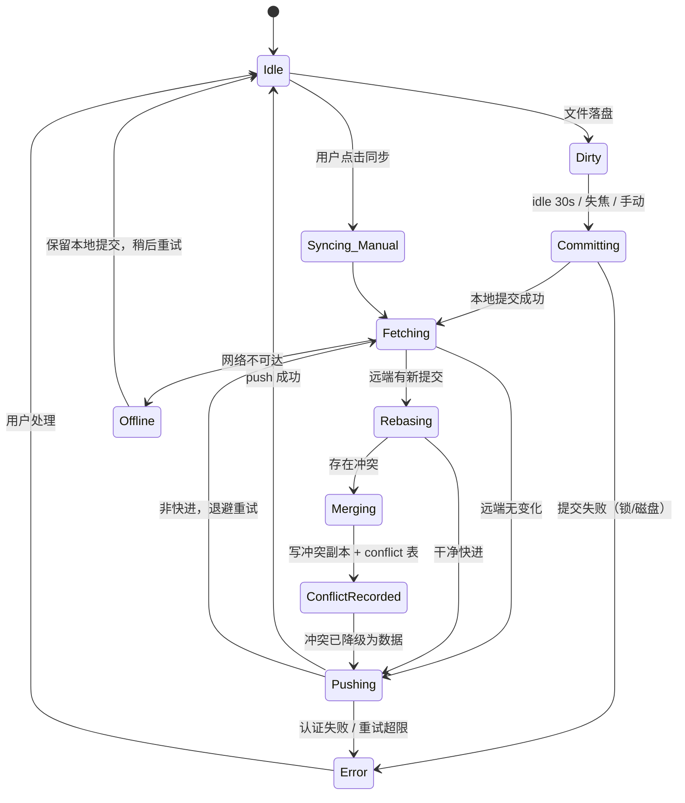
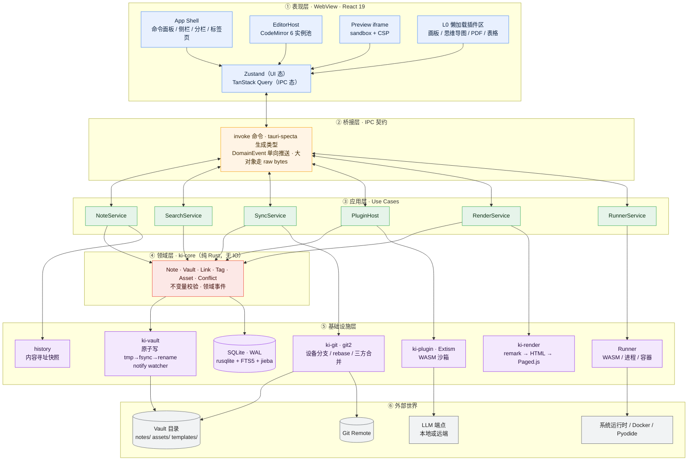

# 知屿 KnowIsle · 技术架构与选型决策文档

> **把知识，安放在自己的岛上。**
>
> 文档编号：KI-ARCH-001
> 状态：**Accepted（已冻结，变更需新增 ADR 并废弃本条）**
> 适用版本：v0.1 ~ v1.x
> 最后更新：2026-10-25

---

## 0. 阅读指南

本文不是"技术栈罗列"，而是一份**决策记录**。每一条选型都必须回答三个问题：

1. **在什么约束下做的这个决定？**（Context）
2. **我们选了什么，为什么是它而不是别的？**（Decision）
3. **这个决定的代价是什么，我们准备怎么还这笔债？**（Consequences）

没有代价的技术选型是幻觉。凡是本文写"坚决不选"的方案，都不是因为它差，而是因为**它与本项目的某条硬约束结构性冲突**——换句话说，在另一个项目里它可能是正确答案。

### 0.1 五条架构公理（不可协商）

这五条是后面所有 ADR 的推导前提。任何 PR 违反其中一条，直接打回，不需要讨论。

| # | 公理 | 推论 |
|---|------|------|
| **A1** | **磁盘上的 Markdown 是唯一真相源。** | 数据库是可随时删除重建的派生索引。任何"只存在 DB 里"的用户内容都是 Bug。 |
| **A2** | **核心逻辑不依赖 UI。** | `isle` CLI 与 GUI 共享同一个 `ki-core`。core 层代码里不允许出现 `tauri::` 字样。 |
| **A3** | **编辑态与渲染态是两条独立管线。** | 编辑用 CodeMirror，渲染用 remark/rehype，二者永不互相污染。 |
| **A4** | **启动关键路径上不允许出现任何插件代码。** | 冷启动只加载"打开一篇笔记"所需的最小闭包。 |
| **A5** | **所有写操作必须原子且可自愈。** | `tmp → fsync → rename`；崩溃后能靠日志与哈希校验回到一致状态。 |

> 这五条公理的解释：我们卖的不是功能，是**"你的知识不会因为我们的 Bug 而消失"**。这是本地优先产品的全部信誉所在。功能可以少，数据不能丢。

---

## 1. 技术选型对比与决策（ADR）

### ADR-001 · 桌面框架：Tauri 2.0

#### Context

需求里同时出现了三个互相拉扯的约束：

- **本地优先** → 大量文件 IO、全文索引、Git 操作，全部在本地完成，不能靠"转发给 Node 再说"。
- **多窗口同时编辑预览** → 每个窗口都是一份独立 WebView 实例，框架的边际内存成本被放大 N 倍。
- **内置一键运行代码** → 需要 spawn 子进程、限制资源、超时杀进程树、捕获 stdout/stderr 流。这是**操作系统级能力**，不是 Web 能力。

#### 对比

| 维度 | Tauri 2.0 | Electron 38 | 权重 |
|------|-----------|-------------|------|
| 安装包体积 | **8–15 MB** | 90–150 MB | 中 |
| 空载常驻内存（Win11） | **~90–140 MB** | ~180–300 MB | 高 |
| 多窗口边际成本 | 低（共享系统 WebView 进程池） | 高（每窗口 +60~90 MB） | **极高** |
| 文件 IO / 索引吞吐 | Rust 原生，SQLite 同进程，零序列化 | Node 侧，跨进程转发 | 高 |
| 进程管控能力（跑代码） | Rust：Job Object / rlimit / PTY / 进程树 kill / cgroup | Node `child_process`，权限模型薄弱，难以做资源限额 | **极高** |
| WebView 渲染一致性 | **碎片化**：WebView2 / WKWebView / WebKitGTK 三套内核 | 自带 Chromium，像素级一致 | 高（负分） |
| 调试与排错体验 | 较差（Rust ↔ JS 双层栈，WebView 差异） | 优秀（一套 DevTools 走天下） | 中 |
| 生态成熟度 | 中（插件数量少，但 2.0 后补齐了 updater/fs/sql 等刚需） | 极高 | 中 |
| 团队上手成本 | 陡（Rust + 生命周期 + 跨语言错误处理） | 平（纯 JS） | 中 |
| 长期维护风险 | 中（依赖各平台 WebView 演进） | 低（自控 Chromium） | 中 |

#### Decision

**选用 Tauri 2.0。Rust 作为唯一的核心运行时，前端只做视图。**

核心理由不是"包小"（那只是营销数字），而是这一条：

> **"一键运行代码"要求我们成为进程的所有者（process owner），而不是进程的调用者（caller）。**

Electron 里跑用户代码，你能拿到的是 `spawn()` 返回的一个 pid。想限制它只能用 256MB 内存？想让它 10 秒后连同所有子孙进程一起死？想给它一个干净的 PID namespace？在 Node 里你要么依赖第三方 native addon，要么放弃。而在 Rust 里，`tokio::process` + Windows Job Object / Unix `setrlimit` + `process_group(0)` + `killpg` 是标准库级别的能力，写出来不到 200 行，且**可以在 CI 里被单元测试覆盖**。

第二个理由：本地优先产品的性能天花板由**索引器**决定。10 万篇笔记的首次索引、增量重建、FTS5 写入，走 Rust + `rusqlite` 是纯内存操作；走 Electron 则要跨越 `renderer → main → native` 三跳，每跳一次结构化克隆。这不是优化问题，是架构问题。

#### Consequences（代价与偿还计划）

| 代价 | 缓解措施 |
|------|----------|
| **WebView 碎片化**：WebKitGTK 在 Linux 上对新 CSS 特性支持滞后 6–18 个月 | ① 明确支持矩阵：Windows 10 1809+ / macOS 12+ / Ubuntu 22.04+（WebKitGTK 4.1）。② CI 三平台跑 Playwright 视觉回归。③ 建立"基线特性白名单"，禁用 `:has()`、`subgrid`、`@container style()` 等非全平台特性，由 ESLint 插件静态拦截。 |
| Rust 开发效率低于 TS | 严格分层：Rust 只写"IO + 算法 + 状态机"，绝不写业务 UI 逻辑。领域层 `ki-core` 保持纯函数风格，测试覆盖率要求 ≥ 85%。 |
| 双语言调试成本 | 统一错误模型：Rust 侧 `KiError` 序列化为 tagged union，前端拿到 `code` 而非解析 message。所有跨语言调用在 `tauri-specta` 生成的类型约束下编译期校验。 |
| 插件生态贫瘠 | 不依赖 Tauri 官方插件做业务，只用作外壳（updater / single-instance / global-shortcut）。业务能力全部自建。 |

#### 坚决不选

- ❌ **Electron** —— 不是因为"它慢"，而是因为它的内存模型与"多窗口 + 常驻后台索引"直接冲突；且进程管控能力不足以支撑可信的代码执行沙箱。
- ❌ **Flutter Desktop** —— 自绘 UI 意味着整个 Markdown 渲染、文本选择、输入法（IME）组合、无障碍全部要重写。中文输入法在自绘引擎里是长期流血点。
- ❌ **纯 Web + PWA** —— 无法访问文件系统目录、无法跑代码、无法做真正的 Git。与"本地优先"根本矛盾。
- ❌ **Wails / Neutralino** —— 同类但生态与 2.0 之后的工程化程度（updater、移动端、权限模型）明显落后。

---

### ADR-002 · 前端框架：React 19

#### Context

一个反直觉的事实：**这个项目 70% 的前端复杂度不在"写 UI"，而在"托管别人的重型 UI"**。

画板、思维导图、电子表格、PDF 标注——这四个都是"轮子已经造好了，你只需要把它塞进来并且别让它把主程序搞崩"的典型场景。选框架的第一优先级不是"谁的运行时更快"，而是**"谁能让这些重型库以最小摩擦落地"**。

#### 对比

| 维度 | React 19 | Vue 3.5 | Svelte 5 |
|------|----------|---------|----------|
| 重型可视化库一等公民支持 | **Excalidraw / tldraw / xyflow(React Flow) / Univer(表格) 全部 React 原生** | 需社区 wrapper，版本滞后 | 需 wrapper 或 iframe 隔离 |
| 细粒度更新模型 | 需手动（编译器 + 状态外置） | Proxy 响应式，自动依赖收集 | 编译期信号，最优 |
| 首屏运行时体积（gzip） | ~45 KB | ~34 KB | ~10 KB |
| 与 CodeMirror 6 的集成范式 | 命令式桥接（`useRef` + `EditorView`），模式成熟稳定 | 成熟 | 成熟 |
| 大列表 / 虚拟滚动 | TanStack Virtual 一等 | 有 | 有 |
| 生态广度（a11y、dnd、图表、表单） | 最大 | 大 | 小 |
| 招聘 / 贡献者池 | 最大 | 大 | 小 |
| 长期演进风险 | 中（RSC 方向有分歧，但 SPA 路线稳定） | 低 | 中（团队规模小，Svelte 5 迁移刚完成） |

#### Decision

**选用 React 19 + TypeScript 5.x，SPA 模式（不使用 RSC / SSR）。**

决定性理由：**`Excalidraw`、`tldraw`、`xyflow`、`Univer` 这四个库，构成了我们"高级组件"需求的 80%。它们都是 React 原生实现，且内部深度依赖 React 的调度与 Portal 机制。** 在 Vue/Svelte 里用它们，你要么等社区 wrapper（滞后 6–12 个月，且遇到 bug 无人修），要么用 iframe 隔离（跨 iframe 的剪贴板、拖拽、焦点管理是地狱）。

而 React 的已知短板——"re-render 太多"——在我们这个场景里有一个**结构性解法**：

> **编辑器文档状态永不进入 React 状态树。**

CodeMirror 的 `EditorState` 是它自己的响应式系统，输入一个字符只触发它内部的 transaction，与 React 的调和完全无关。React 只负责"渲染编辑器外壳"（工具栏、状态栏、标签页），而这些组件的更新频率是**秒级**而非**毫秒级**。我们不需要 React 快，我们只需要它**别挡路**。

#### Consequences

| 代价 | 缓解措施 |
|------|----------|
| 默认 re-render 策略粗放 | ① 三条硬规则：编辑器内容不进 React；滚动/拖拽/光标位置用 `ref` + 订阅；跨组件高频通信走外部 store 的 `subscribe` 而非 context。② CI 引入 React DevTools Profiler 基线，PR 触发 render 次数回归检测。 |
| 包体积大于 Svelte | 路由级 + 插件级 code split；主 chunk 预算 350KB（gzip），CI 卡口。 |
| `useEffect` 心智负担 | 用 TanStack Query 接管所有异步 IPC（不再手写 `useEffect` 做数据获取），用 Zustand 接管全局状态，把 `useEffect` 的用途压缩到"DOM 副作用"一类。 |

#### 坚决不选

- ❌ **Vue 3** —— 语言本身更优雅，但在"重型第三方库托管"这个决定性维度上，我们要为每个库付一次适配成本。这不划算。
- ❌ **Svelte 5** —— 运行时最优雅、体积最小。但生态是硬伤：贡献者池小一个数量级，插件作者更可能写 React 版本。
- ❌ **Next.js / Nuxt / SvelteKit** —— 我们是桌面应用，没有服务端。引入 SSR 框架只为拿到路由和构建，代价是整条 RSC/边缘运行时的心智负担。**用 Vite + React Router（或 TanStack Router）即可。**
- ❌ **Web Components 作为主架构** —— 样式隔离很香，但状态管理与生态几乎为零，且与 CodeMirror 的命令式 API 配合别扭。仅用于**插件样式隔离**（见 2.4）。

---

### ADR-003 · 编辑器内核：CodeMirror 6

#### Context

这是全项目**最不可逆**的一个决定。编辑器内核决定了：Vim 模式能做到什么程度、10 万字文档能不能流畅、多窗口能不能开得起、Live Preview 能不能实现。

需求给出的三个关键词是：**Vim 支持、Markdown 性能、多窗口**。这三个词已经把答案锁死了，但我们仍然要论证一遍。

#### 对比

| 维度 | CodeMirror 6 | Monaco Editor | ProseMirror |
|------|--------------|---------------|-------------|
| 文档模型 | 平衡树（Text rope）+ 增量解析（Lezer） | 行数组 + 全文 tokenizer | Schema 化节点树 |
| 打开 10 万字 Markdown | **~80 ms** | ~400 ms | ~600 ms+（需全文 parse） |
| 单实例常驻内存 | **~6–10 MB** | ~60–120 MB | ~30 MB |
| 10 个实例同时存在 | 可行（~80 MB） | 不可行（~1 GB） | 勉强（~300 MB） |
| Vim 模式 | **`@replit/codemirror-vim` 一等支持**，与 CM6 事务模型深度整合 | `monaco-vim` 社区维护，长期滞后，与官方 API 打架 | `prosemirror-vim` 残缺，选择/撤销语义不匹配 |
| 源码即真相 | **天然**（缓冲区就是文本） | 天然 | **需 round-trip，有损** |
| 所见即所得 | 通过 Decoration / Widget 叠加实现（Live Preview） | 不适合 | 天生擅长 |
| 包体积（gzip） | **~200 KB**（按需引入语言包） | ~5 MB | ~350 KB |
| 可扩展性 | 极高（Extension 组合，函数式） | 中（API 面窄，改不动） | 高（但受 Schema 约束） |
| 多光标 / 折叠 / 搜索 | 内置 | 内置 | 需自行实现 |

#### Decision

**选用 CodeMirror 6 作为唯一的主编辑内核。ProseMirror 仅允许作为插件内部的局部编辑器，永不做主文档模型。**

三条理由，按重要性排序：

**① Markdown 的真相是纯文本，任何"解析成富文本树再序列化回来"的方案都会吃掉用户的东西。**

ProseMirror 的世界观是"文档是一棵有 Schema 的树"。这在富文本里是优点，在 Markdown 里是灾难：frontmatter、HTML 片段、非标准表格、`<details>` 折叠块、注释 `<!-- -->`、行内 LaTeX 边界、缩进敏感的嵌套列表——每一项都要在 Schema 里建模，每一项 round-trip 都可能丢字符或重排空白。

用户打开一篇 Markdown，看到的是他写的样子；保存后文件 diff 应该**只有他改的那几行**。这是本地优先产品的底线（Git 同步直接依赖它，见 3.5）。ProseMirror 做不到这个保证，CodeMirror 6 天然就是。

**② Vim 模式不是"加分项"，是"筛选器"。**

`@replit/codemirror-vim` 是把 Vim 的 keymap 编译成 CM6 的 Transaction 序列，因此 Vim 的 `dG`、`ci"`、宏录制、`.` 重复，都能和 CM6 的撤销栈、多光标、语法高亮正确协同。`monaco-vim` 是外部补丁，很多操作绕过了 Monaco 的编辑模型，导致撤销栈错乱——这是 Vim 用户第一个小时就会发现的问题。

**③ 多窗口是内存问题，而 Monaco 的单位内存成本高一个数量级。**

用户开 6 个窗口对比笔记是常见操作。CM6 每实例 ~8MB，6 个 = 48MB；Monaco 每实例 ~80MB，6 个 = 480MB，还没算 Chromium/WebView 本身。在"多窗口同时编辑预览"这条需求上，Monaco 直接出局。

#### 关键设计：Live Preview 的实现方式

我们不采用"源码模式 / 预览模式"二选一，而是**单缓冲区 + Decoration 叠加**：

```
EditorState.doc  ← 唯一真相（纯 Markdown 文本）
       │
       ├── Lezer Markdown 语法树（增量解析，viewport 优先）
       │
       └── Decoration 层：
             · 标题 → 字号/字重（ViewPlugin）
             · 图片/表格/公式 → Widget（替换渲染，光标进入时还原为源码）
             · 语法符号 → 淡化（cursor-line 内高亮，其余隐藏）
```

核心约束：**Decoration 永远是"视图层投影"，绝不回写文档**。这意味着无论 Live Preview 多花哨，`Ctrl+S` 写出去的一定是用户敲的那个纯文本。这条约束也是 A3 公理的落地形式。

#### Consequences

| 代价 | 缓解措施 |
|------|----------|
| 富文本能力需要自己搭 | 建立 `packages/editor` 内部 DSL：`defineBlockRenderer()` 统一注册 Widget，避免每个语法各写一套。表格编辑走"光标进入时切换为轻量 grid 编辑器"的局部方案。 |
| 大文档的 Decoration 计算可能卡顿 | 严格 viewport 优先：只对可视区 ±2000px 计算 Decoration；超过 500KB 的文档自动降级为"纯源码模式"并提示。 |
| 没有开箱的 Markdown LSP | 自建 `ki-lint`：基于 Lezer 树做规则检查（死链、重复标题、frontmatter schema 校验），跑在 Worker 里。 |

#### 坚决不选

- ❌ **Monaco** —— 它是"代码编辑器"，不是"知识库编辑器"。5MB 体积、每实例 80MB 内存、Vim 支持残缺，三个硬伤各自致命。
- ❌ **ProseMirror / Tiptap 作为主内核** —— 会让我们失去"纯文本真相"，进而破坏 Git 同步与用户信任。**Tiptap 允许作为某个插件的内部编辑器**（例如"可视化表格"或"卡片式大纲"），但不允许触碰 `.md` 文件。
- ❌ **Slate.js** —— 维护活跃度与稳定性不足，文档模型同样是富文本树，问题同 ProseMirror。
- ❌ **自研 contenteditable 编辑器** —— 这是一条用两年时间重新发现"为什么大家都用现成内核"的路。
- ❌ **Electron + VS Code 的 Monaco 复用（Theia 路线）** —— 见 ADR-001。

---

### ADR-004 · 本地存储：SQLite + rusqlite（无 ORM）

> **⚠️ 本 ADR 的检索部分与迁移方案已被下方 ADR-007 取代（M4 落地时实测推翻）。**
>
> 保留原文是为了让后来者看清**前提错在哪**：第 2 点「中文分词」的实现方案（`jieba-rs` 预分词 + `unicode61`）建立在「`unicode61` 按字切分中文」这个错误认知上；`refinery` 迁移也一并取消（索引库是派生数据，整库重建即可）。
>
> **仍然有效**：SQLite + `rusqlite`(bundled) + 手写 Repository、坚决不用 ORM、PRAGMA 基线、Consequences 里 `spawn_blocking` 与「UI 线程永不直连」的约束。

#### Context

数据库承担三个角色，性质完全不同：

1. **元数据索引**（标题、标签、时间、链接图）→ 关系型，需要 JOIN。
2. **全文检索**（中文分词！）→ FTS5。
3. **操作日志 / 历史版本索引** → 追加写，需要事务。

三者都在本地，单进程，单用户。这个场景下 ORM 的价值（屏蔽多数据库差异、团队协作规范、复杂关联加载）几乎全部不成立，而它的成本（编译摩擦、N+1、失控的 SQL、难以使用 SQLite 特有能力）全部成立。

#### 对比

| 方案 | 类型安全 | 迁移 | FTS5 / 自定义分词 | 构建摩擦 | 异步模型 | 结论 |
|------|----------|------|-------------------|----------|----------|------|
| **rusqlite + 手写 Repository**（~~refinery~~ 已按 ADR-007 取消） | 手写映射（编译期保证） | 索引库**整库重建**，无迁移 | **完全掌控** | **低**（bundled feature，零系统依赖） | 同步（配 `spawn_blocking`） | ✅ **选用** |
| Diesel | 编译期最强 | 需 `diesel_cli` | 需绕开 DSL 写裸 SQL | 高（宏重、编译慢、错误信息晦涩） | 同步 | ❌ |
| SeaORM | 运行期 + 部分编译期 | 内置 | 受限（难注册 tokenizer） | 中（被迫引入 tokio 全栈） | 异步 | ❌ |
| sqlx | 编译期（需 `DATABASE_URL` 或 `.sqlx` 离线缓存） | 需外部工具 | 受限 | **中高**（离线缓存极易与 schema 漂移，贡献者首跑必踩坑） | 异步 | ❌ |
| Prisma / Drizzle | 优秀 | 优秀 | 不支持 FTS5 自定义分词 | 极高（需要 Node 侧持有 DB） | — | ❌ 架构错位 |

#### Decision

**`rusqlite`（`bundled` feature）+ `refinery` 迁移 + 手写 Repository 层。**

关键考量是**中文全文检索**。FTS5 内置的 `unicode61` 分词器对中文是**按字切分**的——搜"知识库"会命中任何包含"知""识""库"三个字的文档，召回率 100%，准确率接近 0。这是国产知识库产品的头号体验杀手。

我们的方案是**双通道索引**（⚠️ 下方 DDL 已被 ADR-007 取代，保留原文以对照前提错在哪，**勿照抄**；现行 DDL 见 `crates/ki-store/src/schema.rs`）：

```sql
-- ⚠️ 已被 ADR-007 取代：unicode61 不按字切分中文，jieba 预分词做不了子串查询
-- 通道 A：原文 + unicode61（服务英文与代码标识符）
CREATE VIRTUAL TABLE note_fts USING fts5(
    title, body, tags,
    content='',                       -- 外部内容表，不重复存储
    tokenize='unicode61 remove_diacritics 2'
);

-- 通道 B：jieba 预分词后的影子列（服务中文）
-- body_tokens = "知识 库 本地 优先 架构 设计"
CREATE VIRTUAL TABLE note_fts_zh USING fts5(
    title_tokens, body_tokens,
    content='',
    tokenize='unicode61'
);
```

写入时用 `jieba-rs` 做一次分词（10 万字约 40ms，跑在索引线程池），查询时用同样的分词器处理 query，两条通道结果用 RRF（Reciprocal Rank Fusion）融合排序。

> ⚠️ **上一段的两个前提都不成立**（M4 实测）：① `unicode61` 把连续汉字合成**一个** token，不是按字切分，「召回率 100%、准确率 0」这个判断本身是错的；② 统计分词（jieba）切出来的词表**无法保证子串查询的召回**（查「知识库」而文档里是「知识库的设计」，词表里是「知识」「库」「设计」—— 词级 AND 直接漏掉）。现行方案是 **CJK bigram 预切分**，见 ADR-007。

> 为什么不用 FTS5 的 custom tokenizer 接口？因为那要求把 jieba 注册进 SQLite 的 C 层，跨平台编译（尤其 Windows MSVC + wasm 目标）麻烦，且无法在 WASM 版复用。预分词落库是"用存储换简单性"的经典权衡，代价是索引体积 +35%，完全可接受。

#### PRAGMA 基线（不可省略）

```sql
PRAGMA journal_mode = WAL;        -- 读写并发，崩溃安全
PRAGMA synchronous = NORMAL;      -- WAL 下足够安全，性能提升 3-5x
PRAGMA foreign_keys = ON;         -- 默认是 OFF，必须显式开
PRAGMA busy_timeout = 5000;       -- 避免索引线程与 UI 线程互锁
PRAGMA temp_store = MEMORY;
PRAGMA mmap_size = 268435456;     -- 256MB，加速大库顺序读
PRAGMA cache_size = -65536;       -- 64MB page cache
```

#### Consequences

| 代价 | 缓解措施 |
|------|----------|
| 手写映射样板代码 | 用 `#[derive(FromRow)]` 宏（自研 60 行）+ Repository trait 收敛；每个表只允许一个 Repository 拥有写权限。 |
| 无编译期 SQL 校验 | 单测里对每个 Repository 跑真实 SQLite（`tempfile` + 内存库），覆盖率 100%；CI 里跑 `EXPLAIN QUERY PLAN` 断言无 `SCAN TABLE`（除 FTS）。 |
| 同步 API 阻塞 async 运行时 | 所有 DB 调用走 `tokio::task::spawn_blocking`，且使用独立连接池（`r2d2_sqlite`），UI 线程永不直连。 |

#### 坚决不选

- ❌ **任何 ORM** —— 我们的表只有约 15 张，但需要 ATTACH、partial index、FTS5、触发器、自定义排序规则。ORM 在这里是纯负资产。
- ❌ **JSON 文件存元数据** —— 10k 笔记的元数据 JSON 约 30MB，每次启动全量 parse 要 400ms+，且无法做增量更新。SQLite 就是"结构化的 JSON"，没有理由不用。
- ❌ **IndexedDB / localStorage 作为主存储** —— 数据在 WebView 的 profile 目录里，用户备份、迁移、跨设备同步全部失控。违反 A1。
- ❌ **LMDB / RocksDB / sled** —— 键值存储做不了"按标签 + 时间 + 全文"的复合查询，最终还是要建倒排索引，等于重写 SQLite。

---

### ADR-005 · 前端状态管理：Zustand + TanStack Query

#### Context

前端的"状态"其实是五种完全不同的东西，混在一起管理是绝大多数编辑器项目后期失控的根源：

| 状态类型 | 例子 | 更新频率 | 归属 |
|----------|------|----------|------|
| 文档状态 | 当前笔记的文本、选区、撤销栈 | 每次击键 | **CodeMirror `EditorState`** |
| 服务端态 | 笔记列表、标签树、搜索结果 | 秒级 | TanStack Query |
| 全局 UI 态 | 侧栏展开、当前 tab、命令面板开关 | 秒级 | Zustand |
| 瞬态交互态 | 拖拽位置、滚动偏移、鼠标坐标 | 每帧 | `ref` + 直接 DOM 操作 |
| 跨窗口态 | 窗口布局、焦点笔记 | 事件驱动 | Tauri event + 持久化 |

#### Decision

**分层治理，绝不合并成一个 store。**

```ts
// 1. 文档态：不进 React
const view = new EditorView({ state: EditorState.create({ doc, extensions }) });
// React 只持有 ref，永不 setState

// 2. 服务端态：TanStack Query
const { data: notes } = useQuery({
  queryKey: ['notes', folderId],
  queryFn: () => invoke('note::list', { folderId }),
  staleTime: 30_000,
});

// 3. 全局 UI 态：Zustand + slice 切分
export const useUIStore = create<UIState>()(
  subscribeWithSelector((set) => ({ /* ... */ }))
);

// 4. 高频瞬态：ref + 订阅，零 re-render
useEffect(() => view.scrollDOM.addEventListener('scroll', onScroll, { passive: true }), []);
```

**关键设计：core → UI 的单向事件流。** Rust 侧任何状态变更（文件被外部修改、索引完成、Git 同步进度）通过 `emit` 推送，前端在 `main.tsx` 里统一订阅，路由到 Query 的 `invalidateQueries` 或 Zustand 的 action。**前端不做轮询。**

> **实施状态（2026-10-26）：MVP 未接入 Zustand 与 TanStack Query。**
> `apps/desktop/package.json` 里这两个包都不存在，当前实现是 `useState` + `useRef`
> （`App.tsx` 1614 行 / 28 处 `useState`），服务端态由每次调用直接 `invoke` +
> 手动 `setState` 承载，没有缓存、失效与重试。
>
> 上面那张表的分层判断**仍然成立**：文档态确实只在 CM6 的 `EditorState` 里，
> 从没进过 React state——这是本 ADR 最重要的一条，也是唯一被完整执行的一条。
> 缺的是「服务端态」与「全局 UI 态」这两层的库。
>
> **接入触发条件**（满足任一条）：
> 1. 同一个查询被三处以上组件各自拉一遍（TanStack Query 的收益起点是**去重**，
>    不是"用上库"）；或
> 2. 跨域共享的 UI 态超过三个域——当前恰好是三个（回收站 / 搜索 / 侧栏，见 B-35）。
>    到第四个域时先拆 hook（B-35），拆完仍需要跨组件订阅才引入 Zustand。
>
> **为什么现在不接**：一个 1614 行的单组件树用不上缓存失效与乐观更新，
> 引入两个库只会把「状态在哪」这个问题从一处变成三处。ADR 写的是**目标形态**，
> 它需要一条明确的接入条件，而不是一个默认已完成的假象。

#### 坚决不选

- ❌ **Redux Toolkit** —— 样板代码与"服务端态"的缺失，让我们要手写缓存、失效、重试。2026 年了，不该再手写这些。
- ❌ **MobX** —— 隐式依赖追踪在**多人插件**场景下不可控：插件的 observable 会意外触发宿主的 reaction，且难以在错误边界里回滚。
- ❌ **Jotai / Recoil** —— 原子化在表单场景很美，在文档级应用里会退化成"一张全局变量表 + 隐式依赖图"，调试成本高于收益。
- ❌ **Context 传递高频状态** —— Context 变更会让整棵子树重渲染，这是 React 性能事故的第一大来源。
- ❌ **把编辑器内容放进任何 React store** —— 违反则直接导致每次击键全树重渲染。这是 Code Review 的红线。

---

### ADR-006 · 样式与主题：Tailwind CSS v4 + 三层 Design Token

#### Context

"主题自定义"这条需求，本质要求是：**在不重新编译、不重启的前提下，让整个应用（包括第三方插件）换一套视觉。**

这排除了所有"编译期固化颜色"的方案。

#### 对比

| 方案 | 运行时换肤 | 与插件隔离 | 体积/性能 | 开发效率 | 结论 |
|------|-----------|-----------|-----------|----------|------|
| **Tailwind v4 + CSS Variables** | ✅ 改 `:root` 变量即可 | ✅ Shadow DOM 内注入 token 副本 | 优秀（原子类，purge 后极小） | 高 | ✅ **选用** |
| CSS-in-JS（Emotion / styled-components） | ✅ | ⚠️ 与 Shadow DOM 冲突 | 差（运行时样式计算，每 keystroke 生成类名） | 中 | ❌ |
| SCSS + 变量 | ❌ 编译期固化 | — | 优秀 | 中 | ❌ |
| UnoCSS | ✅ | ✅ | 优秀 | 高（但预设生态小于 Tailwind） | ⚠️ 备选 |
| 纯 CSS Modules | ✅（变量） | ✅ | 优秀 | 中 | ⚠️ 可与 Tailwind 并用 |

#### Decision

**Tailwind CSS v4（CSS-first 配置）+ 三层 Design Token 体系。**

```css
/* L1 · Primitive：物理色板，永不被组件直接引用 */
:root {
  --ki-blue-500: oklch(0.62 0.19 254);
  --ki-slate-900: oklch(0.21 0.02 258);
}

/* L2 · Semantic：语义层，主题只覆写这一层 */
:root, [data-theme="light"] {
  --ki-bg-canvas: var(--ki-slate-50);
  --ki-bg-surface: #fff;
  --ki-text-primary: var(--ki-slate-900);
  --ki-text-muted: var(--ki-slate-500);
  --ki-border-subtle: oklch(0.92 0.005 258);
  --ki-accent: var(--ki-blue-500);
}

[data-theme="dark"] {
  --ki-bg-canvas: oklch(0.18 0.015 258);
  --ki-bg-surface: oklch(0.22 0.015 258);
  --ki-text-primary: oklch(0.95 0.005 258);
  --ki-text-muted: oklch(0.66 0.01 258);
}

/* L3 · Component：组件级微调，允许主题精细控制 */
:root {
  --ki-editor-cursor: var(--ki-accent);
  --ki-editor-selection: oklch(0.62 0.19 254 / 0.18);
  --ki-sidebar-item-active-bg: oklch(0.62 0.19 254 / 0.10);
}
```

Tailwind v4 的 `@theme` 直接映射到 CSS 变量，因此：

```html
<div class="bg-[var(--ki-bg-surface)] text-[var(--ki-text-primary)]">
```

**主题 = 一份 JSON，只覆写 L2/L3。**

```ts
export interface ThemeDefinition {
  id: string;                       // "ki.solarized-dark"
  name: string;                     // "Solarized Dark"
  base: 'light' | 'dark';           // 决定原生控件（滚动条、菜单）的明暗
  tokens: Partial<Record<`--ki-${string}`, string>>;
  syntax?: Record<string, string>;  // CodeMirror 高亮色
}
```

应用主题 = 注入一个 `<style id="ki-theme">` + 设置 `data-theme` 属性。**零重载，零重编译。**

> **实施状态（2026-10-26）：token 体系已落地，Tailwind 未接入。**
> 当前样式是 `apps/desktop/src/index.css`（1660 行手写 CSS），三层结构与本节
> 逐层对应：L1 `--ki-slate-*`（物理色板）、L2 `--ki-bg-*` / `--ki-text-*` /
> `--ki-accent`（语义层，主题只覆写这一层）、L3 `--ki-editor-*` /
> `--ki-sidebar-*`（组件级）。暗色主题就是 `[data-theme='dark']` 覆写 L2 一次，
> 组件规则零改动——本节承诺的「运行时换肤」已经兑现。
>
> 没有的只有 Tailwind 那一层（`package.json` 里没有 `tailwindcss`，
> `index.css` 里没有 `@theme`）。
>
> **接入触发条件**（满足任一条）：
> 1. 新增一个**有设计稿的新界面**——那时本来就要写新样式，顺手用原子类不是返工；
> 2. `index.css` 超过 2500 行，且新增规则开始大量重复现有的组合
>    （那时缺的是抽象；先抽 `@layer components`，Tailwind 是可选解不是唯一解）。
>
> **为什么现在不接**：接入意味着把 1660 行 CSS 与 12 个 `.tsx` 里的每一处
> className 都改一遍（共 24 个源文件）。这是**纯机械替换，不产生任何用户可见
> 价值**，却要重跑全部 GUI 验收。ADR 写的是选型，不是排期；差异在这里说清楚，
> 比在 README 里假装已经用了要诚实。

**插件样式隔离**：插件渲染在 Shadow DOM 内，宿主在 `shadowRoot` 上注入一份 token 的 CSS 变量副本。插件用 `var(--ki-*)` 就自动跟随主题；想绕过则自己写死颜色（后果自负）。这比 `iframe` 轻，比 `scoped CSS` 强。

#### 坚决不选

- ❌ **CSS-in-JS** —— 运行时样式计算在"多窗口 × 多编辑器实例 × 每次击键"的组合下是灾难；且与 CodeMirror 直接操作 DOM 的生命周期冲突。
- ❌ **SCSS 变量做主题** —— 编译期固化，无法运行时切换。SCSS 可以用于**构建期的 mixin 复用**，但不承担主题职责。
- ❌ **Ant Design / MUI 作为主 UI 库** —— 它们的样式体系自带强主张（主题变量、组件结构），与"深度自定义 + 插件生态"冲突。改用 **Radix UI（headless）+ 自研样式**，只借无障碍与交互逻辑。
- ❌ **`styled-jsx` / Vue SFC scoped 思路** —— 与 React 生态和 Shadow DOM 都不合。

---

### ADR-007 · 检索：FTS5 双通道 + bigram，不用 jieba（取代 ADR-004 的检索部分）

> **状态**：v0.3（M4）已实施。ADR-004 的「本地存储」结论仍然有效，
> 但其中**检索方案那一段（双通道 + jieba）已被本 ADR 取代**，
> 且它陈述的一个技术前提是错的。改检索之前先读这里。

#### Context：ADR-004 写错了一个前提

ADR-004 里这句话是**错的**：

> FTS5 内置的 `unicode61` 分词器对中文是**按字切分**的——搜"知识库"会命中
> 任何包含"知""识""库"三个字的文档。

实测（SQLite 3.46 / 3.53 均一致）：

```sql
-- 插入 "知识库的设计"
SELECT count(*) FROM t WHERE t MATCH '知识库';   -- 0
SELECT count(*) FROM t WHERE t MATCH '知识库的设计'; -- 1
```

`unicode61` **不按字切分**，它把一段**连续汉字合成一个 token**。
`知识库的设计` 整体是一个 token，所以查 `知识库`（精确）命中不了，
查 `库` 也命中不了（除非那个「库」在原文里被空格或标点隔开）。

这推翻的不是"要做双通道"这个结论，而是**做双通道的理由**：

- ❌ 错理由：「unicode61 按字切，召回 100% 准确率 0」
- ✅ 对理由：**token 级匹配做不了 CJK 子串匹配**。任何以词/token 为单位的
  索引（unicode61、jieba、trigram 之外的一切）都要求查询与文档在同一个
  切分粒度上对齐；而用户搜的是子串，子串天然不对齐。

顺带修正另一条：`Rust的所有权` 在 `unicode61` 下也是**一个** token。
所以查 `rust`（精确）不中、`rust*`（前缀）中——但 `本地优先Rust` 这种
「ASCII 在汉字后面」的写法连前缀都不行。这是通道 A 必须做 **ASCII 投影**
（把非 ASCII 抹成空格）的原因。

#### Decision

三层分工，每层只做一件事：

```
plan(query)  ──> 通道 A（ASCII 投影，词首前缀）   ┐
                通道 B（CJK bigram，AND）        ├─> RRF ─> 候选池 ─> NoteLocator ─> 命中行
                文件名通道（字面子串）            ┘
```

1. **索引层只选候选，不做判定。** 行号、UTF-16 列号、摘要窗口全部由
   `ki_vault::NoteLocator` 的字面子串扫描产出。这条分工是整次换芯的支点：
   18 条既有行为契约自动继续成立（它们是同一份代码在跑），检索精度与旧引擎
   完全相同，差异只可能来自候选集。
2. **通道 B 用 bigram，不用 jieba。** 见下。
3. **两张 FTS 表都是 `content=''`**（contentless）：索引里**不存正文副本**
   （公理 A1：磁盘才是唯一真相源）。

#### 为什么是 bigram 而不是 jieba

索引层的任务只有一条：**不能漏候选**。bigram 恰好能给出这条保证，
而且可以证明：

> 若 `Q ⊆ T`（Q 是 T 的连续子串）且 Q 含 ≥2 个汉字，
> 则 Q 的 bigram 多重集 ⊆ T 的 bigram 多重集。

证明是一行：Q 里每个 bigram 都是 T 里同一个位置的 bigram。多重集而非集合，
是因为 `哈哈` 在 T 里出现一次、在 Q 里出现两次时需要能"用两次"；
而 FTS5 的 `AND` 只查有没有，比多重集更宽松，所以这条保证只会更强。

实测：300 篇随机混排文档 + **2971 组**「Q 是 T 的连续子串且含 ≥2 汉字」的
随机查询，**漏召回 0 组**。

jieba 给不出任何保证：查询切出来的词与文档切出来的词依赖上下文，
`知识库` 在一处成词、在另一处被切成 `知识` + `库`，于是「明明有这句话却搜不到」。
它换来的是更好的相关性排序——但排序在我们这里是 RRF 与定位器的事，
不该拿召回率去换。附带省掉：14MB 内嵌词典、`Jieba::new()` 的启动成本、
query/doc 分词不一致这一类 bug。

**切分规则**（`crates/ki-search/src/bigram.rs`）：

| 文本 | 通道 B |
|---|---|
| `知识库` | `知识 识库` |
| `Rust的所有权` | `的所 所有 有权 t的` |
| `知识库Rust` | `知识 识库 库R` |
| `的` / `🙂🙂` / `foo_bar` | 空 |

- 字符分三类：`Cjk`（Han 各区块 + 假名 + 谚文 + 注音，**不含** CJK 标点与全角形式）、
  `Word`（`is_alphanumeric() && !is_cjk`，含全角字母数字，**不含** `_`/`-`/emoji）、
  `Other`（分隔）。
- 每个 `Cjk` run 发全部重叠 bigram；**跨脚本边界**另发 `prev+run[0]` /
  `run[last]+next`（`知识库Rust` 里 `库R` 是唯一的跨脚本线索，不发就漏召回）。
- `Word` run 本身不进通道 B（通道 A 负责）。token 用单空格连接，**保留重复**
  （bm25 需要词频）。

#### 为什么是 contentless，以及摘要从哪来

`content=''` 的 FTS5 表默认**不支持 DELETE**（报
`cannot DELETE from contentless fts5 table`），必须带 `contentless_delete=1`
（SQLite ≥ 3.43）。它与 `columnsize=0` **互斥**，一起写建表直接报错。

contentless 不存原文，因此 `snippet()` / `highlight()` 不可用——**我们本来也不需要**：
摘要由定位器从磁盘上的正文算出来，那才是唯一真相源。这顺带解决了文档里
`content=''` 与 `snippet()` 的既有冲突。

#### 为什么不用 refinery

索引库整库可重建（10k 篇的库，SQL 侧只要 0.5 秒；剩下的时间全是逐篇读盘，见下）。迁移是给「删了就没了」的数据用的；
对可重建的库，迁移只会留下一串立刻会被丢弃的迁移文件，并引入一条
「迁移写错了但没人发现」的新故障路径。

**处置**：任何可疑状态（`quick_check` 不过、schema 版本不符、分词版本不符、
`vault_root` 不符、三张表行数不一致）一律**整库重建**。

**偿还触发条件**：第一张存不可重建数据的表（历史版本、链接元数据）落地时，
同时引入 refinery 与从 v1 起的基线迁移——那时重建不再是无损操作。

#### RRF 参数

`score(d) = Σ 1/(k + rank_i(d))`，**k = 60，权重全 1.0**，每通道 top-200，
候选池 400。文件名通道的候选**全部进池**（`name_hit` 是排序契约第一键，
被截断挤掉会让「按文件名搜」直接失效）。

不做通道加权：A/B 互斥，N 的重要性由第一排序键保证，加权只增加解释成本。

**但 RRF 目前只决定「谁进池」，不决定最终顺序。** 命中行的顺序仍是
`name_hit desc → path asc → line asc`，与旧引擎逐字一致——否则前端列表顺序
会变，而那是没有契约支撑的行为变更。**相关性排序（让最相关的笔记靠前）
仍然没有做**，它需要新的排序契约与前端文案。

#### 已知收窄与偿还计划

| 收窄 | 表现 | 偿还 |
|---|---|---|
| **ASCII 词中子串不保证** | `us` 搜不到正文里的 `Rust`（词首前缀 `ru`/`rus`/`rust` 可以） | 加 FTS5 `trigram` 第三通道，代价是索引体积。用例 `known_divergence_ascii_infix_is_documented` 钉住了当前行为，修好它会变红 |
| **单字 / 纯 emoji 查询走全扫** | 没有 bigram 也没有 ASCII 词，索引里查不到，只能逐篇字面扫描 | 全扫要读全库（旧引擎是内存里过一遍）。10k 库上明显更慢。可考虑给 CJK 单字加一路 unigram 通道，代价是索引翻倍 |
| **`total` 可能是下界** | 候选池饱和时 `total` 只统计池内命中 | `truncated` 为真，UI 说「至少 N 条」 |
| **`size + mtime` 漏检同秒改动** | 同一毫秒内改动且字节数不变 → 判成未变 | 当前编辑篇走 `refresh`（每次搜索前重读），其余靠重新扫描；记在 BACKLOG |

#### 10k 库的成本结构（实测，release 构建）

先把结论放前面：**索引结构不是瓶颈，逐篇读盘才是；而「逐篇读盘」的成本又分
两半——路径闸（M6 第 ① 步已砍掉）与 `CreateFileW` 本身（砍不掉）。**

##### 三个时点

夹具 10,000 篇 / 2.52 MB 正文 / 50 个父目录 / Windows / `%TEMP%`。判据是
`sync_after_scan` 的墙钟时间，median of 5。基准住在版本库里：
`crates/ki-ipc/tests/index_bench.rs`（`#[ignore]`，跑法见文件头）。

| 时点 | 热（文件已在缓存里） | 冷（刚写完夹具） | 相对基线 |
|---|---|---|---|
| M4（`6392772`，另一份夹具） | 15.7 s | 100.9 s | 历史参考，**不可直接比** |
| M6 基线（2026-10-26，本刀改动前重测） | **18.4 s** | 111.9 s | 1.00× |
| M6 第 ① 步之后 | **9.9 s** | 97.9 s | **1.86×** |

**不要拿 M4 的 15.7 s 当今天的基线**：同一台机器、同一份夹具，改动前重测是
18.4 s（差 17%，来自机器状态与杀软缓存）。性能断言必须带「哪天、哪台机、
什么夹具」，否则下一个优化者会拿一个不存在的前提做决策——本 ADR 初版的
「10k 篇约 5 秒」就是这么来的。

##### 钱花在哪（分项实测，µs/篇）

`per_file_cost_breakdown` 在同一份夹具上逐项计时：

| 项 | 耗时 | 说明 |
|---|---|---|
| `File::open`（只开不读） | **619** | `CreateFileW` 的单价 |
| `fs::metadata`（path stat） | **147** | 同一量级的固定成本 |
| `File::open + fstat` | 625 | `fstat` 只加 6 µs —— 它不碰路径 |
| `File::open + read_to_end` | 695 | 读 252 字节本身只要 70 µs |
| `symlink_metadata`（最终组件的软链检查） | 147 | 第一道闸的最后一跳，必须留 |
| `project + token_stream` | **5.2** | 分词可以忽略不计 |

本刀没动的三项沿用 M4 的分表实测：`scan_vault` **30 ms**、SQL 写入
（note + 两张 FTS 表）**470 ms**、无变化的增量同步 **6 ms**。本刀基准里
scan 实测 31–50 ms，与它一致——扫描与 SQL 都不是瓶颈。

三个对照实验定死了这些数字的性质：

| 对照 | 结果 | 读法 |
|---|---|---|
| 同一个文件 open 10k 次 | **301 µs/次** | 路径解析/目录查找占一半 |
| 同一个文件 stat 10k 次 | 141 µs/次 | 换不换文件几乎无差 → **固定成本** |
| 4 / 8 / 16 线程并行 open | 2427 / 2259 / 2154 ms | 2.9× 封顶，8→16 已饱和 |

**`CreateFileW` 在这台机器上是 300–600 µs 一次**（杀软实时保护 + 文件系统
过滤驱动），10k 篇光 open 就要 6.2 s。所以「10k 篇 ≤3 s」**在物理上不成立**，
与我们的代码无关。并行能把 open 压到 2.15 s，但加上必须的 stat、read 与
SQL 写入，最好也是 5.4 s——仍然到不了 5×，而它要引入线程池、在途内存上限
与新的错误传播路径。**本刀不做，也不该做**：它属于第 ② 步之后的独立决策。

##### 本刀砍掉了什么

`read_note` 每篇原本做：2 次 `dunce::canonicalize`（库根、目标）+ 3–5 次
`symlink_metadata` + 1 次 `metadata` + 1 次 open。`ResolvedVault` 之后变成：
**1 次 `symlink_metadata`（最终组件）+ 1 次 open + 1 次 `fstat`**。

| 环节 | 改动前 | 改动后 |
|---|---|---|
| 库根 canonicalize | 10,000 次 | **1 次** |
| 父目录链 canonicalize | 10,000 次 | **50 次**（去重后的父目录数） |
| 父目录链 symlink_metadata | ~20,000 次 | **100 次** |
| 最终组件 symlink_metadata | 10,000 次 | 10,000 次（必须留） |
| 目标 canonicalize | 10,000 次 | **0 次**（论证见下） |
| `metadata`（判类型/大小） | 10,000 次 | **0 次**（合并进 open 的 `fstat`） |

「路径闸」这一项从约 1.14 ms/篇降到 0.154 ms/篇（**7.4×**），但整体只快
1.86×——因为 619 µs 的 open 与本刀无关，而它才是大头。

##### 为什么可以省掉目标那一次 canonicalize

旧的第二道闸是 `canonicalize(root.join(rel)).starts_with(canonical_root)`，
实质是「穿透所有链接之后，真实落点仍在库内」。而**第一道闸已经确认路径上
没有重解析点**，在这个前提下 `canonicalize(parent.join(name))` 恒等于
`canonicalize(parent).join(name)`：父目录那一段已经规范化过，最后一段是普通
文件名（不含分隔符、不是 `.`/`..`、不是链接）。所以「父目录 canonical +
文件名」与「目标整体 canonical」是同一个结果。

代价两条，都记在这里：

1. **第二道闸在日常路径上永不触发。** 它退化成纯纵深防御，唯一的回归保护
   是 `path.rs` 的注入用例 `resolve_rejects_a_cached_parent_outside_the_root`。
   造不出真实场景：能骗过 `is_symlink()` 的重解析点（Windows 卷挂载点、
   Unix bind mount）都要管理员权限，CI 与开发机都建不出来。
2. **第一道闸看不见的重解析点不再被第二道闸兜住。** 判定可接受：挂载点必须
   落在目录上，`read_note` 随后以 `NotAFile` 拒绝目录；其余读路径拿到的路径
   仍在库内，只是落点可能跨了卷。

##### 仍然阻塞首屏，本刀没有解决

同步挂在 `vault_scan` 后面，所以树要等索引建完才出来：10k 库的首次打开是
「转圈 9.9 秒（缓存热）到 97.9 秒（缓存冷）」。本刀让这个数变小了，但**顺序
没变**——第 ① 步不解决阻塞。改成「先出树、索引后台跑」需要新的可见性契约
（搜索时索引可能还没建完），那是 B-27 的第 ② 步。

**它是一次性的**：之后每次启动只跑无变化的增量同步（6 ms），热启动
（含 Tauri + WebView2 初始化）实测 7.8 s。

#### Consequences

| 代价 | 缓解 |
|---|---|
| 索引体积（每字约 2 个 bigram token） | 只索引 CJK bigram，ASCII 走投影；超预算再考虑去重（会损失词频）。实测 10k 篇 / 2.0 MiB 正文 → 索引库 1.6 MiB |
| 首次建库要读全部正文，且阻塞首屏 | 每 256 篇一个事务；建库期间搜索会排队（`busy_timeout=5000`）。真正的解在 B-27（per-file 路径闸）与「后台索引」 |
| 全扫路径要读全库 | 单字/emoji 查询本来就少见；`plan` 把它们明确分流。实测 10k 库单字查询 14 s |
| 两套引擎共存 | 旧引擎保留一个 release 作回滚路径与对拍参照，之后清理 |

#### 坚决不选

- ❌ **jieba / 任何统计分词** —— 见上，召回率不能拿来换排序。
- ❌ **FTS5 `trigram`** —— 它能做子串匹配，但索引体积约为原文 3 倍，
  而 bigram 已经给出了可证明的召回保证。留作 ASCII 词中子串的偿还方案。
- ❌ **把正文存进 FTS 表** —— 违反 A1，且会把索引库撑到与 Vault 同量级。
- ❌ **在索引库里存行号/摘要** —— 它们必须由磁盘上的当前版本算出来，
  否则会与用户看到的正文不一致。

---

### ADR-008 · 回收站：清单只描述「位置」，不描述「内容」

> **状态**：v0.2（M5 三刀）已实施。删除的语义从「移进一个目录，剩下的自己去翻」
> 升级成「可列、可恢复、可清空、可分页」。改回收站之前先读这里。

#### Context：删除是半成品，而它缺的正好是「回哪儿」

M2 的 `delete_note` 把文件 `rename` 进 `.knowisle/trash/<unix_ms>-<原名>`。
文件确实还在，但**原目录丢了**：`a/b/c.md` 与 `x/c.md` 删掉之后长得一模一样，
应用里也没有列表、没有恢复、没有清空。代码注释自己写着「这不是回收站」。

local-first 的第一条信任是「我的东西不会消失」。误删找不回是发版后第一周
就会被骂的洞——而且它比崩溃丢字更容易触发：崩溃要断电，误删只要手滑。

三个约束把方案夹在中间：

1. **A5**：所有写操作必须 `tmp → fsync → rename`；
2. **追加式**：一次删除写一条，不要每次重写整份；
3. **不动 `.knowisle/trash` 的目录布局**（扫描器已忽略它，用户也会去翻）。

#### 决策 1：否决「把原路径编码进文件名」

最省事的方案是不引入任何新文件：把路径转义进文件名，
`1699-a%2Fb%2Fc.md`，读的时候再解回来。**否决**，四条理由按硬度排序：

1. **255 字节上限**。`a/b/c.md` 编码后更长（中文一个字 3 字节，转义再翻倍），
   深路径直接落不了盘。而"落不了盘"的唯一降级是截断——截断就是静默丢路径，
   正好是这一刀要消灭的东西。
2. **文件名不是字符串**。它要过 Windows 保留名（`CON` / `PRN`）、大小写折叠、
   尾部点与空格。路径里任何一段都可能是这些，编码之后语义全丢，而且**不报错**。
3. **文件名是给人看的**。用户打开 `.knowisle/trash/` 时，`1699-a%2Fb%2Fc.md`
   完全不可读，而「一眼认出这是哪篇」是 M2 就定下的目标。
4. **规则一升级就要迁移**。转义表、分隔符、编码版本，任何一个变了，旧文件名
   就得分版本解析——这是给一个字符串引入 schema 迁移，而它本来只需要存一个字段。

#### 决策 2：清单是一条一个文件，不是一份 JSONL

约束 1 与约束 2 在**一个文件**上互斥：`tmp → rename` 只能整体替换，
`O_APPEND` 做不到原子替换。于是把「追加」下沉到目录层：

```
.knowisle/trash/                      # 不变：平铺，只躺被删的文件
.knowisle/trash-manifest/             # 新增：一条删除一个文件
└── 1699-a.md.json                    # {"origin":"a/b/c.md","deletedAt":1699}
```

新增一条 = 新增一个文件（走 `write::atomic_replace`，与正文写入同一条
`tmp → fsync → rename`），从不重写已有记录。四个好处都不是附赠的：

1. **单条损坏只损失一条**。单文件 JSON 里一个坏字节会让整份清单读不出来，
   所有原路径一起消失；而这里坏掉的那条只是退化成「原路径未知」。
2. **O(1) 删除**。不需要「读全量 → 改 → 写全量」，也就没有"写到一半把别人的
   记录一起写丢"的窗口。
3. **读侧天然自愈**：孤儿记录（文件已经不在回收目录里）在列表时被忽略，
   不需要任何清理任务。
4. **不需要锁**。并发删除各写各的文件；单文件方案要么加锁，要么丢记录。

**为什么是 `trash` 的兄弟目录而不是 `trash/manifest/`**：回收目录的布局是
约束 3。往里塞子目录会让 `ls` 的结果混进一个不是笔记的东西、让所有"回收目录
里有几个文件"的判断多一个例外、也会让用户以为那个目录是他自己删的。

代价是 1000 条删除会有 1000 个小文件。**写**侧这个代价是真的：一次删除写一个
小文件，而它每天最多发生几次。**读**侧不是——「枚举 + 逐条读清单」在 10k 条
上是 **7.24 秒**（见「分页：排序键为什么是文件名」），所以列表是分页的。
这一段原来写的是「读 1000 个小文件在本机是毫秒级」，被 release 实测推翻了。

#### 决策 3：真相源的分工——它为什么不违反 A1

```
回收目录里有没有那个文件  =  它还在不在        ← 真相源（A1）
清单里有没有那条记录      =  知不知道它原来在哪  ← 可降级的描述
```

于是顺序被钉死：

- **删除**：先搬文件 → 后写清单。崩溃只丢"它原来在哪"，文件仍在回收目录里。
- **恢复**：先搬文件 → 后删清单。崩溃只留一条孤儿记录，下次列表时被忽略。

反过来的顺序（先写清单）会在崩溃时留下「清单说有、文件没有」的悬空条目——
列表里多一个点开就报错的假记录。宁可少一条元数据，也不要多一条假条目。

**这不违反 A1**：清单里只有 `origin` + `deletedAt`，**没有正文副本**。
丢了它，文件仍在磁盘上，仍然能恢复到库根目录。它描述的是位置，不是内容；
正文的真相始终在 Markdown 里。同理，它也不是「索引库」——索引可整库重建，
而清单丢了就真的回不到原目录，所以它不能放进 `index.sqlite`（那会跟着一起被
`quick_check` 失败后的重建清掉）。

> 1.7 表里「❌ JSON 文件元数据」那条否的是**用 JSON 当主存储**，不是"任何
> JSON 都不许写"。这条界线写在这里，免得后来者拿那张表当反例。

#### 降级矩阵

| 磁盘状态 | 列表 | 恢复 |
|---|---|---|
| 正常 | 原名 + 原路径 | 回原目录 |
| 记录缺失 | 原名 + 「原路径未知」 | 落库根目录，`fallback = recordMissing` |
| 记录损坏 / 被改成越界路径 | 原名 + 「原路径未知」 | 落库根目录，`fallback = recordCorrupt` |
| 原目录已被外部删除 | 原名 + 原路径（仍显示） | 落库根目录，`fallback = originGone`，**不代建目录** |
| 原路径上有个同名**目录** | — | 原目录里的 `c 2.md`，`fallback = null`、`renamed = true` |
| 条目被外部删掉 | 列表里没有 | `IO` / `NOT_FOUND` |
| 目标已存在（文件） | — | `c 2.md`，`renamed`，**不覆盖** |
| 父目录只读 / 权限不足 / 路径上有链接 | — | `IO` / `PATH_ESCAPE`，**条目留在回收站** |
| 清单目录写不进去 | 删除照样成功，条目退化为「原路径未知」 | 落库根目录 |
| 索引库不可用 | — | 恢复成功，`indexed = false` |

两条判据值得单独说：

- **清单坏了不是错误**。文件还在，用户要的是"把它弄回来"，不是一句
  "清单损坏"。所以读侧把三种坏法（缺失、JSON 坏、路径越界）统一成
  `origin: null`，UI 显示「原路径未知」，恢复照常可用。
- **撞名不覆盖**。恢复是唯一一次"把一个旧版本搬回用户眼前"的操作，
  静默覆盖等于删掉他**现在**想要的那份。改名规则沿用 §3.2：`c.md → c 2.md`。

#### 降级判据：只有 `NotFound` 降级（M5 第二刀）

第一刀把三种成因压成了一个 `degraded: bool`，于是前端只剩一句「原路径记录
缺失」——对"原目录没了"那种情况，这句话在**指错方向**：记录没丢，是目录没了。

改法不是把布尔拆成三个布尔，而是**把判据收窄**，再用返回结构把事实带出去。

**为什么只有 `NotFound` 降级。** 降级是替用户做决定：把文件放到一个他没要求
的地方。它只在"原来的位置已经不可能回去了"时成立。其余失败都是"现在回不去，
但改一下就能回去"：

| 失败 | 旧行为 | 新行为 | 为什么 |
|---|---|---|---|
| 父目录不存在 | 落库根 | `originGone` | 真的回不去了（且**不代建**，见决策 3） |
| 父目录只读 | 落库根（`resolve_for_write` 恰好成功，然后 `rename` 失败） | `IO` | 用户去改权限，文件还在回收站里等着 |
| 父目录链不可进入（`chmod 000`） | **落库根** | `IO` | 同上；旧行为把文件搬到了他没要求的地方 |
| 路径上有链接 / junction | 落库根 | `PATH_ESCAPE` | 写路径的边界与扫描器同一条，恢复不能绕过它 |
| 原路径上有个同名目录 | **落库根** | 原目录里 `c 2.md` | 名字被占不是"目录没了"，改个名就行 |

表格里加粗的两行是这次真正修掉的 bug。它们的共同成因是
`resolve_for_write(...).ok()`：那个函数**顺带**检查了最终组件是不是目录
（`NotAFile`），于是"名字被占"与"原目录没了"在调用方看来完全一样。

**为什么拆 `ensure_parent_dir_usable`。** 判据必须能分开问，所以把
`resolve_for_write` 里混着的两件事拆开：

- `path::ensure_parent_dir_usable(root, rel)`：语法、父目录链逐级拒绝重解析点、
  父目录必须存在、规范化后仍在 Vault 内。**不看最后一段**。
- `resolve_for_write`：复用它，再补最后一段的 `NotAFile` / 重解析点检查。

**不在 `trash` 里 match 错误文案。** 判据是 `KiError::Io { kind: NotFound, .. }`
这个结构化事实。match 字符串等于把判据藏进提示语：改一句话就静默改了行为，
而且没有任何测试会红。

**`requested` 是意图，`path` 是事实。** 两者在降级时分叉：

| 场景 | `requested` | `path` | `renamed` |
|---|---|---|---|
| 正常 | `a/b/c.md` | `a/b/c.md` | false |
| 撞名 | `a/b/c.md` | `a/b/c 2.md` | true |
| 原目录没了 | `a/b/c.md` | `c.md` | **false** |
| 清单丢了 | `c.md` | `c.md` | false |

`renamed` 因此**不能**用 `path != requested` 判断——`originGone` 下两者天然
不同，那样写会把"降级"报成"改名"。它由真正执行改名的那一步（`unique_target`）
置位；实现上 `land()` 把"落到哪"和"改没改名"绑成一个返回值，调用方拿不到
不一致的组合。

**`fallback` 与 `renamed` 正交。** `originGone` 落到库根时，根目录也可能已有
同名文件——两件事同时发生。所以前端 `describeRestore` 用 `switch`（无
`default`，末尾 `const _exhaustive: never`）算"落点那一句"，撞名与索引提示是
**后缀**，不是分支。第一版用 `if (degraded) return …` 提前返回，把 `renamed`
整个吞掉了。

#### 清空：部分失败也是一条事实（M5 第二刀）

`trash_purge` 从 `Result<u64, KiError>` 改成 `Result<PurgeResult, KiError>`，
`PurgeResult { removed, failed }`，并且**永远 `Ok`**（除非回收目录本身读不出来）。

旧签名在部分失败时返回第一个 `Err` 并**丢掉 `removed`**：前端拿到错误就
`return`，既不刷新列表也不说删了几个，面板上于是还列着已经被删掉的文件——
一个面板，两个真相。清空是"能删的都删掉"的意图，部分成功必须能被表达。

删不掉的计入 `failed`，它们仍然躺在回收目录里，刷新后照旧看得见。

**清单按条清，不能整块删。** 第一版在清空末尾 `remove_dir_all(trash-manifest)`，
端到端当场红了：它连带删掉**删不掉那几篇**的记录——文件还在回收目录里，原路径
却没了，列表上那一条当场退化成「原路径未知」。刚说完"删不掉的已留在列表里"，
就把它的原路径扔了，等于给那句承诺打了个折。

一条记录一个文件本来就是为这种事准备的，于是改成按条判断：
`still_in_trash(entry)` **只有拿到 `NotFound` 才算"确定不在"**，读不出来
（被占用）一律当"还在"。宁可留一条孤儿记录（读侧本来就忽略），也不要丢掉一份
原路径。全清干净、目录真的空了才 `remove_dir`——非空是正常状态，不是错误。

清单目录清理失败**不计数**：残留的只是孤儿记录，算进 `failed` 会让 UI 说
"还有一篇删不掉"，而那一篇并不存在。

#### 分页：排序键为什么是文件名（M5 第三刀）

`trash_list` 原来一次返回 `Vec<TrashEntry>`：`read_dir` 全量 → 逐条
`metadata()` + 读清单 + 解析时间戳 → 排序 → 全量返回。10k 条的库上实测
**7.24 秒**（release / 本机 NVMe / 夹具 = 10k 条 0 字节文件 + 10k 条清单，
5 次中位数；min 7168 / max 7266ms），而面板是从侧栏底部点开的，用户对
卡三秒毫无预期。

现在是 `TrashPage { entries, total, next }`，一次调用最多读一页（默认 200，
服务端钳到 ≤500）的清单。同一夹具上首屏 **120ms**（5 次中位数，min 118 /
max 127；刚造完那两万个文件、Defender 还在扫的第一次是 1.1s）。**约 60 倍**，
判据是「首屏 ≤ 基线的 1/10」。

**排序键取文件名前缀，不读清单。** `delete_note` 里 `stamp = unix_ms()`
**同时**用于文件名（`unique_trash_name`）与清单 `deletedAt`（`record`），
所以「按文件名前缀排序」与「按清单 `deletedAt` 排序」是**同一件事**，不是
近似——这一点由那条赋值保证，不是巧合。反过来做（先读清单再排序）会让分页
不成立：为了排出第一页，得把 10k 条清单全读一遍，那正是这 7 秒的来源。

代价是清单被手改成别的 `deletedAt` 时，排序仍按文件名（显示值仍取清单）。
**这是有意的**：排序键必须不依赖 IO。
`the_order_follows_the_file_name_even_when_the_manifest_says_otherwise`
把这条不一致钉住了，免得下一个人把它当 bug 修回去。

**必须 `parse::<i64>()`，不许字符串比较。** 文件名前缀是十进制数，而字典序
里 `999-…` 大于 `1000-…`。真实时间戳都是 13 位，平时看不出差别，所以要有
一条显式造短前缀的用例（`the_sort_key_is_the_numeric_prefix_not_the_string`）。

**keyset 游标，不是 offset。** 游标是 `(deleted_at, entry)`，比较它的字典序：
倒序里「下一页」= 键**严格小于**游标。tiebreaker 必须是 `entry`（磁盘真名）
而不是 `name`（展示名）：`a/c.md` 与 `b/c.md` 的展示名完全一样，拿它当游标
会漏条。offset 的坏处在"翻到第 5 页时恢复一条"那一刻现形——所有行往前挪
一位，再翻页就跳过一条。`a_restore_between_pages_does_not_shift_the_rest`
就是这条分水岭。

**`total` 来自一次 `read_dir`。** 那很便宜（一次枚举、零 open），真正贵的
是逐条读清单，而分页正是为了不读它。**不缓存**目录列表：回收站随时会被
恢复/清空改动，缓存只会让 `total` 变成谎话。它不含目录、不含枚举时读不出
类型的条目。

**`size` 惰性。** 判"是不是文件"用 `DirEntry::file_type()`（Windows 上来自
目录枚举本身，不额外 syscall）；`metadata()` 只对当前页那 ≤ limit 条做。
`mtime` 同理——它只服务"没有时间戳前缀"的兜底。

**`next` 是事实，不是估算。** `take(limit + 1)`，多出来那条只用来决定
`next`，绝不进结果。用 `entries.len() < limit` 推会错两次：目录被跳过、
条目在两次调用之间被恢复，都会让长度小于 limit 而其实还有下一页。

**`limit` 服务端钳制**（`0 → 200`、`> 500 → 500`）。IPC 是公开边界，
`trash_list(root, null, 100000)` 若被放行，一次调用就读 10 万条清单，分页
等于没做。

**前端：累积加载 + 1000 行上限。** 到顶之后按钮变成「已显示前 1000 条
（共 N 条）」，不再发请求——10000 个 DOM 节点塞进面板会让滚动掉帧，而翻到
第 1000 条还没找到东西时该做的是搜索（B-29 第 ② 步）。**恢复一条不整页
重取**：本地移除那一行 + `total - 1`，keyset 保证已加载的前缀不移位；
`purge` 之后才重置回第一页。面板也不关——从回收站里挑东西的人多半还要接着
挑，每恢复一条就关面板等于让他重新翻回原来那一页；恢复成功那句话因此写在
面板的 `notice` 行里，顶栏的 flash 会被模态面板盖住。

**清理策略仍然不做。** 分页只解决"打得开"，不解决"该不该留"。
保留 N 天 / 总量 X MB 需要设置页，且默认必须关闭，是 B-29 的第 ② 步。

**已知边界：清空仍然是全量、同步的。** 10k 条实测 16.2 秒（9999 个文件 +
9999 条清单，`%TEMP%`，约 1.2ms/次删除），期间按钮显示「清空中…」但没有任何
进度。这不改分页语义（`purge` 就该扫目录），但清理策略落地时要一并考虑进度
反馈——那时才会出现"一次删掉几千条"的常态场景。

#### 错误模型：没有新增变体

按「前端要不要给出不同的下一步」判：恢复失败的下一步只有三种——
刷新列表（`IO`/`NOT_FOUND`）、换个名字（我们自动做了，不是错误）、
什么都别做（清单坏了但文件在，也不是错误）。三种都被现有变体覆盖，
所以 `KiError` 仍然是 12 个变体，`describeError` 一个字没动。

第二刀同样没有新增变体。这四件事——降级原因、改名、索引未更新、清空部分
失败——都是**事实**，不是错误：它们各自对应的下一步分别是"什么都不用做"、
"知道了"、"重启会重建"、"看看是谁占着文件"，没有一个是"报错了，重试"。
判据仍然是那一条：**前端要不要给出不同的下一步**。答案是"要不同的措辞，
不要不同的动作"，所以它们进返回结构，不进错误。

第三刀（分页）也没有新增变体：`total` 与 `next` 是**列表自身的形状**，
不是错误。`next === null` 甚至不是异常状态——它就是"翻到底了"。

返回结构：

```rust
RestoreResult { path, requested, fallback: Option<Fallback>, renamed, indexed }
Fallback       = RecordMissing | RecordCorrupt | OriginGone
PurgeResult    { removed, failed }
TrashPage      { entries, total, next: Option<TrashCursor> }
TrashCursor    { deleted_at, entry }
```

返回事实、让 UI 决定怎么说——文案的所有权留在前端。

#### 索引怎么知道文件回来了

恢复命令自己调 `search::reindex` 定点补一行。**不依赖前端记得重扫**：
前端恢复完确实会重扫（树要刷新），但把"搜索能找到"挂在调用方的自觉上，
等于给将来的 `isle` CLI 埋一个不报错的洞——文件回来了、搜不到、没人知道为什么。

`reindex` 不是 `invalidate`：后者只丢进程内连接，索引库里缺的那一行还在缺。

**失败不改命令的成功语义。** 文件已经在正确的位置了，判成失败会诱导用户重试，
而重试会得到 `c 2.md`——一次索引故障变成两份笔记。所以只把事实带出去：
`indexed = false`，前端说「索引未更新，重启应用会重建」。索引库可整库重建
（ADR-004），所以那句话是真的。

`ki-vault` 不索引，`trash::restore` 返回时 `indexed` 恒为 `false`（此刻它确实
不在索引里），由 `trash_restore` 补完索引再置真。

#### 验收与变异验证（实测）

| 用例 | 条件 | 结果 |
|---|---|---|
| `a_record_is_never_observed_half_written` | 500 次重写 + 并发读者，debug 构建 | `torn = 0`（573 次读） |
| 同上，把 `record()` 换成 `fs::write` | 同一台机器 | **`torn = 209`（573 次读）** |
| `a_hard_kill_right_after_a_delete_still_lists_the_entry` | 12 轮随机时刻硬杀 | 0 轮丢失已完成的删除 |
| 同上，同一变异 | 同一台机器 | **第 1 轮就抓到 0 字节记录** |
| `paging_never_repeats_or_drops_an_entry` | 97 条 / 每页 7 条 | 14 页，集合与磁盘相等 |
| `ten_thousand_entries_page_through_without_gaps` | 10k 条 / 每页 200 条，release | 50 页、10000 条，与 `read_dir` 集合相等 |
| `a_restore_between_pages_does_not_shift_the_rest` | 20 条 / 每页 5 条，中途删一条 | 19 条，不重不漏 |
| 同上，把游标当 offset 用（`skip(n)`） | 同一台机器 | **18 条：跳过了一条** |
| `the_sort_key_is_the_numeric_prefix_not_the_string` | `999-…` 与 `1000-…` | `1000` 在前 |
| 同上，排序改成 `entry` 字符串比较 | 同一台机器 | **`999` 在前** |
| `purging_deletes_every_entry_not_just_the_loaded_page` | 12 条 / 每页 5 条 | `total = 12`，清空删 12 |
| 同上，`total` 改成当前页条数 | 同一台机器 | **`total = 5`** |

第二条推翻了本 ADR 初稿的一个判断。原本以为「`kill -9` 证明不了原子写」——
进程死了页缓存还在，`fs::write` 写下去的字节照样读得到。实测相反：
`File::create` 的 truncate 与随后的 `write` 是**两个 syscall**，
硬杀落在中间就留下一个 0 字节文件，而这个窗口在真实负载下足够宽
（12 轮里第 1 轮就撞上）。所以验收 4「删完立刻 kill -9」确实能分辨
原子写与非原子写——它和并发读者用例验的是同一件事的两个入口。

端到端（真实 WebView2 + CDP，`.tmp/cdp-trash.mjs`，夹具 4 篇）**29 项全过、0 跳过**：

| 验收 | 实测 |
|---|---|
| 删除 → 列表 | 行显示 `c.md` / `a/b/c.md` / `31 B · 10/25 23:51`，侧栏条数 1 |
| 恢复 | 回 `a/b/c.md`、sha 与删除前一致、清单记录被删、树里出现、`Ctrl+Shift+F` 命中 |
| 撞名 | 落成 `a/b/c 2.md`，两条 sha 各自对得上，flash 说「原名已被占用」 |
| 清单写坏 | 行显示「原路径未知（清单缺失）」、恢复落库根、提示「原路径记录缺失」、控制台零报错 |
| 删完立刻硬杀 | `taskkill /F` 后重启，条目与原路径 `e.md` 仍在，还能恢复 |
| 清空 | 二次确认标题「清空回收站？」、回收目录与清单都空、空态文案正确、条数消失、按钮变灰 |

> 脚本**第二次**运行时红了 3 项，原因不在实现：夹具没清掉上一轮恢复出来的
> `c 2.md` / `d.md`，撞名判定读到它们，落点变成 `c 3.md` / `d 2.md`。
> 夹具改成「先递归删掉所有 `.md`、不删目录」之后才幂等。**端到端脚本的夹具
> 必须自己负责幂等**，否则它只能跑一次，而第二次的失败会伪装成实现回归。

第二刀另起一份 `.tmp/cdp-trash2.mjs`（夹具 7 篇），**29 项：通过 28、失败 0、
跳过 1，退出码 2**（第 6 条显式 SKIP，见下）。连跑两遍同结果——夹具幂等：

| 验收 | 实测 |
|---|---|
| 清单记录被删 | 落库根 `c.md`，flash「已恢复到库根 c.md：没有这条记录」 |
| 清单写成半截 | 落库根 `d.md`，flash「…：清单记录损坏」，与上一条**措辞不同** |
| 原目录被外部删掉 | 落库根 `e.md`，flash「…：原目录 nested 已不存在」，且**不代建** `nested` |
| 原路径上是同名目录 | 落成 `a/b/f 2.md`、库根干净、flash「已恢复为 a/b/f 2.md（原名已被占用）」 |
| 回收目录里的文件被独占 | 命令报 IO（「文件正被别的程序占用：g.md」）、面板留着、条目还在、库根零文件、**没有任何 flash** |
| 清空时一篇被占 | 确认框关闭、`removed = 2 / failed = 1`、列表仍列 1 条且**仍知道原路径 `g.md`**、错误行「已永久删除 2 篇，1 篇删不掉（可能被占用），已留在列表里」 |
| 放开占用后恢复 | 回 `g.md`，flash「已恢复到 g.md」——**不是**「已恢复到库根」，说明记录没被清空连带删掉 |

第 6 条（索引库不可用 → `indexed === false`）在端到端里造不出来：要让索引库
整体不可用才能复现，而那条路会先让 `vault_scan` 的同步与重扫报错，分不清是
"索引坏了"还是"应用坏了"。它由 `ki-ipc/tests/trash.rs` 的
`a_restore_that_cannot_update_the_index_still_succeeds` 覆盖（`scan` 之后直接
用 `rusqlite` 删掉索引库的 `meta` 表，让 `reindex` 在 SQL 层失败——不用 chmod，
因为连接已经打开了）。

> 脚本第一次跑红了 5 项，**4 项是脚本自己的问题**，值得记下来：
>
> 1. `.trash-link` 是**开关**。面板已经开着时再点会关掉它，随后
>    `waitFor('.trash-panel')` 白等 5 秒报「面板没出现」——看起来像入口坏了，
>    其实是脚本自己关的。`openTrash` 改成幂等之后，`7a` 与 `5f` 一起转绿。
> 2. 「面板关了」离「文案写上去」还有一次 `read_note` 往返：`setTrashOpen(false)`
>    在 `await openNote()` **之前**，`showFlash` 在它之后。第 1 条曾经靠运气过，
>    第 2、3 条就没那个运气。`restoreAndWait` 现在分开等两件事。
> 3. 夹具只删 `.md` **文件**不删目录，而第 4 条故意在 `a/b/f.md` 放了一个同名
>    **目录**——第二次运行在 `writeFileSync` 上撞 `EISDIR`。幂等性又一次只做了
>    一半。
>
> 剩下 1 项是**真 bug**：`purge` 整块 `remove_dir_all(trash-manifest)`，把删不掉
> 那一篇的记录也删了。`7d` 绿着（条目列出来了），`7f` 才抓到原路径丢了。

第三刀另起一份 `.tmp/cdp-trash-page.mjs`（夹具 10k 条，**放系统临时目录**），
**25 项全过、0 跳过**：

| 验收 | 实测 |
|---|---|
| 首屏 | 200 行、标题 `10000`、底部「已显示 200 / 共 10000 条」；点开到 200 行 1.5s（debug） |
| 加载更多 | 400 行、计数跟着变；400 个 origin 无重复，且顺序就是磁盘上最新 400 条 |
| 恢复第二页的一条 | 399 行、面板**不关**、`total` 9999、回执「已恢复到库根 n09749.md：原目录 notes 已不存在」、文件真在库根 |
| 恢复后继续翻 | 599 行，集合与预期**完全相等**——offset 实现会少一条而行数一样，所以这里比的是集合不是行数 |
| 清空 | 二次确认、空态文案、`total` 消失、侧栏徽标归零、磁盘一条不剩（16.2s / 9999 条） |

> 夹具**必须放系统临时目录**：本机实测仓库 `.tmp` 里删一个文件 390ms，
> `%TEMP%` 里 1.8ms。同一份 10k 夹具，构造 596s vs 23s，清空则从"跑不完"
> 变成 16s。兜底断言因此写成「路径必须在 `std::env::temp_dir()` 下」，
> 比原来的「含 `.tmp`」更严。

#### Consequences

| 代价 | 缓解 |
|---|---|
| 1000 条删除 = 1000 个小文件 | 回收站本就该手动清；列表分页之后首屏只读一页（10k 条 120ms）。容量上限见 BACKLOG B-29 |
| 清单与回收目录可能不同步（孤儿记录 / 无记录条目） | 读侧以回收目录为准，两侧都能自愈，没有清理任务 |
| 恢复不代建原目录 | 落库根并明确告知。**代建是刻意不做的**：用户删掉那个目录可能正是他的意思，恢复一篇笔记不该把目录树复活一整片 |
| 同毫秒撞名的条目在清单丢失后原名会残留 `-1-` 前缀 | 只在"同毫秒删两次同名 + 清单同时丢失"时出现，记在 BACKLOG B-31 |
| 回收站没有大小上限、没有定时清理 | 明确不做（本轮范围）；用户手动清空 |
| 排序键是文件名前缀，清单被手改时顺序与显示时间不一致 | 有意为之：排序键不能依赖 IO，否则分页不成立。有一条用例钉住它 |

#### 坚决不选

- ❌ **把原路径编码进文件名** —— 见决策 1，四条硬伤。
- ❌ **单文件 JSONL 追加** —— 与 A5 的原子替换互斥；一条坏字节毁掉整份清单。
- ❌ **把回收站状态放进索引库**（`note.is_trashed` / `original_path`）——
  索引可重建，清单不可；一次 `quick_check` 失败的重建就会把原路径清空。
- ❌ **恢复时静默覆盖同名文件** —— 用户会失去他现在想要的那一份。
- ❌ **自动清理（N 天后删除）** —— 那是"帮你删掉你可能还要的东西"，
  与这一刀的目的相反。用户手动清空。
- ❌ **offset 分页** —— 恢复一条就让后面的行整体移位，翻页会重复或漏条。
  keyset 的游标是排序键本身，没有这个窗口。
- ❌ **虚拟滚动** —— 有 1000 行上限兜底（10k 个 DOM 节点才需要它）；
  等 B-29 第 ② 步落地时一并评估，不提前引入一个滚动库。

---

### 1.7 选型边界总表

这张表是本文档的**执行摘要**。任何偏离此表的 PR 需要先改这张表。

| 领域 | ✅ 我们选了什么 | ❌ 我们坚决不选什么 |
|------|----------------|---------------------|
| 桌面壳 | Tauri 2.0（Rust 核心 + 系统 WebView） | Electron、Flutter Desktop、PWA、Wails |
| 前端框架 | React 19 + TypeScript，Vite 构建，SPA | Vue、Svelte、Next.js/Nuxt、Web Components 主架构 |
| 路由 | TanStack Router（类型安全，无服务端） | React Router 的 data loader 模式、任何 SSR 方案 |
| 编辑内核 | CodeMirror 6（唯一主内核） | Monaco、ProseMirror/Tiptap 主内核、Slate、自研 contenteditable |
| 文档模型 | 纯 Markdown 文本 + Lezer 增量语法树 | 富文本节点树、任何有损 round-trip 方案 |
| 本地库 | SQLite（rusqlite bundled）+ WAL + FTS5 | 任何 ORM、IndexedDB 主存储、LMDB/RocksDB、JSON 文件**作为主存储**（回收站清单是唯一例外，见 ADR-008） |
| 回收站 | 平铺的 `trash/` + 一条一个文件的清单 `trash-manifest/`（ADR-008） | 把原路径编码进文件名、单文件 JSONL 追加、把回收站状态放进索引库、自动定时清理 |
| 迁移 | **索引库整库重建**（派生数据，无迁移）；不可重建的数据落地时才引入 refinery | 给可重建的库写迁移、运行时下载迁移脚本、`diesel_cli` |
| 中文检索 | **CJK bigram 预切分** + FTS5 双通道 + RRF 融合（ADR-007） | jieba 等统计分词、仅用 unicode61（token 级匹配做不了子串匹配）、Elasticsearch |
| 前端状态 | Zustand（UI 态）+ TanStack Query（IPC 态）+ CM6 EditorState（文档态） | Redux、MobX、Jotai/Recoil、Context 传高频状态 |
| 样式 | Tailwind v4 + 三层 CSS 变量 Token | CSS-in-JS、SCSS 变量主题、Ant Design/MUI 主库 |
| UI 原语 | Radix UI（headless）+ 自研样式 | 任何带强视觉主张的组件库 |
| 渲染管线 | remark/rehype → HTML → 沙箱 iframe；Paged.js 分页 | 编辑器内直接渲染 PDF、html2canvas/jsPDF |
| PDF 导出 | 隐藏 WebView 打印 API / Paged.js + 平台原生 PDF | 前端 canvas 截图、Electron 打印依赖 |
| Git 实现 | `git2`（libgit2），设备分支 + 三方合并 | `gitoxide`（merge 支持不全，暂缓）、shell 调用 `git` 二进制（跨平台与错误处理差） |
| 插件运行时 | L0 React.lazy / L1 Extism(WASM) / L2 Sidecar | 任意执行未签名 JS 插件、`eval`、主进程内 `require` |
| 测试 | Vitest + Playwright + `cargo test` + 三平台 CI 视觉回归 | 只测 happy path、只在单平台 CI |
| 包管理 | pnpm workspace + Cargo workspace | npm/yarn（monorepo 性能差）、单一巨型 crate |

### 1.8 版本矩阵（基线）

| 组件 | 版本 | 锁定理由 |
|------|------|----------|
| Rust | 1.82+ (edition 2021) | `async fn in trait` 稳定 |
| Tauri | 2.x | 2.0 的 IPC 重写带来 3–5x 大 payload 提升 |
| React | 19.x | `use()` + Actions，配合 TanStack Query |
| TypeScript | 5.6+ | 类型收窄与 `satisfies` |
| CodeMirror | 6.x (`@codemirror/*` 各自最新) | 无版本锁定，语义化发布稳定 |
| Tailwind CSS | 4.x | CSS-first 配置，`@theme` 直连变量 |
| SQLite | **3.46**（`rusqlite 0.32` bundled，内置 FTS5） | `contentless_delete=1` 要求 3.43+；再升 rusqlite 会顶掉 MSRV 1.82，见 ADR-007 |
| Node | 22 LTS | 构建工具链 |

---

## 2. 系统架构设计

### 2.1 分层模型：六边形 + 端口适配

```
┌─────────────────────────────────────────────────────────────┐
│  适配器层 (Adapters)                                         │
│  ├─ apps/desktop  → Tauri Commands（GUI 的唯一入口）          │
│  ├─ crates/ki-cli → isle 子命令（终端 / CI 的唯一入口）        │
│  └─ apps/web      → 未来：只读分享页（同一套 core）            │
├─────────────────────────────────────────────────────────────┤
│  应用层 (Application / Use Cases)                            │
│  NoteService · SearchService · SyncService · PluginHost      │
│  —— 编排事务、发领域事件、做权限校验，不含 UI 概念             │
├─────────────────────────────────────────────────────────────┤
│  领域层 (Domain · ki-core)                                   │
│  Note · Vault · Link · Tag · Asset · Conflict                │
│  —— 纯 Rust，无 IO，无 async，无 tauri。可被 100% 单测        │
├─────────────────────────────────────────────────────────────┤
│  基础设施层 (Infrastructure)                                 │
│  ki-store(SQLite) · ki-vault(fs+watcher) · ki-git            │
│  ki-search(FTS5) · ki-render · ki-plugin(WASM)               │
└─────────────────────────────────────────────────────────────┘
```

**依赖方向严格单向向内。** `ki-core` 的 `Cargo.toml` 里不允许出现 `tauri`、`tokio`、`rusqlite`、`git2`。这条规则由 CI 的 `cargo-deny` + 自定义脚本强制检查——**架构约束必须是可执行的，否则它只是文档里的一句话。**

为什么值得这样拆？因为 `isle` CLI 不是"顺便做的命令行工具"，它是**架构健康度的探针**：

```bash
isle note list --tag rust --since 7d
isle search "本地优先" --json | jq '.[].path'
isle export --format pdf --out ./dist
isle sync --dry-run
```

如果 CLI 能实现全部核心能力而不碰 GUI 代码，说明领域层是真的解耦了。如果某天发现"这个功能只能在 GUI 里做"，那一定是架构被侵蚀了。

### 2.2 本地优先（Local-First）的工程实现

"本地优先"不是"数据存在本地"这么廉价。它是一组**可验证的工程约束**：

| 约束 | 验证方式 |
|------|----------|
| 断网可用 | CI 在 `--offline` 网络命名空间下跑完整 E2E |
| 无账号可用 | 首次启动不出现任何登录/注册界面 |
| 数据可迁移 | `isle export --raw` 产出纯文件树，无专有格式 |
| 索引可重建 | 删除 `index.sqlite` 后功能完整，仅首次搜索变慢 |
| 崩溃不丢数据 | 随机 `kill -9` 注入测试（`cargo test --features chaos`） |

#### 写路径（Write Path）

```
① UI 意图
   invoke('note::save', { noteId, content })
        │
② 校验（core）
   · 路径规范化，拒绝 `..` 穿越与符号链接逃逸
   · 大小上限（默认 50MB）、编码校验（必须是合法 UTF-8）
   · 乐观并发：比对传入的 baseHash 与磁盘当前 hash
        │
③ 原子落盘（ki-vault）
   write(.knowisle/tmp/<uuid>.md)
   fsync(file) → rename(tmp, target) → fsync(parent_dir)
        │
④ 事务化记账（ki-store，单事务）
   UPDATE note SET content_hash, size, mtime, updated_at
   INSERT INTO oplog(op, note_id, payload, device_id, ts)
        │
⑤ 广播
   emit('note://saved', { noteId, hash, mtime })
        │
⑥ 异步索引（debounce 250ms，后台线程池）
   jieba 分词 → 更新 note_fts / note_fts_zh → 重建该笔记的出链
   → emit('search://indexed', { noteId })
```

**为什么必须 `fsync` 目录？** 因为 `rename` 只保证"目录项更新是原子的"，不保证它已落盘。断电后可能出现"文件内容在，但目录项丢失"或反之。Windows 上 `rename` 是 `MoveFileEx`，需要 `MOVEFILE_WRITE_THROUGH`；macOS/Linux 上必须 `fsync(dirfd)`。这是一个 90% 的笔记应用都没做对的细节，也是"用户说我的笔记凭空消失了"类事故的根因。

#### 读路径（Read Path）

**元数据走 DB，正文走文件。**

```
列表/大纲/标签树/反链  →  SQLite（毫秒级，带索引）
正文内容              →  按需 readFile（不常驻内存，LRU 缓存 20 篇）
搜索结果摘要           →  FTS5 snippet()（DB 内存一份分词文本，不存原文）
```

不在 DB 里存全文原文，是为了避免"文件改了但 DB 没跟上"的双写不一致。DB 里只存**派生数据**（分词文本、摘要、哈希），派生数据错了可以重建，原文错了就是事故。

#### 外部变更检测

用户在 VS Code 里改了一个文件、或者 `git pull` 拉下来 30 个改动——我们必须感知并正确处理。

```
notify (inotify / FSEvents / ReadDirectoryChangesW)
   → 事件去抖（250ms）+ 路径归一化
   → 批量比对 mtime + size（快速路径）
   → 哈希比对（慢速路径，仅 mtime 变化时）
   → 分类处理：
        · 内容变化且当前未编辑  → 静默重载 + 更新索引
        · 内容变化且当前正在编辑 → 标记"磁盘已更新"，状态栏提示，不打断输入
        · 文件删除但编辑器有未保存内容 → 转为"孤立缓冲区"，提示另存
        · 文件重命名 → 更新 note_id 映射，修复所有入链
```

**注意**：`notify` 在 Windows 上对"保存时先删后建"的编辑器（很多编辑器这么干）会连发 `Remove` + `Create` 两个事件。必须做**路径级合并**，否则每次外部保存都会触发一次"文件被删除"的误报。

#### 崩溃恢复

| 故障 | 恢复机制 |
|------|----------|
| 进程被 kill | WAL 自动回滚未提交事务；`hot-exit` 缓冲区（每 1.5s 落盘脏 buffer 到 `.knowisle/session/`）在启动时比对 hash，提示恢复 |
| 断电 | `fsync` 保证已确认的写不丢；未确认的写最多丢 1.5s 输入（hot-exit 间隔） |
| 索引损坏 | `index.sqlite` 整删重建（`isle reindex`，10k 笔记约 20s）；启动时 `PRAGMA quick_check` 检测 |
| Git 仓库损坏 | 检测到 `.git` 异常 → 自动降级为"本地模式"，不阻塞编辑，引导用户修复 |
| 磁盘写满 | 写前检查可用空间，低于 500MB 时横幅警告；写入失败时保留 tmp 文件并提示路径 |

### 2.3 UI 与 Core 的分离设计

#### 仓库结构

```
knowisle/
├── Cargo.toml                    # workspace
├── crates/
│   ├── ki-core/                  # 领域模型（纯，无 IO）
│   ├── ki-ipc/                   # Tauri 命令层：解包 → 调 service → 序列化
│   ├── ki-store/                 # SQLite 仓储 + refinery 迁移
│   ├── ki-vault/                 # 文件系统、原子写、watcher
│   ├── ki-search/                # FTS5 + jieba + RRF
│   ├── ki-git/                   # 同步引擎（git2）
│   ├── ki-render/                # md → html → pdf
│   ├── ki-plugin/                # Extism WASM 宿主
│   └── ki-cli/                   # isle 二进制
├── apps/
│   └── desktop/
│       ├── src-tauri/            # Tauri 应用壳（只剩起窗口）
│       └── src/                  # React UI
├── scripts/                      # 可重复执行的验收脚本（crash-note-save.sh 等）
├── packages/
│   ├── ui/                       # 设计系统（token + Radix 封装）
│   ├── editor/                   # CodeMirror 6 封装
│   └── sdk/                      # 插件 SDK（TS 类型 + 运行时）
└── docs/
    └── ARCHITECTURE.md
```

> **生成物落点（M1 实测修正）**：本节早期把 `bindings.ts` 规划在 `packages/bindings/`。M1 接 `tauri-specta` 时改放在 `apps/desktop/src/api/bindings.ts`——目前只有桌面端一个消费者，为一个文件建一个 workspace 包，收益是零，成本是每个 import 都要过一层包名解析。等 `packages/sdk` 真的需要它时再抽出去，那时才有第二个消费者。

> **命令层为什么在 `crates/ki-ipc` 而不是 `src-tauri`（M1 实测修正）**：`src-tauri` 是个二进制壳，它的测试要链接 webview、clippy 要 GUI 系统库，于是"命令层进不了 CI 的 lint，也写不了测试"。而会丢数据的 `note_save` 恰恰最需要被验证。挪出来之后 `tauri` 关掉 default features（不拉 wry），`cargo test -p ki-ipc` 只要 20ms。`src-tauri` 现在只剩"注册插件 + 起窗口"，薄到不需要测试。

`src-tauri` 里的代码应当**薄到无聊**——每个 command 就是"解包参数 → 调 service → 序列化结果"，不超过 15 行。业务逻辑一旦出现在这里，就说明它跑错了层。

#### IPC 契约：类型由 Rust 单向生成

手写两套类型（Rust struct + TS interface）是 bug 的温床。我们用 `tauri-specta` 从 command 签名生成 TypeScript：

```rust
#[tauri::command]
#[specta::specta]
pub async fn note_save(
    state: State<'_, AppState>,
    note_id: NoteId,
    content: String,
    base_hash: Option<ContentHash>,
) -> Result<SaveResult, KiError> { ... }
```

生成的是一个 `commands` 对象，函数名转小驼峰（IPC 字符串仍是 `note_save`）：

```ts
export const commands = {
  noteSave: (noteId: string, content: string, baseHash: string | null) =>
    __TAURI_INVOKE<SaveResult>("note_save", { noteId, content, baseHash }),
}
```

CI 里跑 `pnpm bindings:check`，如果生成结果与提交的 `bindings.ts` 不一致则**构建失败**。这保证了"前端调用的 API 一定存在且类型正确"。

> **生成器的三个默认值不能照单全收（M1 实测）**：
>
> 1. `ErrorHandlingMode` 默认是 `Result`，生成 `{ status, data | error }` 包装，逼着前端每处调用改写。本项目用 `Throw`——与 `invoke()` 原语义逐字相同，`try/catch` 一行不动。**换契约不该顺带改调用风格。**
> 2. `u64` / `i64` 默认导成 TS `bigint`，而 bigint 默认**禁止导出**（直接报错）。但 Tauri v2 走 JSON，`u64` 到 webview 里本来就是 double，导成 bigint 是错的。用 `dangerously_cast_bigints_to_number()` 承认既成事实，安全边界写死在领域层注释里（2^53）。
> 3. serde 分相默认开启，一个 `skip_serializing_if` 就能炸出 `FileNode_Serialize | FileNode_Deserialize` 联合类型。本项目类型形状对称，用 `disable_serde_phases()` 统一。
>
> **生成器必须是 bin，不能是 example**：`tauri-build` 只给 **bin** 目标嵌 ComCtl32 v6 清单，example 没有清单，Windows 上必然 `STATUS_ENTRYPOINT_NOT_FOUND (0xc0000139)`。
>
> **版本必须三件套精确钉死**：`tauri-specta` 对 `specta` 的依赖是 `=2.0.0-rc.N`。写成 `"2"` 或 `^` 会解析出两个 specta，症状是 `the trait bound Foo: specta::Type is not satisfied`——而你已经 derive 过了。

> **命令命名偏差（M0 实测修正）**：本文早期写的是 `domain::action` 形式（如 `note::save`），但 Tauri 的 `#[tauri::command]` 要求命令名必须是合法的 Rust 函数名，`::` 不可用。实际约定改为 **`domain_action`**：`vault_scan`、`note_read`、`vault_save`。语义不变，只是分隔符从 `::` 变成 `_`。
>
> **另一条 M0 实测结论**：所有阻塞型命令必须走 `tauri::async_runtime::spawn_blocking`。`async fn` 命令跑在 tokio 核心线程上，一次 500ms 的目录扫描会阻塞其它命令与事件循环，表现为"点按钮之后整个界面卡住"。这条规则适用于所有文件 IO、SQLite 查询、Git 操作。

#### 写入：原子性只有一种实现

公理 A5（`tmp → fsync → rename`）在代码里只有一处落点：`ki-vault::write_note`。四步各自堵一个洞：

| 步骤 | 堵的洞 |
|---|---|
| 写同目录 tmp（`create_new`） | 不碰目标文件，目标在任何时刻都是完整的旧内容 |
| `sync_all()` | 不 fsync 就 rename，崩溃后可能得到"有目录项、没数据块"的空文件 |
| `rename` | 同一文件系统内原子替换：要么旧内容、要么新内容 |
| fsync 父目录（仅 Unix） | 不刷目录，rename 本身可能在崩溃后丢失（退化成旧内容，不是损坏） |

**tmp 必须放在目标同目录**：`rename` 只在同一文件系统内原子，跨设备会返回 `EXDEV`，只能退化成"复制 + 删除"，原子性全没。代价是崩溃后留下孤儿 tmp（`.knowisle.tmp.<pid>.<seq>`，扩展名不是 `.md`，扫描器看不见）。

**Windows 上做不到目录 fsync**（`std::fs` 打不开目录），因此降级为"崩溃后 rename 可能没生效"——结果是旧内容，不破坏核心承诺。

Windows 上 `fs::rename` 的实测结论（`crates/ki-vault/tests/write.rs` 里有对应用例）：

| 情形 | 结果 |
|---|---|
| 目标已存在 | **覆盖成功**（`MoveFileExW` + `MOVEFILE_REPLACE_EXISTING`） |
| 目标是只读文件 | **失败** `ERROR_ACCESS_DENIED`，目标保持旧内容 |
| 目标被其他句柄占用且对方拒绝 `FILE_SHARE_DELETE` | **失败** `ERROR_ACCESS_DENIED`，目标保持旧内容 |
| 目标是目录 | **失败** `ERROR_ACCESS_DENIED` |

第二、三条是 M2 必须处理的用户可见场景（笔记正在别的编辑器里开着）：错误要翻译成"文件被占用，请关闭后重试"，而不是笼统的"读写失败"。

**验收方式**：`scripts/crash-note-save.sh` 让子进程连续写 1MB，父进程在随机时刻硬杀（Unix `SIGKILL` / Windows `TerminateProcess`），重启后校验磁盘内容必须是某一代的**完整**内容。

三平台实测（CI，各 20 轮，每一轮都在写入中途硬杀）：

| 平台 | 硬杀机制 | 半截内容 | 崩溃后存活代次 | 孤儿 tmp / 轮 |
|---|---|---|---|---|
| Linux（ubuntu-latest） | `SIGKILL` | **0 / 20** | gen 1–5 | 0.0 |
| macOS（Darwin） | `SIGKILL` | **0 / 20** | gen 2–8 | 0.2 |
| Windows | `TerminateProcess` | **0 / 20** | gen 1–4 | 0.3 |

> **CI 里这一步必须显式 `shell: bash`。** Windows runner 的默认 shell 是 PowerShell，它执行 `./scripts/x.sh` 既不报错也不执行——直接 0.3 秒"成功"退出、零输出。第一次接 CI 时 windows-latest 就是这么**假绿**的：崩溃测试根本没跑过。凡是"跑一个脚本"的 CI 步骤，`shell` 都不是可省项。

> **一个反直觉的实测结论**：时序型崩溃测试**不足以**证明原子性。硬杀只能落在系统调用之间，而 1MB 的 `write_all` 在本地 SSD 上一次 syscall 就进了页缓存，朴素 `fs::write` 的截断窗口只有几十微秒——把实现换成 `fs::write` 后跑 25 轮硬杀，**一轮都没被抓到**。
>
> 真正的判据是一条确定性用例：**写之前打开的句柄，写之后读到的必须仍是旧内容**（`rename` 让旧 inode 与目录项解绑，旧句柄仍指向旧 inode；原地重写则同一 inode 内容已变）。这条用例在朴素实现下立刻红。两条一起留着：一条验结果，一条验机制。

#### 自动保存：1.5 秒是一个上界，不是一个间隔

原子写保证"不会写坏"，但**不保证"写过了"**。一个文件可以每字节都完整，却仍然落后于用户手指 10 分钟。所以 M1 还有第二个验收项：**断电最多丢 1.5 秒**。

这条承诺由三个决定共同支撑，任何一个做错，承诺就不成立：

| 决定 | 做错的后果 |
|---|---|
| **throttle 而不是 debounce** | 连续输入时计时器被无限重置，**一个字都没落盘**，断电丢全部 |
| **定时器在 Rust 侧，不在前端** | webview 的 `setTimeout` 在窗口失焦时被节流到约 1 次/分钟，用户切走再回来发现根本没存 |
| **落盘前校验 mtime** | 自动保存把别人（Obsidian / 另一个编辑器）刚存的内容静默覆盖掉 |

##### 为什么 debounce 给不出上界

| 策略 | 连续输入 10 分钟 | 断电最坏丢失 |
|---|---|---|
| debounce 1.5s | 计时器被无限重置，一次都没落盘 | **全部** |
| throttle 1.5s | 每 1.5 秒强制落一次 | **≤ 1.5 秒** |

debounce 的语义是"安静下来之后再做"，它天然没有上界——只要用户不停手，它就永远不做。用它做自动保存是本末倒置：用户以为存了，实际一个字都没落盘。throttle 才是"每隔 1.5 秒做一次"，有上界。

时机决策在 `ki-vault::SaveThrottle`（纯逻辑，可注入时钟做确定性测试），执行器在 `ki-ipc::autosave`（持有待写内容、起定时线程、串行化落盘）。分成两层是因为前者可以注入任意时间点做断言，后者必须和线程打交道——混在一起就两头都测不好。

##### 定时器为什么不能放在前端

Chromium 在窗口失焦或最小化时把后台定时器压到约 1 次/分钟。自动保存若依赖前端定时器，用户切到别的应用去查资料、回来发现"自动保存"早就停摆了——这是自动保存类功能最典型的隐形失效，而且**人盯着窗口的时候它一切正常**，测试时极难发现。

放在 Rust 侧的线程里，节流不存在，1.5 秒就是 1.5 秒。

##### 冲突：丢别人的数据比丢自己的严重一档

自动保存在用户没有明确动作的情况下写盘。如果用户在 Obsidian 里改了同一篇，知屿 1.5 秒后把它覆盖掉——丢的是**别人已经保存好的数据**。断电丢的只是"还没写的"，这个是抹掉"已经写好的"。

`note_save` 因此分成两个入口：

| 入口 | 行为 |
|---|---|
| `write_note(root, rel, content)` | 无条件覆盖（新建、显式保存） |
| `write_note_checked(root, rel, content, expected_mtime)` | 乐观锁：磁盘 mtime 不等于预期就返回 `KiError::Conflict`，**一个字节都不写** |

只比 mtime 不比内容 hash：算 hash 要把文件整个读一遍，而自动保存每 1.5 秒触发一次，1MB 的笔记就是每 1.5 秒多读 1MB。mtime 是行业惯例（Obsidian 同款）。已知漏检：mtime 精度只有 1 秒的文件系统（FAT32、部分网络盘）上，同一秒内的两次外部修改可能拿到相同 mtime。这是取舍，不是疏忽。

**基线由 Rust 维护，不由前端每次带上来。** 自动落盘是异步的，前端在 `note_edit` 返回时根本不知道新 mtime 是多少；若基线留在前端，第二次落盘必然误判冲突。前端只在切换文档时传一次打开时的 mtime。

##### 验收：两个互补的问题

| 问题 | 测试 | 判据 |
|---|---|---|
| 会不会写坏 | `ki-vault/tests/crash.rs` | 20 轮硬杀，0 轮半截 |
| 断电丢多少 | `ki-ipc/tests/crash_autosave.rs` | 20 轮硬杀，**P95 ≤ 1500ms + 500ms 抖动预算** |
| 节拍准不准 | `ki-vault::autosave` 单元测试 | 注入时钟，连续输入 10s，落盘 ≥ 6 次且任意时刻落后 ≤ 1.5s |

第二、三条测的是**同一件事的两个层面**，不能互相替代：单元测试用注入的 `Instant` 严格锁死节拍（零抖动、零调度、可重复），端到端测试证明真实线程与真实磁盘上没有别的东西把节拍拖长。前者是承诺本身，后者是承诺在真机上成立。

第二条的测法：子进程以 10ms/字持续打字，每次都走真实的 `autosave::submit`，并**自己盯着磁盘**——文件长度一变就报一次 `FLUSHED`。父进程等第一次观测到落盘（锚点，避开进程冷启动的偏斜），再随机等 0–1999ms 后硬杀，落后量直接是 `被杀时刻 − 最后一次观测到落盘的时刻`。

不用「丢失字符数 × 平均节拍」换算：那个系数是子进程的实测打字速率，CI runner 上 `sleep(10ms)` 实际会睡到 33ms，于是同样丢 46 个字，快机器算作 460ms、慢机器算作 1500ms——**测出来的是机器负载，不是磁盘的落后程度**。

实测（Windows 本机，20 轮）：**P50 589ms · P95 1409ms · max 1409ms**。分布形状很说明问题——落后量严格等于「被杀时刻 mod 1.5s」，说明落盘节拍精确，而不是碰巧没超。

三平台 CI 实测（run 40081847761，各 20 轮）：

| 平台 | P50 | P95 | max |
|---|---|---|---|
| Windows | 409ms | 1496ms | 1496ms |
| Linux | 707ms | 1313ms | 1313ms |
| macOS | 789ms | 1183ms | 1183ms |

500ms 抖动预算只给端到端那一条：worker 线程在满载的 CI runner 上被推迟几百毫秒是常态。它不放松产品承诺——debounce 实现会在这里差一个数量级，仍然是一条一数量级的判别器。

换成 debounce 实现时这条会直接爆表：子进程一直在打字，磁盘上的字符数会一直停在 0。

#### 错误模型

```rust
#[derive(Debug, Clone, thiserror::Error, Serialize, Type)]
#[serde(
    tag = "code",
    content = "detail",
    rename_all = "SCREAMING_SNAKE_CASE",
    rename_all_fields = "camelCase"
)]
pub enum KiError {
    NotADirectory { path: String },
    NotAFile { path: String },
    PathEscape { path: String },
    ReservedPath { path: String },
    Io { path: String, kind: IoKind, message: String },
    InvalidEncoding { path: String },
    InvalidName { name: String, reason: String },
    NameTaken { path: String },
    TooLarge { path: String, size: u64 },
    Conflict { path: String, expected_mtime: i64, disk_mtime: Option<i64> },
    Internal(String),
}

/// IO 失败的**可操作分类**：改权限 / 关掉占用程序 / 清磁盘 / 重新扫描 / 没有建议。
#[derive(Serialize, Type)]
#[serde(rename_all = "SCREAMING_SNAKE_CASE")]
pub enum IoKind {
    PermissionDenied,
    Busy,
    StorageFull,
    NotFound,
    Other,
}
```

前端拿到的是：

```json
{ "code": "IO", "detail": { "path": "notes/a.md", "kind": "PERMISSION_DENIED", "message": "拒绝访问" } }
```

用 `switch (err.code)` 做第一层映射，`IO` 再用 `switch (detail.kind)` 做第二层。**永远不要 `err.message.includes('not found')`** —— 那是把国际化、日志格式、用户文案三者耦合在一起的经典错误；`kind` 存在的意义就是让这句话不必成立。

三条约束：

1. **粒度按处理方式，不按出错位置。** 判据是「前端要不要给出不同的下一步」，不是「错误发生在哪个函数里」。所以「目标是目录」是 `NotAFile` 而不是 `Io`——它不是磁盘故障，用户该换目标而不是查权限；「`.knowisle/` 不许动」是 `ReservedPath`，因为文件本身完全可读写。
2. **前端 `switch` 不许写 `default`。** 有了 `default`，`error` 只会被收窄成「剩余成员」而不是 `never`，`tsc` 不会报错，新变体就静默落进兜底文案。`apps/desktop/src/api/errors.ts` 末尾的 `const _exhaustive: never = error` 是这条约束的可执行形式，删掉任一 case 都会让 `tsc` 失败。
3. **`IO` 的 `message` 不是契约。** 它随平台与语言变化，只在 `kind === 'OTHER'` 时作为补充细节展示。`kind` 的判定顺序是「先 `ErrorKind`（1.0 就稳定的 `PermissionDenied` / `NotFound`），再 raw os code 分平台查表」——`StorageFull` / `ResourceBusy` 这类 `ErrorKind` 是 Rust 1.83 才稳定的，而 MSRV 是 1.82，所以磁盘满与占用只能走 raw code 表。

#### 三条铁律

1. **前端不得直接读写 Vault 文件系统。** 不启用 `@tauri-apps/plugin-fs` 的写权限。所有写操作必须经过 core，因为只有 core 会做路径校验、原子写、oplog 记账。
2. **core 不认识 `tauri::AppHandle`。** 通过 `trait EventSink { fn emit(&self, e: DomainEvent); }` 抽象。测试里注入 `Vec<DomainEvent>` 断言事件序列；Tauri 适配器里注入真实 handle。
3. **派生数据一律由 core 计算。** 前端不许遍历全部笔记算标签树，不许自己解析 Markdown 建反链。前端是渲染器，不是计算器。

### 2.4 插件化架构：让重型功能不拖慢启动

#### 核心问题

画板（Excalidraw ~400KB）、思维导图（~300KB）、PDF 标注（pdf.js ~1.2MB + worker）、电子表格（Univer ~2MB）——这四个加起来接近 4MB。如果它们进入主 bundle，冷启动会被拖到 3 秒以上。

#### 三级插件模型

| 级别 | 形态 | 典型例子 | 隔离强度 | 加载时机 |
|------|------|----------|----------|----------|
| **L0 · 内置懒模块** | `React.lazy` + 动态 `import()`，独立 chunk | 画板、思维导图、PDF 标注、表格、AI 面板、历史版本对比 | 同进程 + ErrorBoundary + Shadow DOM | 激活事件触发时 |
| **L1 · WASM 插件** | Extism（wasmtime），用户可从市场安装 | 自定义导出器、格式化规则、语言分词器、主题包 | **强**（能力制，只能调 host functions） | 命令触发 / 启动时（仅 manifest） |
| **L2 · Sidecar 进程** | 独立可执行文件，stdio/JSON-RPC 通信 | 本地 LLM 推理、headless 渲染、代码执行运行时 | **OS 级** | 按需 spawn，空闲 5min 后回收 |

**L0 不是"插件"，是"我们自己写的、但假装是插件的模块"。** 它存在的意义是强制我们遵守插件契约——如果内置功能都必须走注册表才能挂载，那么第三方插件就一定能挂载。**用同一套 API 吃自己的狗粮，是插件系统不腐烂的唯一办法。**

#### 插件清单（Manifest）

```jsonc
{
  "id": "knowisle.canvas",
  "name": "画板",
  "version": "1.0.0",
  "engines": { "knowisle": ">=0.4.0" },
  "main": "dist/index.js",              // L1 时为 wasm 路径

  // 激活事件：只有命中才加载代码。空数组 = 启动即加载（仅核心插件允许）
  "activationEvents": [
    "onEditor:ext:.canvas",
    "onCommand:canvas.new",
    "onView:canvas.gallery"
  ],

  // 贡献点：插件向宿主"声明"自己扩展了什么
  "contributes": {
    "editors":    [{ "extensions": [".canvas"], "priority": 100 }],
    "commands":   [{ "id": "canvas.new", "title": "新建画板", "keybinding": "mod+shift+c" }],
    "views":      [{ "id": "canvas.gallery", "location": "sidebar", "icon": "palette" }],
    "exporters":  [{ "id": "canvas.png", "for": [".canvas"] }],
    "slashItems": [{ "trigger": "/canvas", "title": "插入画板" }]
  },

  // 能力声明：默认全部关闭，按需申请
  "capabilities": [
    "vault:read",
    "vault:write:assets",
    "clipboard:write",
    "net:none"
  ]
}
```

**权限模型的关键设计：默认拒绝。** 插件不声明 `net:fetch` 就发不出任何 HTTP 请求（L1 由 WASM host 拦截，L0 由 CSP + 宿主代理拦截）。这不是安全洁癖，而是用户信任的基础——一个本地知识库应用如果让插件偷偷把笔记上传，产品就死了。

#### 启动预算与加载策略

```
t0    主进程启动，加载 Rust core，打开 SQLite（WAL 已有，~15ms）
t0+80ms   WebView 创建，加载主 chunk（目标 ≤350KB gzip）
t0+250ms  首屏骨架渲染，读取最近打开的笔记元数据
t0+400ms  编辑器实例化，CodeMirror + Markdown 语言包（~200KB）
t0+600ms  ✅ 可输入（P95 目标）

后台（不阻塞）：
  requestIdleCallback → 预取 L0 插件 chunk（fetch + compile，但【不 eval】）
  索引线程池 → 增量索引上次会话遗留的脏笔记
  Git 服务 → 延迟 3s 后检查远端（可配置关闭）
```

**"预取但不执行"是关键。** `import()` 的 `fetch` + `compile` 阶段可以在空闲时完成（省下后续 200-400ms），但模块顶层代码（`eval` 阶段）必须等到真正激活——因为很多库在 `import` 时会注册全局副作用、申请 WebGL 上下文、甚至发起网络请求。

**硬规则：任何插件不得在模块顶层做 IO。** 由 SDK 提供 `activate(ctx)` 生命周期，所有初始化必须放在里面。

#### 隔离与容错

| 风险 | 对策 |
|------|------|
| 插件抛异常白屏 | 每个插件渲染点包 `<PluginBoundary>`：捕获错误 → 显示"该插件崩溃，点击重载" → 主程序继续运行 |
| 插件样式污染 | Shadow DOM 挂载，宿主注入 token 变量副本；不允许插件写 `document.head` |
| 插件阻塞主线程 | 计算密集任务（思维导图布局、PDF 解析、Diff）**必须**进 Web Worker；SDK 提供 `ctx.runInWorker()` |
| 插件内存泄漏 | 卸载时强制 `view.destroy()` + `worker.terminate()`；开发模式下提供泄漏检测面板 |
| 插件死循环 | 命令调用超时 5s → 提示 + 允许强制卸载（L0 无法真正 kill，但可以隔离 UI 并重载窗口） |
| 插件版本不兼容 | `engines.knowisle` 语义化版本校验，不满足则禁用并在插件页显示原因 |

#### EditorHost：自定义编辑器的统一入口

```
用户双击 assets/xxx.canvas
   ↓
EditorHost.resolve(path)
   ↓ 查 registry（按扩展名 + priority）
   ├─ 命中 L0/L1 插件 → <Suspense> 显示骨架 → 挂载插件编辑器
   └─ 未命中 → 回落 CodeMirror 纯文本编辑器（永不失败）
```

**"永不失败"是设计原则**：任何文件都必须能被打开，哪怕只能看到乱码。这比"优雅地报错"更重要——用户要的是"我的文件还在"。

### 2.5 渲染管线：编辑 ≠ 渲染

这是本项目最容易被做错的地方。绝大多数 Markdown 编辑器的技术债，都来自"试图用编辑器解决渲染问题"。

```
┌── 管线 ①：编辑 ──────────────────────────────────┐
│  .md 文本 → CodeMirror 6 → Lezer 增量语法树       │
│           → Decoration/Widget 投影（Live Preview）│
│  特性：60fps、光标精确、可撤销、纯文本真相          │
└───────────────────────────────────────────────────┘

┌── 管线 ②：预览 ──────────────────────────────────┐
│  .md 文本 → remark-parse → mdast → 插件转换       │
│           → rehype（数学/代码高亮/图表）          │
│           → HTML 字符串 → 沙箱 iframe 渲染         │
│  特性：完整 HTML 能力、可嵌入 iframe、CSP 隔离      │
└───────────────────────────────────────────────────┘

┌── 管线 ③：导出 ──────────────────────────────────┐
│  管线② 的 HTML + 打印 CSS + Paged.js 分页        │
│           → 隐藏 WebView → 平台 PDF API           │
│  特性：与预览像素级一致、矢量文字、可选中           │
└───────────────────────────────────────────────────┘
```

三条管线**共享同一个 Markdown 解析器版本**（`remark` 的 AST 是唯一中间表示），但**绝不共享 DOM**。预览区是 `iframe sandbox="allow-same-origin"`，禁 inline script，禁 `allow-top-navigation`——因为用户可能粘贴任意 HTML。

#### 分页预览的实现

"分页预览"（Paged Preview）不是"把预览区拉窄"，而是**用打印媒体查询渲染真实分页**：

```css
@page {
  size: A4;
  margin: 20mm 18mm;
  @bottom-center { content: counter(page) " / " counter(pages); }
}

.page-break { break-after: page; }
h2, h3 { break-after: avoid; }      /* 标题不与正文分离 */
pre, table, figure { break-inside: avoid; }
```

用 [Paged.js](https://pagedjs.org/) 在预览 iframe 里做 polyfill，把连续文档切成 `.pagedjs_page` 块。**预览看到的分页 = 导出的 PDF 分页**，因为用的是同一份 HTML + 同一份 CSS。这是"所见即所得"在导出场景的唯一正确实现。

#### PDF 导出决策

| 路径 | 方案 | 保真度 | 依赖 | 用途 |
|------|------|--------|------|------|
| **主路径** | 隐藏 WebView 加载 paged HTML → 平台原生 PDF API（Win: WebView2 `PrintToPdfAsync`；macOS: `WKWebView.createPDF`；Linux: sidecar headless chromium） | ★★★★★（CSS 全保真） | 无额外体积 | 默认 |
| 备选路径 | Typst sidecar：md → typst → PDF | ★★★★（排版精美，但丢自定义 CSS） | +30MB | "论文/书籍排版"模式 |
| 降级路径 | 调用系统打印对话框，用户选"另存为 PDF" | ★★★★ | 无 | 平台 API 不可用时 |

**坚决不做**：`html2canvas` + `jsPDF`（文字变图片、不可选中、体积爆炸、中文换行错乱）、前端 `window.print()`（无法控制分页与页眉页脚，且会打印整个应用界面）。

### 2.6 一键运行代码：可信执行的分级设计

这是 Tauri 选型回报最大的功能，也是最容易做出安全事故的功能。

#### 执行分级

| 级别 | 运行时 | 隔离 | 适用 | 默认 |
|------|--------|------|------|------|
| **L1 · WASM** | Python (Pyodide) / JS (QuickJS) / Lua | 内存沙箱，无文件系统，无网络 | 教学示例、算法演示、数据处理 | ✅ **默认** |
| **L2 · 进程** | 系统已安装的 node/python/deno/bun | 子进程 + 工作目录隔离 + 资源限额 | 需要真实依赖的场景 | 需用户确认 |
| **L3 · 容器** | Docker / Podman | 完全隔离 | 不可信代码、复杂依赖 | 需显式开启 |

**为什么默认 WASM？** 因为"为了跑一行 `print("hello")` 而让用户装 Python"是不可接受的产品体验。Pyodide 冷启动约 2s（首次需下载 ~10MB，之后缓存），足够覆盖 90% 的笔记内代码场景。需要 `pandas` 读本地 CSV？那就升级到 L2，此时用户已经在写真实代码了，愿意配置环境。

#### L2 进程执行的硬约束

```rust
// 伪代码：资源限额 + 进程树回收
let mut cmd = tokio::process::Command::new(runtime);
cmd.current_dir(sandbox_dir)              // .knowisle/run/<uuid>/
   .env_clear()                           // 清空环境变量
   .envs(allowed_env)                     // 仅 PATH / HOME / LANG
   .stdin(Stdio::null())
   .stdout(Stdio::piped())
   .stderr(Stdio::piped());

#[cfg(unix)]
unsafe { cmd.pre_exec(|| { setrlimit(RLIMIT_AS, 512MB); setsid(); Ok(()) }); }

#[cfg(windows)]
// 使用 Job Object: JOB_OBJECT_LIMIT_PROCESS_MEMORY + KILL_ON_JOB_CLOSE
```

配套限制：

| 资源 | 限制 | 超限行为 |
|------|------|----------|
| 墙钟时间 | 10s（可配 1–60s） | SIGKILL 整个进程组 |
| 内存 | 512MB | OOM kill |
| 输出 | 1MB（stdout+stderr 合计） | 截断 + 提示 |
| 文件写入 | 仅沙箱目录，1GB 配额 | 拒绝写入 |
| 网络 | L2 默认放行（用户代码），L3 默认禁止 | 可配置 |
| 进程数 | 32 | 拒绝 fork |

**输出必须流式回传**：`run://stdout` 事件逐块推送到 UI，而不是等进程结束一次性返回。用户跑一个 `for i in range(1000000): print(i)` 时，如果等结束才显示，体验就是"卡死"。

#### 结果持久化

运行结果**不写回 Markdown 源文件**（那会污染用户的文本），而是存在 `.knowisle/cache/run/<noteId>/<blockHash>.json`。渲染时通过 Decoration Widget 在代码块下方展示。这样：
- 文件 diff 干净（Git 同步友好）
- 结果可缓存（同一代码块不重复跑）
- 用户可选择"折叠/展开/固定显示"

### 2.7 性能预算（卡口）

没有数字的性能目标是许愿。下表的「卡口」列说明这条预算在哪里被强制执行：**CI** 是构建阻断，**本机**是发布前必须手动跑的验收。

| 指标 | 目标 | 卡口 | 测量方式 |
|------|------|------|----------|
| K1 冷启动：窗口首次可见 | ≤ 600ms (P95) | CI + 本机 | `scripts/perf-window-visible.ps1`（Win32 `IsWindowVisible` 忙等，不带 CDP 参数）。实测 P95 395ms（runner 上 12–195ms） |
| K2 冷启动：侧栏树渲染完 | ≤ 2000ms (P95) | 本机 | `scripts/perf-coldstart.mjs`（CDP 判 `.tree-row`）。实测 P95 1774ms——**其中约 1.7s 是 Tauri + WebView2 的进程与环境初始化**：把前端换成一张 165 字节的空白页，这个数仍是 1709ms。所以 K2 卡的是前端与扫描的回归，不是启动速度 |
| 打开 10k 笔记 Vault | ≤ 1.2s | 本机 | E2E 脚本 |
| 全局搜索响应 | ≤ 60ms (P95) | 本机 | 基准测试（`criterion`） |
| 击键到像素 | ≤ 16ms (P99) | 本机 | Playwright + PerformanceObserver |
| 10 万字文档滚动 | 60fps 稳定 | 本机 | 帧率采样 |
| 安装包体积 | Win/macOS ≤ 20MB；AppImage ≤ 100MB | CI | `release.yml` 的 bundle job（逐包断言，超限即红）。实测 msi 3.29 / nsis 2.27 / dmg 2.68 / AppImage 77.6 MiB——AppImage 的大头是随包的 WebKitGTK，不是我们的代码 |
| 空载 RSS | `knowisle.exe` 私有 ≤ 40MB | 本机 | 按 pid 父子递归采样。WebView2 子树只记基线不设卡口——它的进程数与显存策略由系统决定，同一份代码换台机器就能差 100MB。实测主进程私有 5.7MB；整树私有 204MB（6 个 `msedgewebview2.exe`，其中 GPU 进程单个就占 103.9MB） |
| 主 chunk（gzip） | ≤ 350KB | 本机 | `vite-bundle-visualizer` |

**为什么 K2 与内存不进 CI。** 实测三次（2026-10-25）：托管 Windows runner 上 WebView2 运行时是装着的（`155.0.4283.62`），`msedgewebview2.exe` 也起来了，但 `--remote-debugging-port` 指定的端口**根本不监听**（`/json/version` 与 `/json/list` 全是 `fetch failed`）。换过 `--disable-gpu`、换过端口（9222 → 内核分配的 51397，避开 Hyper-V 预留区间），三次重试全败。Chromium 绑不上调试端口时是**静默放弃** DevTools 的，所以这条路在服务会话 + 无交互桌面 + 无显卡的 runner 上走不通。旁证：K1 在 runner 上只要 12–15ms，本机是 200–400ms——那边 WebView2 并没有真正接上。

CI 只留 K1，它的独有价值是「`tauri build` 产出的那个二进制真的能起来」（别的 job 只做 debug 编译检查）。K2 与内存是**发布前必须在本机跑一遍**的验收。


---

## 3. 数据模型与存储设计

### 3.1 Vault 物理结构

Vault 就是一个普通文件夹。用户可以用 Finder/资源管理器打开它、用 `git` 操作它、用其他编辑器编辑它。**我们不发明专有格式，这是本地优先的底线。**

```
my-vault/
├── .knowisle/                      # 应用元数据（部分进 Git，见下表）
│   ├── vault.json                  # VaultConfig（共享配置，进 Git）
│   ├── workspace.json              # 窗口/标签布局（设备级，不进 Git）
│   ├── device.json                 # 设备 ID + 设备分支名（不进 Git）
│   ├── index.sqlite                # 派生索引（不进 Git，可重建）
│   ├── index.sqlite-wal
│   ├── session/                    # 崩溃恢复缓冲区（不进 Git）
│   ├── cache/
│   │   ├── thumbs/                 # 图片缩略图
│   │   ├── render/                 # 预览渲染缓存
│   │   └── run/                    # 代码块执行结果
│   ├── history/                    # 本地历史版本（内容寻址，不进 Git）
│   │   ├── objects/ab/ab3f9c...    # 去重后的内容块
│   │   └── index.sqlite            # note_id → (ts, hash) 映射
│   ├── trash/                      # 回收站：平铺，只躺被删掉的文件（ADR-008）
│   │   └── 1699…-周会.md
│   ├── trash-manifest/             # 原路径清单：一条删除一个 JSON（ADR-008）
│   │   └── 1699…-周会.md.json      # {"origin":"notes/周会.md","deletedAt":1699…}
│   ├── plugins/                    # 已安装插件（配置进 Git，二进制走 release）
│   └── tmp/                        # 原子写的临时区（启动时清空）
│
├── notes/                          # 📝 主 Markdown 目录（用户可自由重组）
│   ├── inbox/
│   │   └── 2026-10-23 随手记.md
│   ├── projects/
│   │   └── knowisle/
│   │       ├── 架构决策.md
│   │       ├── 竞品分析.md
│   │       └── assets/             # 笔记级附件（可选，跟随笔记移动）
│   │           └── 架构草图.png
│   └── daily/
│       └── 2026/
│           └── 10/
│               └── 2026-10-23.md
│
├── assets/                         # 🖼 全局附件（内容寻址，不可变）
│   ├── images/
│   │   └── 2026/10/a3/
│   │       └── a3f9c1e8...b7.png   # 文件名 = sha256 前 32 位
│   └── files/
│       └── 2026/10/7d/
│           └── 7d2e4a91...0c.pdf
│
├── templates/                      # 📋 笔记模板
│   ├── daily.md
│   ├── meeting.md
│   └── book-review.md
│
├── .gitattributes
├── .gitignore
└── README.md
```

#### 进 Git 的边界（关键！）

| 路径 | 进 Git | 理由 |
|------|--------|------|
| `notes/**` `assets/**` `templates/**` | ✅ | 用户内容，必须同步 |
| `.knowisle/vault.json` | ✅ | 共享配置（目录约定、链接风格、忽略规则） |
| `.knowisle/workspace.json` | ❌ | 设备相关（窗口尺寸、打开哪些 tab），同步会导致多端互相覆盖 |
| `.knowisle/device.json` | ❌ | 每台设备唯一，同步会让两台机器抢同一个设备分支 |
| `.knowisle/index.sqlite*` | ❌ | 派生数据，体积大（可达 200MB），二进制冲突无法合并 |
| `.knowisle/cache/**` | ❌ | 纯缓存 |
| `.knowisle/session/**` | ❌ | 崩溃恢复，纯本地 |
| `.knowisle/history/**` | ❌ | 分钟级快照，会让仓库爆炸（Git 已经有自己的历史） |
| `.knowisle/trash/**` | ❌ | 删除的笔记，纯本地 |
| `.knowisle/trash-manifest/**` | ❌ | 回收站的原路径清单，纯本地（丢了只影响"恢复回哪个目录"） |
| `.knowisle/plugins/*/dist/**` | ❌ | 二进制产物，走 Release 分发 |

```gitignore
# .knowisle/.gitignore（放在子目录里，自动作用于其下）
index.sqlite*
workspace.json
device.json
session/
cache/
history/
trash/
tmp/
plugins/*/dist/
```

#### `.gitattributes`：跨平台同步的隐形护栏

```gitattributes
# 统一换行符，否则 Windows 与 macOS 每次同步都会产生"整个文件都改了"的假 diff
* text=auto eol=lf

# Markdown 明确按文本处理
*.md text eol=lf

# 二进制文件禁止 diff/merge（它们本来就不该冲突，因为内容寻址）
*.png binary
*.jpg binary
*.pdf binary
*.sqlite binary
*.woff2 binary

# 冲突时保留双方（仅用于追加型文件）
CHANGELOG.md merge=union
```

**没有这个文件，多端 Git 同步在第一天就会崩。** Windows 的 CRLF 与 macOS 的 LF 会让 Git 认为每个文件都变了，一次同步产生几千个冲突——这是绝大多数"Obsidian + Git 同步"用户放弃的直接原因。

### 3.2 文件命名与链接规范

| 规则 | 决策 | 理由 |
|------|------|------|
| 笔记文件名 | 保留用户输入的原名，仅去除 `\/:*?"<>|` | 中文用户需要中文文件名；slug 化会破坏可读性 |
| 重名处理 | `标题.md` → `标题 2.md`（而非加 hash） | 人类可读优先 |
| 附件命名 | **内容寻址**：`sha256(content)[0..32].ext` | ① 天然去重 ② 永不可能冲突（Git 同步零冲突） ③ 重命名不产生 diff ④ 可 GC |
| 附件目录 | `assets/images/<yyyy>/<mm>/<hash前2位>/` | 单目录文件数控制在 ~1000，避免文件系统性能退化 |
| Markdown 内链接 | **相对路径 + POSIX 分隔符** | `` 在任何平台、任何 Git 客户端都能解析 |
| Wiki 链接 | `[[笔记标题]]` 允许书写，索引时解析为 `note_id`，**导出时编译为相对路径** | 书写体验与可移植性兼得 |
| 重命名笔记 | 更新 DB 中的 `note_id → path` 映射 + 批量修复所有入链 | 用户不需要关心链接是否失效 |

> **为什么不把附件内联成 base64？** 因为 10 张图就能让一个 md 文件变成 20MB，Git diff 爆炸，编辑器卡顿，且无法在外部工具中打开。附件必须独立成文件。

### 3.3 核心 TypeScript Interface

```ts
/* ───────────────────────── 基础类型 ───────────────────────── */

/** UUID v7：时间有序，天然适合做主键与游标分页 */
export type VaultId = string;
export type NoteId = string;
export type DeviceId = string;

/** 内容哈希，带算法前缀便于未来迁移（blake3 等） */
export type ContentHash = `sha256:${string}`;

/** ISO 8601 with timezone，永远存 UTC */
export type Timestamp = string;

/* ───────────────────────── Vault 配置 ───────────────────────── */

export interface VaultConfig {
  schemaVersion: number;
  id: VaultId;
  name: string;
  createdAt: Timestamp;

  /** 目录约定（相对 Vault 根，POSIX 分隔符） */
  paths: {
    notes: string;        // 默认 "notes"
    assets: string;       // 默认 "assets"
    templates: string;    // 默认 "templates"
  };

  /** 附件策略 */
  attachment: {
    /** content-addressed：全局去重，Git 友好（推荐） */
    /** alongside-note：附件跟随笔记目录，便于单独分享 */
    mode: 'content-addressed' | 'alongside-note';
    hashLength: number;          // 默认 32
    dedupe: boolean;             // 默认 true
    maxSizeMb: number;           // 单文件上限，默认 100
  };

  /** 链接风格 */
  link: {
    style: 'wikilink' | 'markdown';
    /** 导出时是否把 wikilink 编译为相对路径 */
    compileOnExport: boolean;
  };

  /** 索引与搜索 */
  index: {
    enableChinese: boolean;      // jieba 分词开关
    excludeGlobs: string[];      // 不索引的路径
    maxFileSizeKb: number;       // 超过则只索引元数据
  };

  sync: SyncConfig;
}

export interface SyncConfig {
  enabled: boolean;
  remote: string | null;         // "git@github.com:me/vault.git"
  /** 集成分支：所有设备最终汇入这里 */
  branch: string;                // "main"
  /** 设备分支：每台设备独有，避免并发 push 互相拒绝 */
  deviceBranch: string;          // "device/<deviceId>"

  autoCommit: {
    enabled: boolean;
    idleMs: number;              // 编辑停止多久后提交，默认 30_000
    maxIntervalMs: number;       // 最长多久强制提交一次，默认 600_000
    onBlur: boolean;             // 窗口失焦时提交
    onClose: boolean;            // 关闭时提交
  };

  pull: {
    strategy: 'rebase';          // 只允许 rebase，禁止 merge commit 污染历史
    intervalMs: number;          // 自动拉取间隔，0 = 仅手动
    onStartup: boolean;
  };

  conflict: {
    /** conflict-file：生成冲突副本，原文件保留本地版本（推荐，永不丢数据） */
    /** prefer-local / prefer-remote：静默取舍，有丢数据风险 */
    policy: 'conflict-file' | 'prefer-local' | 'prefer-remote';
    /** 二进制/JSON 等无法三方合并的文件 */
    binaryPolicy: 'keep-both' | 'prefer-local' | 'prefer-remote';
  };
}

/* ───────────────────────── 笔记元数据 ───────────────────────── */

export interface NoteMeta {
  id: NoteId;
  vaultId: VaultId;

  /** Vault 相对路径，POSIX 分隔符。重命名时更新，id 不变 */
  path: string;

  title: string;
  aliases: string[];
  tags: string[];

  createdAt: Timestamp;
  updatedAt: Timestamp;         // 文件 mtime，非 DB 写入时间

  contentHash: ContentHash;
  size: number;
  wordCount: number;

  /** 原始 frontmatter，不做 schema 约束（用户自定义字段） */
  frontmatter: Record<string, unknown>;

  /** 出链（由索引器解析） */
  outgoingLinks: NoteId[];
  /** 入链数量（反链列表按需查询，不内联） */
  backlinkCount: number;

  isPinned: boolean;
  isTrashed: boolean;
  trashedAt: Timestamp | null;
  /** 回收站中原始路径，用于恢复 */
  originalPath: string | null;
}

/* ───────────────────────── 用户设置（设备级） ───────────────────────── */

export interface UserSettings {
  schemaVersion: number;

  appearance: AppearanceSettings;
  editor: EditorSettings;
  keymap: KeymapSettings;
  ai: AiSettings;
  advanced: AdvancedSettings;
}

export interface AppearanceSettings {
  /** 内置主题 id 或用户主题 id */
  themeId: string;
  /** 跟随系统明暗 */
  followSystem: boolean;
  /** 用户主题覆盖（L2/L3 token） */
  customTokens: Record<string, string>;
  uiFontSize: number;
  /** 用户自定义 CSS，注入到主窗口（不含插件 Shadow DOM） */
  customCss: string;
  reducedMotion: boolean;
}

export interface EditorSettings {
  vimMode: boolean;
  /** 显示行号 */
  lineNumbers: boolean;
  lineWrapping: 'none' | 'viewport' | 'column';
  wrapColumn: number;

  /** Live Preview：语法符号淡化 + Widget 渲染 */
  livePreview: boolean;
  /** 光标所在行始终显示源码（Live Preview 的逃生舱） */
  sourceOnCursorLine: boolean;
  typewriterMode: boolean;
  /** 专注模式：淡化非当前段落 */
  focusMode: boolean;

  fontSize: number;
  fontFamily: string;
  tabSize: number;
  spellcheck: boolean;

  runCode: {
    /** wasm：零依赖，默认；process：需系统运行时；container：需 Docker */
    defaultSandbox: 'wasm' | 'process' | 'container';
    timeoutMs: number;          // 默认 10_000
    memoryLimitMb: number;      // 默认 512
    showOutputInline: boolean;
  };
}

export interface KeymapSettings {
  preset: 'default' | 'vim' | 'emacs' | 'vscode';
  /** 用户覆盖，格式 "mod+k mod+s": "command.id" */
  overrides: Record<string, string>;
}

export interface AiSettings {
  /** API Key 存系统钥匙串（keyring），绝不写入 settings.json */
  provider: 'openai' | 'anthropic' | 'ollama' | 'custom';
  baseUrl: string | null;
  model: string;
  /** 本地优先：默认不发送任何笔记内容到远端 */
  allowRemoteContext: boolean;
  /** 检索增强的 top-k */
  ragTopK: number;
}

export interface AdvancedSettings {
  /** 关闭遥测（默认关闭，且不提供开启入口） */
  telemetry: false;
  /** 索引线程数，0 = 自动（CPU 核数 - 1） */
  indexThreads: number;
  /** 开发者模式：显示插件性能面板 */
  devMode: boolean;
  logLevel: 'error' | 'warn' | 'info' | 'debug';
}

/* ───────────────────────── 主题 ───────────────────────── */

export interface ThemeDefinition {
  id: string;
  name: string;
  author?: string;
  /** 决定原生控件（滚动条、窗口标题栏、菜单）的明暗 */
  base: 'light' | 'dark';
  /** 只允许覆写 --ki-* 前缀的变量 */
  tokens: Record<`--ki-${string}`, string>;
  /** CodeMirror 语法高亮 */
  syntax?: {
    keyword?: string;
    string?: string;
    comment?: string;
    function?: string;
    variable?: string;
    number?: string;
    heading?: string;
    link?: string;
    code?: string;
  };
}

/* ───────────────────────── 插件清单 ───────────────────────── */

export interface PluginManifest {
  id: string;                   // "knowisle.canvas"（反向域名）
  name: string;
  version: string;              // semver
  description?: string;
  author?: string;
  license?: string;
  icon?: string;

  engines: { knowisle: string };  // ">=0.4.0"

  /** L1 插件为 .wasm 路径；L0 内置模块为 JS chunk */
  main: string;
  kind: 'builtin' | 'wasm' | 'sidecar';

  /** 空数组表示启动即加载（仅 builtin 核心插件允许） */
  activationEvents: ActivationEvent[];

  contributes: {
    editors?: Array<{ extensions: string[]; priority: number }>;
    commands?: Array<{ id: string; title: string; keybinding?: string }>;
    views?: Array<{ id: string; location: 'sidebar' | 'panel' | 'tab'; icon?: string }>;
    exporters?: Array<{ id: string; for: string[]; label: string }>;
    slashItems?: Array<{ trigger: string; title: string; description?: string }>;
    themes?: ThemeDefinition[];
  };

  /** 能力声明，默认全部拒绝 */
  capabilities: PluginCapability[];
}

export type ActivationEvent =
  | `onEditor:ext:${string}`     // "onEditor:ext:.canvas"
  | `onCommand:${string}`
  | `onView:${string}`
  | `onStartup`
  | `onVaultOpen`;

export type PluginCapability =
  | 'vault:read'
  | 'vault:write:notes'
  | 'vault:write:assets'
  | 'clipboard:read'
  | 'clipboard:write'
  | 'net:fetch'
  | 'shell:exec';
```

### 3.4 SQLite Schema 要点

> **本节是目标形态（M5+ 的标签、链接图、附件），不是当前实现。** M4 落地的只是子集 —— `meta` / `note` / `note_fts` / `note_fts_zh` 四张表，字段名以 `crates/ki-store/src/schema.rs` 为准（`note` 用 `INTEGER PRIMARY KEY` 作 rowid，路径 `UNIQUE`，`status` 区分 `ok` / `skipped`）。下面 `note_fts` / `note_fts_zh` 两段 DDL **已被 ADR-007 取代**，现行是 `body_ascii` + `body_tokens` 两列、`content=''` + `contentless_delete=1`。

```sql
-- 笔记元数据（真相在文件，这里是索引）
CREATE TABLE note (
  id            TEXT PRIMARY KEY,           -- uuid v7
  vault_id      TEXT NOT NULL,
  path          TEXT NOT NULL UNIQUE,       -- vault 相对路径，POSIX
  title         TEXT NOT NULL,
  content_hash  TEXT NOT NULL,
  size          INTEGER NOT NULL,
  word_count    INTEGER NOT NULL DEFAULT 0,
  created_at    TEXT NOT NULL,
  updated_at    TEXT NOT NULL,
  is_pinned     INTEGER NOT NULL DEFAULT 0,
  -- ⚠️ 回收站**不走**这三列（ADR-008）：索引库可整库重建，而"原来在哪个目录"
  -- 丢了就回不去。现行实现是磁盘上的 .knowisle/trash + trash-manifest。
  is_trashed    INTEGER NOT NULL DEFAULT 0,
  trashed_at    TEXT,
  original_path TEXT,
  frontmatter   TEXT                        -- JSON，便于 json_extract 查询
);
CREATE INDEX idx_note_updated ON note(updated_at DESC) WHERE is_trashed = 0;
CREATE INDEX idx_note_path    ON note(path);

-- 全文索引（双通道：原文 + 中文预分词）
-- ⚠️ 已被 ADR-007 取代（unicode61 不按字切分中文、jieba 预分词做不了子串查询）
-- 现行 DDL 见 crates/ki-store/src/schema.rs
CREATE VIRTUAL TABLE note_fts USING fts5(
  title, body, tags, content='', tokenize='unicode61 remove_diacritics 2'
);
CREATE VIRTUAL TABLE note_fts_zh USING fts5(
  title_tokens, body_tokens, content='', tokenize='unicode61'
);

-- 标签（层级用 path 表达：tech/rust/async）
CREATE TABLE tag (
  id    INTEGER PRIMARY KEY,
  name  TEXT NOT NULL,
  path  TEXT NOT NULL UNIQUE,
  color TEXT
);
CREATE TABLE note_tag (
  note_id TEXT NOT NULL REFERENCES note(id) ON DELETE CASCADE,
  tag_id  INTEGER NOT NULL REFERENCES tag(id) ON DELETE CASCADE,
  PRIMARY KEY (note_id, tag_id)
);

-- 链接图（反链查询）
CREATE TABLE link (
  source_id TEXT NOT NULL REFERENCES note(id) ON DELETE CASCADE,
  target_id TEXT,                            -- 解析失败时为 NULL（死链）
  target_raw TEXT NOT NULL,                  -- 原始 "[[xxx]]"
  kind      TEXT NOT NULL,                   -- 'wiki' | 'markdown' | 'embed'
  PRIMARY KEY (source_id, target_raw)
);
CREATE INDEX idx_link_target ON link(target_id) WHERE target_id IS NOT NULL;

-- 附件（内容寻址）
CREATE TABLE asset (
  hash       TEXT PRIMARY KEY,               -- sha256
  path       TEXT NOT NULL,
  mime       TEXT NOT NULL,
  size       INTEGER NOT NULL,
  created_at TEXT NOT NULL
);
CREATE TABLE asset_ref (
  note_id TEXT NOT NULL REFERENCES note(id) ON DELETE CASCADE,
  hash    TEXT NOT NULL REFERENCES asset(hash),
  PRIMARY KEY (note_id, hash)
);

-- 历史版本索引（内容块去重存储）
CREATE TABLE history (
  id      INTEGER PRIMARY KEY,
  note_id TEXT NOT NULL REFERENCES note(id) ON DELETE CASCADE,
  ts      TEXT NOT NULL,
  hash    TEXT NOT NULL,                     -- 指向 history/objects/
  size    INTEGER NOT NULL,
  reason  TEXT NOT NULL                      -- 'auto' | 'manual' | 'pre-restore'
);
CREATE INDEX idx_history_note_ts ON history(note_id, ts DESC);

-- 操作日志（撤销栈持久化 + 跨设备归因 + 合并后语义修复）
CREATE TABLE oplog (
  id        INTEGER PRIMARY KEY,
  ts        TEXT NOT NULL,
  device_id TEXT NOT NULL,
  op        TEXT NOT NULL,                   -- 'create'|'update'|'rename'|'delete'|'restore'
  note_id   TEXT,
  payload   TEXT NOT NULL,                   -- JSON
  synced    INTEGER NOT NULL DEFAULT 0
);

-- 待处理冲突
CREATE TABLE conflict (
  id         INTEGER PRIMARY KEY,
  note_id    TEXT,
  path       TEXT NOT NULL,
  kind       TEXT NOT NULL,                  -- 'text' | 'json' | 'binary'
  local_hash TEXT,
  remote_hash TEXT,
  created_at TEXT NOT NULL,
  resolved_at TEXT
);

-- 插件状态
CREATE TABLE plugin_state (
  plugin_id TEXT NOT NULL,
  key       TEXT NOT NULL,
  value     TEXT NOT NULL,
  PRIMARY KEY (plugin_id, key)
);
```

**Schema 设计要点**：

- **`note.path` 唯一但 `note.id` 稳定**。重命名只改 `path`，所有链接、历史、标签、收藏都绑在 `id` 上，永不断裂。
- **`frontmatter` 存 JSON**。用户自定义字段无法预知 schema，用 SQLite 的 `json_extract(frontmatter, '$.status')` 做查询，需要时再建生成列 + 索引。
- **`link.target_id` 允许 NULL**。死链是常态（用户先写链接再建笔记），索引器在目标出现时回填。这是"双向链接"能用的前提。
- **`oplog` 不只是日志**。它是撤销栈的持久化（重启后仍能 `Ctrl+Z`）、跨设备归因（"这条笔记上周是谁改的"）、以及合并后语义修复的依据。

### 3.5 Git 同步策略：把冲突从"事故"降级为"数据"

#### 问题定义

先说清楚 Git 为什么不是同步引擎：

| Git 的能力 | 同步需要的能力 | 差距 |
|-----------|---------------|------|
| 提交是显式的 | 编辑应该自动留痕 | 需要自动提交策略 |
| 冲突是**阻断式**的（工作区进入 `MERGING` 状态） | 用户必须能继续工作 | 需要把冲突降级为数据 |
| 二进制冲突无法合并 | 附件不能冲突 | 需要内容寻址从结构上消灭冲突 |
| 历史是"版本"粒度 | 用户要"分钟"粒度 | 需要独立的历史系统 |
| 分支是给多人协作用的 | 多设备本质是"一个人多个身份" | 需要设备分支模型 |

绝大多数"Markdown + Git 同步"方案的失败，都是因为把 Git 当成了 Dropbox 用。

#### 分支模型：一设备一分支

```
origin/main       ●──────●──────────●──────────●
                   \      \          \          \
device/mac          ●──●   \          \          \
                            \          \          \
device/win                   ●────●     \          \
                                        \          \
device/linux                             ●────●─────●
```

**规则**：

1. 每台设备有唯一 `deviceBranch`（`device/<uuid>`），存在 `.knowisle/device.json`（不进 Git）。
2. 设备**只在自己分支上提交**，永不直接提交 `main`。
3. 同步 = `fetch` → `rebase device/* onto origin/main` → 若成功则 `merge --ff-only` 到 `main` → `push`。
4. `push` 被拒（别人先推了）→ 回到步骤 3，指数退避重试，最多 3 次。
5. 任何一步失败 → 工作区保持干净（rebase 失败会 `--abort`），用户继续编辑，下次重试。

**为什么不是"所有设备都提交 main"？** 因为并发 push 会被拒绝，用户被迫在 GUI 里处理 rebase；而 `git pull --rebase` 一旦冲突，工作区进入半完成状态，普通用户无法恢复。设备分支把"本地历史"和"集成"解耦，任何一次失败都能 `reset --hard origin/main` 回到安全点。

#### 提交策略

| 参数 | 决策 | 理由 |
|------|------|------|
| 触发时机 | 编辑停止 30s / 窗口失焦 / 关闭 / 手动 | 避免每个字符一个 commit |
| 提交粒度 | 一次"编辑会话"= 一个 commit | 历史可读 |
| 消息格式 | `[device:macbook] auto: 3 notes (+42/-7)` | 机器可解析前缀 + 人类可读摘要 |
| 暂存策略 | `git add -A` 但尊重 `.gitignore` 与用户 `index.excludeGlobs` | 不遗漏新文件 |
| 禁止操作 | `push --force`（除显式"修复同步"流程）、`commit --amend` 已推送提交、`rebase` 已推送的 `main` | 保护协作与历史 |
| 大文件 | 超过 5MB 提示启用 Git LFS（可选） | 避免仓库膨胀 |

#### 冲突解决：分层降级

| 文件类型 | 策略 | 用户感知 |
|----------|------|----------|
| **Markdown** | `git merge-file -p --diff3` 三方合并。失败时：保留本地版本为原文，远端版本写成 `<name>.conflict-<device>-<ts>.md`，同时在 `conflict` 表记录 | 侧栏出现"1 个待处理冲突"徽标，点击进入并排对比 |
| **附件**（内容寻址） | **结构上不可能冲突**（同名 = 同内容） | 无感 |
| **`vault.json`** | 字段级合并：标量键按 `updatedAt` 取新；数组键取并集；对象键递归 | 无感 |
| **插件配置** | 同 `vault.json` | 无感 |
| **其他二进制** | `keep-both`：两份都留，加后缀 | 提示"发现重复文件" |

**核心洞察：把冲突从"阻断式失败"降级为"可事后处理的数据"。**

用户的编辑流永远不被打断。冲突被记录、被展示、被用户择机处理。这比"弹一个对话框说 merge conflict，请打开终端解决"要好一万倍——后者是给开发者用的，我们的用户是写笔记的人。

#### 历史版本：与 Git 彻底解耦

用户要的"历史版本"是**分钟级**的（"我十分钟前删的那段话"），Git 是**会话级**的。用 Git 做历史版本会导致：仓库爆炸、用户看到一堆无意义的 commit、`git gc` 后历史丢失。

独立实现：

```
.knowisle/history/
├── objects/
│   ├── a3/a3f9c1e8b7d2...        # 内容块（同内容只存一份，硬链接去重）
│   └── 7d/7d2e4a910c5f...
└── index.sqlite                   # history(note_id, ts, hash, size)
```

**保留策略**（滑动窗口）：

| 时间范围 | 保留粒度 | 单笔记上限 |
|----------|----------|-----------|
| 最近 24 小时 | 每 5 分钟 | 288 条 |
| 最近 7 天 | 每天 1 条（当日最后一版） | 7 条 |
| 最近 30 天 | 每周 1 条 | 4 条 |
| 30 天以上 | 仅手动标记的里程碑 | 不限 |

**存储优化**：内容寻址 + 硬链接。修改 10 次、每次改一行，只多存 10 个小对象（未改动部分共享）。10k 笔记运行一年，历史库通常 < 500MB。

#### 同步状态机



#### 跨设备"语义合并"（oplog 的隐藏价值）

纯文本三方合并有时会产生语义错误。典型场景：

- 设备 A 把 `笔记A.md` 重命名为 `笔记B.md`
- 设备 B 同时修改了 `笔记A.md` 的内容
- Git 看到的是 "delete + add" 与 "modify"，可能产生冲突或丢失重命名

我们用 `oplog` 做**事后修复**：合并完成后，扫描两端的 oplog，发现"同一 note_id 在两端分别发生 rename 与 update"，则自动把 A 的路径 + B 的内容合并成一个正确结果，并在 `conflict` 表留一条"已自动修复"记录。

这是"操作日志 + 文件真相"双轨制的最大收益：**Git 负责字节，oplog 负责语义。**

### 3.6 备份、迁移与逃生舱

| 场景 | 方案 |
|------|------|
| 手动备份 | `isle export --raw --out ./backup` 产出纯文件树（无任何专有格式） |
| 定时备份 | 设置里可开启"每日快照"，写 `~/.knowisle/backups/<vault>/<date>.zip`（不含 index.sqlite） |
| 迁移到新机器 | 复制 Vault 文件夹（或 `git clone`）+ 首次启动自动 `reindex` |
| 版本升级 | `schemaVersion` 单调递增，refinery 迁移单向执行；启动前自动备份 `vault.json` |
| 降级（用户装回旧版） | 检测到 `schemaVersion` 高于当前版本 → 拒绝打开，提示升级（**绝不静默降级，那会毁数据**） |
| 完全逃离 | 删掉 `.knowisle/` 目录，剩下的就是一堆 `.md` 和图片。**这是我们对用户的承诺。** |

---

## 4. 附录

### 4.1 关键决策速查

| 问题 | 答案 | 一句话理由 |
|------|------|-----------|
| 用什么壳？ | Tauri 2.0 | 只有它能安全地做进程管控 |
| 用什么框架？ | React 19 | 重型可视化库全是 React 原生 |
| 用什么编辑器？ | CodeMirror 6 | 纯文本真相 + 真 Vim + 低内存 |
| 数据存哪？ | SQLite（派生）+ 文件（真相） | 索引可重建，内容不可丢 |
| 用什么 ORM？ | **不用**，rusqlite + 手写 Repository | 需要 FTS5 与 PRAGMA 的完全控制 |
| 状态怎么管？ | Zustand + TanStack Query + CM6 EditorState | 五种状态分层治理 |
| 主题怎么做？ | Tailwind v4 + 三层 CSS 变量 | 运行时换肤的唯一正解 |
| 插件怎么隔离？ | L0 lazy / L1 WASM / L2 Sidecar | 启动路径上零插件代码 |
| Git 怎么同步？ | 设备分支 + rebase + 冲突降级为文件 | Git 不是同步引擎，要围着它设计 |
| 历史版本？ | 内容寻址快照，与 Git 解耦 | 分钟级需求，Git 是会话级 |

### 4.2 未决问题与演进路线

| # | 问题 | 当前倾向 | 触发条件 |
|---|------|----------|----------|
| Q1 | 实时协作（两人同时编辑一篇） | 不做。CRDT 会产生非 Git 友好的状态，破坏"纯文本真相" | 若做，作为插件 + 独立 `.crdt` 侧车文件，不改 `.md` |
| Q2 | 移动端 | 只读 + 快速捕获（Tauri 2.0 支持 iOS/Android） | v1.0 之后 |
| Q3 | Web 分享页 | `apps/web` 复用 `ki-core` 编译为 WASM，只读渲染 | 需要分享功能时 |
| Q4 | 本地 AI（RAG） | Sidecar + llama.cpp / Ollama，索引复用现有 FTS + 向量列 | v0.8 |
| Q5 | 协同画板 | 单独 `.canvas` JSON 文件（Excalidraw 格式），不做实时同步 | 有明确需求时 |
| Q6 | `gitoxide` 替换 `git2` | 观察中。gix 的 merge 支持尚不完整 | gix 支持三方合并时 |
| Q7 | 多 Vault 同时打开 | 支持，每个 Vault 独立 SQLite 连接池 | v0.6 |

### 4.3 架构图



**读图要点**：

1. **所有箭头向内**。`ki-core` 不知道 Tauri、不知道 SQLite、不知道 React。它是唯一可以被完整单测的层。
2. **`STORE <--> IPC` 是唯一的跨语言边界**。没有第二条通路——前端不能绕过它去碰文件系统。
3. **`LAZY` 不在启动关键路径上**。它在 `EditorHost` 解析扩展名时才被动态 `import()`。
4. **`PREVIEW` 是独立的 iframe**，与 `EDITOR` 共享解析器版本，但不共享 DOM。
5. **`HIST` 独立于 `GIT`**。历史版本是分钟级的本地能力，同步是会话级的网络能力，两者不耦合。

---

<div align="center">

**知屿 KnowIsle** · 把知识，安放在自己的岛上。

*本文件是架构的唯一真相源。修改它之前，先写一个新的 ADR。*

</div>
